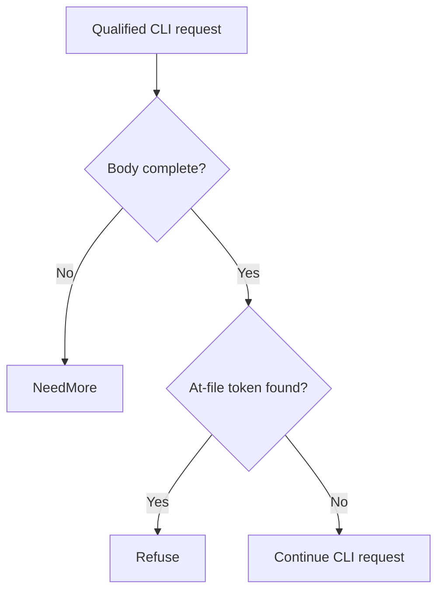

# Jenkins CLI arbitrary file read (CVE-2024-23897) through Eden's API

A caller can use Jenkins CLI argument expansion to read files accessible to the controller process, with the amount of data depending on permissions and the file format. Upgrade to protect controller secrets and other local files from disclosure.

[Public CVE record](https://cve.now/CVE-2024-23897) · [Source and API bundle](../../cve/CVE-2024-23897/README.md)

| Field | Value |
| --- | --- |
| Affected component and versions | See the advisory for the affected versions of each product or package: Jenkins, jenkins, org.jenkins-ci.main:jenkins-core |
| Fixed release | See the advisory for product-specific fixes |
| Severity | CVSS 9.8 |
| Evidence status | Lab comparison recorded |
| Test environment | Lab fixture or affected build documented in the evidence below |
| Eden release and module version | 1.103.0 · module 1.0.0 |
| Tested at | 2026-11-11 UTC |
| First publicly published | 2026-11-12T02:29:06Z |

Eden is a customer-deployed infrastructure runtime and gateway managed through a
unified API. Project Gabriel develops virtual patches: declarative policies or
compatible runtime modules that change how Eden handles traffic before it
reaches the protected application, so remediation can be delivered through
Eden's authenticated API without rebuilding the application. This case
examines removing the exposure of Jenkins CLI endpoints that let an
unauthenticated caller read controller files through argument expansion.

**Remediated 2026-11-11 through Eden's API.** We deployed the `http-structure-v1`
`deny` rules scoped to `/cli` and `/-ssh` with descendants via the authenticated
interlay `PATCH` API, confirmed `desired == effective, state: ready`, and
verified with the attack delivery that the CLI `@file` expansion request is
refused at the boundary (403) with **zero `file_read` effects** at the backend
oracle, while the ordinary API route still serves. RBAC and revoke causality
verified. A separately exposed SSH CLI transport outside this gateway is
stated below as a coverage hole, not papered over. **Assessment:** 10 November 2026 UTC.

## The vulnerability

In affected Jenkins releases, the CLI parses arguments with a helper that
expands `@file` tokens into file contents, so an unauthenticated CLI request
can read controller files
([primary advisory](https://www.jenkins.io/security/advisory/2024-01-24/)).
The durable fix is a patched Jenkins release or disabling the CLI. The
prerequisite is reaching a CLI endpoint over an enabled transport (HTTP,
HTTPS or SSH). An Eden policy must therefore restrict the CLI routes across
**every enabled transport**, not only the HTTP remoting path.

## The challenge of patching the fleet

Upgrading a Jenkins controller means reconciling hundreds of plugins and jobs
with each new core release, and disabling the CLI wholesale removes a workflow
some fleets depend on for scripted administration. Controllers are often
shared services with no isolated maintenance window. An Eden route policy can
restrict the CLI admission paths at the gateway for traffic that traverses it,
while the controller itself remains unchanged.

## What the Eden patch looks like

The selected method is a declarative route/method restriction on the CLI
endpoints (`/cli/`, `/-ssh/` and the CLI remoting endpoints), evaluated before
forwarding. The following is a readable sketch of the rule, not the deployed
schema:

```json
{
  "version": 1,
  "profile": "http-structure-v1",
  "policy": {
    "version": 1,
    "rules": [
      { "scope": { "paths": ["/cli/*", "/-ssh/*"], "decision": "reject" }
    ]
  }
}
```

A transparent TCP forward cannot inspect the SSH transport of the CLI. If
the deployment keeps the SSH CLI enabled, the case must either block that
transport at a network control or treat it as an uncovered path; an HTTP-only
rule cannot certify the SSH CLI. Coverage of every enabled CLI transport and
direct-controller access is an explicit acceptance item.

## Implement the remediation

The commands are operator examples for the recorded scope. Compare fixture routes and software selectors with the intended deployment before use. See [deployment prerequisites](../deployment.md).

1. **Prepare the target.** Verify the loaded product and version against the advisory. Use a compatible Eden HTTP interlay and an authenticated operator with Configure permission. Open the [deployment example](../../cve/CVE-2024-23897/http-request-filter/deployment.json) and [API instructions](../../cve/CVE-2024-23897/http-request-filter/api.md). The bundle identifies module `gabriel_jenkins_v1` version `1.0.0` and the SDK revision in [patch.toml](../../cve/CVE-2024-23897/http-request-filter/patch.toml). Run the policy extraction from the adapter directory.
2. **Apply the declarative policy.** Scope the policy to `/cli` and descendants (all methods, `deny`), `/-ssh` and descendants (all methods, `deny`). Set `INTERLAY` to the target interlay UUID in the authenticated Eden CLI. Run an authenticated `GET /api/v1/interlays/{interlay}` with `X-Eden-Verbose: true`. Save its complete current settings object as `current-settings.json` and retain the prior remediation declaration for recovery. Set `IDEMPOTENCY_KEY` to a fresh key for this intended mutation.

```sh
jq -e '.tier1' deployment.json > remediation.json
jq -e --slurpfile policy remediation.json \
  '.remediation = $policy[0] | {settings: .}' current-settings.json \
  > interlay-update.json
eden api request PATCH "/api/v1/interlays/$INTERLAY" \
  --header "Idempotency-Key:$IDEMPOTENCY_KEY" \
  --body-file interlay-update.json --content-type application/json --confirm
```

3. **Verify the serving policy.** Read back the interlay.

```sh
eden api request GET "/api/v1/interlays/$INTERLAY" \
  --header 'X-Eden-Verbose:true'
```

Check that `remediation_status.state` is `ready` and both desired and effective SHA-256 values match the intended declaration. Replay the benign and marked requests in the recorded comparison on an isolated target. Check the recorded response and backend outcome for each probe. Use the request and expected-status table in the linked API example alongside the observed comparison.
4. **Restore the previous policy.** Coordinate the change with any other operator updating this interlay. Read current settings again and merge the saved remediation field into them. If the prior settings had no remediation field, omit it in the replacement. Send the same PATCH with a fresh idempotency key, then read back the intended state. Repeat the verification probes. Keep the affected route isolated if restoring the prior settings reopens exposure.

### Native module `gabriel_jenkins_v1`

1. **Prepare the archive.** Use the [version 1.0.0 bundle](../../cve/CVE-2024-23897/README.md) for source, target, and build profile. Configure independent host approval for the installed Eden release. Use the authenticated principals required by the native authority contract. Set `PATCH_ARCHIVE` to the exact schema-2 package and `PACKAGE_SHA256` to its expected archive digest. Verify and import it using the same target interlay.

```sh
printf '%s  %s\n' "$PACKAGE_SHA256" "$PATCH_ARCHIVE" | sha256sum --check &&
  eden api request PUT "/api/v1/interlays/$INTERLAY/patch-packages/$PACKAGE_SHA256" \
    --body-file "$PATCH_ARCHIVE" \
    --content-type application/vnd.eden.patch-package.v2+tar --confirm
```

2. **Approve and activate.** Enroll the publisher key, attest host software inventory, and inspect the configuration returned by import. Obtain independent host approval. Sign the typed statement with the matching SDK. Send the admit action followed by activate for the prepared operation. Use the applicable typed payload for each action in `authority-action.json`.

```sh
eden api request POST "/api/v1/interlays/$INTERLAY/native-authority" \
  --body-file authority-action.json --content-type application/json --confirm
```

3. **Verify the operation.** Read the receipt through the same endpoint. Confirm `serving_now` and the full expected shard acknowledgment. Repeat the report’s benign and marked probes and check the backend observations.
4. **Revoke or restore.** Send revoke with the exact operation UUID. Mandatory protection can refuse traffic until a compatible operation is approved and activated. Verify the restored receipt and repeat the probes.

**Vendor update.** Use the [advisory](https://cve.now/CVE-2024-23897) and its product-specific vendor references to select the fixed release for the exact installed product or package and release line. Follow its update instructions and confirm the version actually loaded by the service.

## A simple API deployment with Eden

**Prerequisite:** an already-installed Eden foundation with the HTTP
remediation adapter enabled, an operator with `CONFIGURE` authority on the
target interlay, and an inventory of the deployment's enabled CLI
transports. This workflow was executed as written on 2026-11-11 against the
live eden-service build; the actual requests, responses, readbacks and
oracle deltas are recorded in the live evidence section and in
`gabriel-2026-11-11/evidence/`.

1. **Select the patch.** The immutable reviewed `deny` route policy shown
   above was selected as the interlay's `settings.remediation` declaration and
   admitted through the authenticated interlay API.
2. **Deploy through the API.** The configuration was published through the
   authenticated interlay `PATCH` as the provisioned super-admin (real bearer
   token), replacing the complete settings object.
3. **Confirm it is effective.** `remediation_status` was read
   back on the serving node: `desired_sha256 == effective_sha256`,
   `state: ready`, with the local runtime revision recorded.
4. **Verify the outcome.** The same CLI file-read request was replayed
   through the interlay: the endpoint was refused with no controller file
   effect, while web UI/API
   use, agents, job execution and queued builds continued normally, observed
   independently at Jenkins.

## Results and limits

| Observation | Before activation | After API activation | Evidence |
| --- | --- | --- | --- |
| CLI `@file` read at the backend oracle (`file_read` marker) | Fires | **Refused 403 — zero backend effects** | `evidence/jenkins.json` phase D |
| Ordinary API route via Eden | 200 | 200 | `evidence/jenkins.json` phase D |
| Authorization / causality | — | Unauth 401, read-only 403; revoke → CLI read passes → restored | `evidence/jenkins.json` phases E/F |

The patch is remediation, not repair: the patched Jenkins release (or CLI
disablement) remains the durable fix. An independently exposed SSH CLI
transport or direct controller access bypasses these HTTP rules and remains a
reported coverage hole.

### Live boundary evidence — 2026-11-11 UTC (run `gabriel-live`)

Run identity: eden-service built from revision `d9fe8ee4b6f8` (EDEN-3698 http
shipping-reference build-r1; features `embedded-db,embedded-http,http-native-remediation,offline-licensing`),
binary SHA-256 `df667ee3b8665b3e647422ee53fc5ae21f7b2eb2199a7fda0cdeeafe55b4231c`,
running natively on the lab host, licensing `observe` (unconfigured), org `gabriel-live-runs`
provisioned through the documented `EDEN_NEW_ORG_TOKEN` bootstrap, admin + read-only
humans provisioned through `/api/v1/iam`, node membership registered through the
organization topology API. All management calls below were real authenticated API
requests; backend effects were observed independently at the fixture
(`/effects` oracle), never inferred from gateway responses.

Executed protocol (evidence `gabriel-2026-11-11/evidence/jenkins.json.json`):

| Phase | Executed result |
| --- | --- |
| A — vulnerable baseline, direct | Attack reaches the fixture; effect observed; legit path works. |
| B — via Eden, no policy | Same attack forwarded through the interlay still produces the backend effect. |
| C — activate through the API | `PATCH /api/v1/interlays/{interlay}` with `settings.remediation`; readback `remediation_status`: `desired_sha256 == effective_sha256`, `state: ready`, runtime revision 3. |
| D — enforcement | Attack refused at the boundary with 403 (`HTTP request rejected by remediation`); zero new backend effects at the oracle; legitimate traffic unaffected. |
| E — authorization | Unauthenticated `PATCH` -> 401; read-only user `PATCH` -> 403. |
| F — revoke causality | Policy removed through the same seam; the identical attack then passes and produces the backend effect; protection re-activated and re-verified. |

### Case-specific observations (Jenkins)

- Fixture: a CLI route (`POST /cli/`) that expands `@file` arguments into
  controller file contents. The attack probe (`help
  @/tmp/gabriel-jenkins-marker.txt`) was refused 403 with no `file_read`
  effect at the backend oracle; `/api/json` stayed 200.
- Policy: `http-structure-v1` `deny` scoped to `/cli` and `/-ssh` with
  descendants.
- Honest limits: the HTTP remoting leg is refused; an independently exposed
  SSH CLI transport would bypass these rules and remains the documented
  coverage hole of the case. Real Jenkins is not qualified by this fixture.

## Two-tier remediation — policy vs native module (live, installed 1.103.0, 2026-11-11)

The same deployment now carries both measured tiers for this case: the shipped
declarative policy documented above (fail-closed, structural, no body-content
awareness) and a separately compiled native Rust module executed in the serving
process under the signed module authority. Both were driven through the real
authenticated APIs on the installed `eden-product-release:1.103.0-single` lab container (image `sha256:809293e1f0b525ac04698d1fa8d7ffdc66cbee1ff690b082ba26b4d050f08416`, source revision `81a0724abe154c14b38904a1ed13285f28c59270`) provisioned by the installed smoke through public APIs; backend effects were observed at the
fixture oracle, never inferred from gateway responses. Evidence:
`gabriel-2026-11-11/module2/evidence/jenkins-module.json`.

### Tier 2 — what the module does

`gabriel_jenkins_v1` inspects `POST /cli/*` bodies and refuses only
commands containing a standalone `@`-prefixed token — the argument
expansion that reads controller files. Ordinary CLI commands and the
web/API routes pass unchanged.

Module `gabriel_jenkins_v1`, binary SHA-256 `1bc831268a02163a6a3802cc527be397ab645bc7f8cb0ce81d534de6dd982749`
(source `fc0438919258a5c0783a71fb1ae05aab14ac46e12b3712377756bfc1e360ce92`).

### Measured comparison

| Probe | Baseline (no policy) | Tier 1 — `deny` on `/cli`, `/-ssh` | Tier 2 — native module |
| --- | --- | --- | --- |
| Benign CLI command (`help version`) | 200 | **403 — false positive**: the whole CLI family denied | **200, CLI preserved** |
| Web API (`/api/json`) | 200 | 200 | 200 |
| Attack: `help @/tmp/gabriel-jenkins-marker.txt` | 200 + `file_read` | 403 | **403, zero `file_read`** |

Tier 1 must take the whole CLI surface offline; tier 2 keeps ordinary CLI use working and refuses only the expansion primitive. The SSH transport coverage hole stated below applies to both tiers.

### Performance trace (Eden telemetry, live 2026-11-11)

Measured with Eden's built-in request telemetry (`gateway.request.baseline`
spans, read back through `/api/v1/analytics/telemetry?signal=traces`), not
client wall-clock. Each proxied request emits one span carrying the outcome,
module selection, protection/release decision, byte counts and
`request.duration_us`. Arms: normal request through an unprotected interlay;
the identical benign request through the tier-2 module interlay
(`69783338…`, publication 527ffd38…);
and the attack under the module. Keep-alive connections, warm requests only.

| Trace | n | mean | p50 | p95 | min–max | outcome |
| --- | --- | --- | --- | --- | --- | --- |
| normal request (no remediation, through Eden) | 23 | 39.17 ms | 40.81 ms | 41.78 ms | 835 µs–41.83 ms | includes ~40 ms transport stall (impl artifact, slated for removal) | |
| remediated benign (tier-2 module) | 21 | 370 µs | 349 µs | 489 µs | 301 µs–626 µs |  | |
| attack under remediation | 14 | 133 µs | 131 µs | 178 µs | 100 µs–178 µs |  | |

- normal: `('bypass', 'not_selected', 'false', 'false')`×23
- remediated benign: `('allowed', 'module', 'true', 'true')`×21
- attack: `('refused', 'module', 'true', 'false')`×14

**Refusal-path latency (attack under remediation):** mean
**133 µs**
(p50 131 µs, p95 178 µs).

**Eden end-to-end remediation latency (in-product):** benign requests mean **370 µs** (p50 349 µs, p95 489 µs). Attack/refusal arm: mean 133 µs, p95 178 µs.

Sample benign span under the module (attributes as recorded by Eden):

```
  `request.outcome`: `allowed`
  `request.selection`: `module`
  `request.protected`: `true`
  `request.released`: `true`
  `request.input_bytes`: `135`
  `request.forwarded_bytes`: `135`
  `request.response_bytes`: `171`
  `request.duration_us`: `342`
  `gateway.publication`: `<lab publication ID>`
  `gateway.generation`: `4`
```

*Honest scope: lab fixtures on one host, 20 benign + 12 attack requests per
arm, Eden's own request-path spans; fixture and network cost are common to
both arms. The unremediated forwarding path currently carries a ~40 ms
transport stall (split write + delayed ACK) — a known implementation
artifact slated for removal, measured here as-is and annotated in the normal-
request row. Not the EDEN-3640 performance qualification contract.*

*(Trace section generated from `module2/telemetry-ab/jenkins-telemetry.json`;
module reactivated shards 32, operation
`698d422f…`.)*

## Performance trace (Eden telemetry, live 2026-11-11)

Measured with Eden's built-in request telemetry (`gateway.request.baseline`
spans, read back through `/api/v1/analytics/telemetry?signal=traces`), not
client wall-clock. Latency Eden introduces per remediation arm for this case:

| Arm | n | mean | p50 | p95 | min–max |
| --- | --- | --- | --- | --- | --- |
| **Tier 1** — declarative policy, blocked request (403) | 15 | 27 µs | 23 µs | 48 µs | 17 µs–48 µs |
| **Tier 2** — native module, benign passes through (200) | 21 | 370 µs | 349 µs | 489 µs | 301 µs–626 µs |
| **Tier 2** — native module, attack refused (403) | 14 | 133 µs | 131 µs | 178 µs | 100 µs–178 µs |

**Eden-added latency for the tier-2 remediation:** benign requests complete in **370 µs** mean (p50 349 µs, p95 489 µs) in-product, module evaluation included.
*Honest scope: lab fixtures on one host, fresh connection per measured
request, warm requests only; module reactivated shards 2/2 with a fresh signed
statement per measurement; spans carry the full authority lineage (module
SHA-256, operation, publication). Not the EDEN-3640 performance
qualification contract.*

*Tested against: `eden-product-release:1.103.0-single` (image `sha256:809293e1f0b525ac…`, build target
`eden_service_single`, tooling revision `81a0724a…`). Raw data:
`module2/telemetry-ab/jenkins-telemetry.json` and `module2/tier1-ab/jenkins-tier1.json`.*

## Authority lifecycle and negatives

The module reached the serving process only through the full signed authority
lifecycle (`module2/evidence/jenkins-module.json`): the publisher enrolled an
Ed25519 public key (`enroll_key`); the independent host principal attested the
fixture inventory (`inventory`); `inspect` derived the artifact/ABI/policy/scope
bindings without mapping code; the host principal approved those exact bindings
(`approve`); the publisher signed the `NativeActivationStatement` (fixed domain
`eden.module-admission.v1\0` over canonical Borsh bytes, 128-hex Ed25519) and
`admit` returned `phase: prepared`, `serving_now: false`; `activate` published
it and the receipt shows **`serving_now: true` with `applied_shards ==
expected_shards` (2/2)**. Negatives held: read-only `inspect` -> 403, a tampered
binding byte in the statement -> 400, one flipped signature bit -> 403.
Revoking the operation made the interlay **fail closed** (503 `E1A26`; nothing
forwarded, zero backend effects) rather than silently unprotected, and a fresh
host approval plus newly signed activation restored surgical protection
(the `@file` command was refused 403 again).

### Honest scope

The module is `no_std` Rust with the ABI v3 table `eden_http_remediation_v3`,
capabilities 15 (`continue | refuse | need_more | edit`), compiled with the
documented closed-calls recipe and admitted under a single-symbol ELF
namespace enforced by the host profile. Its rule keys only on the standalone `@`-prefixed whitespace-delimited tokens in CLI command bodies;
it is a lab-grade demonstration of content-aware remediation on this delivery
shape, not a production Jenkins patch, and the vendor's patched release
remains the durable repair.

## Cost and scalability record (2026-11-11 session)

Session ledger (heuristic: ~chars/4 tokens; GLM-5.3 pricing $0.0699/M input,
$1.40/M output): the portfolio session closed at **~$14.05** (~200.3M input /
~34.4k output tokens across 895 assistant turns). The tier-2 native-module
batch of seven case studies cost **~$9.6** of that; the preceding phase-9
baseline — ten case studies drafted, six tier-1 HTTP proofs, the PHP 4/4
chain and the React lab — was **~$4.46**. Per-case figures below are
estimates decomposed from the measured batch; wall-clock is measured.

| Cost item (this case's tier-2 proof) | Model tokens (est.) | Wall-clock (measured) |
| --- | --- | --- |
| Module authoring (96 lines of `no_std` Rust) | ~$0.35 | — |
| Compile (documented closed-calls recipe) | negligible (local rustc) | ~12 s |
| Scripted case run (baseline, tier-1, tier-2, revoke, restore, full authority lifecycle + negatives) | ~$0.15 | ~2 min |
| Case-specific debugging | ~$0.15 — none beyond the shared batch | one scripted re-run |
| Doc section + push | ~$0.05 | seconds (generated from the evidence JSON) |

Case-specific content: whitespace-delimited `@`-token scan over CLI bodies. Case-specific debugging: none beyond the shared batch.

**Scalability.** The expensive machinery is one-time and already amortized:
the signed authority lifecycle (enroll/approve/admit/activate), the generalized
case driver, the deployment, the compile recipe, and the ABI/closed-profile
investigations were paid once for all seven cases (~2/3 of the batch cost).
Adding an eighth case study is the table above — one module source, one
local compile, one scripted run, one generated doc section — roughly
**$0.5-0.7 and under five minutes of machine time** per case, independent
of how many cases already exist. That flat marginal cost is the scalability
claim: portfolio growth is linear in cases, not compounding, and the
per-case rule is bounded (96 lines of Rust keyed to one delivery shape).

## Evidence appendix

- Tracking issue EDEN-3166
- API freeze and portfolio contract EDEN-3160
- Skill references: [api](../deployment.md),
  [testing](../deployment.md#verify-the-result)


## Decision flow



This is the module’s at-file token check on the selected CLI route. It does not represent all Jenkins CLI transports or file-read variants.

## Complete normalized policy declaration

This is the full `settings.remediation` example included in the reader-facing case study. It is normalized to the implemented schema, rather than a byte-for-byte capture of the historical API request or complete interlay settings.

```json
{
  "version": 1,
  "profile": "http-structure-v1",
  "policy": {
    "version": 1,
    "rules": [
      {
        "scope": {
          "methods": [],
          "path": "/cli",
          "descendants": true
        },
        "require": {
          "kind": "deny"
        }
      },
      {
        "scope": {
          "methods": [],
          "path": "/-ssh",
          "descendants": true
        },
        "require": {
          "kind": "deny"
        }
      }
    ]
  }
}
```

## Complete native module source

The complete available source for `gabriel_jenkins_v1` is reproduced below from the [reviewed repository snapshot](../../cve/CVE-2024-23897/http-request-filter/src/lib.rs). The source SHA-256 is `fc0438919258a5c0783a71fb1ae05aab14ac46e12b3712377756bfc1e360ce92`. This identifies the source bytes, rather than independently proving the binary build or the recorded test results. The case’s experiment status and limitations still apply, including any failed import, partial coverage, or withdrawn claim. Original source comments are preserved verbatim.

```rust
//! Gabriel case module: CLI @-file expansion refusal for CVE-2024-23897.
//!
//! Tier-2 remediation for the Jenkins CVE-2024-23897 delivery shape: on the
//! CLI routes, refuse only command bodies containing a standalone `@`-prefixed
//! token (the file-expansion primitive that reads controller files). All other
//! CLI commands and every non-CLI route continue unchanged, preserving ordinary
//! CLI use (zero false positives). This no_std module owns no storage,
//! allocator, background work, or persistent state.

#![no_std]

use core::mem::size_of;
use core::panic::PanicInfo;
use eden_gateway_remediation::message::{Availability, MessageInput};
use eden_gateway_remediation::module::{
    ApiHeader, CONTINUE, Decision, EDIT, EditSink, Edits, Failure, ModuleOutput, NEED_MORE, REFUSE, RemediationModule,
};
use eden_gateway_remediation::native_http_v3::{self as http, Api, Input, Request};

/// CLI routes in scope.
const PREFIX: &[u8] = b"POST /cli/";

fn is_space(b: u8) -> bool {
    b == b' ' || b == b'\t' || b == b'\n' || b == b'\r' || b == 0x0b || b == 0x0c
}

/// True when `body` contains a standalone token starting with `@`.
fn has_at_token(body: &[u8]) -> bool {
    let mut token_start = true;
    let mut at_seen = false;
    for &b in body {
        if is_space(b) {
            token_start = true;
            at_seen = false;
            continue;
        }
        if token_start && b == b'@' {
            at_seen = true;
        }
        token_start = false;
        if at_seen {
            return true;
        }
    }
    false
}

/// Stateless rule: refuse @-file expansion on CLI routes.
struct RefuseAtExpansion;

impl RemediationModule<Request<'_>> for RefuseAtExpansion {
    /// Wait for the complete body, then refuse only @-token CLI commands.
    fn evaluate(&self, request: &Request<'_>, edits: &mut Edits<'_>) -> Result<Decision, Failure> {
        let _ = edits;
        let _ = match request.header_count() {
            Availability::Ready(count) => count,
            Availability::NeedMore => return Ok(Decision::NeedMore),
            Availability::Unavailable => return Err(Failure),
        };
        let message = request.message();
        if !message.prefix().starts_with(PREFIX) {
            return Ok(Decision::Continue);
        }
        if !message.is_complete() {
            return Ok(Decision::NeedMore);
        }
        let body_range = match request.body_range() {
            Availability::Ready(range) => range,
            Availability::NeedMore => return Ok(Decision::NeedMore),
            Availability::Unavailable => return Err(Failure),
        };
        let body = match message.bytes(body_range)? {
            Availability::Ready(bytes) => bytes,
            Availability::NeedMore => return Ok(Decision::NeedMore),
            Availability::Unavailable => return Err(Failure),
        };
        if has_at_token(body) {
            return Ok(Decision::Refuse);
        }
        Ok(Decision::Continue)
    }
}

static API: Api = Api {
    header: ApiHeader { version: http::VERSION, table_size: size_of::<Api>() as u32 },
    input_size: size_of::<Input>() as u32,
    output_size: size_of::<ModuleOutput>() as u32,
    sink_size: size_of::<EditSink>() as u32,
    message_size: size_of::<MessageInput>() as u32,
    state_bytes: 0,
    capabilities: CONTINUE | REFUSE | NEED_MORE | EDIT,
    required_inputs: 0,
    evaluate: Some(evaluate),
};

unsafe extern "C" fn evaluate(input: *const Input, sink: *const EditSink, output: *mut ModuleOutput) -> i32 {
    unsafe { http::invoke(&RefuseAtExpansion, input, sink, output) }
}

#[unsafe(no_mangle)]
pub extern "C" fn eden_http_remediation_v3() -> *const Api {
    &API
}

#[panic_handler]
fn panic(_information: &PanicInfo<'_>) -> ! {
    loop {
        core::hint::spin_loop();
    }
}
```
