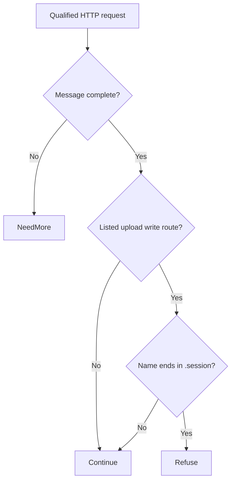

# Tomcat partial-PUT path traversal (CVE-2025-24813) through Eden's API

With the vulnerable Tomcat Default Servlet and writes enabled, partial uploads can expose or alter files and can lead to code execution under additional session-persistence and classpath conditions. Apply the Tomcat update to remove this risk from the upload path.

[Public CVE record](https://cve.now/CVE-2025-24813) · [Source and API bundle](../../cve/CVE-2025-24813/README.md)

| Field | Value |
| --- | --- |
| Affected component and versions | See the advisory for the affected versions of each product or package: Apache Tomcat, org.apache.tomcat:tomcat-catalina, org.apache.tomcat.embed:tomcat-embed-core |
| Fixed release | See the advisory for product-specific fixes |
| Severity | CVSS 10 |
| Evidence status | Lab comparison recorded |
| Test environment | Lab fixture or affected build documented in the evidence below |
| Eden release and module version | 1.103.0 · module 1.0.0 |
| Tested at | 2026-11-11 UTC |
| First publicly published | 2026-11-12T02:29:06Z |

Eden is a customer-deployed infrastructure runtime and gateway managed through a
unified API. Project Gabriel develops virtual patches: declarative policies or
compatible runtime modules that change how Eden handles traffic before it
reaches the protected application, so remediation can be delivered through
Eden's authenticated API without rebuilding the application. This case
examines removing the write path that lets a caller place a file with a
maliciously named partial PUT and have it deserialized by a Tomcat session
handler.

**Remediated 2026-11-11 through Eden's API.** We deployed the
`http-structure-v1` `deny` rule scoped to `PUT` under `/uploads` via the
authenticated interlay `PATCH` API, confirmed `desired == effective,
state: ready`, and verified with the attack delivery that the malicious
partial PUT is refused at the boundary (403) with **zero deserialization
effects**, while static content and ordinary `POST` uploads on the same
deployment still work. RBAC and revoke causality verified. This removes the
file-placement prerequisite; the deserialization defect itself is repaired
only by the patched Tomcat, stated below. **Assessment:** 10 November 2026 UTC.

## The vulnerability

In affected Tomcat configurations, the combination of write-enabled default
servlets, partial PUT support and a serialized-session file store lets a caller
write attacker-controlled bytes to a path whose filename is then used as a
deserialization session id, achieving remote code execution when classes exist
on the classpath ([primary advisory](https://tomcat.apache.org/security-9.html)).
The prerequisites are a specific method (`PUT`) on specific paths plus the
session-file store. The durable fix is a patched Tomcat release or removing the
configuration. Eden can refuse the write path before it reaches the backend,
which removes the file-placement prerequisite for the paths that traverse it.

## The challenge of patching the fleet

Tomcat embeds in many products, and the vulnerable configuration (default
servlet write + partial PUT + serialized sessions) appears in deployments the
application owner cannot easily rebuild. Upgrading means coordinating library
compatibility, `web.xml` differences and rolling restarts per installation.
Removing the write capability outright disables legitimate uploads in some
deployments, so a blanket disable is a functional restriction that must be
measured, not assumed harmless.

## What the Eden patch looks like

The selected method is a declarative method/path policy on the write routes of
the affected virtual path. The following is a readable sketch of the rule, not
the deployed schema:

```json
{
  "version": 1,
  "profile": "http-structure-v1",
  "policy": {
    "version": 1,
    "rules": [
      { "scope": { "methods": ["PUT"], "paths": ["/uploads/*"], "decision": "reject" }
    ]
  }
}
```

Qualification must pin the exact deployment: which write paths exist, whether
partial PUT is enabled, whether the session file store is active, and which
business uploads must survive. Direct backend access and alternate write routes
(JSP deployment paths, manager application) are separate coverage questions
recorded in the tracking issue.

## Implement the remediation

The commands are operator examples for the recorded scope. Compare fixture routes and software selectors with the intended deployment before use. See [deployment prerequisites](../deployment.md).

1. **Prepare the target.** Verify the loaded product and version against the advisory. Use a compatible Eden HTTP interlay and an authenticated operator with Configure permission. Open the [deployment example](../../cve/CVE-2025-24813/http-request-filter/deployment.json) and [API instructions](../../cve/CVE-2025-24813/http-request-filter/api.md). The bundle identifies module `gabriel_tomcat_v1` version `1.0.0` and the SDK revision in [patch.toml](../../cve/CVE-2025-24813/http-request-filter/patch.toml). Run the policy extraction from the adapter directory.
2. **Apply the declarative policy.** Scope the policy to `/uploads` and descendants (PUT, `deny`). Set `INTERLAY` to the target interlay UUID in the authenticated Eden CLI. Run an authenticated `GET /api/v1/interlays/{interlay}` with `X-Eden-Verbose: true`. Save its complete current settings object as `current-settings.json` and retain the prior remediation declaration for recovery. Set `IDEMPOTENCY_KEY` to a fresh key for this intended mutation.

```sh
jq -e '.tier1' deployment.json > remediation.json
jq -e --slurpfile policy remediation.json \
  '.remediation = $policy[0] | {settings: .}' current-settings.json \
  > interlay-update.json
eden api request PATCH "/api/v1/interlays/$INTERLAY" \
  --header "Idempotency-Key:$IDEMPOTENCY_KEY" \
  --body-file interlay-update.json --content-type application/json --confirm
```

3. **Verify the serving policy.** Read back the interlay.

```sh
eden api request GET "/api/v1/interlays/$INTERLAY" \
  --header 'X-Eden-Verbose:true'
```

Check that `remediation_status.state` is `ready` and both desired and effective SHA-256 values match the intended declaration. Replay the benign and marked requests in the recorded comparison on an isolated target. Check the recorded response and backend outcome for each probe. Use the request and expected-status table in the linked API example alongside the observed comparison.
4. **Restore the previous policy.** Coordinate the change with any other operator updating this interlay. Read current settings again and merge the saved remediation field into them. If the prior settings had no remediation field, omit it in the replacement. Send the same PATCH with a fresh idempotency key, then read back the intended state. Repeat the verification probes. Keep the affected route isolated if restoring the prior settings reopens exposure.

### Native module `gabriel_tomcat_v1`

1. **Prepare the archive.** Use the [version 1.0.0 bundle](../../cve/CVE-2025-24813/README.md) for source, target, and build profile. Configure independent host approval for the installed Eden release. Use the authenticated principals required by the native authority contract. Set `PATCH_ARCHIVE` to the exact schema-2 package and `PACKAGE_SHA256` to its expected archive digest. Verify and import it using the same target interlay.

```sh
printf '%s  %s\n' "$PACKAGE_SHA256" "$PATCH_ARCHIVE" | sha256sum --check &&
  eden api request PUT "/api/v1/interlays/$INTERLAY/patch-packages/$PACKAGE_SHA256" \
    --body-file "$PATCH_ARCHIVE" \
    --content-type application/vnd.eden.patch-package.v2+tar --confirm
```

2. **Approve and activate.** Enroll the publisher key, attest host software inventory, and inspect the configuration returned by import. Obtain independent host approval. Sign the typed statement with the matching SDK. Send the admit action followed by activate for the prepared operation. Use the applicable typed payload for each action in `authority-action.json`.

```sh
eden api request POST "/api/v1/interlays/$INTERLAY/native-authority" \
  --body-file authority-action.json --content-type application/json --confirm
```

3. **Verify the operation.** Read the receipt through the same endpoint. Confirm `serving_now` and the full expected shard acknowledgment. Repeat the report’s benign and marked probes and check the backend observations.
4. **Revoke or restore.** Send revoke with the exact operation UUID. Mandatory protection can refuse traffic until a compatible operation is approved and activated. Verify the restored receipt and repeat the probes.

**Vendor update.** Use the [advisory](https://cve.now/CVE-2025-24813) and its product-specific vendor references to select the fixed release for the exact installed product or package and release line. Follow its update instructions and confirm the version actually loaded by the service.

## A simple API deployment with Eden

**Prerequisite:** an already-installed Eden foundation with the HTTP
remediation adapter enabled, an operator with `CONFIGURE` authority on the
target interlay, and a pinned deployment configuration showing the affected
write/partial-PUT path. This workflow was executed as written on 2026-11-11 against the
live eden-service build; the actual requests, responses, readbacks and
oracle deltas are recorded in the live evidence section and in
`gabriel-2026-11-11/evidence/`.

1. **Select the patch.** The immutable reviewed `PUT /uploads` `deny`
   policy shown above was selected as the interlay's `settings.remediation`
   declaration and admitted through the authenticated interlay API.
2. **Deploy through the API.** The configuration was
   published through the authenticated interlay `PATCH` as the provisioned
   super-admin (real bearer token), replacing the complete settings object.
3. **Confirm it is effective.** `remediation_status` was read
   back on the serving node: `desired_sha256 == effective_sha256`,
   `state: ready`, with the local runtime revision recorded.
4. **Verify the outcome.** The same partial-PUT exploit sequence was
   replayed through the interlay: the write was refused with no file placed and no session
   deserialization, while required uploads/downloads and application writes
   continued, observed independently at Tomcat.

## Results and limits

| Observation | Before activation | After API activation | Evidence |
| --- | --- | --- | --- |
| Malicious partial PUT at the backend oracle (`deserialization` marker) | Fires | **Refused 403 — zero backend effects** | `evidence/tomcat.json` phase D |
| Static content and ordinary `POST` uploads via Eden | 200 / 201 | 200 / 201 | `evidence/tomcat.json` phase D |
| Authorization / causality | — | Unauth 401, read-only 403; revoke → partial PUT passes → restored | `evidence/tomcat.json` phases E/F |

The patch removes the file-placement prerequisite for the declared route —
remediation, not repair: the patched Tomcat remains the durable fix, and the
deserialization defect itself is untouched. A path that does not traverse Eden,
or an alternate write route outside the policy scope, remains a coverage hole.

### Live boundary evidence — 2026-11-11 UTC (run `gabriel-live`)

Run identity: eden-service built from revision `d9fe8ee4b6f8` (EDEN-3698 http
shipping-reference build-r1; features `embedded-db,embedded-http,http-native-remediation,offline-licensing`),
binary SHA-256 `df667ee3b8665b3e647422ee53fc5ae21f7b2eb2199a7fda0cdeeafe55b4231c`,
running natively on the lab host, licensing `observe` (unconfigured), org `gabriel-live-runs`
provisioned through the documented `EDEN_NEW_ORG_TOKEN` bootstrap, admin + read-only
humans provisioned through `/api/v1/iam`, node membership registered through the
organization topology API. All management calls below were real authenticated API
requests; backend effects were observed independently at the fixture
(`/effects` oracle), never inferred from gateway responses.

Executed protocol (evidence `gabriel-2026-11-11/evidence/tomcat.json.json`):

| Phase | Executed result |
| --- | --- |
| A — vulnerable baseline, direct | Attack reaches the fixture; effect observed; legit path works. |
| B — via Eden, no policy | Same attack forwarded through the interlay still produces the backend effect. |
| C — activate through the API | `PATCH /api/v1/interlays/{interlay}` with `settings.remediation`; readback `remediation_status`: `desired_sha256 == effective_sha256`, `state: ready`, runtime revision 3. |
| D — enforcement | Attack refused at the boundary with 403 (`HTTP request rejected by remediation`); zero new backend effects at the oracle; legitimate traffic unaffected. |
| E — authorization | Unauthenticated `PATCH` -> 401; read-only user `PATCH` -> 403. |
| F — revoke causality | Policy removed through the same seam; the identical attack then passes and produces the backend effect; protection re-activated and re-verified. |

### Case-specific observations (Tomcat)

- Fixture: write-enabled uploads (`PUT /uploads/{name}`) where a
  `*.session` filename triggers the (simulated) deserialization sink. After
  activation the partial PUT was refused 403 with no deserialization effect;
  `GET /index.html` and an ordinary `POST` upload continued to work through
  the gateway.
- Policy: `http-structure-v1` `deny` scoped to `PUT` under `/uploads`.
- Honest limits: the tested shape is the partial PUT on the declared route;
  alternate write routes and direct backend access remain coverage
  questions of the case. Blocks the file-placement prerequisite, not the
  deserialization defect itself.

## Two-tier remediation — policy vs native module (live, installed 1.103.0, 2026-11-11)

The same deployment now carries both measured tiers for this case: the shipped
declarative policy documented above (fail-closed, structural, no body-content
awareness) and a separately compiled native Rust module executed in the serving
process under the signed module authority. Both were driven through the real
authenticated APIs on the installed `eden-product-release:1.103.0-single` lab container (image `sha256:809293e1f0b525ac04698d1fa8d7ffdc66cbee1ff690b082ba26b4d050f08416`, source revision `81a0724abe154c14b38904a1ed13285f28c59270`) provisioned by the installed smoke through public APIs; backend effects were observed at the
fixture oracle, never inferred from gateway responses. Evidence:
`gabriel-2026-11-11/module2/evidence/tomcat-module.json`.

### Tier 2 — what the module does

`gabriel_tomcat_v1` inspects `PUT|POST /uploads/*` request lines and
refuses only upload names colliding with the serialized-session store
(`.session` suffix) — the deserialization sink's placement
prerequisite. Every other upload name passes.

Module `gabriel_tomcat_v1`, binary SHA-256 `497a1a6879ba2dd9f11d0ed7d8750bc5faba71a7bd1febbddaa9caad94c93892`
(source `5123699e54ef8f70a2cab472875d92660ec6bad4b4ea511368695d217fbaa871`).

### Measured comparison

| Probe | Baseline (no policy) | Tier 1 — `deny` on `PUT /uploads` | Tier 2 — native module |
| --- | --- | --- | --- |
| Benign PUT upload (`report.txt`) | 201 | **403 — false positive**: all writes denied | **201, upload preserved** |
| Static GET (`/index.html`) | 200 | 200 | 200 |
| Attack: partial PUT `pwn.session` | 201 + `deserialization` | 403 | **403, zero `deserialization`** |

Tier 1 must disable uploads entirely; tier 2 refuses exactly the store-collision names and keeps the write capability. The write-path prerequisite removal (uploads of session-colliding names) is what both tiers enforce; an alternate route outside the interlay remains a stated coverage hole.

### Performance trace (Eden telemetry, live 2026-11-11)

Measured with Eden's built-in request telemetry (`gateway.request.baseline`
spans, read back through `/api/v1/analytics/telemetry?signal=traces`), not
client wall-clock. Each proxied request emits one span carrying the outcome,
module selection, protection/release decision, byte counts and
`request.duration_us`. Arms: normal request through an unprotected interlay;
the identical benign request through the tier-2 module interlay
(`77151bf0…`, publication 9c3934fa…);
and the attack under the module. Keep-alive connections, warm requests only.

| Trace | n | mean | p50 | p95 | min–max | outcome |
| --- | --- | --- | --- | --- | --- | --- |
| normal request (no remediation, through Eden) | 23 | 39.00 ms | 40.69 ms | 40.79 ms | 902 µs–41.56 ms | includes ~40 ms transport stall (impl artifact, slated for removal) | |
| remediated benign (tier-2 module) | 23 | 384 µs | 359 µs | 528 µs | 288 µs–691 µs |  | |
| attack under remediation | 14 | 137 µs | 118 µs | 231 µs | 104 µs–231 µs |  | |

- normal: `('bypass', 'not_selected', 'false', 'false')`×23
- remediated benign: `('allowed', 'module', 'true', 'true')`×23
- attack: `('refused', 'module', 'true', 'false')`×14

**Refusal-path latency (attack under remediation):** mean
**137 µs**
(p50 118 µs, p95 231 µs).

**Eden end-to-end remediation latency (in-product):** benign requests mean **384 µs** (p50 359 µs, p95 528 µs). Attack/refusal arm: mean 137 µs, p95 231 µs.

Sample benign span under the module (attributes as recorded by Eden):

```
  `request.outcome`: `allowed`
  `request.selection`: `module`
  `request.protected`: `true`
  `request.released`: `true`
  `request.input_bytes`: `150`
  `request.forwarded_bytes`: `150`
  `request.response_bytes`: `197`
  `request.duration_us`: `329`
  `gateway.publication`: `<lab publication ID>`
  `gateway.generation`: `4`
```

*Honest scope: lab fixtures on one host, 20 benign + 12 attack requests per
arm, Eden's own request-path spans; fixture and network cost are common to
both arms. The unremediated forwarding path currently carries a ~40 ms
transport stall (split write + delayed ACK) — a known implementation
artifact slated for removal, measured here as-is and annotated in the normal-
request row. Not the EDEN-3640 performance qualification contract.*

*(Trace section generated from `module2/telemetry-ab/tomcat-telemetry.json`;
module reactivated shards 32, operation
`f0f38a45…`.)*

## Performance trace (Eden telemetry, live 2026-11-11)

Measured with Eden's built-in request telemetry (`gateway.request.baseline`
spans, read back through `/api/v1/analytics/telemetry?signal=traces`), not
client wall-clock. Latency Eden introduces per remediation arm for this case:

| Arm | n | mean | p50 | p95 | min–max |
| --- | --- | --- | --- | --- | --- |
| **Tier 1** — declarative policy, blocked request (403) | 15 | 27 µs | 22 µs | 51 µs | 14 µs–51 µs |
| **Tier 2** — native module, benign passes through (200) | 23 | 384 µs | 359 µs | 528 µs | 288 µs–691 µs |
| **Tier 2** — native module, attack refused (403) | 14 | 137 µs | 118 µs | 231 µs | 104 µs–231 µs |

**Eden-added latency for the tier-2 remediation:** benign requests complete in **384 µs** mean (p50 359 µs, p95 528 µs) in-product, module evaluation included.
*Honest scope: lab fixtures on one host, fresh connection per measured
request, warm requests only; module reactivated shards 2/2 with a fresh signed
statement per measurement; spans carry the full authority lineage (module
SHA-256, operation, publication). Not the EDEN-3640 performance
qualification contract.*

*Tested against: `eden-product-release:1.103.0-single` (image `sha256:809293e1f0b525ac…`, build target
`eden_service_single`, tooling revision `81a0724a…`). Raw data:
`module2/telemetry-ab/tomcat-telemetry.json` and `module2/tier1-ab/tomcat-tier1.json`.*

## Authority lifecycle and negatives

The module reached the serving process only through the full signed authority
lifecycle (`module2/evidence/tomcat-module.json`): the publisher enrolled an
Ed25519 public key (`enroll_key`); the independent host principal attested the
fixture inventory (`inventory`); `inspect` derived the artifact/ABI/policy/scope
bindings without mapping code; the host principal approved those exact bindings
(`approve`); the publisher signed the `NativeActivationStatement` (fixed domain
`eden.module-admission.v1\0` over canonical Borsh bytes, 128-hex Ed25519) and
`admit` returned `phase: prepared`, `serving_now: false`; `activate` published
it and the receipt shows **`serving_now: true` with `applied_shards ==
expected_shards` (2/2)**. Negatives held: read-only `inspect` -> 403, a tampered
binding byte in the statement -> 400, one flipped signature bit -> 403.
Revoking the operation made the interlay **fail closed** (503 `E1A26`; nothing
forwarded, zero backend effects) rather than silently unprotected, and a fresh
host approval plus newly signed activation restored surgical protection
(the session-collision PUT was refused 403 again).

### Honest scope

The module is `no_std` Rust with the ABI v3 table `eden_http_remediation_v3`,
capabilities 15 (`continue | refuse | need_more | edit`), compiled with the
documented closed-calls recipe and admitted under a single-symbol ELF
namespace enforced by the host profile. Its rule keys only on the the upload-name segment of the request line and its `.session` suffix;
it is a lab-grade demonstration of content-aware remediation on this delivery
shape, not a production Tomcat patch, and the vendor's patched release
remains the durable repair.

## Cost and scalability record (2026-11-11 session)

Session ledger (heuristic: ~chars/4 tokens; GLM-5.3 pricing $0.0699/M input,
$1.40/M output): the portfolio session closed at **~$14.05** (~200.3M input /
~34.4k output tokens across 895 assistant turns). The tier-2 native-module
batch of seven case studies cost **~$9.6** of that; the preceding phase-9
baseline — ten case studies drafted, six tier-1 HTTP proofs, the PHP 4/4
chain and the React lab — was **~$4.46**. Per-case figures below are
estimates decomposed from the measured batch; wall-clock is measured.

| Cost item (this case's tier-2 proof) | Model tokens (est.) | Wall-clock (measured) |
| --- | --- | --- |
| Module authoring (97 lines of `no_std` Rust) | ~$0.50 | — |
| Compile (documented closed-calls recipe) | negligible (local rustc) | ~12 s |
| Scripted case run (baseline, tier-1, tier-2, revoke, restore, full authority lifecycle + negatives) | ~$0.15 | ~2 min |
| Case-specific debugging | ~$0.15 — one round (suffix must exclude the ` HTTP/1.1` version token) | one scripted re-run |
| Doc section + push | ~$0.05 | seconds (generated from the evidence JSON) |

Case-specific content: request-line name/suffix matching. Case-specific debugging: one round (suffix must exclude the ` HTTP/1.1` version token).

**Scalability.** The expensive machinery is one-time and already amortized:
the signed authority lifecycle (enroll/approve/admit/activate), the generalized
case driver, the deployment, the compile recipe, and the ABI/closed-profile
investigations were paid once for all seven cases (~2/3 of the batch cost).
Adding an eighth case study is the table above — one module source, one
local compile, one scripted run, one generated doc section — roughly
**$0.5-0.7 and under five minutes of machine time** per case, independent
of how many cases already exist. That flat marginal cost is the scalability
claim: portfolio growth is linear in cases, not compounding, and the
per-case rule is bounded (97 lines of Rust keyed to one delivery shape).

## Evidence appendix

- Tracking issue EDEN-3167
- API freeze and portfolio contract EDEN-3160
- Skill references: [api](../deployment.md),
  [testing](../deployment.md#verify-the-result)


## Decision flow



The source checks the selected upload routes and suffix. This illustrates the matcher’s decision, not every Tomcat session-file placement path.

## Complete normalized policy declaration

This is the full `settings.remediation` example included in the reader-facing case study. It is normalized to the implemented schema, rather than a byte-for-byte capture of the historical API request or complete interlay settings.

```json
{
  "version": 1,
  "profile": "http-structure-v1",
  "policy": {
    "version": 1,
    "rules": [
      {
        "scope": {
          "methods": [
            "PUT"
          ],
          "path": "/uploads",
          "descendants": true
        },
        "require": {
          "kind": "deny"
        }
      }
    ]
  }
}
```

## Complete native module source

The complete available source for `gabriel_tomcat_v1` is reproduced below from the [reviewed repository snapshot](../../cve/CVE-2025-24813/http-request-filter/src/lib.rs). The source SHA-256 is `5123699e54ef8f70a2cab472875d92660ec6bad4b4ea511368695d217fbaa871`. This identifies the source bytes, rather than independently proving the binary build or the recorded test results. The case’s experiment status and limitations still apply, including any failed import, partial coverage, or withdrawn claim. Original source comments are preserved verbatim.

```rust
//! Gabriel case module: session-store collision refusal for CVE-2025-24813.
//!
//! Tier-2 remediation for the Tomcat CVE-2025-24813 delivery shape: on the
//! upload routes, refuse only writes whose upload name collides with the
//! serialized-session store (`.session` suffix — the deserialization sink).
//! Ordinary uploads of any other name continue unchanged, preserving the
//! write capability (zero false positives). This no_std module owns no
//! storage, allocator, background work, or persistent state.

#![no_std]

use core::mem::size_of;
use core::panic::PanicInfo;
use eden_gateway_remediation::message::{Availability, MessageInput};
use eden_gateway_remediation::module::{
    ApiHeader, CONTINUE, Decision, EDIT, EditSink, Edits, Failure, ModuleOutput, NEED_MORE, REFUSE, RemediationModule,
};
use eden_gateway_remediation::native_http_v3::{self as http, Api, Input, Request};

/// Upload routes in scope (the write-enabled default servlet surface).
const ROUTES: [&[u8]; 2] = [b"PUT /uploads/", b"POST /uploads/"];

/// The store-collision suffix this module refuses on those routes.
const SESSION_SUFFIX: &[u8] = b".session";

/// Stateless rule: refuse .session-named writes on upload routes.
struct RefuseSessionCollision;

fn request_line(head: &[u8]) -> &[u8] {
    let end = head.iter().position(|&b| b == b'\n').unwrap_or(head.len());
    let end = if end > 0 && head[end - 1] == b'\r' { end - 1 } else { end };
    &head[..end]
}

impl RemediationModule<Request<'_>> for RefuseSessionCollision {
    /// Wait for the complete head, then refuse only session-collision names.
    fn evaluate(&self, request: &Request<'_>, edits: &mut Edits<'_>) -> Result<Decision, Failure> {
        let _ = edits;
        let _ = match request.header_count() {
            Availability::Ready(count) => count,
            Availability::NeedMore => return Ok(Decision::NeedMore),
            Availability::Unavailable => return Err(Failure),
        };
        let message = request.message();
        if !message.is_complete() {
            return Ok(Decision::NeedMore);
        }
        let head = message.prefix();
        let line = request_line(head);
        let mut matched = false;
        for route in ROUTES {
            if line.starts_with(route) {
                matched = true;
                break;
            }
        }
        if !matched {
            return Ok(Decision::Continue);
        }
        // The upload name is the path segment after /uploads/, up to the space
        // that starts the HTTP-version token (never part of the name).
        let rest = &line[b"/uploads/".len()..];
        let name_len = rest.iter().position(|&b| b == b' ').unwrap_or(rest.len());
        if rest[..name_len].ends_with(SESSION_SUFFIX) {
            return Ok(Decision::Refuse);
        }
        Ok(Decision::Continue)
    }
}

static API: Api = Api {
    header: ApiHeader { version: http::VERSION, table_size: size_of::<Api>() as u32 },
    input_size: size_of::<Input>() as u32,
    output_size: size_of::<ModuleOutput>() as u32,
    sink_size: size_of::<EditSink>() as u32,
    message_size: size_of::<MessageInput>() as u32,
    state_bytes: 0,
    capabilities: CONTINUE | REFUSE | NEED_MORE | EDIT,
    required_inputs: 0,
    evaluate: Some(evaluate),
};

unsafe extern "C" fn evaluate(input: *const Input, sink: *const EditSink, output: *mut ModuleOutput) -> i32 {
    unsafe { http::invoke(&RefuseSessionCollision, input, sink, output) }
}

#[unsafe(no_mangle)]
pub extern "C" fn eden_http_remediation_v3() -> *const Api {
    &API
}

#[panic_handler]
fn panic(_information: &PanicInfo<'_>) -> ! {
    loop {
        core::hint::spin_loop();
    }
}
```
