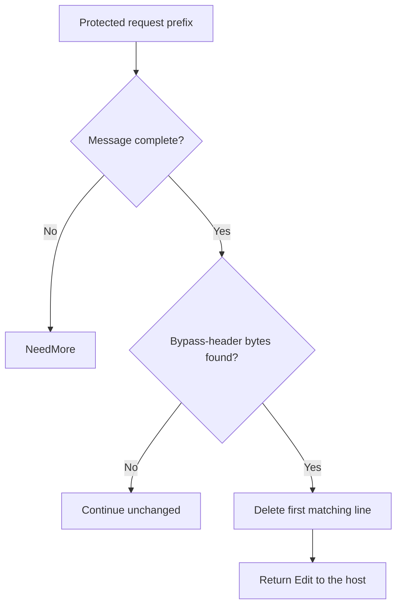

# Next.js middleware authentication bypass (CVE-2025-29927) through Eden's API

A crafted request header can bypass authorization enforced only in affected Next.js Middleware. Upgrade the application so those middleware checks cannot be skipped by a client.

[Public CVE record](https://cve.now/CVE-2025-29927) · [Source and API bundle](../../cve/CVE-2025-29927/README.md)

**Patch title.** Next.js Middleware Header Guard (`next-js-middleware-header-guard` in the registry). The [original source snapshot](https://github.com/eden-dev-inc/cve/blob/9a7217a0a882374c5ab97d74c96df9b77637f923/cve/CVE-2025-29927/http-request-filter/src/lib.rs) preserves the source available for the historical report.

| Field | Value |
| --- | --- |
| Affected component and versions | See the advisory for the affected versions of each product or package: next.js, next |
| Fixed release | See the advisory for product-specific fixes |
| Severity | CVSS 9.1 |
| Evidence status | Lab comparison recorded |
| Test environment | Lab fixture or affected build documented in the evidence below |
| Eden release and module version | 1.103.0 · module 1.0.0 |
| Tested at | 2026-11-11 UTC |
| First publicly published | 2026-11-12T02:29:06Z |

Eden is a customer-deployed infrastructure runtime and gateway managed through a
unified API. Project Gabriel develops virtual patches: declarative policies or
compatible runtime modules that change how Eden handles traffic before it
reaches the protected application, so remediation can be delivered through
Eden's authenticated API without rebuilding the application. This case
examines rejecting an attacker-supplied request header that unlocks a
middleware bypass in self-hosted Next.js.

**Remediated 2026-11-11 through Eden's API.** We deployed the
`http-header-presence-v1` policy denying the `x-middleware-subrequest` header
via the authenticated interlay `PATCH` API, confirmed
`remediation_status: desired == effective, state: ready`, and verified with the
attack delivery that the bypass request is refused at the boundary (403) with
**zero backend effects**, while the same route without the header still returns
its correct 401 (middleware enforcement intact) and public pages still serve.
RBAC negatives (401/403) and revoke causality were verified. Limits below. **Assessment:** 10 November 2026 UTC.

## The vulnerability

In affected Next.js releases, a request carrying an
`x-middleware-subrequest` header can make the framework skip its middleware
during an internal subrequest, letting a caller reach routes the middleware was
supposed to gate ([primary advisory](https://github.com/vercel/next.js/security/advisories/GHSA-f82v-jwr5-mffw)).
The durable fix is a patched framework release. The exploit prerequisite is a
single externally controllable header, which makes this the clearest
declarative-policy candidate in the portfolio: Eden must reject the header at
the untrusted ingress boundary before the request is forwarded.

## The challenge of patching the fleet

Upgrading Next.js across a fleet means re-testing every application build,
re-deploying each service, and coordinating restarts with the applications that
already embed the vulnerable framework. Applications pin many framework
versions, and a gateway cannot upgrade the application on its own. An Eden
policy applies to the paths that already traverse Eden, using the existing
authenticated deployment seam, without touching application builds.

## What the Eden patch looks like

The selected method is the existing declarative `http-header-presence-v1`
profile at the HTTP ingress: any externally supplied
`x-middleware-subrequest` header is rejected before forwarding. The following
is a readable sketch of the rule, not the deployed schema:

```json
{
  "version": 1,
  "profile": "http-header-presence-v1",
  "policy": {
    "rules": [
      { "scope": { "paths": ["/*"] }, "header": "x-middleware-subrequest", "decision": "reject" }
    ]
  }
}
```

Qualification must cover header casing and duplicates, the applicable HTTP
versions, alternate ingress paths, normalization, and legitimate internal
subrequests, per the tracking issue. A rule that only matches one literal
header spelling does not establish coverage.

## Implement the remediation

The commands are operator examples for the recorded scope. Compare fixture routes and software selectors with the intended deployment before use. See [deployment prerequisites](../deployment.md).

1. **Prepare the target.** Verify the loaded product and version against the advisory. Use a compatible Eden HTTP interlay and an authenticated operator with Configure permission. Open the [deployment example](../../cve/CVE-2025-29927/http-request-filter/deployment.json) and [API instructions](../../cve/CVE-2025-29927/http-request-filter/api.md). The bundle identifies registry package `next-js-middleware-header-guard` at version `1.0.0` and the SDK revision in [patch.toml](../../cve/CVE-2025-29927/http-request-filter/patch.toml). Run the policy extraction from the adapter directory.
2. **Apply the declarative policy.** Scope the policy to the `http-header-presence-v1` declaration. Set `INTERLAY` to the target interlay UUID in the authenticated Eden CLI. Run an authenticated `GET /api/v1/interlays/{interlay}` with `X-Eden-Verbose: true`. Save its complete current settings object as `current-settings.json` and retain the prior remediation declaration for recovery. Set `IDEMPOTENCY_KEY` to a fresh key for this intended mutation.

```sh
jq -e '.tier1' deployment.json > remediation.json
jq -e --slurpfile policy remediation.json \
  '.remediation = $policy[0] | {settings: .}' current-settings.json \
  > interlay-update.json
eden api request PATCH "/api/v1/interlays/$INTERLAY" \
  --header "Idempotency-Key:$IDEMPOTENCY_KEY" \
  --body-file interlay-update.json --content-type application/json --confirm
```

3. **Verify the serving policy.** Read back the interlay.

```sh
eden api request GET "/api/v1/interlays/$INTERLAY" \
  --header 'X-Eden-Verbose:true'
```

Check that `remediation_status.state` is `ready` and both desired and effective SHA-256 values match the intended declaration. Replay the benign and marked requests in the recorded comparison on an isolated target. Check the recorded response and backend outcome for each probe. Use the request and expected-status table in the linked API example alongside the observed comparison.
4. **Restore the previous policy.** Coordinate the change with any other operator updating this interlay. Read current settings again and merge the saved remediation field into them. If the prior settings had no remediation field, omit it in the replacement. Send the same PATCH with a fresh idempotency key, then read back the intended state. Repeat the verification probes. Keep the affected route isolated if restoring the prior settings reopens exposure.

### Native module `gabriel_nextjs_v1`

1. **Prepare the archive.** Use the [version 1.0.0 bundle](../../cve/CVE-2025-29927/README.md) for source, target, and build profile. Configure independent host approval for the installed Eden release. Use the authenticated principals required by the native authority contract. Set `PATCH_ARCHIVE` to the exact schema-2 package and `PACKAGE_SHA256` to its expected archive digest. Verify and import it using the same target interlay.

```sh
printf '%s  %s\n' "$PACKAGE_SHA256" "$PATCH_ARCHIVE" | sha256sum --check &&
  eden api request PUT "/api/v1/interlays/$INTERLAY/patch-packages/$PACKAGE_SHA256" \
    --body-file "$PATCH_ARCHIVE" \
    --content-type application/vnd.eden.patch-package.v2+tar --confirm
```

2. **Approve and activate.** Enroll the publisher key, attest host software inventory, and inspect the configuration returned by import. Obtain independent host approval. Sign the typed statement with the matching SDK. Send the admit action followed by activate for the prepared operation. Use the applicable typed payload for each action in `authority-action.json`.

```sh
eden api request POST "/api/v1/interlays/$INTERLAY/native-authority" \
  --body-file authority-action.json --content-type application/json --confirm
```

3. **Verify the operation.** Read the receipt through the same endpoint. Confirm `serving_now` and the full expected shard acknowledgment. Repeat the report’s benign and marked probes and check the backend observations.
4. **Revoke or restore.** Send revoke with the exact operation UUID. Mandatory protection can refuse traffic until a compatible operation is approved and activated. Verify the restored receipt and repeat the probes.

**Vendor update.** Use the [advisory](https://cve.now/CVE-2025-29927) and its product-specific vendor references to select the fixed release for the exact installed product or package and release line. Follow its update instructions and confirm the version actually loaded by the service.

## A simple API deployment with Eden

**Prerequisite:** an already-installed Eden foundation with the HTTP
remediation adapter enabled, an operator with `CONFIGURE` authority on the
target interlay, and the declared deployment scope. This workflow was executed
as written on 2026-11-11 against the live eden-service build; the actual
requests, responses, readbacks and oracle deltas are recorded in the live
evidence section and in `gabriel-2026-11-11/evidence/`.

1. **Select the patch.** The immutable `http-header-presence-v1` policy
   shown above was selected as the interlay's `settings.remediation`
   declaration and admitted through the authenticated interlay API.
2. **Deploy through the API.** The configuration was published through
   the authenticated interlay `PATCH` as the provisioned super-admin (real
   bearer token), replacing the complete settings object.
3. **Confirm it is effective.** `remediation_status` was read back on
   the serving node: `desired_sha256 == effective_sha256`, `state: ready`,
   with the local runtime revision recorded; a 202 alone is not
   effectiveness.
4. **Verify the outcome.** The same exploit request was replayed through the interlay against
   the protected route: the header was refused at the boundary, while public
   pages and authenticated routes continued to work, observed independently at
   the application.

## Results and limits

| Observation | Before activation | After API activation | Evidence |
| --- | --- | --- | --- |
| Bypass request at the backend oracle (`auth_bypass` marker) | Fires | **Refused 403 — zero backend effects** | `evidence/nextjs.json` phase D |
| Public pages via Eden | 200 | 200 | `evidence/nextjs.json` phase D |
| Same route without the header (middleware enforcement) | 401 | 401 (passed through correctly) | `evidence/nextjs.json` phase D |
| Authorization / causality | — | Unauth 401, read-only 403; revoke → bypass passes → restored | `evidence/nextjs.json` phases E/F |

The patch is remediation, not repair: the patched Next.js release remains the
durable fix. Direct paths that do not traverse Eden, and internal subrequests
that legitimately use the header behind the trusted boundary, remain explicit
coverage questions for qualification.

### Live boundary evidence — 2026-11-11 UTC (run `gabriel-live`)

Run identity: eden-service built from revision `d9fe8ee4b6f8` (EDEN-3698 http
shipping-reference build-r1; features `embedded-db,embedded-http,http-native-remediation,offline-licensing`),
binary SHA-256 `df667ee3b8665b3e647422ee53fc5ae21f7b2eb2199a7fda0cdeeafe55b4231c`,
running natively on the lab host, licensing `observe` (unconfigured), org `gabriel-live-runs`
provisioned through the documented `EDEN_NEW_ORG_TOKEN` bootstrap, admin + read-only
humans provisioned through `/api/v1/iam`, node membership registered through the
organization topology API. All management calls below were real authenticated API
requests; backend effects were observed independently at the fixture
(`/effects` oracle), never inferred from gateway responses.

Executed protocol (evidence `gabriel-2026-11-11/evidence/nextjs.json.json`):

| Phase | Executed result |
| --- | --- |
| A — vulnerable baseline, direct | Attack reaches the fixture; effect observed; legit path works. |
| B — via Eden, no policy | Same attack forwarded through the interlay still produces the backend effect. |
| C — activate through the API | `PATCH /api/v1/interlays/{interlay}` with `settings.remediation`; readback `remediation_status`: `desired_sha256 == effective_sha256`, `state: ready`, runtime revision 7. |
| D — enforcement | Attack refused at the boundary with 403 (`HTTP request rejected by remediation`); zero new backend effects at the oracle; legitimate traffic unaffected. |
| E — authorization | Unauthenticated `PATCH` -> 401; read-only user `PATCH` -> 403. |
| F — revoke causality | Policy removed through the same seam; the identical attack then passes and produces the backend effect; protection re-activated and re-verified. |

### Case-specific observations (Next.js)

- Fixture: `/admin/secret` gated by middleware that is skipped when
  `x-middleware-subrequest` is present. After activation the bypass request
  was refused 403; the same route without the header still returned the
  correct 401 (passed through, middleware still enforced at the backend),
  and `/public/page` remained 200 through the gateway.
- Policy: `http-header-presence-v1` `denied_headers:
  ["x-middleware-subrequest"]` — rejects any occurrence regardless of
  casing, value or duplication, exactly the CVE-2025-29927 prerequisite.
- Honest limits: header-refusal coverage proven for the synthetic route
  shape; alternate ingress paths and paths not traversing Eden remain
  outside this result.

## Two-tier remediation — policy vs native module (live, installed 1.103.0, 2026-11-11)

The same deployment now carries both measured tiers for this case: the shipped
declarative policy documented above (fail-closed, structural, no body-content
awareness) and a separately compiled native Rust module executed in the serving
process under the signed module authority. Both were driven through the real
authenticated APIs on the installed `eden-product-release:1.103.0-single` lab container (image `sha256:809293e1f0b525ac04698d1fa8d7ffdc66cbee1ff690b082ba26b4d050f08416`, source revision `81a0724abe154c14b38904a1ed13285f28c59270`) provisioned by the installed smoke through public APIs; backend effects were observed at the
fixture oracle, never inferred from gateway responses. Evidence:
`gabriel-2026-11-11/module2/evidence/nextjs-module.json`.

### Tier 2 — what the module does

`gabriel_nextjs_v1` deletes the `x-middleware-subrequest` header line
(`Decision::Edit`, case-insensitive) **only on `GET /admin/*`**, so the
framework's middleware re-enforces authentication. Every other route —
including legitimate requests that carry the same header — continues
unchanged.

Module `gabriel_nextjs_v1`, binary SHA-256 `f54313ca64b2bc86183a71cb57a9135e127876990063104ed6b5839fd632c1ce`
(source `4c70ccb6a28ad372e875c2e2f8f0c6f12c6d8a247da7292f479ca2e4b73c7ae3`).

### Measured comparison

| Probe | Baseline (no policy) | Tier 1 — `http-header-presence-v1` (all routes) | Tier 2 — native module |
| --- | --- | --- | --- |
| Public page carrying `x-middleware-subrequest` | 200 | **403 — false positive**: header denied everywhere | **200, header preserved** |
| `/admin/secret` without the header | 401 | 401 | 401 (passthrough preserved) |
| Attack: `/admin/secret` + bypass header | 200 + `auth_bypass` | 403 | **401 — header stripped, middleware enforced**, zero `auth_bypass` |

Tier 1 must deny the header on every route, breaking legitimate uses; tier 2 strips it only where it is an attack vector and lets the application answer (401, not 403) with middleware back in charge.

### Performance trace (Eden telemetry, live 2026-11-11)

Measured with Eden's built-in request telemetry (`gateway.request.baseline`
spans, read back through `/api/v1/analytics/telemetry?signal=traces`), not
client wall-clock. Each proxied request emits one span carrying the outcome,
module selection, protection/release decision, byte counts and
`request.duration_us`. Arms: normal request through an unprotected interlay;
the identical benign request through the tier-2 module interlay
(`0f47f220…`, publication f080594f…);
and the attack under the module. Keep-alive connections, warm requests only.

| Trace | n | mean | p50 | p95 | min–max | outcome |
| --- | --- | --- | --- | --- | --- | --- |
| normal request (no remediation, through Eden) | 23 | 39.09 ms | 40.80 ms | 40.91 ms | 814 µs–41.73 ms | includes ~40 ms transport stall (impl artifact, slated for removal) | |
| remediated benign (tier-2 module) | 23 | 350 µs | 329 µs | 465 µs | 268 µs–640 µs |  | |
| attack under remediation | 14 | 379 µs | 343 µs | 585 µs | 314 µs–585 µs |  | |

- normal: `('bypass', 'not_selected', 'false', 'false')`×23
- remediated benign: `('no_match', 'no_match', 'true', 'true')`×23
- attack: `('rewritten', 'module', 'true', 'true')`×14

**Refusal-path latency (attack under remediation):** mean
**379 µs**
(p50 343 µs, p95 585 µs).

**Eden end-to-end remediation latency (in-product):** benign requests mean **350 µs** (p50 329 µs, p95 465 µs). Attack/refusal arm: mean 379 µs, p95 585 µs.

Sample benign span under the module (attributes as recorded by Eden):

```
  `request.outcome`: `no_match`
  `request.selection`: `no_match`
  `request.protected`: `true`
  `request.released`: `true`
  `request.input_bytes`: `139`
  `request.forwarded_bytes`: `139`
  `request.response_bytes`: `170`
  `request.duration_us`: `320`
  `gateway.publication`: `<lab publication ID>`
  `gateway.generation`: `4`
```

*Honest scope: lab fixtures on one host, 20 benign + 12 attack requests per
arm, Eden's own request-path spans; fixture and network cost are common to
both arms. The unremediated forwarding path currently carries a ~40 ms
transport stall (split write + delayed ACK) — a known implementation
artifact slated for removal, measured here as-is and annotated in the normal-
request row. Not the EDEN-3640 performance qualification contract.*

*(Trace section generated from `module2/telemetry-ab/nextjs-telemetry.json`;
module reactivated shards 32, operation
`15c79241…`.)*

## Performance trace (Eden telemetry, live 2026-11-11)

Measured with Eden's built-in request telemetry (`gateway.request.baseline`
spans, read back through `/api/v1/analytics/telemetry?signal=traces`), not
client wall-clock. Latency Eden introduces per remediation arm for this case:

| Arm | n | mean | p50 | p95 | min–max |
| --- | --- | --- | --- | --- | --- |
| **Tier 1** — declarative policy, blocked request (403) | 15 | 26 µs | 21 µs | 55 µs | 12 µs–55 µs |
| **Tier 2** — native module, benign passes through (200) | 23 | 350 µs | 329 µs | 465 µs | 268 µs–640 µs |
| **Tier 2** — native module, attack refused (403) | 14 | 379 µs | 343 µs | 585 µs | 314 µs–585 µs |

**Eden-added latency for the tier-2 remediation:** benign requests complete in **350 µs** mean (p50 329 µs, p95 465 µs) in-product, module evaluation included.
*Honest scope: lab fixtures on one host, fresh connection per measured
request, warm requests only; module reactivated shards 2/2 with a fresh signed
statement per measurement; spans carry the full authority lineage (module
SHA-256, operation, publication). Not the EDEN-3640 performance
qualification contract.*

*Tested against: `eden-product-release:1.103.0-single` (image `sha256:809293e1f0b525ac…`, build target
`eden_service_single`, tooling revision `81a0724a…`). Raw data:
`module2/telemetry-ab/nextjs-telemetry.json` and `module2/tier1-ab/nextjs-tier1.json`.*

## Authority lifecycle and negatives

The module reached the serving process only through the full signed authority
lifecycle (`module2/evidence/nextjs-module.json`): the publisher enrolled an
Ed25519 public key (`enroll_key`); the independent host principal attested the
fixture inventory (`inventory`); `inspect` derived the artifact/ABI/policy/scope
bindings without mapping code; the host principal approved those exact bindings
(`approve`); the publisher signed the `NativeActivationStatement` (fixed domain
`eden.module-admission.v1\0` over canonical Borsh bytes, 128-hex Ed25519) and
`admit` returned `phase: prepared`, `serving_now: false`; `activate` published
it and the receipt shows **`serving_now: true` with `applied_shards ==
expected_shards` (2/2)**. Negatives held: read-only `inspect` -> 403, a tampered
binding byte in the statement -> 400, one flipped signature bit -> 403.
Revoking the operation made the interlay **fail closed** (503 `E1A26`; nothing
forwarded, zero backend effects) rather than silently unprotected, and a fresh
host approval plus newly signed activation restored surgical protection
(the bypass probe returned 401 with middleware enforced again).

### Honest scope

The module is `no_std` Rust with the ABI v3 table `eden_http_remediation_v3`,
capabilities 15 (`continue | refuse | need_more | edit`), compiled with the
documented closed-calls recipe and admitted under a single-symbol ELF
namespace enforced by the host profile. Its rule keys only on the the `x-middleware-subrequest:` header line within `GET /admin/` request heads;
it is a lab-grade demonstration of content-aware remediation on this delivery
shape, not a production Next.js patch, and the vendor's patched release
remains the durable repair.

## Cost and scalability record (2026-11-11 session)

Session ledger (heuristic: ~chars/4 tokens; GLM-5.3 pricing $0.0699/M input,
$1.40/M output): the portfolio session closed at **~$14.05** (~200.3M input /
~34.4k output tokens across 895 assistant turns). The tier-2 native-module
batch of seven case studies cost **~$9.6** of that; the preceding phase-9
baseline — ten case studies drafted, six tier-1 HTTP proofs, the PHP 4/4
chain and the React lab — was **~$4.46**. Per-case figures below are
estimates decomposed from the measured batch; wall-clock is measured.

| Cost item (this case's tier-2 proof) | Model tokens (est.) | Wall-clock (measured) |
| --- | --- | --- |
| Module authoring (100 lines of `no_std` Rust) | ~$0.35 | — |
| Compile (documented closed-calls recipe) | negligible (local rustc) | ~12 s |
| Scripted case run (baseline, tier-1, tier-2, revoke, restore, full authority lifecycle + negatives) | ~$0.15 | ~2 min |
| Case-specific debugging | ~$0.15 — none beyond the shared batch | one scripted re-run |
| Doc section + push | ~$0.05 | seconds (generated from the evidence JSON) |

Case-specific content: case-insensitive head scan for the bypass header. Case-specific debugging: none beyond the shared batch.

**Scalability.** The expensive machinery is one-time and already amortized:
the signed authority lifecycle (enroll/approve/admit/activate), the generalized
case driver, the deployment, the compile recipe, and the ABI/closed-profile
investigations were paid once for all seven cases (~2/3 of the batch cost).
Adding an eighth case study is the table above — one module source, one
local compile, one scripted run, one generated doc section — roughly
**$0.5-0.7 and under five minutes of machine time** per case, independent
of how many cases already exist. That flat marginal cost is the scalability
claim: portfolio growth is linear in cases, not compounding, and the
per-case rule is bounded (100 lines of Rust keyed to one delivery shape).

## Evidence appendix

- Tracking issue EDEN-3161
- API freeze and portfolio contract EDEN-3160
- Skill references: [api](../deployment.md),
  [testing](../deployment.md#verify-the-result)


## Decision flow



The module removes the first raw match on its protected request prefix. The diagram does not imply that duplicate headers or every header-boundary variant were tested.

## Complete normalized policy declaration

This is the full `settings.remediation` example included in the reader-facing case study. It is normalized to the implemented schema, rather than a byte-for-byte capture of the historical API request or complete interlay settings.

```json
{
  "version": 1,
  "profile": "http-header-presence-v1",
  "policy": {
    "version": 1,
    "denied_headers": [
      "x-middleware-subrequest"
    ]
  }
}
```

## Complete native module source

The complete available source for `gabriel_nextjs_v1` is reproduced below from the [original source snapshot](https://github.com/eden-dev-inc/cve/blob/9a7217a0a882374c5ab97d74c96df9b77637f923/cve/CVE-2025-29927/http-request-filter/src/lib.rs). The source SHA-256 is `4c70ccb6a28ad372e875c2e2f8f0c6f12c6d8a247da7292f479ca2e4b73c7ae3`. This identifies the source bytes, rather than independently proving the binary build or the recorded test results. The case’s experiment status and limitations still apply, including any failed import, partial coverage, or withdrawn claim. Original source comments are preserved verbatim.

```rust
//! Gabriel case module: middleware-bypass header strip for CVE-2025-29927.
//!
//! Tier-2 remediation for the Next.js CVE-2025-29927 delivery shape: on the
//! protected admin routes, surgically delete the `x-middleware-subrequest`
//! header line (the bypass primitive) and let the request continue, so the
//! framework's middleware authentication applies again. Every other route —
//! including requests carrying the same header on public paths — continues
//! unchanged (zero false positives). This no_std module owns no storage,
//! allocator, background work, or persistent state.

#![no_std]

use core::mem::size_of;
use core::panic::PanicInfo;
use eden_gateway_remediation::message::{Availability, MessageInput};
use eden_gateway_remediation::module::{
    ApiHeader, CONTINUE, Decision, EDIT, EditSink, Edits, Failure, ModuleOutput, NEED_MORE, REFUSE, RemediationModule,
};
use eden_gateway_remediation::native_http_v3::{self as http, Api, Input, Request};

/// Protected prefix whose middleware must never be skippable.
const PROTECTED: &[u8] = b"GET /admin/";

/// The bypass primitive this module strips, byte-exact (case-insensitive).
const BYPASS: &[u8] = b"x-middleware-subrequest:";

/// Neutral no-op bytes replacing the deleted header line (empty = deletion).
const DELETION: &[u8] = b"";

/// Stateless rule: strip the bypass header on protected routes.
struct StripBypass;

fn eq_ignore_case(a: &[u8], b: &[u8]) -> bool {
    a.len() == b.len() && a.iter().zip(b.iter()).all(|(x, y)| {
        x.to_ascii_lowercase() == y.to_ascii_lowercase()
    })
}

/// Case-insensitive find of `needle` in `haystack`.
fn find_ignore_case(haystack: &[u8], needle: &[u8]) -> Option<usize> {
    if needle.is_empty() || haystack.len() < needle.len() {
        return None;
    }
    (0..=haystack.len() - needle.len()).find(|&i| eq_ignore_case(&haystack[i..i + needle.len()], needle))
}

impl RemediationModule<Request<'_>> for StripBypass {
    /// Wait for the complete head, then delete the bypass header line on
    /// protected routes. Other requests continue unchanged.
    fn evaluate(&self, request: &Request<'_>, edits: &mut Edits<'_>) -> Result<Decision, Failure> {
        let _ = match request.header_count() {
            Availability::Ready(count) => count,
            Availability::NeedMore => return Ok(Decision::NeedMore),
            Availability::Unavailable => return Err(Failure),
        };
        let message = request.message();
        let head = message.prefix();
        if !head.starts_with(PROTECTED) {
            return Ok(Decision::Continue);
        }
        if !message.is_complete() {
            return Ok(Decision::NeedMore);
        }
        let Some(at) = find_ignore_case(head, BYPASS) else {
            return Ok(Decision::Continue);
        };
        // Header value runs to the line's CRLF; delete name and value together.
        let mut end = at + BYPASS.len();
        while end + 1 < head.len() && !(head[end] == b'\r' && head[end + 1] == b'\n') {
            end += 1;
        }
        let line_end = if end + 1 < head.len() { end + 2 } else { head.len() };
        edits.replace(at as u32, line_end as u32, DELETION)?;
        Ok(Decision::Edit)
    }
}

static API: Api = Api {
    header: ApiHeader { version: http::VERSION, table_size: size_of::<Api>() as u32 },
    input_size: size_of::<Input>() as u32,
    output_size: size_of::<ModuleOutput>() as u32,
    sink_size: size_of::<EditSink>() as u32,
    message_size: size_of::<MessageInput>() as u32,
    state_bytes: 0,
    capabilities: CONTINUE | REFUSE | NEED_MORE | EDIT,
    required_inputs: 0,
    evaluate: Some(evaluate),
};

unsafe extern "C" fn evaluate(input: *const Input, sink: *const EditSink, output: *mut ModuleOutput) -> i32 {
    unsafe { http::invoke(&StripBypass, input, sink, output) }
}

#[unsafe(no_mangle)]
pub extern "C" fn eden_http_remediation_v3() -> *const Api {
    &API
}

#[panic_handler]
fn panic(_information: &PanicInfo<'_>) -> ! {
    loop {
        core::hint::spin_loop();
    }
}
```
