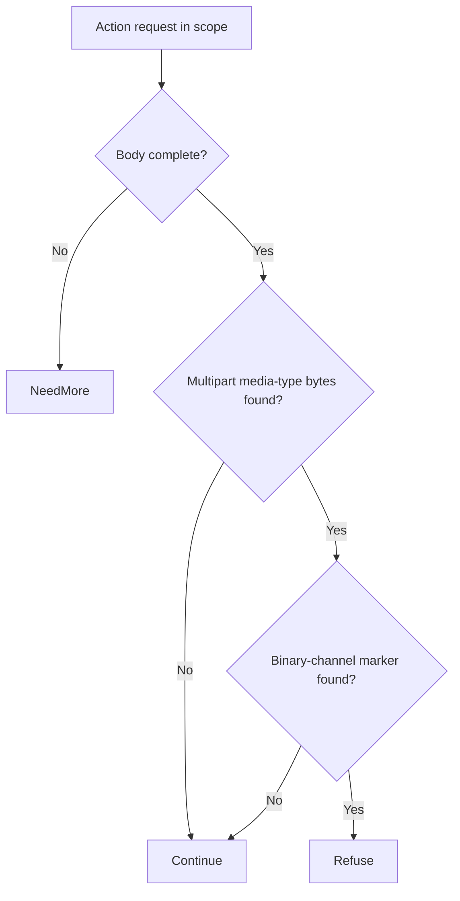

# React Server Components decoder (CVE-2025-55182) through Eden's API

A remote caller can execute code through an affected React Server Components decoder without authenticating. Upgrade the installed server-component packages to prevent externally supplied requests from controlling the server process.

[Public CVE record](https://cve.now/CVE-2025-55182) · [Vendor or publisher advisory](https://react.dev/blog/2025/12/03/critical-security-vulnerability-in-react-server-components)

| Field | Value |
| --- | --- |
| Affected component and versions | See the advisory for the affected versions of each product or package: react-server-dom-webpack, react-server-dom-turbopack, react-server-dom-parcel |
| Fixed release | See the advisory for product-specific fixes |
| Severity | CVSS 10 |
| Evidence status | Related decoder evidence |
| Test environment | Related affected decoder experiment |
| Eden release and module version | 1.103.0 |
| Tested at | 2026-11-11 UTC |
| First publicly published | 2026-11-12T02:29:06Z |

Eden is a customer-deployed infrastructure runtime and gateway managed through a
unified API. Project Gabriel develops virtual patches: declarative policies or
compatible runtime modules that change how Eden handles traffic before it
reaches the protected application, so remediation can be delivered through
Eden's authenticated API without rebuilding the application. This case
examines the portfolio's deepest-introspection problem: enforcing a security
invariant on a streaming serialized payload before the React Server Components
decoder processes it.

**Shared decoder evidence recorded on 2026-11-11.** The
[CVE-2026-126187 experiment](CVE_2026_126187.md) used the authenticated
interlay API to deny traffic on the tested decode route and observed zero
decode arrivals. CVE-2025-55182-specific protection remains unverified.
The semantic-validation module remains a follow-on.
**Assessment:** 10 November 2026 UTC.

## The vulnerability

In affected Next.js/React framework releases, the React Server Components (RSC)
flight payload decoder processes a serialized stream from the request in a way
that can yield remote code execution for a crafted payload
([primary advisory](https://react.dev/blog/2025/12/03/critical-security-vulnerability-in-react-server-components)).
The durable fix is a patched framework build. The exploit prerequisite is not a
simple route, header or JSON member: it is a structure inside a
content-type-specific, possibly streamed serialization, which a declarative
`http-structure-v1` rule cannot see. Known-payload matching is explicitly
insufficient per the tracking issue.

## The challenge of patching the fleet

A patched framework build means rebuilding and redeploying every affected
application, and RSC payloads cross client and server boundaries with streaming
semantics, so an operator cannot "just" drop a WAF-style signature and call it
covered. This case exists in the portfolio precisely because the generic
middleware must prove a **complete invariant** against the actual decoder,
across all admitted encodings — or be replaced.

## What the Eden patch looks like

The selected method is a separately compiled native Rust remediation module
through `RemediationModule<I>` at the HTTP adapter, evaluated on the decoded
request stream before the application receives it. The module would enforce a
predeclared structural invariant on the RSC flight payload (for example,
refusing undeclared module references in the payload) with `NeedMore`
incremental decisions across chunked delivery. No CVE-specific pattern list is
proposed; the module is validated against the decoder's own accepted
serialization, and every admitted encoding (including multipart and streamed
transfers) must be covered or the profile refuses rather than passing bytes
through uninspected.

The native authority lifecycle applies: publisher key enrollment, host
inventory attestation, typed approval of the exact artifact/ABI/scope bindings,
publisher-signed activation statement, `admit`, then explicit `activate` with
receipt — never a bare upload. This native path exists in the 1.103.0 contract;
this case's module does not yet exist.

## Implement the remediation

The linked React decoder experiment exercised a related advisory. Qualify the patched server-component packages with ordinary navigation and server actions in the application.

1. **Identify the affected installation.** Check the installed component and the advisory’s prerequisites.
2. **Apply the vendor fix.** Use the [advisory](https://react.dev/blog/2025/12/03/critical-security-vulnerability-in-react-server-components) to select the fixed release for the exact installed product or package and release line. Follow its update instructions and confirm the version actually loaded by the service.
3. **Verify the upgrade.** Confirm the running version and repeat normal operations on the upgraded service. Use an isolated environment for security regression probes.
4. **Restore service if the update fails.** Follow the vendor’s recovery instructions and keep the affected operation isolated until the supported fix is active.

## A simple API deployment with Eden

**Prerequisite:** an already-installed Eden foundation with native HTTP
remediation enabled, operator `CONFIGURE`+`Grant`/`Promote` authority, an
enrolled host approver principal, and a pinned application/framework artifact
with the affected decoder confirmed. The workflow below is in development; no
module or request exists yet.

1. **Select the patch.** A separately compiled module, built from matching
   reviewed source for the closed profile, would be packaged as a standard
   schema-2 `rust_module` package and imported through the interlay API.
2. **Deploy through the API.** The native authority sequence would be
   exercised: `enroll_key`, host `inventory`/`approve`, then `admit` and
   `activate` the signed candidate, reading the receipt and `serving_now`.
3. **Confirm it is effective.** The operator would read back the exact
   artifact, ABI, scope and runtime revision on each serving node.
4. **Verify the outcome.** The same exploit payload would be replayed: no
   execution marker occurs, while RSC navigation, Server Actions and ordinary
   application semantics are preserved, observed independently at the
   application.

## Results and limits

| Observation | Before activation | After API activation | Evidence |
| --- | --- | --- | --- |
| Advisory trigger shape decoded by the real affected package | Decoded (baseline) | **Refused 403 — zero decode arrivals** | `evidence/react.json` (CVE-2026-126187 run) |
| Legitimate `GET /` via Eden | 200 | 200 | `evidence/react.json` phase D |
| media_type alternative (closes `$B` channel, keeps text/plain) | — | Deployed and measured | `evidence/react.json` phase G |

The `deny` policy refused traffic on the tested decode route in the
[CVE-2026-126187 experiment](CVE_2026_126187.md). A semantic-validation
module for allowing legitimate server actions remains follow-on work.

## Evidence appendix

- Tracking issue EDEN-3164
- API freeze and portfolio contract EDEN-3160
- Skill references: [api](../deployment.md),
  [testing](../deployment.md#verify-the-result)

## Decision flow



This is the shared module from the later React experiment. It does not add an independent CVE-2025-55182 exploit or protection result.

## Complete normalized policy declaration

This is the full `settings.remediation` example included in the reader-facing case study. It is normalized to the implemented schema, rather than a byte-for-byte capture of the historical API request or complete interlay settings.

```json
{
  "version": 1,
  "profile": "http-structure-v1",
  "policy": {
    "version": 1,
    "rules": [
      {
        "scope": {
          "methods": [
            "POST"
          ],
          "path": "/action",
          "descendants": true
        },
        "require": {
          "kind": "deny"
        }
      }
    ]
  }
}
```

## Complete native module source

This is the shared `gabriel_react_v1` module from the later React decoder experiment referenced by this case. Its inclusion does not establish a separate CVE-2025-55182 exploit baseline or protection result.

The source SHA-256 is `89282d7f6e4a8833906ffd8cf76ab360e057c4ce568d55f081a1ba25475104e0`. This identifies the source bytes, rather than independently proving the binary build or the recorded test results. The case’s experiment status and limitations still apply, including any failed import, partial coverage, or withdrawn claim. Original source comments are preserved verbatim.

```rust
//! Gabriel case module: RSC typed-array channel refusal for CVE-2026-126187.
//!
//! Tier-2 remediation for the React Server Components CVE-2026-126187
//! delivery shape: on the decode route, refuse only multipart flight bodies
//! whose rows reference binary `$B` form-field channels (the typed-array
//! materialization primitive driving the vulnerable decoder). Benign multipart
//! form submissions and all string flights continue unchanged, preserving the
//! decode capability (zero false positives). This no_std module owns no
//! storage, allocator, background work, or persistent state.

#![no_std]

use core::mem::size_of;
use core::panic::PanicInfo;
use eden_gateway_remediation::message::{Availability, MessageInput};
use eden_gateway_remediation::module::{
    ApiHeader, CONTINUE, Decision, EDIT, EditSink, Edits, Failure, ModuleOutput, NEED_MORE, REFUSE, RemediationModule,
};
use eden_gateway_remediation::native_http_v3::{self as http, Api, Input, Request};

/// Decode route in scope.
const PREFIX: &[u8] = b"POST /action ";

/// The multipart media type whose $B channel is the primitive.
const MULTIPART: &[u8] = b"multipart/form-data";

/// A `$B` row reference inside a multipart flight body.
const ROW_REF: &[u8] = b"\"$B";

fn find(haystack: &[u8], needle: &[u8]) -> Option<usize> {
    if needle.is_empty() || haystack.len() < needle.len() {
        return None;
    }
    (0..=haystack.len() - needle.len()).find(|&i| &haystack[i..i + needle.len()] == needle)
}

/// Stateless rule: refuse $B-referencing multipart flights on the decode route.
struct RefuseTypedArrayChannel;

impl RemediationModule<Request<'_>> for RefuseTypedArrayChannel {
    /// Wait for the complete body, then refuse only $B-referencing multipart.
    fn evaluate(&self, request: &Request<'_>, edits: &mut Edits<'_>) -> Result<Decision, Failure> {
        let _ = edits;
        let _ = match request.header_count() {
            Availability::Ready(count) => count,
            Availability::NeedMore => return Ok(Decision::NeedMore),
            Availability::Unavailable => return Err(Failure),
        };
        let message = request.message();
        if !message.prefix().starts_with(PREFIX) {
            return Ok(Decision::Continue);
        }
        if !message.is_complete() {
            return Ok(Decision::NeedMore);
        }
        let head = message.prefix();
        if find(head, MULTIPART).is_none() {
            // String flights and other media types: the advisory's channel is
            // multipart-only; preserve them unchanged.
            return Ok(Decision::Continue);
        }
        let body_range = match request.body_range() {
            Availability::Ready(range) => range,
            Availability::NeedMore => return Ok(Decision::NeedMore),
            Availability::Unavailable => return Err(Failure),
        };
        let body = match message.bytes(body_range)? {
            Availability::Ready(bytes) => bytes,
            Availability::NeedMore => return Ok(Decision::NeedMore),
            Availability::Unavailable => return Err(Failure),
        };
        if find(body, ROW_REF).is_some() {
            return Ok(Decision::Refuse);
        }
        Ok(Decision::Continue)
    }
}

static API: Api = Api {
    header: ApiHeader { version: http::VERSION, table_size: size_of::<Api>() as u32 },
    input_size: size_of::<Input>() as u32,
    output_size: size_of::<ModuleOutput>() as u32,
    sink_size: size_of::<EditSink>() as u32,
    message_size: size_of::<MessageInput>() as u32,
    state_bytes: 0,
    capabilities: CONTINUE | REFUSE | NEED_MORE | EDIT,
    required_inputs: 0,
    evaluate: Some(evaluate),
};

unsafe extern "C" fn evaluate(input: *const Input, sink: *const EditSink, output: *mut ModuleOutput) -> i32 {
    unsafe { http::invoke(&RefuseTypedArrayChannel, input, sink, output) }
}

#[unsafe(no_mangle)]
pub extern "C" fn eden_http_remediation_v3() -> *const Api {
    &API
}

#[panic_handler]
fn panic(_information: &PanicInfo<'_>) -> ! {
    loop {
        core::hint::spin_loop();
    }
}
```

## Performance

The public evidence for this case does not include request-latency measurements.
