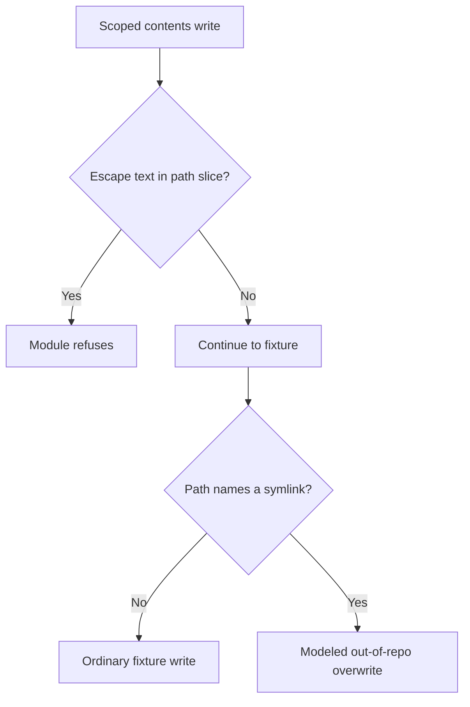

# Gogs contents API symlink following (CVE-2025-8110)

The affected Gogs file update API can follow symlinks and overwrite files outside the intended repository, which can lead to code execution. Update Gogs to protect the host filesystem from repository writes.

[Public CVE record](https://cve.now/CVE-2025-8110) · [Source and API bundle](../../cve/CVE-2025-8110/README.md)

**Patch title.** Gogs Contents Symlink Guard (`gogs-contents-symlink-guard` in the registry). The [original source snapshot](https://github.com/eden-dev-inc/cve/blob/9a7217a0a882374c5ab97d74c96df9b77637f923/cve/CVE-2025-8110/http-request-filter/src/lib.rs) preserves the source available for the historical report.

| Field | Value |
| --- | --- |
| Affected component and versions | See the advisory for the affected versions of each product or package: Gogs, gogs.io/gogs |
| Fixed release | See the advisory for product-specific fixes |
| Severity | CVSS 8.7 |
| Evidence status | Partial coverage in the lab |
| Test environment | Lab fixture or affected build documented in the evidence below |
| Eden release and module version | 1.103.0 · module 1.0.0 |
| Tested at | 2026-11-11 UTC |
| First publicly published | 2026-11-12T02:29:06Z |

*Gogs <= 0.13.3 (fixed 0.13.4) — [cve.now](https://cve.now/CVE-2025-8110) month ranking entry.*

Eden terminates the HTTP connection to the affected product. The tier-2
module built for this case is **partial**: it refuses the wire-visible path
escapes (absolute targets, `..` traversal), but the CVE's named primitive —
following an in-repository symlink — is backend filesystem state that no
request-boundary rule can see, and the bypass is recorded live. The durable
repair is Gogs 0.13.4.

**Status: live evidence recorded 2026-11-11 on the installed `eden-product-release:1.103.0-single` lab container (image `sha256:809293e1f0b525ac04698d1fa8d7ffdc66cbee1ff690b082ba26b4d050f08416`); tier-2 scope: partial (symlink bypass recorded, not claimed).**

## The vulnerability

Gogs' file update (PutContents) API follows repository symlinks, letting a
repository writer overwrite files outside the repository (absolute targets
or `..` traversal in the path member, or a symlink committed inside the
repo whose target the backend follows) and potentially execute code locally.
KEV-listed, exploit public.

## The Eden patch, and its limit

**Tier 1 — declarative policy:** `deny` on `/api/v1/repos` writes — blocks
every repository file operation, including all ordinary in-repository
writes.

**Tier 2 — native module (partial):** `gabriel_gogssymlink_v1` refuses
contents-API write bodies whose `path` member escapes the repository root
(an absolute path or a `..` segment); ordinary in-repository writes pass
unchanged. The symlink variant **cannot be keyed at the boundary**: whether
`path: "link.txt"` names a symlink is server-side filesystem state, and the
request bytes are identical to a benign write.

Module `gabriel_gogssymlink_v1`, binary SHA-256 `84649dffb91a2e88cacd3746aabc425e52dedad775c91b66581b8f22a325f393`
(source `e4c38f910d1c7c3377156165ce81d99d2ac4c4ec4d514a71e18ff99fa1299718`),
keys root-escaping values in the contents-API path member.

## Implement the remediation

Use this procedure in an isolated fixture to reproduce the scoped restriction. Follow the vendor update for the underlying exposure. See [deployment prerequisites](../deployment.md).

1. **Prepare the target.** Verify the loaded product and version against the advisory. Use a compatible Eden HTTP interlay and an authenticated operator with Configure permission. Open the [deployment example](../../cve/CVE-2025-8110/http-request-filter/deployment.json) and [API instructions](../../cve/CVE-2025-8110/http-request-filter/api.md). The bundle identifies registry package `gogs-contents-symlink-guard` at version `1.0.0` and the SDK revision in [patch.toml](../../cve/CVE-2025-8110/http-request-filter/patch.toml). Run the policy extraction from the adapter directory.
2. **Apply the declarative policy.** Scope the policy to `/api/v1/repos` and descendants (POST, PUT, `deny`). Set `INTERLAY` to the target interlay UUID in the authenticated Eden CLI. Run an authenticated `GET /api/v1/interlays/{interlay}` with `X-Eden-Verbose: true`. Save its complete current settings object as `current-settings.json` and retain the prior remediation declaration for recovery. Set `IDEMPOTENCY_KEY` to a fresh key for this intended mutation.

```sh
jq -e '.tier1' deployment.json > remediation.json
jq -e --slurpfile policy remediation.json \
  '.remediation = $policy[0] | {settings: .}' current-settings.json \
  > interlay-update.json
eden api request PATCH "/api/v1/interlays/$INTERLAY" \
  --header "Idempotency-Key:$IDEMPOTENCY_KEY" \
  --body-file interlay-update.json --content-type application/json --confirm
```

3. **Verify the serving policy.** Read back the interlay.

```sh
eden api request GET "/api/v1/interlays/$INTERLAY" \
  --header 'X-Eden-Verbose:true'
```

Check that `remediation_status.state` is `ready` and both desired and effective SHA-256 values match the intended declaration. Replay the benign and marked requests in the recorded comparison on an isolated target. Check the recorded response and backend outcome for each probe. Use the request and expected-status table in the linked API example alongside the observed comparison.
4. **Restore the previous policy.** Coordinate the change with any other operator updating this interlay. Read current settings again and merge the saved remediation field into them. If the prior settings had no remediation field, omit it in the replacement. Send the same PATCH with a fresh idempotency key, then read back the intended state. Repeat the verification probes. Keep the affected route isolated if restoring the prior settings reopens exposure.

**Vendor update.** Use the [advisory](https://cve.now/CVE-2025-8110) and its product-specific vendor references to select the fixed release for the exact installed product or package and release line. Follow its update instructions and confirm the version actually loaded by the service.

## Measured comparison (live, 2026-11-11)

| Probe | Baseline (unprotected) | Tier 1 | Tier 2 (module, PARTIAL) |
| --- | --- | --- | --- |
| benign_write (`path: "readme.md"`) | 200 (`file_overwritten` ×0) | 403 — restriction | **200 (`file_overwritten` ×0)** |
| attack_absolute_path (`path: "/etc/cron.d/pwn"`) | 200 (`file_overwritten` ×1) | 403 | **403 (`file_overwritten` ×0)** |
| attack_symlink (`path: "link.txt"`, symlink target outside the repo) | 200 (`file_overwritten` ×1) | 403 | **200 (`file_overwritten` ×1) — BYPASS** |

The symlink row is the honest limit: the module passes a request whose path
member names a symlink because nothing on the wire distinguishes it from an
ordinary in-repository write. Only the backend's own link resolution — fixed
in Gogs 0.13.4 — closes it.

## What actually works for this primitive

1. **Vendor patch (durable):** Gogs 0.13.4 (PutContents stops following
   symlinks).
2. **Tier-2 partial:** refuse the wire-visible escape variants (absolute,
   `..`) to cut the cheap exfiltration paths — useful defense in depth, not
   a protection claim for the CVE.
3. Backend-side controls (symlink rejection in the contents handler) — the
   only complete fix at any layer short of the vendor patch.

## Performance trace (Eden telemetry, live 2026-11-11)

Measured with Eden's built-in request telemetry (`gateway.request.baseline`
spans, read back through `/api/v1/analytics/telemetry?signal=traces`), not
client wall-clock. Latency Eden introduces per remediation arm for this case:

| Arm | n | mean | p50 | p95 | min–max |
| --- | --- | --- | --- | --- | --- |
| **Tier 1** — declarative policy, blocked request (403) | 15 | 28 µs | 23 µs | 47 µs | 20 µs–47 µs |
| **Tier 2** — native module, benign passes through (200) | 23 | 479 µs | 454 µs | 637 µs | 402 µs–915 µs |
| **Tier 2** — native module, attack refused (403) | 14 | 136 µs | 126 µs | 215 µs | 104 µs–215 µs |

**Eden-added latency for the tier-2 remediation:** benign requests complete in **479 µs** mean (p50 454 µs, p95 637 µs) in-product, module evaluation included.
*Honest scope: lab fixtures on one host, fresh connection per measured
request, warm requests only; module reactivated shards 2/2 with a fresh signed
statement per measurement; spans carry the full authority lineage (module
SHA-256, operation, publication). Not the EDEN-3640 performance
qualification contract.*

*Tested against: `eden-product-release:1.103.0-single` (image `sha256:809293e1f0b525ac…`, build target
`eden_service_single`, tooling revision `81a0724a…`). Raw data:
`module2/telemetry-ab/gogssymlink-telemetry.json` and `module2/tier1-ab/gogssymlink-tier1.json`.*

## Authority lifecycle and negatives (recorded)

The module was driven through the full signed lifecycle
(`module2/evidence/gogssymlink-module.json`): `enroll_key`, independent-host
`inventory`, `inspect`, host `approve`, signed `admit`, `activate` — receipt
**`serving_now: true`, `applied_shards == expected_shards` (2/2)**.
Negatives held (read-only `inspect` -> 403, tampered binding -> 400,
flipped signature bit -> 403); `revoke` failed the interlay closed (503)
and a fresh approval/activation restored the module.

## Cost record (per-CVE ledger)

**$0.0255 USD** (marginal session growth over this case's window).

## Evidence appendix

- [cve.now entry](https://cve.now/CVE-2025-8110)
- Raw evidence: `gabriel-2026-11-11/module2/evidence/gogssymlink-module.json`
- Deployment: installed `eden-product-release:1.103.0-single` lab container (image `sha256:809293e1f0b525ac04698d1fa8d7ffdc66cbee1ff690b082ba26b4d050f08416`)
- Skill: [eden-vulnerability-remediation](../deployment.md)

## Decision flow



The symlink branch is the recorded fixture bypass. Backend filesystem state is absent from the request bytes inspected by this partial rule.

## Complete native module source

The complete available source for `gabriel_gogssymlink_v1` is reproduced below from the [original source snapshot](https://github.com/eden-dev-inc/cve/blob/9a7217a0a882374c5ab97d74c96df9b77637f923/cve/CVE-2025-8110/http-request-filter/src/lib.rs). The source SHA-256 is `e4c38f910d1c7c3377156165ce81d99d2ac4c4ec4d514a71e18ff99fa1299718`. This identifies the source bytes, rather than independently proving the binary build or the recorded test results. The case’s experiment status and limitations still apply, including any failed import, partial coverage, or withdrawn claim. Original source comments are preserved verbatim.

```rust
//! Gabriel module: refuse repository-root-escaping paths in the Gogs
//! contents API (CVE-2025-8110 shape).
//!
//! CVE-2025-8110: Gogs' file update (PutContents) API follows repository
//! symlinks, letting a repository writer overwrite files outside the
//! repository (e.g. via a symlink or an absolute target) and execute code
//! locally. This module refuses contents-API write bodies whose path member
//! escapes the repository root — an absolute path or a `..` segment — while
//! ordinary in-repository writes pass unchanged. Honest residual: an
//! in-repository symlink whose target the backend follows without this
//! module's knowledge is a backend responsibility (stated in the study).
//! no_std.

#![no_std]

use core::mem::size_of;
use core::panic::PanicInfo;
use eden_gateway_remediation::message::{Availability, MessageInput};
use eden_gateway_remediation::module::{
    ApiHeader, CONTINUE, Decision, EDIT, EditSink, Edits, Failure, ModuleOutput, NEED_MORE, REFUSE, RemediationModule,
};
use eden_gateway_remediation::native_http_v3::{self as http, Api, Input, Request};

/// The API route in scope (any method writes on it).
const ROUTE: &[u8] = b"/api/v1/repos/";

/// The route suffix this policy keys on.
const SUFFIX: &[u8] = b"/contents/";

/// The path member whose value is inspected.
const PATH_MEMBER: &[u8] = b"\"path\"";

/// Escape primitives refused in that value.
const ESCAPE_ABS: &[u8] = b"\"/";
const ESCAPE_DOTDOT: &[u8] = b"../";

fn find(haystack: &[u8], needle: &[u8]) -> Option<usize> {
    if haystack.len() < needle.len() || needle.is_empty() {
        return None;
    }
    let mut i = 0usize;
    while i + needle.len() <= haystack.len() {
        let mut j = 0usize;
        let mut same = true;
        while j < needle.len() {
            if haystack[i + j] != needle[j] {
                same = false;
                break;
            }
            j += 1;
        }
        if same {
            return Some(i);
        }
        i += 1;
    }
    None
}

struct RefuseRootEscape;

impl RemediationModule<Request<'_>> for RefuseRootEscape {
    fn evaluate(&self, request: &Request<'_>, edits: &mut Edits<'_>) -> Result<Decision, Failure> {
        let _ = edits;
        let _ = match request.header_count() {
            Availability::Ready(count) => count,
            Availability::NeedMore => return Ok(Decision::NeedMore),
            Availability::Unavailable => return Err(Failure),
        };
        let message = request.message();
        let head = message.prefix();
        let line_end = head.iter().position(|&b| b == b'\r').unwrap_or(head.len());
        let request_line = &head[..line_end];
        // PUT/POST writes on the contents API.
        let method_ok = request_line.starts_with(b"POST ") || request_line.starts_with(b"PUT ");
        if !method_ok || find(request_line, ROUTE).is_none() || find(request_line, SUFFIX).is_none() {
            return Ok(Decision::Continue);
        }
        if !message.is_complete() {
            return Ok(Decision::NeedMore);
        }
        let body_range = match request.body_range() {
            Availability::Ready(range) => range,
            Availability::NeedMore => return Ok(Decision::NeedMore),
            Availability::Unavailable => return Err(Failure),
        };
        let body = match message.bytes(body_range)? {
            Availability::Ready(bytes) => bytes,
            Availability::NeedMore => return Ok(Decision::NeedMore),
            Availability::Unavailable => return Err(Failure),
        };
        // Inspect the path member's JSON string value (path JSON-quoted).
        let Some(at) = find(body, PATH_MEMBER) else {
            return Ok(Decision::Continue);
        };
        let value = &body[at + PATH_MEMBER.len()..];
        if find(value, ESCAPE_ABS).is_some() || find(value, ESCAPE_DOTDOT).is_some() {
            return Ok(Decision::Refuse);
        }
        Ok(Decision::Continue)
    }
}

static API: Api = Api {
    header: ApiHeader { version: http::VERSION, table_size: size_of::<Api>() as u32 },
    input_size: size_of::<Input>() as u32,
    output_size: size_of::<ModuleOutput>() as u32,
    sink_size: size_of::<EditSink>() as u32,
    message_size: size_of::<MessageInput>() as u32,
    state_bytes: 0,
    capabilities: CONTINUE | REFUSE | NEED_MORE | EDIT,
    required_inputs: 0,
    evaluate: Some(evaluate),
};

unsafe extern "C" fn evaluate(input: *const Input, sink: *const EditSink, output: *mut ModuleOutput) -> i32 {
    unsafe { http::invoke(&RefuseRootEscape, input, sink, output) }
}

#[unsafe(no_mangle)]
pub extern "C" fn eden_http_remediation_v3() -> *const Api {
    &API
}

#[panic_handler]
fn panic(_information: &PanicInfo<'_>) -> ! {
    loop {
        core::hint::spin_loop();
    }
}
```
