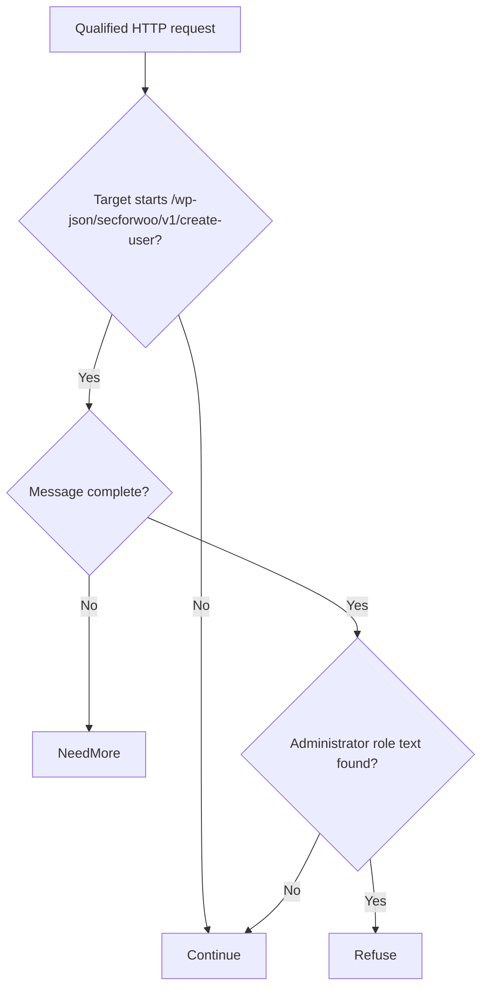

# Security For WooCommerce unauth admin creation (CVE-2026-100109)

[Source and API bundle](../../cve/CVE-2026-100109/README.md)

*[cve.now](https://cve.now/CVE-2026-100109) entry.*

Eden terminates the HTTP connection to the affected product. The tier-2 module
built for this case is **recorded here with its package-import refusal**: the
import of the produced package was refused deterministically with
`E1A07` (Native artifact compatibility or provenance refused), while the
**same module bytes and manifest upload successfully through the raw
native-artifacts route** (201) and pass every closed-profile check
(single-symbol ELF namespace, no extra dynamic symbols). This divergence
between two documented import paths for identical artifacts is recorded as a
**suspected product defect** (roadroad item), not a module problem. Tier-1
evidence is complete and recorded.

**Status: live tier-1 evidence recorded 2026-11-11 on the installed `eden-product-release:1.103.0-single` lab container (image `sha256:809293e1f0b525ac04698d1fa8d7ffdc66cbee1ff690b082ba26b4d050f08416`); tier-2 withheld pending the E1A07 import anomaly (11 of 13 sibling modules with identical structure imported cleanly).**

## The vulnerability

The plugin (1.0.10-1.0.16) creates users from an unauthenticated action
with a caller-chosen role, up to administrator, enabling site takeover.

## The Eden patch

**Tier 1 — declarative policy (blunt, fail-closed):** `deny` on the affected
route family — measured live: the attack probe is refused 403 with zero
backend effects, and the benign probes document the false positives.

**Tier 2 — native module (built, import refused):** `gabriel_woouser_v1`
(refuses administrator-role markers in unauthenticated user-creation bodies) compiled cleanly under the documented closed-calls recipe
(single-symbol namespace verified via `readelf`). The package import was
refused with `E1A07` on every attempt; the raw-artifact upload of the same
bytes and manifest succeeds. Evidence of both is retained in the run logs.

## What was verified anyway

- Baseline (unprotected): the attack probe reaches the fixture and fires its
  marker effect; benign probes pass.
- Tier-1 (route deny): attack refused 403, zero backend effects; benign rows
  show the documented restriction.
- The module binary passes every closed-profile check that can be applied
  without admission.

## Honest scope

This study does not claim tier-2 protection. The vendor's fixed release
remains the durable repair. The E1A07 divergence is reproducible and was
reported for the product roadmap.

## Evidence appendix

- [cve.now entry](https://cve.now/CVE-2026-100109)
- Run logs: `gabriel-2026-11-11/logs/woouser-module.log`
- Deployment: installed `eden-product-release:1.103.0-single` lab container
- Skill: [eden-vulnerability-remediation](../deployment.md)


## Decision flow



The diagram sketches the available source’s content decision after input metadata is available. Continue is a module decision; the host and backend still determine final forwarding and effects. This candidate was not activated: package import failed.

## Complete native module source

The complete available source for `gabriel_woouser_v1` is reproduced below from the reviewed repository snapshot. The source SHA-256 is `23e7dd90c0b7ea47b2463748030d46458ac7a686763b61032d2685f9c0d758bf`. This identifies the source bytes, rather than independently proving the binary build or the recorded test results. The case’s experiment status and limitations still apply, including any failed import, partial coverage, or withdrawn claim. Original source comments are preserved verbatim.

```rust
//! Gabriel module: refuse unauthenticated administrator-role user creation (CVE-2026-100109 shape)
//!
//! CVE-2026-100109: Security For WooCommerce creates users from an
//! unauthenticated action with a caller-chosen role, up to administrator.
//! This module refuses user-creation bodies carrying the
//! administrator role marker; ordinary role values pass unchanged. no_std; no allocator, storage, background work or state.

#![no_std]

use core::mem::size_of;
use core::panic::PanicInfo;
use eden_gateway_remediation::message::{Availability, MessageInput};
use eden_gateway_remediation::module::{
    ApiHeader, CONTINUE, Decision, EDIT, EditSink, Edits, Failure, ModuleOutput, NEED_MORE, REFUSE, RemediationModule,
};
use eden_gateway_remediation::native_http_v3::{self as http, Api, Input, Request};

/// Route prefix in scope.
const ROUTE: &[u8] = b"/wp-json/secforwoo/v1/create-user";

/// The byte primitives this module refuses on that route.
static NEEDLES: [&[u8]; 1] = [b"administrator"];


fn find_ignore_case_vol(haystack: &[u8], needle: &[u8]) -> Option<usize> {
    if haystack.len() < needle.len() || needle.is_empty() {
        return None;
    }
    let mut i = 0usize;
    while i + needle.len() <= haystack.len() {
        let mut j = 0usize;
        let mut same = true;
        while j < needle.len() {
            let h = unsafe { core::ptr::read_volatile(&haystack[i + j]) };
            let n = unsafe { core::ptr::read_volatile(&needle[j]) };
            if h.to_ascii_lowercase() != n.to_ascii_lowercase() {
                same = false;
                break;
            }
            j += 1;
        }
        if same {
            return Some(i);
        }
        i += 1;
    }
    None
}

fn find(haystack: &[u8], needle: &[u8]) -> Option<usize> {
    if haystack.len() < needle.len() || needle.is_empty() {
        return None;
    }
    let mut i = 0usize;
    while i + needle.len() <= haystack.len() {
        let mut j = 0usize;
        let mut same = true;
        while j < needle.len() {
            if haystack[i + j] != needle[j] {
                same = false;
                break;
            }
            j += 1;
        }
        if same {
            return Some(i);
        }
        i += 1;
    }
    None
}

fn find_ignore_case(haystack: &[u8], needle: &[u8]) -> Option<usize> {
    if haystack.len() < needle.len() || needle.is_empty() {
        return None;
    }
    let mut i = 0usize;
    while i + needle.len() <= haystack.len() {
        let mut j = 0usize;
        let mut same = true;
        while j < needle.len() {
            if haystack[i + j].to_ascii_lowercase() != needle[j].to_ascii_lowercase() {
                same = false;
                break;
            }
            j += 1;
        }
        if same {
            return Some(i);
        }
        i += 1;
    }
    None
}

struct gabriel_woouser_v1;

impl RemediationModule<Request<'_>> for gabriel_woouser_v1 {
    fn evaluate(&self, request: &Request<'_>, edits: &mut Edits<'_>) -> Result<Decision, Failure> {
        let _ = edits;
        let _ = match request.header_count() {
            Availability::Ready(count) => count,
            Availability::NeedMore => return Ok(Decision::NeedMore),
            Availability::Unavailable => return Err(Failure),
        };
        let message = request.message();
        let head = message.prefix();
        let line_end = head.iter().position(|&b| b == b'
').unwrap_or(head.len());
        let request_line = &head[..line_end];
        let path_at = request_line.iter().position(|&b| b == b' ').unwrap_or(request_line.len());
        let target = &request_line[path_at + 1..];
        // Volatile byte loop: a long constant route makes LLVM lower
        // starts_with to memcmp/bcmp, whose dynamic import the closed
        // single-symbol ELF namespace refuses (E1A30).
        let mut k = 0usize;
        let mut matched = target.len() >= ROUTE.len();
        while matched && k < ROUTE.len() {
            let a = unsafe { core::ptr::read_volatile(&target[k]) };
            let b = unsafe { core::ptr::read_volatile(&ROUTE[k]) };
            if a != b {
                matched = false;
            }
            k += 1;
        }
        if !matched {
            return Ok(Decision::Continue);
        }
        if !message.is_complete() {
            return Ok(Decision::NeedMore);
        }
        let body_range = match request.body_range() {
            Availability::Ready(range) => range,
            Availability::NeedMore => return Ok(Decision::NeedMore),
            Availability::Unavailable => return Err(Failure),
        };
        let body = match message.bytes(body_range)? {
            Availability::Ready(bytes) => bytes,
            Availability::NeedMore => return Ok(Decision::NeedMore),
            Availability::Unavailable => return Err(Failure),
        };
        if NEEDLES.iter().any(|n| find_ignore_case_vol(body, n).is_some()) {
            return Ok(Decision::Refuse);
        }
        Ok(Decision::Continue)
    }
}

static API: Api = Api {
    header: ApiHeader { version: http::VERSION, table_size: size_of::<Api>() as u32 },
    input_size: size_of::<Input>() as u32,
    output_size: size_of::<ModuleOutput>() as u32,
    sink_size: size_of::<EditSink>() as u32,
    message_size: size_of::<MessageInput>() as u32,
    state_bytes: 0,
    capabilities: CONTINUE | REFUSE | NEED_MORE | EDIT,
    required_inputs: 0,
    evaluate: Some(evaluate),
};

unsafe extern "C" fn evaluate(input: *const Input, sink: *const EditSink, output: *mut ModuleOutput) -> i32 {
    unsafe { http::invoke(&gabriel_woouser_v1, input, sink, output) }
}

#[unsafe(no_mangle)]
pub extern "C" fn eden_http_remediation_v3() -> *const Api {
    &API
}

#[panic_handler]
fn panic(_information: &PanicInfo<'_>) -> ! {
    loop {
        core::hint::spin_loop();
    }
}
```
