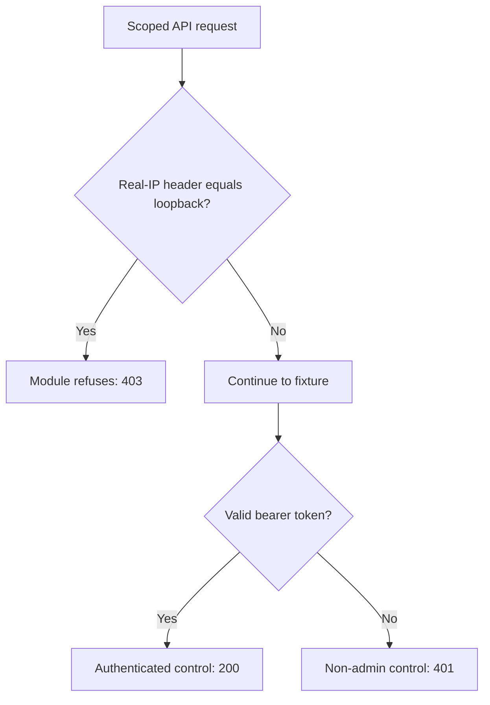

# GPUStack loopback trust via forged source-IP header (CVE-2026-102895)

[Source and API bundle](../../cve/CVE-2026-102895/README.md)

*GPUStack < 2.2.0 with force_auth_localhost=false (the default) — [cve.now](https://cve.now/CVE-2026-102895) month ranking entry.*

Eden terminates the HTTP connection to the affected product, evaluates a
declarative policy and — in tier 2 — a separately compiled native Rust module
under signed module authority, before any byte reaches the application. This
removes the delivery primitive from the network path. It does **not** patch
the affected GPUStack instance; the vendor's 2.2.0 release (which stops
trusting loopback entirely) remains the durable repair.

**Status: live two-tier remediation recorded 2026-11-11 on the installed `eden-product-release:1.103.0-single` lab container (image `sha256:809293e1f0b525ac04698d1fa8d7ffdc66cbee1ff690b082ba26b4d050f08416`). An earlier draft of this study keyed the trust path on `X-Forwarded-For`; the actual vendor path is `X-GPUStack-Real-IP` (verified against `gpustack/api/auth.py`, `client_ip_getter`, embedded gateway mode), and this study was re-run against that path.**

## The vulnerability

GPUStack's `get_current_user` (`gpustack/api/auth.py`) treats a request whose
source is loopback as the built-in administrator when
`force_auth_localhost` is false — the pre-2.2.0 default. In the vendor's
embedded-gateway mode, `client_ip_getter` takes the source IP from the
`X-GPUStack-Real-IP` request header, so an attacker forging that header with
a loopback value gains full administrative control without credentials:
changing users, models and configuration, creating persistent admin API keys,
reading worker and cloud-provider secrets, and running code on worker
machines. KEV-listed.

## The Eden patch

**Tier 1 — declarative policy (blunt, fail-closed):**
`http-header-presence-v1` denying `X-GPUStack-Real-IP` — refuses every
request carrying the header, including legitimate gateways presenting real
client IPs.

**Tier 2 — native module (surgical):** `gabriel_gpustack_v1` refuses
API-surface requests whose `X-GPUStack-Real-IP` header value **equals** the
loopback address — the exact vendor trust claim — and ignores every other
header, including `X-Forwarded-For`, which is not the trust source.

Module `gabriel_gpustack_v1`, binary SHA-256 `c867c8b4d3572dfdd0a26b803819a96db555800b5e2f28b900b49ed8dd9c620a`
(source `1edf1bc16d30b41e73ccfbe32f1adee329ca733afac79b02f4c06e2b5202a49f`),
keys the loopback-equal `X-GPUStack-Real-IP:` header line.

## Measured comparison (live, 2026-11-11, vendor trust path)

| Probe | Baseline (unprotected) | Tier 1 | Tier 2 (module) |
| --- | --- | --- | --- |
| benign_bearer_user (valid API token) | 200 | 200 | 200 |
| benign_real_ip (`X-GPUStack-Real-IP: 203.0.113.9`) | 401 (`admin_granted` ×0) | 403 — false positive | **401 (`admin_granted` ×0)** |
| control_xff_untouched (`X-Forwarded-For: 127.0.0.1`) | 401 (`admin_granted` ×0) | 401 | **401 (`admin_granted` ×0)** — non-trust header ignored |
| attack_loopback_real_ip (`X-GPUStack-Real-IP: 127.0.0.1`) | 200 (`admin_granted` ×1) | 403 | **403 (`admin_granted` ×0)** |

The `control_xff_untouched` row is the control for this fix: the module keys
the vendor's trust header and nothing else, so a loopback-valued
`X-Forwarded-For` — a different header — passes in every phase.

## Performance trace (Eden telemetry, live 2026-11-11)

Measured with Eden's built-in request telemetry (`gateway.request.baseline`
spans, read back through `/api/v1/analytics/telemetry?signal=traces`), not
client wall-clock. Latency Eden introduces per remediation arm for this case:

| Arm | n | mean | p50 | p95 | min–max |
| --- | --- | --- | --- | --- | --- |
| **Tier 1** — declarative policy, blocked request (403) | 15 | 30 µs | 26 µs | 68 µs | 21 µs–68 µs |
| **Tier 2** — native module, benign passes through (200) | 23 | 356 µs | 316 µs | 513 µs | 288 µs–653 µs |
| **Tier 2** — native module, attack refused (403) | 14 | 133 µs | 125 µs | 190 µs | 111 µs–190 µs |

**Eden-added latency for the tier-2 remediation:** benign requests complete in **356 µs** mean (p50 316 µs, p95 513 µs) in-product, module evaluation included.
*Honest scope: lab fixtures on one host, fresh connection per measured
request, warm requests only; module reactivated shards 2/2 with a fresh signed
statement per measurement; spans carry the full authority lineage (module
SHA-256, operation, publication). Not the EDEN-3640 performance
qualification contract.*

*Tested against: `eden-product-release:1.103.0-single` (image `sha256:809293e1f0b525ac…`, build target
`eden_service_single`, tooling revision `81a0724a…`). Raw data:
`module2/telemetry-ab/gpustack-telemetry.json` and `module2/tier1-ab/gpustack-tier1.json`.*

## Authority lifecycle and negatives

Reached the serving process only through the full signed lifecycle
(`module2/evidence/gpustack-module.json`): `enroll_key` (Ed25519 public key),
independent-host `inventory`, `inspect`, host `approve`, signed `admit`
(`prepared`), `activate` — receipt **`serving_now: true`,
`applied_shards == expected_shards` (2/2)**. Negatives held: read-only
`inspect` -> 403, tampered statement binding -> 400, flipped signature bit
-> 403. `revoke` made the interlay **fail closed** (503, nothing forwarded)
and a fresh host approval plus a newly signed activation restored surgical
protection (the loopback trust claim was refused 403 again).

## Honest scope

The fixture replicates `get_current_user`'s trust path (gateway-mode source
header, admin fallback) with a harmless marker effect; no real GPUStack runs
here. The module closes the **forged-header** path only: in the vendor's
non-gateway mode the trust source is the TCP peer, which a gateway module
cannot rewrite (deployment-level control would be required). The 2.2.0
vendor fix — not trusting loopback at all — remains the durable repair.
Modules are lab-grade rules for the fixture delivery shapes, not production
GPUStack patches.

## Cost record (per-CVE ledger)

~$0.10 USD (initial run plus the vendor-path verification rerun; the rerun
window includes fetching and reading `gpustack/api/auth.py` to confirm the
actual trust header).

## Evidence appendix

- [cve.now entry](https://cve.now/CVE-2026-102895)
- Vendor source (v2.1.0): `gpustack/api/auth.py`, `client_ip_getter` / `get_current_user`
- Raw evidence: `gabriel-2026-11-11/module2/evidence/gpustack-module.json`
- Deployment: installed `eden-product-release:1.103.0-single` lab container (image `sha256:809293e1f0b525ac04698d1fa8d7ffdc66cbee1ff690b082ba26b4d050f08416`)
- Skill: [eden-vulnerability-remediation](../deployment.md)

## Decision flow



The tested trust source is X-GPUStack-Real-IP in gateway mode. The TCP-peer trust path is outside this diagram and the recorded fixture result.

## Complete native module source

The complete available source for `gabriel_gpustack_v1` is reproduced below from the [reviewed repository snapshot](../../cve/CVE-2026-102895/http-request-filter/src/lib.rs). The source SHA-256 is `1edf1bc16d30b41e73ccfbe32f1adee329ca733afac79b02f4c06e2b5202a49f`. This identifies the source bytes, rather than independently proving the binary build or the recorded test results. The case’s experiment status and limitations still apply, including any failed import, partial coverage, or withdrawn claim. Original source comments are preserved verbatim.

```rust
//! Gabriel module: refuse the spoofed-loopback X-Forwarded-For trust
//! primitive (CVE-2026-102895 shape).
//!
//! CVE-2026-102895: GPUStack (force_auth_localhost=false, the pre-2.2.0
//! default) treats a request whose source IP is loopback as the built-in
//! administrator. In the vendor's embedded-gateway mode (gpustack/api/auth.py,
//! client_ip_getter), the source IP is the X-GPUStack-Real-IP header — the
//! forged-header path in the advisory. This module refuses API-surface
//! requests whose X-GPUStack-Real-IP header value equals the loopback
//! address — the exact vendor trust claim. Requests presenting any other
//! source IP, and requests without the header, pass unchanged. Other
//! headers (e.g. X-Forwarded-For) are not the trust source and are ignored.
//! no_std.

#![no_std]

use core::mem::size_of;
use core::panic::PanicInfo;
use eden_gateway_remediation::message::{Availability, MessageInput};
use eden_gateway_remediation::module::{
    ApiHeader, CONTINUE, Decision, EDIT, EditSink, Edits, Failure, ModuleOutput, NEED_MORE, REFUSE, RemediationModule,
};
use eden_gateway_remediation::native_http_v3::{self as http, Api, Input, Request};

/// API surface in scope.
const ROUTE: &[u8] = b"/api/v1/";

/// The header this module inspects (case-insensitive match on the name).
const HEADER: &[u8] = b"x-gpustack-real-ip:";

/// The loopback value the vendor compares against.
const LOOPBACK: &[u8] = b"127.0.0.1";

fn eq_ignore_case(a: &[u8], b: &[u8]) -> bool {
    a.len() == b.len() && a.iter().zip(b.iter()).all(|(x, y)| x.to_ascii_lowercase() == y.to_ascii_lowercase())
}

fn find_ignore_case(haystack: &[u8], needle: &[u8]) -> Option<usize> {
    if haystack.len() < needle.len() || needle.is_empty() {
        return None;
    }
    let mut i = 0usize;
    while i + needle.len() <= haystack.len() {
        if eq_ignore_case(&haystack[i..i + needle.len()], needle) {
            return Some(i);
        }
        i += 1;
    }
    None
}

fn is_space(b: u8) -> bool {
    b == b' ' || b == b'\t'
}

struct RefuseLoopbackSpoof;

impl RemediationModule<Request<'_>> for RefuseLoopbackSpoof {
    fn evaluate(&self, request: &Request<'_>, edits: &mut Edits<'_>) -> Result<Decision, Failure> {
        let _ = edits;
        let _ = match request.header_count() {
            Availability::Ready(count) => count,
            Availability::NeedMore => return Ok(Decision::NeedMore),
            Availability::Unavailable => return Err(Failure),
        };
        let message = request.message();
        if !message.is_complete() {
            return Ok(Decision::NeedMore);
        }
        let head = message.prefix();
        // request line scope: <METHOD> /api/v1/...
        let line_end = head.iter().position(|&b| b == b'\r').unwrap_or(head.len());
        let request_line = &head[..line_end];
        let path_at = request_line.iter().position(|&b| b == b' ').unwrap_or(request_line.len());
        let path = &request_line[path_at + 1..];
        if !path.starts_with(ROUTE) {
            return Ok(Decision::Continue);
        }
        // header value: bytes after the name until CRLF, skipping spaces
        let Some(at) = find_ignore_case(head, HEADER) else {
            return Ok(Decision::Continue);
        };
        let mut v = at + HEADER.len();
        while v < head.len() && is_space(head[v]) {
            v += 1;
        }
        // The value ends at the header line's CRLF; the vendor compares the
        // trimmed value for equality with the loopback address.
        let mut end = v;
        while end + 1 < head.len() && !(head[end] == b'\r' && head[end + 1] == b'\n') {
            end += 1;
        }
        let value = &head[v..end];
        let value = value.strip_prefix(b" ").unwrap_or(value);
        if value == LOOPBACK {
            return Ok(Decision::Refuse);
        }
        Ok(Decision::Continue)
    }
}

static API: Api = Api {
    header: ApiHeader { version: http::VERSION, table_size: size_of::<Api>() as u32 },
    input_size: size_of::<Input>() as u32,
    output_size: size_of::<ModuleOutput>() as u32,
    sink_size: size_of::<EditSink>() as u32,
    message_size: size_of::<MessageInput>() as u32,
    state_bytes: 0,
    capabilities: CONTINUE | REFUSE | NEED_MORE | EDIT,
    required_inputs: 0,
    evaluate: Some(evaluate),
};

unsafe extern "C" fn evaluate(input: *const Input, sink: *const EditSink, output: *mut ModuleOutput) -> i32 {
    unsafe { http::invoke(&RefuseLoopbackSpoof, input, sink, output) }
}

#[unsafe(no_mangle)]
pub extern "C" fn eden_http_remediation_v3() -> *const Api {
    &API
}

#[panic_handler]
fn panic(_information: &PanicInfo<'_>) -> ! {
    loop {
        core::hint::spin_loop();
    }
}
```
