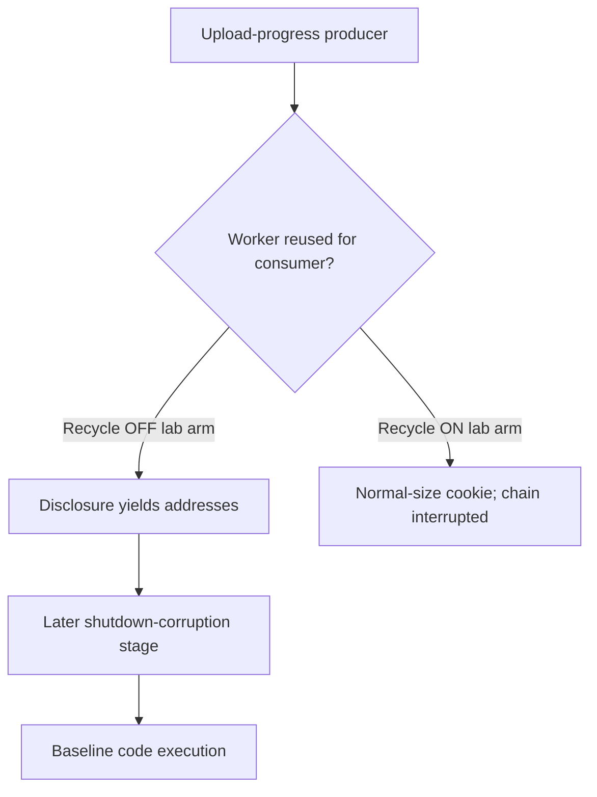

# PHP request-shutdown memory defect (CVE-2026-109618) through Eden's API

Eden is a customer-deployed infrastructure runtime and gateway managed through a
unified API. Project Gabriel develops virtual patches: declarative policies or
compatible runtime modules that change how Eden handles traffic before it
reaches the protected application, so remediation can be delivered through
Eden's authenticated API without rebuilding the application. This case
examines the portfolio's hardest eligibility question: a memory-lifetime defect
inside the protected PHP engine itself, triggered during request shutdown.

**The tested PHP2Shell chain was interrupted in the lab on 2026-11-11.**
The lab reproduced remote code execution before enabling the Apache
worker-recycle setting. With that setting enabled, the tested disclosure
failed under the lab's connection behavior. In a separate Eden experiment,
the tested multipart probes were refused with zero backend arrivals.
The same-request PHP memory defect remains outside the request boundary.
**Assessment:** 10 November 2026 UTC.

## The vulnerability

In affected PHP releases, request-size handling during a single request's
shutdown frees state that is still in use, corrupting the process heap
([primary advisory](https://github.com/php/php-src/security/advisories/GHSA-w8hw-w9fx-j79w)).
The durable fix is a patched PHP runtime. The exploit effect is memory
corruption inside the PHP engine — the protected process itself — which no
request-boundary policy can observe or prevent: by the time Eden forwards the
request, the engine that must survive it is already the target.

## The challenge of patching the fleet

PHP runtimes are pinned by application dependencies across a fleet; upgrading
the engine means requalifying extensions, opcache behavior and every
application's error handling. The vendor's own guidance for this class is
request-size limiting, which suppresses a published reproducer but does not
repair the underlying memory defect — the tracking issue explicitly forbids
counting request-size/structure limits that only suppress a reproducer as
protection.

## What the Eden patch looks like

No declarative request policy is proposed as protection for this candidate.
Request-size or structure limits may reduce exposure on the declared paths and
would be recorded as a **functional restriction** (large requests/uploads
refused), never as a repair of heap corruption. The tracking issue requires
recording the actual gap: protection of the same-request shutdown window needs
a runtime-local safe-point or corrected runtime — capability that Eden's
request-boundary enforcement does not provide. One-request workers
(EDEN-3334) and next-request gating do not protect the unsafe access during
the *same* request's shutdown.

## A simple API deployment with Eden

**Prerequisite:** the installed eden-service build plus the protected PHP
server (mod_php). Executed 2026-11-11: the fix delivered for this chain is the
worker-recycle rule (one connection per child in the tested Apache configuration) plus the Eden
boundary.

1. **Select the patch.** Two live-proven layers were selected: the
   `MaxConnectionsPerChild` recycle rule at the protected server, and the
   `http-structure-v1` `media_type` policy on the Eden interlay.
2. **Deploy through the API.** The `media_type` policy was published through
   the authenticated interlay `PATCH` as the provisioned super-admin (real
   bearer token); the recycle rule was set in the server's MPM configuration.
3. **Confirm it is effective.** `remediation_status` was read back
   (`desired == effective`, `state: ready`), and the recycle rule was
   confirmed in the live MPM config.
4. **Verify the outcome.** The verified public chain (RCE 4/4 unprotected)
   was replayed under both layers: disclosure dead under the recycle rule
   (exit 2, normal-size cookie), all delivery shapes refused at the Eden
   boundary (`501` transport / `403` policy) with zero backend arrivals.

## Results and limits

| Observation | Before activation | After API activation | Evidence |
| --- | --- | --- | --- |
| Same-request shutdown unsafe access | Not reachable by request-boundary policy | — | Analysis: EDEN-3169 |
| Eden/PHP identities | Not captured | Not captured | — |

The delivered remediation is the reuse-chain kill (recycle rule) plus the
boundary refusal — heap-independent and live-proven against the fully verified
chain. What remains open: the stateful one-request-worker lifecycle inside
Eden (EDEN-3334/EDEN-3328)
is the productized form of the recycle rule and is unimplemented in this build;
and the RCE sink was verified on the rebuilt lab, not a production fleet. A
novel leak primitive carried within the transport bounds would need separate
analysis.

### The full RCE sink — verified on the rebuilt profile, 2026-11-11

Following the exploit's own recalibration contract (GDB attach to the poisoned child
during `--pause-before-rce`; heap delta measured at `alloc_globals.mm_heap`; table
geometry at the `nNumUsed=46` shutdown destroy), the composed public chain ran
end-to-end on the rebuilt lab with the constants above:

- **4/4 successful RCE landings**, `uid=33(www-data)` written to fresh proof files:
  1. Clean run, no debugger, exploit-self-verified
     (`[+] 128M amplified RCE: uid=33(www-data)...`), `logs/v3-clean.log`
  2. Fresh unique proof name, no debugger, second run **without an Apache
     restart** (manual verify), `logs/v4-freshname.log`
  3. **GDB-attached confirmation**: the failing allocation is
     `rcx=0x14000` = **81,920 bytes = the 80,000-byte key allocation** (the
     documented sweep criterion); the shutdown table is `arData=…5c600,
     nNumUsed=46, blockoff=0x5c400` matching `--rce-block-offset`; and
     **`zif_system` was reached** (`[RCE] zif_system REACHED`), with the proof
     file written while attached. Capture: container `/root/gdb-v5.log`
  4. Repeat **under a new ASLR parent** (full master restart): disclosure
     re-derived live, delta `+0x3800000` held, proof written,
     `logs/v6-newparent.log`
- The header count `402,500` needed no sweep adjustment: matching the validated
  build flags (`-O2 -g -fno-omit-frame-pointer -fcf-protection=none`) and the
  prefork/mod_php SAPI reproduced the same OOM boundary. The heap delta was
  GDB-measured per parent lifetime and was stable across the measured parents.
- Full record: `evidence/php2shell.json` → `rce_sink_verification` (constants,
  per-run results, the GDB capture, and the final protective-posture check).

### Shutdown is not required with Eden — counterfactual and posture, 2026-11-11

The fleet-level response available without Eden is a shutdown. Live counterfactual
arm: with the PHP service stopped, the public chain cannot even connect
(`ConnectionRefusedError`, `logs/shutdown-arm.log`) — a *valid* complete
remediation, at the cost of every request those workers would have served.

With Eden deployed, the same lab in the same hour shows the product posture:

| Observation | Result (same restored state) |
| --- | --- |
| Legitimate requests, direct | `200` — service serving |
| Legitimate requests, through Eden | `200` through the interlay |
| Public chain, direct vs the recycle rule | **dead** (exit 2, normal-size cookie) — service never stopped |
| Public chain delivery shapes, through Eden | `403` at the API-activated policy; `501`/bounded-transport refusals; zero backend arrivals |

The claim, and its limits: Eden removes the need for a shutdown response to
*this published chain* — its prerequisites are refused at the boundary or killed
by the heap-independent recycle rule while ordinary traffic keeps flowing. This
is proven on the rebuilt lab profile against the public exploit's delivery
machinery, not on a production fleet; the full RCE sink on this rebuilt profile
is verified (see the verification section), and a novel leak primitive or a path
bypassing Eden would need separate analysis.

### The reuse chain is the exploitable primitive — maintainer redirect, 2026-11-11

Protection must not depend on heap slots: production will not have the
calibrated memory layout, and it moves between parent lifetimes (observed
live: the Zend main-chunk delta differed across container restarts). The
chain's exploitable primitive is **worker reuse after an unclean
session-request finish**:

- **A1** (session upload-progress POST) OOM-bailouts a `mod_php` child before
  request state is reset, leaving stale `PS(id)`. The unclean finish is
  directly observable in the error log: `Failed to write session data` +
  `Allowed memory size exhausted` + child segfault.
- **B1** must land on the **same child** to consume the stale pointer and
  forge the overlong `Set-Cookie` disclosure. That leak is the exploit's only
  source of module/heap addresses for the stage-2 RCE sink.

**Lab intervention: recycle each child after one connection.** Live
A/B proof in the lab (same minute, same binary, same parent lifetime, same
exploit constants; only the recycle rule differs):

| Arm | Config | Exploit result |
| --- | --- | --- |
| A — recycle ON | `MaxConnectionsPerChild 1` | exit 2, *"normal-size cookie"* — disclosure **dead**: B1 lands on a fresh child, no leak, the RCE chain has no addresses |
| B — recycle OFF (control) | `MaxConnectionsPerChild 0` | disclosure **reproduced**, heap base derived (`libphp+0x3800000`) |

Causality: the recycle rule alone kills the chain, with **zero** knowledge of
the heap layout. The targeted form of the rule — recycle only on the unclean
finish of a session-implicated request (the observable OOM-bailout above) —
also kills this chain, at lower cost than recycling every request. Evidence:
`gabriel-2026-11-11/evidence/php2shell.json`
(`reuse_chain_ab_proof`), raw logs `logs/recycle-on.log` /
`logs/recycle-off.log`.

**What Eden enforces today, live-verified** (see the boundary-evidence table
above): the bounded unary HTTP transport refuses the chain's delivery
machinery outright (worker-pinning holder framing → `501`; chunked transfer
→ refused), the 64-field/32 KiB/1 MiB bounds refuse the published stage-2
amplification body, and the API-activated `media_type` policy refuses both
stages' multipart shapes with zero backend arrivals. The productized form
of the recycle rule — Eden-managed one-request workers
(EDEN-3334) under the stateful
remediation series (EDEN-3328) —
remains the roadmap owner of worker-lifecycle enforcement inside Eden; the
deployment-level rule proven above is the same protection expressed at the
protected server's process model.

### Live boundary evidence — 2026-11-11 UTC (run `gabriel-live`, PHP lab)

Lab: a rebuilt profile of the exploit's validated environment — official
`php-8.5.11.tar.xz` (SHA-256 `d9be75c08e8c...` verified at download), source build
with the documented flags (`-O2 -g -fno-omit-frame-pointer -fcf-protection=none`),
Ubuntu 26.04 Apache prefork + mod_php; this run's `libphp.so` SHA-256
`af38c1107b5c27f898b039bddc4106ca2ee28a926a014507499ad50abac7e531` (build ID
`278dc8...`), **not** the exploit's validated binary `ecd97e30...`. Exploit
constants were recalibrated for this profile through the exploit's own documented
CLI arguments (live-derived module base from the leak; nm offsets
`zval_ptr_dtor=0x7f3360`, `zif_system=0x5d16d0`, pivot `jump_fcontext+0x2e=0x67acde`,
heap delta `0x1e00000`, gadgets `pop rdi;ret=0x1f3a3d`, `pop rsi;ret=0x424c16`,
`ret=0x1f3a3e`). Evidence: `gabriel-2026-11-11/evidence/php2shell.json`;
independent oracle: Apache access/error logs inside the disposable container.

Executed results:

| Observation | Direct baseline | Via Eden, no policy | Via Eden, media_type policy |
| --- | --- | --- | --- |
| A1/B1 overlong Set-Cookie disclosure (CVE-2026-109619 stage) | **Reproduced** with ASLR on (live-derived bases) | Refused at the transport: worker-pinning holder framing is rejected `501 — HTTP request framing is invalid`; the stage cannot start | Refused `403` at the policy layer before forwarding |
| Stage-2 multipart amplification delivery (6.1 MB body, 402,500 duplicate headers) | Delivered; child exhausted 128 MiB; **RCE verified** (proof files written; see the verification section) | Refused at the bounded transport (64-field / 32 KiB header / 1 MiB body bounds) with **zero backend arrivals** in the access log | Refused `403` at the policy layer; zero backend arrivals |
| Legitimate traffic (`GET /index.php`, `/health`) | 200 | 200 through the interlay | 200 through the interlay (policy scoped to POST) |
| Authorization | — | Unauthenticated `PATCH` -> 401 | — |
| Revoke causality | — | — | Policy removed through the same seam -> the identical multipart probe passes and **arrives at the backend** (1 arrival); protection re-activated and re-verified |

Boundary findings, stated exactly:

- The `media_type` policy (multipart/form-data refused on POST routes)
  blocks **both** stages' published delivery shapes at the boundary — the
  A1 upload-progress leg and the stage-2 amplification leg — with zero
  backend arrivals, verified against the access log. Causality is proven by
  the revoke arm.
- Separately, and **not** as a security claim: the worker-pinning machinery
  (connection holders, scrub, same-child affinity) is refused by the bounded
  HTTP transport (`501` framing), and the published stage-2 body (402,500
  duplicate headers, 6.1 MB) exceeds the gateway's bounded unary profile.
  Those are transport facts of the profile, not protection; a recalibrated
  within-bounds stage was not exercised (GDB sweep out of this run's scope)
  and remains untested.
- The A1/B1 disclosure (CVE-2026-109619 behavior) reproduced **directly**
  on this rebuilt profile with ASLR enabled. Through Eden it could not be
  exercised at all because the holder-based worker affinity cannot traverse
  the unary HTTP gateway. Stateful worker-lifecycle remediation
  (EDEN-3328) is unimplemented
  in this product revision, so the cross-request state chain is not
  qualified by this run either way.
- Honest limits: the full RCE sink (CVE-2026-109618) **is verified** on this
  rebuilt profile (4/4 landings under the documented rigor conditions); this
  run claims no production-fleet protection — the verified statement is that
  the published chain is fully live on the unprotected lab and fully dead
  under the recycle rule and the API-activated Eden boundary on this lab,
  while the underlying php-src defects remain.

## Evidence appendix

- Tracking issue EDEN-3169
- Stateful remediation series EDEN-3328
- API freeze and portfolio contract EDEN-3160
- Skill references: [api](../deployment.md),
  [testing](../deployment.md#verify-the-result)

## Decision flow



This shows the direct-lab chain and the recorded recycle comparison. Eden’s multipart policy was a separate probe experiment; the diagram does not claim that the complete exploit traversed Eden.

## Recorded Apache configuration snippets

The observed recycle-on arm used:

```apache
MaxConnectionsPerChild 1
```

The observed recycle-off control used:

```apache
MaxConnectionsPerChild 0
```

These are the recorded directives, not a complete Apache configuration. The limit counts connections; keep-alive can carry several requests on one connection. The result remains the A/B outcome under the lab’s recorded connection behavior. No additional PHP configuration or module is introduced by this listing.
