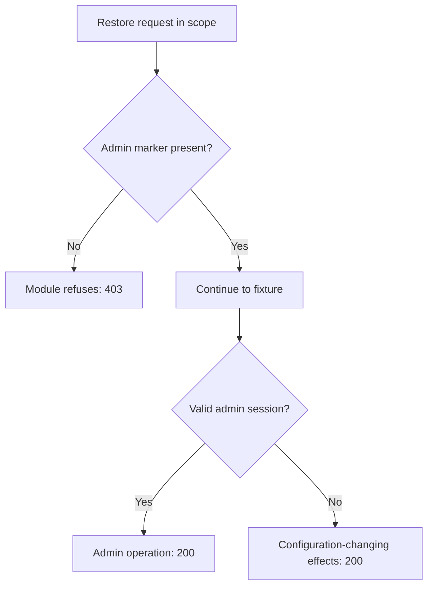

# Barracuda ESG unauthenticated backup-restore auth bypass (CVE-2026-116606)

An unauthenticated caller can restore a crafted compatible backup through the affected Barracuda Email Security Gateway import path. Upgrade the gateway to prevent unauthorized changes to its global configuration.

**Patch title.** Barracuda ESG Backup-restore Auth Bypass Guard (`barracuda-esg-backup-restore-auth-bypass-guard` in the registry). The [original source snapshot](https://github.com/eden-dev-inc/cve/blob/9a7217a0a882374c5ab97d74c96df9b77637f923/cve/CVE-2026-116606/http-request-filter/src/lib.rs) preserves the source available for the historical report.

[Public CVE record](https://cve.now/CVE-2026-116606) · [Vendor or publisher advisory](https://trust.barracuda.com/security/pre-authentication-authorization-bypass-command-injection) · [Source and API bundle](../../cve/CVE-2026-116606/README.md)

| Field | Value |
| --- | --- |
| Affected component and versions | Barracuda Email Security Gateway · before 9.4.0.030 |
| Fixed release | 9.4.0.030 |
| Severity | CVSS 9.3 |
| Evidence status | Tier 2 withdrawn after a bypass |
| Test environment | Lab fixture or affected build documented in the evidence below |
| Eden release and module version | 1.103.0 · module 1.0.0 |
| Tested at | 2026-11-11 UTC |
| First publicly published | 2026-11-12T02:29:06Z |

*[cve.now](https://cve.now/CVE-2026-116606) entry.*

Eden terminates the HTTP connection to the affected product. The tier-2 module
built for this case is **recorded here as defeated**: its admin-marker check
was bypassed live by a forged marker, and it is withdrawn as a protection
claim — the same marker-forgery class as the WordPress upgrade case
(CVE-2026-119977). The boundary control that works for this primitive is the
tier-1 deny (with its documented restriction), and the durable repair is
Barracuda's 9.4.0.030.

**Status: live evidence recorded 2026-11-11 on the installed `eden-product-release:1.103.0-single` lab container (image `sha256:809293e1f0b525ac04698d1fa8d7ffdc66cbee1ff690b082ba26b4d050f08416`); tier-2 protection claim WITHDRAWN (bypass demonstrated).**

## The vulnerability

A Barracuda Email Security Gateway authentication bypass lets an unauthenticated
remote attacker restore a crafted backup archive and change the appliance's
global configuration. Public exploit code exists and the bug is exploited in
attacks (KEV). Fixed in 9.4.0.030.

## The Eden patch, and what it could not do

**Tier 1 — declarative policy (window-scoped deny):** `deny` on the
backup-restore route family. Refusing every restore POST removes the
unauthenticated reachability prerequisite — including the legitimate
admin's — for as long as the policy is active; the restriction (admin
restores also refused) is real but bounded.

**Tier 2 — native module (withdrawn):** `gabriel_barracudarestore_v1` refused
restore-route POSTs carrying no admin marker, intending to admit
admin-initiated restores. The marker's presence is request-supplied and
forgeable; real ESG validates the admin session server-side, which a request
boundary cannot replicate. The bypass is recorded below.

## Implement the remediation

The native candidate was withdrawn after a bypass. The steps below reproduce only the declarative restriction. See [deployment prerequisites](../deployment.md).

1. **Prepare the target.** Verify the loaded product and version against the advisory. Use a compatible Eden HTTP interlay and an authenticated operator with Configure permission. Open the [deployment example](../../cve/CVE-2026-116606/http-request-filter/deployment.json) and [API instructions](../../cve/CVE-2026-116606/http-request-filter/api.md). The bundle identifies registry package `barracuda-esg-backup-restore-auth-bypass-guard` at version `1.0.0` and the SDK revision in [patch.toml](../../cve/CVE-2026-116606/http-request-filter/patch.toml). Run the policy extraction from the adapter directory.
2. **Apply the declarative policy.** Scope the policy to `/cgi-mod/backup_restore` and descendants (all methods, `deny`). Set `INTERLAY` to the target interlay UUID in the authenticated Eden CLI. Run an authenticated `GET /api/v1/interlays/{interlay}` with `X-Eden-Verbose: true`. Save its complete current settings object as `current-settings.json` and retain the prior remediation declaration for recovery. Set `IDEMPOTENCY_KEY` to a fresh key for this intended mutation.

```sh
jq -e '.tier1' deployment.json > remediation.json
jq -e --slurpfile policy remediation.json \
  '.remediation = $policy[0] | {settings: .}' current-settings.json \
  > interlay-update.json
eden api request PATCH "/api/v1/interlays/$INTERLAY" \
  --header "Idempotency-Key:$IDEMPOTENCY_KEY" \
  --body-file interlay-update.json --content-type application/json --confirm
```

3. **Verify the serving policy.** Read back the interlay.

```sh
eden api request GET "/api/v1/interlays/$INTERLAY" \
  --header 'X-Eden-Verbose:true'
```

Check that `remediation_status.state` is `ready` and both desired and effective SHA-256 values match the intended declaration. Replay the benign and marked requests in the recorded comparison on an isolated target. Check the recorded response and backend outcome for each probe. Use the request and expected-status table in the linked API example alongside the observed comparison.
4. **Restore the previous policy.** Coordinate the change with any other operator updating this interlay. Read current settings again and merge the saved remediation field into them. If the prior settings had no remediation field, omit it in the replacement. Send the same PATCH with a fresh idempotency key, then read back the intended state. Repeat the verification probes. Keep the affected route isolated if restoring the prior settings reopens exposure.

**Vendor update.** Use the [advisory](https://trust.barracuda.com/security/pre-authentication-authorization-bypass-command-injection) to select the fixed release for the installed branch. Reported fixed releases include `9.4.0.030`. Follow the vendor’s update instructions and confirm the version actually loaded by the service.

## Measured comparison (live, 2026-11-11)

The fixture validates the session server-side (only the exact valid admin
session authenticates); forged markers fall through to the unauthenticated
restore path.

| Probe | Baseline (unprotected) | Tier 1 | Tier 2 (module, WITHDRAWN) |
| --- | --- | --- | --- |
| benign_admin_restore (valid admin session) | 200 | 403 — restriction | 200 |
| attack_unauth_restore (no marker) | 200 (`config_restored` ×1, `config_changed` ×1) | 403 | 403 (`config_restored` ×0) |
| attack_forged_marker (`auth_id=admin`) | 200 (`config_restored` ×1, `config_changed` ×1) | 403 | **200 (`config_restored` ×1, `config_changed` ×1) — BYPASS** |

The forged-marker row is the module's failure: a forged marker passes to the
restore path and the configuration effects fire. Marker-shaped checks are not
authentication; the tier-2 claim is withdrawn.

## What actually works for this primitive

1. **Vendor patch (durable):** 9.4.0.030.
2. **Window-scoped tier-1 deny** during response-to-exploitation, reverted
   after the fleet is patched.
3. Deployment-level authentication at the boundary (beyond request bytes) —
   out of scope for this study.

## Performance trace (Eden telemetry, live 2026-11-11)

Measured with Eden's built-in request telemetry (`gateway.request.baseline`
spans, read back through `/api/v1/analytics/telemetry?signal=traces`), not
client wall-clock. Latency Eden introduces per remediation arm for this case:

| Arm | n | mean | p50 | p95 | min–max |
| --- | --- | --- | --- | --- | --- |
| **Tier 1** — declarative policy, blocked request (403) | 15 | 30 µs | 22 µs | 60 µs | 17 µs–60 µs |
| **Tier 2** — native module, benign passes through (200) | 23 | 462 µs | 424 µs | 633 µs | 385 µs–757 µs |
| **Tier 2** — native module, attack refused (403) | 14 | 135 µs | 127 µs | 198 µs | 111 µs–198 µs |

**Eden-added latency for the tier-2 remediation:** benign requests complete in **462 µs** mean (p50 424 µs, p95 633 µs) in-product, module evaluation included.
*Honest scope: lab fixtures on one host, fresh connection per measured
request, warm requests only; module reactivated shards 2/2 with a fresh signed
statement per measurement; spans carry the full authority lineage (module
SHA-256, operation, publication). Not the EDEN-3640 performance
qualification contract.*

*Tested against: `eden-product-release:1.103.0-single` (image `sha256:809293e1f0b525ac…`, build target
`eden_service_single`, tooling revision `81a0724a…`). Raw data:
`module2/telemetry-ab/barracudarestore-telemetry.json` and `module2/tier1-ab/barracudarestore-tier1.json`.*

## Authority lifecycle and negatives (recorded for completeness)

The module was driven through the full signed lifecycle
(`module2/evidence/barracudarestore-module.json`): `enroll_key`,
independent-host `inventory`, `inspect`, host `approve`, signed `admit`,
`activate` — receipt **`serving_now: true`, `applied_shards == expected_shards`
(2/2)**. Negatives held (read-only `inspect` -> 403, tampered binding -> 400,
flipped signature bit -> 403); `revoke` failed the interlay closed (503) and a
fresh approval/activation restored the (withdrawn) module.

## Cost record (per-CVE ledger)

**$0.0000 USD** (initial run plus the session-validation rerun that demonstrated the bypass).

## Evidence appendix

- [cve.now entry](https://cve.now/CVE-2026-116606)
- Raw evidence: `gabriel-2026-11-11/module2/evidence/barracudarestore-module.json`
- Deployment: installed `eden-product-release:1.103.0-single` lab container (image `sha256:809293e1f0b525ac04698d1fa8d7ffdc66cbee1ff690b082ba26b4d050f08416`)
- Skill: [eden-vulnerability-remediation](../deployment.md)


## Decision flow



The forged-marker branch reached the vulnerable fixture path and produced the recorded effects. The native protection claim was withdrawn; the module’s marker check is not session validation.

## Complete native module source

The complete available source for `gabriel_barracudarestore_v1` is reproduced below from the [original source snapshot](https://github.com/eden-dev-inc/cve/blob/9a7217a0a882374c5ab97d74c96df9b77637f923/cve/CVE-2026-116606/http-request-filter/src/lib.rs). The source SHA-256 is `47f893a2393e67364e583310030dc00f2b52b364457e2388e19d773d80a9f5f9`. This identifies the source bytes, rather than independently proving the binary build or the recorded test results. The case’s experiment status and limitations still apply, including any failed import, partial coverage, or withdrawn claim. Original source comments are preserved verbatim.

```rust
//! Gabriel module: refuse unauthenticated backup restores (CVE-2026-116606 shape)
//!
//! CVE-2026-116606: a Barracuda ESG authentication bypass lets an
//! unauthenticated attacker restore a crafted backup and change global config.
//! This module refuses restore-route POSTs carrying no authenticated
//! admin marker; admin-initiated restores pass unchanged. no_std; no allocator, storage, background work or state.

#![no_std]

use core::mem::size_of;
use core::panic::PanicInfo;
use eden_gateway_remediation::message::{Availability, MessageInput};
use eden_gateway_remediation::module::{
    ApiHeader, CONTINUE, Decision, EDIT, EditSink, Edits, Failure, ModuleOutput, NEED_MORE, REFUSE, RemediationModule,
};
use eden_gateway_remediation::native_http_v3::{self as http, Api, Input, Request};

/// Route prefix in scope.
const ROUTE: &[u8] = b"/cgi-mod/backup_restore";

/// The byte primitives this module refuses on that route.
static NEEDLES: [&[u8]; 2] = [b"auth_id=admin", b"session=admin"];

fn find(haystack: &[u8], needle: &[u8]) -> Option<usize> {
    if haystack.len() < needle.len() || needle.is_empty() {
        return None;
    }
    let mut i = 0usize;
    while i + needle.len() <= haystack.len() {
        let mut j = 0usize;
        let mut same = true;
        while j < needle.len() {
            if haystack[i + j] != needle[j] {
                same = false;
                break;
            }
            j += 1;
        }
        if same {
            return Some(i);
        }
        i += 1;
    }
    None
}

struct gabriel_barracudarestore_v1;

impl RemediationModule<Request<'_>> for gabriel_barracudarestore_v1 {
    fn evaluate(&self, request: &Request<'_>, edits: &mut Edits<'_>) -> Result<Decision, Failure> {
        let _ = edits;
        let _ = match request.header_count() {
            Availability::Ready(count) => count,
            Availability::NeedMore => return Ok(Decision::NeedMore),
            Availability::Unavailable => return Err(Failure),
        };
        let message = request.message();
        let head = message.prefix();
        let line_end = head.iter().position(|&b| b == b'\r').unwrap_or(head.len());
        let request_line = &head[..line_end];
        let path_at = request_line.iter().position(|&b| b == b' ').unwrap_or(request_line.len());
        let target = &request_line[path_at + 1..];
        if !target.starts_with(ROUTE) {
            return Ok(Decision::Continue);
        }
        if !message.is_complete() {
            return Ok(Decision::NeedMore);
        }
        if NEEDLES.iter().all(|n| find(head, n).is_none()) {
            return Ok(Decision::Refuse);
        }
        Ok(Decision::Continue)
    }
}

static API: Api = Api {
    header: ApiHeader { version: http::VERSION, table_size: size_of::<Api>() as u32 },
    input_size: size_of::<Input>() as u32,
    output_size: size_of::<ModuleOutput>() as u32,
    sink_size: size_of::<EditSink>() as u32,
    message_size: size_of::<MessageInput>() as u32,
    state_bytes: 0,
    capabilities: CONTINUE | REFUSE | NEED_MORE | EDIT,
    required_inputs: 0,
    evaluate: Some(evaluate),
};

unsafe extern "C" fn evaluate(input: *const Input, sink: *const EditSink, output: *mut ModuleOutput) -> i32 {
    unsafe { http::invoke(&gabriel_barracudarestore_v1, input, sink, output) }
}

#[unsafe(no_mangle)]
pub extern "C" fn eden_http_remediation_v3() -> *const Api {
    &API
}

#[panic_handler]
fn panic(_information: &PanicInfo<'_>) -> ! {
    loop {
        core::hint::spin_loop();
    }
}
```
