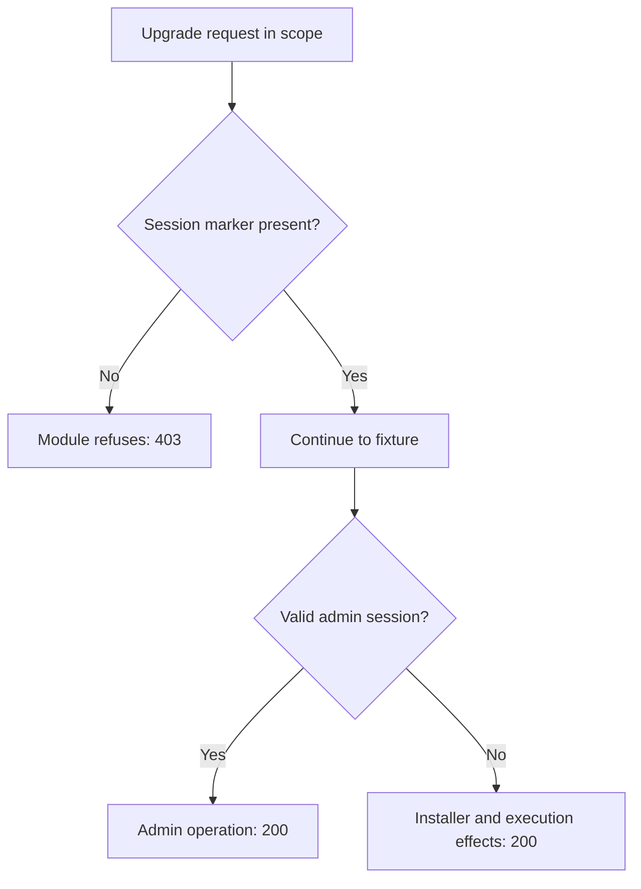

# WordPress core upgrade installer race (CVE-2026-119977)

[Source and API bundle](../../cve/CVE-2026-119977/README.md)

*WordPress core 4.7.0-7.1.3 (fixed 7.1.4) — [cve.now](https://cve.now/CVE-2026-119977) month ranking entry.*

Eden terminates the HTTP connection to the affected product. The tier-2
module built for this case is **recorded here as defeated**: its marker check
was bypassed live by a forged session marker, and it is withdrawn as a
protection claim. The boundary control that works for this primitive is the
tier-1 window-scoped deny (with its documented restriction), and the
durable repair is the vendor's 7.1.4.

**Status: live evidence recorded 2026-11-11 on the installed `eden-product-release:1.103.0-single` lab container (image `sha256:809293e1f0b525ac04698d1fa8d7ffdc66cbee1ff690b082ba26b4d050f08416`); tier-2 protection claim withdrawn (bypass demonstrated).**

## The vulnerability

During a core upgrade, the WordPress installer can be raced by an
unauthenticated attacker, leading to code execution on the server inside
the upgrade window. KEV-listed, exploit public.

## The Eden patch, and what it could not do

**Tier 1 — declarative policy (window-scoped deny):** `deny` on
`/wp-admin` POST descendants. Refusing every upgrade-route POST for the
duration of the upgrade window removes the unauthenticated reachability
prerequisite — including the legitimate admin's — and the policy is reverted
after the window. The restriction (admin upgrades also refused during the
window) is real but bounded: it is the standard maintenance-window trade.

**Tier 2 — native module (withdrawn):** `gabriel_wpupgrade_v1` refused
upgrade-route POSTs that carried no `wordpress_logged_in=` session-cookie
marker, intending to admit admin-initiated upgrades while refusing the
racer. This check is **not authentication**: the marker's *presence* is
request-supplied and forgeable, and real WordPress validates the session
server-side — which the gateway cannot replicate. The bypass below is
recorded live.

## Measured comparison (live, 2026-11-11)

The fixture validates the session server-side (only the exact valid admin
session authenticates; anything else falls through to the unauthenticated
race path), so the forged-marker probe exercises the real primitive.

| Probe | Baseline (unprotected) | Tier 1 (window deny) | Tier 2 (module, WITHDRAWN) |
| --- | --- | --- | --- |
| benign_admin_upgrade (valid admin session) | 200 | 403 — restriction | 200 |
| attack_unauth_upgrade (no cookie) | 200 (`installer_raced` ×1, `rce_marker` ×1) | 403 | 403 (`installer_raced` ×0) |
| attack_forged_marker (`wordpress_logged_in=forged`) | 200 (`installer_raced` ×1, `rce_marker` ×1) | 403 | **200 (`installer_raced` ×1, `rce_marker` ×1) — BYPASS** |

The forged-marker row is the module's failure: the marker check passes a
forged cookie through to the race path, and the backend effects fire. A
gateway that does not hold or validate WordPress session state cannot close
this primitive by request bytes alone; marker-shaped checks are
security-by-marker and are not a protection claim.

## What actually works for this primitive

1. **Vendor patch (durable):** WordPress 7.1.4.
2. **Window-scoped tier-1 deny:** refuse *all* upgrade-route POSTs during
   the upgrade window (admin included), revert after. The admin loses
   in-window upgrade calls — acceptable for a short window and the only
   request-boundary control with no false negative here.
3. Deployment-level authentication at the boundary (beyond request bytes) —
   out of scope for this study.

## Performance trace (Eden telemetry, live 2026-11-11)

Measured with Eden's built-in request telemetry (`gateway.request.baseline`
spans, read back through `/api/v1/analytics/telemetry?signal=traces`), not
client wall-clock. Latency Eden introduces per remediation arm for this case:

| Arm | n | mean | p50 | p95 | min–max |
| --- | --- | --- | --- | --- | --- |
| **Tier 1** — declarative policy, blocked request (403) | 15 | 28 µs | 22 µs | 54 µs | 18 µs–54 µs |
| **Tier 2** — native module, benign passes through (200) | 23 | 466 µs | 436 µs | 640 µs | 375 µs–770 µs |
| **Tier 2** — native module, attack refused (403) | 14 | 134 µs | 126 µs | 218 µs | 103 µs–218 µs |

**Eden-added latency for the tier-2 remediation:** benign requests complete in **466 µs** mean (p50 436 µs, p95 640 µs) in-product, module evaluation included.
*Honest scope: lab fixtures on one host, fresh connection per measured
request, warm requests only; module reactivated shards 2/2 with a fresh signed
statement per measurement; spans carry the full authority lineage (module
SHA-256, operation, publication). Not the EDEN-3640 performance
qualification contract.*

*Tested against: `eden-product-release:1.103.0-single` (image `sha256:809293e1f0b525ac…`, build target
`eden_service_single`, tooling revision `81a0724a…`). Raw data:
`module2/telemetry-ab/wpupgrade-telemetry.json` and `module2/tier1-ab/wpupgrade-tier1.json`.*

## Authority lifecycle and negatives (recorded for completeness)

The module was still driven through the full signed lifecycle
(`module2/evidence/wpupgrade-module.json`): `enroll_key`, independent-host
`inventory`, `inspect`, host `approve`, signed `admit`, `activate` — receipt
**`serving_now: true`, `applied_shards == expected_shards` (2/2)**. Negatives
held (read-only `inspect` -> 403, tampered binding -> 400, flipped signature
bit -> 403); `revoke` failed the interlay closed (503) and a fresh
approval/activation restored the (withdrawn) module.

## Cost record (per-CVE ledger)

~$0.10 USD (initial run plus the session-validation rerun that demonstrated
the bypass; the rerun window includes the fixture's server-side validation
change).

## Evidence appendix

- [cve.now entry](https://cve.now/CVE-2026-119977)
- Raw evidence: `gabriel-2026-11-11/module2/evidence/wpupgrade-module.json`
- Deployment: installed `eden-product-release:1.103.0-single` lab container (image `sha256:809293e1f0b525ac04698d1fa8d7ffdc66cbee1ff690b082ba26b4d050f08416`)
- Skill: [eden-vulnerability-remediation](../deployment.md)

## Decision flow



The forged-marker branch reached the vulnerable fixture path and produced the recorded effects. The native protection claim was withdrawn; the module’s marker check is not session validation.

## Complete native module source

The complete available source for `gabriel_wpupgrade_v1` is reproduced below from the [reviewed repository snapshot](../../cve/CVE-2026-119977/http-request-filter/src/lib.rs). The source SHA-256 is `659a564e7a802dc5bdf52bc05002deb6957da534ab975f4fe8918e029cc89309`. This identifies the source bytes, rather than independently proving the binary build or the recorded test results. The case’s experiment status and limitations still apply, including any failed import, partial coverage, or withdrawn claim. Original source comments are preserved verbatim.

```rust
//! Gabriel module: refuse unauthenticated core-upgrade requests during the
//! WordPress installer window (CVE-2026-119977 shape).
//!
//! CVE-2026-119977: the core upgrade installer can be raced by an
//! unauthenticated attacker, leading to code execution during the upgrade
//! window. This module refuses POSTs on the upgrade routes that carry no
//! authenticated admin session cookie; admin-initiated upgrades (with a
//! wordpress_logged_in cookie) pass unchanged. no_std.

#![no_std]

use core::mem::size_of;
use core::panic::PanicInfo;
use eden_gateway_remediation::message::{Availability, MessageInput};
use eden_gateway_remediation::module::{
    ApiHeader, CONTINUE, Decision, EDIT, EditSink, Edits, Failure, ModuleOutput, NEED_MORE, REFUSE, RemediationModule,
};
use eden_gateway_remediation::native_http_v3::{self as http, Api, Input, Request};

/// Upgrade routes in scope (admin update surfaces).
const ROUTE_A: &[u8] = b"POST /wp-admin/update-core";
const ROUTE_B: &[u8] = b"POST /wp-admin/upgrade";

/// The authenticated-session marker required to pass.
const SESSION: &[u8] = b"wordpress_logged_in=";

fn find(haystack: &[u8], needle: &[u8]) -> Option<usize> {
    if haystack.len() < needle.len() || needle.is_empty() {
        return None;
    }
    let mut i = 0usize;
    while i + needle.len() <= haystack.len() {
        let mut j = 0usize;
        let mut same = true;
        while j < needle.len() {
            if haystack[i + j] != needle[j] {
                same = false;
                break;
            }
            j += 1;
        }
        if same {
            return Some(i);
        }
        i += 1;
    }
    None
}

struct RefuseUnauthUpgrade;

impl RemediationModule<Request<'_>> for RefuseUnauthUpgrade {
    fn evaluate(&self, request: &Request<'_>, edits: &mut Edits<'_>) -> Result<Decision, Failure> {
        let _ = edits;
        let _ = match request.header_count() {
            Availability::Ready(count) => count,
            Availability::NeedMore => return Ok(Decision::NeedMore),
            Availability::Unavailable => return Err(Failure),
        };
        let message = request.message();
        if !message.is_complete() {
            return Ok(Decision::NeedMore);
        }
        let head = message.prefix();
        if !head.starts_with(ROUTE_A) && !head.starts_with(ROUTE_B) {
            return Ok(Decision::Continue);
        }
        // Only the Cookie header is consulted; a session cookie proves the
        // request's origin is the authenticated admin, not the racing attacker.
        if find(head, SESSION).is_none() {
            return Ok(Decision::Refuse);
        }
        Ok(Decision::Continue)
    }
}

static API: Api = Api {
    header: ApiHeader { version: http::VERSION, table_size: size_of::<Api>() as u32 },
    input_size: size_of::<Input>() as u32,
    output_size: size_of::<ModuleOutput>() as u32,
    sink_size: size_of::<EditSink>() as u32,
    message_size: size_of::<MessageInput>() as u32,
    state_bytes: 0,
    capabilities: CONTINUE | REFUSE | NEED_MORE | EDIT,
    required_inputs: 0,
    evaluate: Some(evaluate),
};

unsafe extern "C" fn evaluate(input: *const Input, sink: *const EditSink, output: *mut ModuleOutput) -> i32 {
    unsafe { http::invoke(&RefuseUnauthUpgrade, input, sink, output) }
}

#[unsafe(no_mangle)]
pub extern "C" fn eden_http_remediation_v3() -> *const Api {
    &API
}

#[panic_handler]
fn panic(_information: &PanicInfo<'_>) -> ! {
    loop {
        core::hint::spin_loop();
    }
}
```
