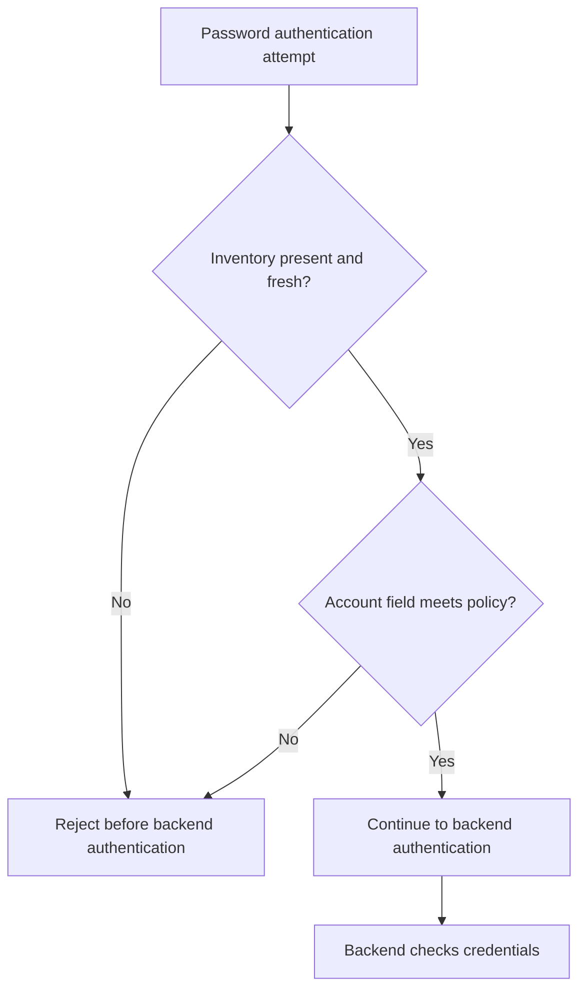

# SSH password authentication prerequisite removal (CVE-2026-123158)

Eden terminates an SSH connection, evaluates an account-state policy before
forwarding a credential, and opens a separately authenticated SSH connection to
a fixed backend. This removes a prerequisite for the bypass at a new enforcement
point. It does **not** patch the protected sshd.

Status: opt-in SSH adapter ported onto main's native remediation contract for
release 1.96.0, without the historical unmerged API/SDK stack. The earlier 1.95
branch executed authenticated endpoint/route creation, activation, readback,
revocation and rollback in an SSH-only image. Those historical results are
identified below; current-source qualification is retained separately on
EDEN-3626. Local qualification does not establish fleet deployment readiness.

## Vulnerability and deployment problem

The [OpenSSH correction](https://github.com/openssh/openssh-portable/commit/4353fdc43ef646c43a8dda7025cc1a898caf1482)
checks that an account's effective password field has at least four bytes before
accepting a crypt comparison. In the affected lab configuration, password
authentication to a passwd-only account with `*` and no shadow entry bypasses
authentication with some long inputs. The backend sshd remains responsible for
checking a usable account's actual password.

A fleet can contain unavailable maintenance windows, embedded installations and
paths that do not traverse a gateway. Updating sshd is the durable vendor fix.
Eden's additional enforcement point requires every claimed protected path to
reach Eden; direct backend access remains a coverage hole.

A transparent TCP forward cannot inspect `SSH_MSG_USERAUTH_REQUEST`: the password
is encrypted with the SSH transport session keys. The adapter therefore performs
real SSH transport and user authentication using `russh`, and evaluates the
shared `PreparedRemediation` decision contract before backend authentication.
There is no password-length threshold or CVE-specific native branch.

## Trust and host keys

The maintainer confirmed a separate Eden host key for release configuration on
2026-11-07. Clients must explicitly pin
that public key. Eden independently pins the backend host public key; there is no
trust-on-first-use fallback. Host-owned bindings fix the tenant, endpoint, target,
key files and account inventory; policy and SSH clients cannot supply them.

Holding each backend's host private key would preserve the client's existing
host identity, but compromise of Eden would then expose every delegated backend
identity. That alternative was not selected.

Pinned-backend password relay was approved for this lab. Eden necessarily sees
the plaintext during authentication. Owned frontend decode buffers, private-key
load buffers and backend client password messages are zeroized after use. Neither
passwords nor password fields belong in logs, telemetry, policy or receipts.
This is not a proof against allocator, kernel, debugger or process-memory capture,
and lab approval is not product-wide approval of credential termination.

Publickey authentication uses explicit frontend-key authorization and a separately
provisioned backend signing key. A signature bound to the frontend SSH session
cannot be reused as a backend signature. This implementation does not imply
transparent support for arbitrary existing client keys or agent forwarding.

## Declarative policy

The versioned artifact is
`policies/ssh/usable-password-field-v1.json`:

```json
{
  "version": 1,
  "profile": "ssh-account-state-v1",
  "policy": {
    "rule_id": "ssh.password.usable-field",
    "minimum_field_bytes": 4,
    "require_modular_crypt": true,
    "maximum_inventory_age_seconds": 60
  }
}
```

Password authentication continues only for an account attested to have an
effective field of at least four bytes beginning with `$`. Missing accounts,
missing policy, unavailable inventory and observations older than the declared
bound fail closed. Accounts created after installation are denied until attested.
The rule does not inspect the password. Declarations cannot disable the `$`
prerequisite. Malformed destinations and malformed or foreign-scope inventory
are rejected before route activation.

The inventory contains account names, field byte counts and a boolean modular
crypt prefix; it never contains fields or hashes. The lab obtains these facts by
reducing passwd/shadow data inside the backend through an operator-owned root
channel. The serving file is bounded, scoped to tenant/endpoint/backend host key,
timestamped and atomically replaced. Its provenance is trusted operator filesystem
ownership, not a cryptographic attestation service. The adapter cannot determine
whether that operator's assertion is truthful.

Freshness is checked at policy evaluation. The backend field may change between
observation and backend authentication: the 60-second observation bound plus
connection/authentication time creates a TOCTOU window. Publication is fenced
through authentication, but that fence does not lock the backend account database.

The `$` requirement is stricter than the upstream length check. Equivalence is
qualified for the tested modular-crypt account population; legacy non-modular
password fields are outside this result. No universal claim that a legitimate
actor cannot be blocked follows from this finite lab.

## Product integration and activation

The `ssh` feature is included in the standard release feature bundles; custom
builds can select it directly. Configure host-owned
`EDEN_SSH_BINDINGS_FILE` before startup. An SSH endpoint stores only a validated
`binding_id`; it does not create a database connection pool. The root gateway's
original TCP listener resolves this binding through the tenant-qualified endpoint
cache and invokes the real SSH adapter.

The SSH route configuration controls
endpoint/interlay requests, host bindings, inventory format and client trust
updates. Feature inclusion is separate from executed release-image qualification.

The existing authenticated interlay PATCH API admits the policy using `ParsedJwt`
and `ControlPerms::CONFIGURE`. It requires the normal `If-Match` and
`Idempotency-Key` publication controls. Unknown profile fields and invalid policies
refuse before persistence. There is no second activation endpoint.

An SSH activation response has a credential-free receipt binding the authenticated
actor, tenant, endpoint, policy digest, publication revision, configuration ETag
and observed local runtime revision. A publication UUID identifies the desired
operation; a node-local runtime generation identifies the observed serving state.
Generation numbers may reset after restart and must be paired with node identity
and policy digest. Submission by itself is not effectiveness. Read back each
serving node independently; one response does not attest a fleet.

Revocation removes the mandatory policy and therefore denies new authentication;
rollback republishes the selected policy through the same authenticated seam.
Already authenticated SSH sessions are not retroactively reauthenticated.

Run the focused protocol and product-path tests with:

```sh
cargo test --locked -p gateway-ssh
cargo test --locked -p eden-service --no-default-features \
  --features embedded-db,ssh,test-utils \
  --test native_ssh_remediation \
  ssh::authenticated_ssh_activation_readback_revoke_and_rollback -- --nocapture
```

The shared API fixtures compile with SSH alone. The service test uses a disposable
counting SSH backend by default. The lab harness's `--api-test-binary` option
supplies the vulnerable/fixed fixtures instead, using the same authenticated
handler and actual gateway listener. Its `--release-image` option exercises the
real Service container through the standard HTTP APIs and SSH listeners.

## Executed evidence

On 2026-11-07, the SSH-only release candidate at `de6fa3344f3f` passed 44 cases
across 132 vulnerable/fixed/protected observations with zero mismatches, plus
16 revocation/rollback controls. The running binary matched the packaged binary
SHA-256. All 60 authentication attempts produced receipts; session command
traffic produced no additional decisions. Correct password authentication and
publickey authentication for both hashed and passwordless accounts were
preserved. Backend binary/configuration and kernel digests remained unchanged.
The Service ran as UID 10001 with no published ports. Raw results and image
provenance are retained on EDEN-3626.

The original pinned lab image was unavailable for that release run. The existing
lab Dockerfile was rebuilt and its replacement image was frozen before testing;
the run manifest records its exact identity. The replacement is not claimed to
be byte-identical to the original image. Both ordinary baseline/reference
controls passed before the release-image matrix.

The earlier standalone qualification below used the original pinned image.
The existing `sshole-lab` image was reused, pinned by image ID
`sha256:fd8f68f034006d3f9563c3cf326d89af2ecbfbf4495a4d5d977ec0b14daf7cf0`.
Current lab fixture and attacker scripts were copied into that image's disposable
containers; the image's embedded copies were stale. A common
`PerSourcePenalties no` test control was installed in every arm before freezing
configuration, to avoid one test affecting the next.

Three arms were compared: A, vulnerable 10.6p1 directly; B, fixed 10.6p2 directly;
and C, the same vulnerable A instance through Eden's protocol adapter. The adapter
lab driver uses local policy provisioning and does not establish API activation.

| Check | Executed result |
| --- | --- |
| Existing baseline and fixed-reference harness | A 7/7, B 7/7 |
| Four account shapes × eight password lengths | 32 cases across A/B/C |
| Correct password and two delegated publickey cases | 3 cases across A/B/C, command effects verified |
| Host with no modular crypt field anywhere | 8 additional cases across A/B/C |
| Total differential matrix | 43 cases, 129 observations; zero errors or B/C mismatches |
| Separate encrypted protocol test | Denied attempts cause zero backend auth calls; password and delegated key preserved |
| Protected binary/config/kernel before and after | Digests unchanged |

Lengths were 0, 8, 255, 256, 257, 300, 1024 and 1025 bytes. The passwd-only `*`
account bypassed A with 257, 300 and 1024 bytes. The 1025-byte case did not bypass
A. Shapes included `*` without shadow, `*` in shadow, locked `!` and a real `$6$`
account. The musl shared shadow-buffer behavior means the shadow-backed shapes
did not reproduce the bypass; that negative finding is part of the affected
population, not an omitted test.

The earlier fixed-reference legitimate-password regression was not reproduced
with this pinned image and current fixtures: both the original seven tests and
the extended business cases passed. Its cause remains unestablished. Initial
failed runs and their raw output are retained in the evidence bundle.

Full kernel-image SHA-256 was
`41ba36d860aa0b0cd995f4ca8856d80249b244577e704929b55be13fbd1ebd2f`.
The same boot identity and kernel image were observed before and after. The
protected vulnerable sshd digest was
`91097c6f129984349e102ebd3c1b2d885bb18f7e0f15b948c084da8e63bab3bd`.
Configuration was frozen before the baseline and remained byte-identical through
protected runs. The kernel image was read through a single read-only bind; no
host package, firewall or sshd setting was modified.

Measured development-build overhead, 50 successful complete SSH connections per
arm, serial connection/authentication/command execution, nearest-rank percentiles:

| Measurement | Direct A | Adapter C |
| --- | ---: | ---: |
| p50 | 119.723 ms | 145.087 ms |
| p95 | 123.219 ms | 148.952 ms |
| p99 | 127.610 ms | 151.969 ms |
| Successful connections/s over measured wall time | 8.222 | 6.964 |
| Combined container cgroup CPU/attempt | 47.503 ms | 77.436 ms |

The CPU denominator includes the client, all sshd children, adapter and background
inventory refresh in the A+C container cgroups. It is not isolated proxy CPU or a
saturated throughput benchmark. These measurements do not qualify release
performance or the product API path.

## Coverage and limits

The lab ran five disposable containers on one private Docker network, no published
ports, and IPv6 disabled. Direct access to A remained allowed and demonstrably
unprotected, as selected for this task. Other hosts, management interfaces,
alternate ports, unmanaged listeners and production IPv6 paths were not inspected.
No fleet-wide coverage claim is made.

The supported session path covers execution, shell/subsystem channels and channel
data/exit handling. PTY, forwarding, keyboard-interactive, host certificates,
agent forwarding and arbitrary key delegation are not qualified. Backend pin
mismatch and unavailable policy fail closed. Inventory trust and refresh are
operator responsibilities.

## What is still not proven

- Production deployment and fleet-wide reachability.
- Multi-node effectiveness, consensus activation, restart recovery and fleet coverage.
- Equivalence for legacy non-modular password hashes or every possible account race.
- Product-wide approval and security qualification of plaintext password relay.
- Capacity under concurrency, long-lived interactive sessions and unsupported SSH methods.


## Decision flow



The SSH policy uses host-supplied account-field metadata and inventory age. Continuing the attempt is not an authentication success.

## Complete SSH policy module source

The full `eden_gateway/ssh/src/policy.rs` source below is the policy module reproduced in the reader-facing case study. It is pinned to commit 353abf31, including its tests; it is an integrated SSH policy module rather than a separately loaded HTTP native module. Its source SHA-256 is `c04189eb4f8786366bda7c595c6c6b6a1e609d17a396f3d192b59f8add623b43`. The encrypted transport and host-binding implementations remain separate components.

```rust
//! Declarative method prerequisites over credential-free account observations.

use eden_gateway_remediation::{
    GatewayRemediationAdapter, InspectionState, PreparedRemediation, RemediationDecision, RemediationDeployment, RemediationError,
    RemediationInput, RemediationInspection, RemediationSelection, ValidatedRemediationDecision,
};
use format::endpoint::EpKind;
use serde::{Deserialize, Serialize};
use serde_json::Value;
use std::sync::Arc;

/// Versioned account-observation policy profile; independent of any CVE.
pub const ACCOUNT_STATE_PROFILE: &str = "ssh-account-state-v1";

/// Host-supplied account field metadata. Never contains the field or its hash.
#[derive(Debug, Clone, Serialize, Deserialize)]
#[serde(deny_unknown_fields)]
pub struct AccountState {
    /// Length in bytes of the effective shadow-or-passwd field.
    pub field_bytes: usize,
    /// Whether the effective field begins with a modular-crypt marker.
    pub modular_crypt: bool,
}

/// A generic password-method prerequisite, compiled before serving.
#[derive(Debug, Clone, Serialize, Deserialize)]
#[serde(deny_unknown_fields)]
pub struct AccountPolicy {
    /// Safe bounded identifier included in decision records.
    pub rule_id: String,
    /// Minimum effective field length in bytes; this is not password length.
    pub minimum_field_bytes: usize,
    /// Must be true: lock/placeholder and non-password fields cannot permit passwords.
    pub require_modular_crypt: bool,
    /// Maximum age of the host-provenanced account observation in seconds.
    pub maximum_inventory_age_seconds: u64,
}

/// Immutable policy plus its exact persisted declaration.
#[derive(Debug)]
pub struct PreparedAccountPolicy {
    /// Original common declaration, retained for publication identity checks.
    declaration: Value,
    /// Validated generic field requirements.
    pub policy: AccountPolicy,
    /// Exact immutable serving snapshot generation; zero for standalone fixtures.
    generation: u64,
}

/// Prepare a bounded declaration off the serving path. Unknown fields, versions
/// and attempts to disable the password-hash prerequisite refuse admission.
pub fn prepare_ssh_remediation(value: &Value) -> Result<Arc<PreparedAccountPolicy>, RemediationError> {
    prepare_ssh_remediation_at_generation(value, 0)
}

/// Prepare a native account policy for the host's exact immutable snapshot.
/// Invalid rules or unsupported declarations fail before publication; generation
/// is retained for the common host's install/read coherence checks.
pub fn prepare_ssh_remediation_at_generation(value: &Value, generation: u64) -> Result<Arc<PreparedAccountPolicy>, RemediationError> {
    let envelope: RemediationDeployment = serde_json::from_value(value.clone()).map_err(|_| RemediationError::PolicyUnavailable)?;
    if envelope.version != 1 || envelope.profile != ACCOUNT_STATE_PROFILE {
        return Err(RemediationError::PolicyUnavailable);
    }
    let policy: AccountPolicy = serde_json::from_value(envelope.policy).map_err(|_| RemediationError::PolicyUnavailable)?;
    if policy.rule_id.is_empty()
        || policy.rule_id.len() > 64
        || !policy.rule_id.bytes().all(|b| b.is_ascii_lowercase() || b.is_ascii_digit() || b"._-".contains(&b))
        || !(1..=4096).contains(&policy.minimum_field_bytes)
        || !(1..=300).contains(&policy.maximum_inventory_age_seconds)
        || !policy.require_modular_crypt
    {
        return Err(RemediationError::PolicyUnavailable);
    }
    Ok(Arc::new(PreparedAccountPolicy { declaration: value.clone(), policy, generation }))
}

impl PreparedAccountPolicy {
    /// Decide from field state only. Unknown accounts and stale observations deny.
    pub fn password_decision(&self, account: Option<&AccountState>, age_seconds: Option<u64>) -> RemediationDecision {
        let allowed = age_seconds.is_some_and(|age| age <= self.policy.maximum_inventory_age_seconds)
            && account.is_some_and(|state| {
                state.field_bytes >= self.policy.minimum_field_bytes && (!self.policy.require_modular_crypt || state.modular_crypt)
            });
        if allowed {
            RemediationDecision::Continue
        } else {
            RemediationDecision::Reject { status_code: 403, reason: self.policy.rule_id.clone() }
        }
    }
}

/// Credential-free parser output presented to the common decision selector.
pub struct SshAuthObservation(pub Value);

/// Adapter over the decrypted authentication phase; mutation is unsupported.
pub struct SshRemediationAdapter;

impl GatewayRemediationAdapter for SshRemediationAdapter {
    type Request = SshAuthObservation;

    fn endpoint_kind(&self) -> EpKind {
        EpKind::Ssh
    }

    fn inspect<'a>(&self, request: &'a Self::Request) -> Result<RemediationInspection<'a>, RemediationError> {
        Ok(RemediationInspection {
            state: InspectionState::Complete,
            input: RemediationInput::Document(&request.0),
        })
    }

    fn apply_mutation(&self, _: &mut Self::Request, _: &ValidatedRemediationDecision) -> Result<(), RemediationError> {
        Err(RemediationError::InvalidDecision)
    }
}

impl PreparedRemediation for PreparedAccountPolicy {
    fn as_any(&self) -> &dyn std::any::Any {
        self
    }

    fn generation(&self) -> u64 {
        self.generation
    }

    fn bind_generation(&mut self, generation: u64) {
        self.generation = generation;
    }

    fn declaration(&self) -> &Value {
        &self.declaration
    }

    fn endpoint_kind(&self) -> EpKind {
        EpKind::Ssh
    }

    fn select(&self, request: &RemediationInspection<'_>) -> Result<RemediationSelection, RemediationError> {
        let RemediationInput::Document(value) = request.input else {
            return Err(RemediationError::InspectionUnavailable);
        };
        #[derive(Deserialize)]
        #[serde(deny_unknown_fields)]
        struct Observation {
            account: Option<AccountState>,
            age_seconds: Option<u64>,
        }
        let observation: Observation = serde_json::from_value(value.clone()).map_err(|_| RemediationError::InspectionUnavailable)?;
        Ok(RemediationSelection::Native(
            self.password_decision(observation.account.as_ref(), observation.age_seconds),
        ))
    }
}

#[cfg(test)]
mod tests {
    use super::*;
    use serde_json::json;

    fn policy() -> Arc<PreparedAccountPolicy> {
        prepare_ssh_remediation(&json!({"version":1,"profile":ACCOUNT_STATE_PROFILE,"policy":{
            "rule_id":"password.usable-field","minimum_field_bytes":4,"require_modular_crypt":true,
            "maximum_inventory_age_seconds":60
        }}))
        .expect("valid policy")
    }

    #[test]
    fn usable_field_is_a_fail_closed_allowlist() {
        let policy = policy();
        for length in [0, 1, 2, 3, 4, 5, 106] {
            for modular in [false, true] {
                let field = AccountState { field_bytes: length, modular_crypt: modular };
                assert_eq!(
                    matches!(policy.password_decision(Some(&field), Some(0)), RemediationDecision::Continue),
                    length >= 4 && modular
                );
                assert!(!matches!(policy.password_decision(Some(&field), Some(61)), RemediationDecision::Continue));
                assert!(!matches!(policy.password_decision(Some(&field), None), RemediationDecision::Continue));
            }
        }
        assert!(matches!(policy.password_decision(None, Some(0)), RemediationDecision::Reject { .. }));
    }

    #[test]
    fn unsupported_versions_and_unbounded_freshness_refuse() {
        let mut declaration = policy().declaration.clone();
        declaration["version"] = json!(2);
        assert!(prepare_ssh_remediation(&declaration).is_err());
        declaration["version"] = json!(1);
        declaration["policy"]["maximum_inventory_age_seconds"] = json!(301);
        assert!(prepare_ssh_remediation(&declaration).is_err());
    }

    #[test]
    fn password_prerequisite_cannot_be_disabled_at_admission() {
        let mut declaration = policy().declaration.clone();
        declaration["policy"]["require_modular_crypt"] = json!(false);
        assert!(prepare_ssh_remediation(&declaration).is_err());
    }

    #[test]
    fn snapshot_generation_and_common_rejection_reason_are_validated() {
        let mut declaration = policy().declaration.clone();
        let prepared = prepare_ssh_remediation_at_generation(&declaration, 9).expect("generation-bound policy");
        assert_eq!(prepared.generation(), 9);
        for invalid in ["Uppercase".to_string(), "x".repeat(65)] {
            declaration["policy"]["rule_id"] = json!(invalid);
            assert!(prepare_ssh_remediation(&declaration).is_err());
        }
    }
}
```
