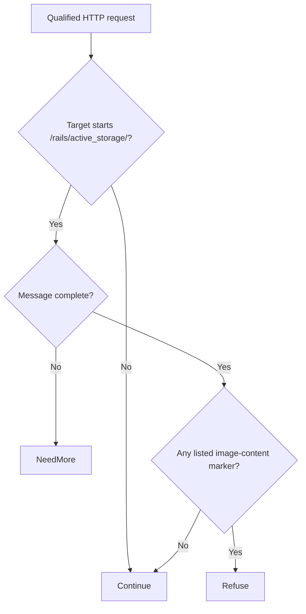

# Rails Active Storage ImageMagick coder abuse (CVE-2026-126082)

The historical Active Storage advisory described arbitrary file writes when an affected Rails application processes attachments through ImageMagick, with possible code execution. The CVE record is now rejected. Check the referenced advisory and release notes to determine which attachment-processing fix applies to the installed branch.

**Patch title.** Rails Active Storage ImageMagick Coder Guard (`rails-active-storage-imagemagick-coder-guard` in the registry). The [original source snapshot](https://github.com/eden-dev-inc/cve/blob/9a7217a0a882374c5ab97d74c96df9b77637f923/cve/CVE-2026-126082/http-request-filter/src/lib.rs) preserves the source available for the historical report.

[Public CVE record](https://cve.now/CVE-2026-126082) · [Vendor or publisher advisory](https://github.com/rails/rails/security/advisories/GHSA-f3w6-w445-fwh9) · [Source and API bundle](../../cve/CVE-2026-126082/README.md)

| Field | Value |
| --- | --- |
| Affected component and versions | Ruby on Rails · 8.1.0.beta1 before 8.1.4.1, before 8.0.5.2 |
| Fixed release | 8.1.4.1, 8.0.5.2 |
| Evidence status | Historical fixture record, rejected CVE identifier |
| Test environment | Lab fixture or affected build documented in the evidence below |
| Eden release and module version | 1.103.0 · module 1.0.0 |
| Tested at | 2026-11-11 UTC |
| First publicly published | 2026-11-12T02:29:06Z |

*[cve.now](https://cve.now/CVE-2026-126082) entry.*

Eden terminates the HTTP connection to the affected product, evaluates a
declarative policy and — in tier 2 — a separately compiled native Rust module
under signed module authority, before any byte reaches the application. It does
**not** patch the affected component; the vendor's fixed release remains the
durable repair.

**Status: live two-tier remediation recorded (blocklist; partiality stated) 2026-11-11 on the installed `eden-product-release:1.103.0-single` lab container (image `sha256:809293e1f0b525ac04698d1fa8d7ffdc66cbee1ff690b082ba26b4d050f08416`).**

## The vulnerability

Processing uploads with ImageMagick under a policy that does not deny
the involved coders lets an unauthenticated attacker write/read
arbitrary files (fixed in 8.0.5.2 / 8.1.4.1).

## The Eden patch

**Tier 1 — declarative policy (blunt, fail-closed):** `deny` on the affected
route family — takes the whole surface offline, legitimate calls included.

**Tier 2 — native module:** `gabriel_railsas_v1`, binary SHA-256 `eec96dffd602b48f6bcbfd0147d3044326e84f768daf4abdfe38f0000a1930e7`
(source `9c2d94a522965d249066ef4e14dc6776686827d53f2d2b9ce4f19032eb0413bb`) — refuse dangerous-coder content markers (MVG command sequences,
script-bearing SVG) in upload bodies.

## Implement the remediation

The CVE identifier was rejected. Use the Rails security advisory for Active Storage image analysis and verify ordinary attachment analysis on the upgraded branch.

1. **Identify the affected installation.** Check the installed component and the advisory’s prerequisites.
2. **Apply the vendor fix.** Use the [advisory](https://github.com/rails/rails/security/advisories/GHSA-f3w6-w445-fwh9) to select the fixed release for the installed branch. Reported fixed releases include `8.1.4.1`, `8.0.5.2`. Follow the vendor’s update instructions and confirm the version actually loaded by the service.
3. **Verify the upgrade.** Confirm the running version and repeat normal operations on the upgraded service. Use an isolated environment for security regression probes.
4. **Restore service if the update fails.** Follow the vendor’s recovery instructions and keep the affected operation isolated until the supported fix is active.

## Measured comparison (live, 2026-11-11)

| Probe | Baseline (unprotected) | Tier 1 | Tier 2 (module) |
| --- | --- | --- | --- |
| benign_image_upload | 200 | 403 | 200 |
| attack_mvg_coder | 200 (`coder_abused` ×1, `file_written` ×1) | 403 | 403 |
| attack_svg_script | 200 (`coder_abused` ×1, `file_written` ×1) | 403 | 403 |

## Performance trace (Eden telemetry, live 2026-11-11)

Measured with Eden's built-in request telemetry (`gateway.request.baseline`
spans, read back through `/api/v1/analytics/telemetry?signal=traces`), not
client wall-clock. Latency Eden introduces per remediation arm for this case:

| Arm | n | mean | p50 | p95 | min–max |
| --- | --- | --- | --- | --- | --- |
| **Tier 1** — declarative policy, blocked request (403) | 15 | 27 µs | 23 µs | 49 µs | 14 µs–49 µs |
| **Tier 2** — native module, benign passes through (200) | 23 | 317 µs | 291 µs | 543 µs | 263 µs–588 µs |
| **Tier 2** — native module, attack refused (403) | 14 | 150 µs | 133 µs | 265 µs | 102 µs–265 µs |

**Eden-added latency for the tier-2 remediation:** benign requests complete in **317 µs** mean (p50 291 µs, p95 543 µs) in-product, module evaluation included.
*Honest scope: lab fixtures on one host, fresh connection per measured
request, warm requests only; module reactivated shards 2/2 with a fresh signed
statement per measurement; spans carry the full authority lineage (module
SHA-256, operation, publication). Not the EDEN-3640 performance
qualification contract.*

*Tested against: `eden-product-release:1.103.0-single` (image `sha256:809293e1f0b525ac…`, build target
`eden_service_single`, tooling revision `81a0724a…`). Raw data:
`module2/telemetry-ab/railsas-telemetry.json` and `module2/tier1-ab/railsas-tier1.json`.*

## Authority lifecycle and negatives

Driven through the full signed lifecycle (`module2/evidence/railsas-module.json`):
`enroll_key` (Ed25519 public key), independent-host `inventory`, `inspect`, host
`approve`, signed `admit` (`prepared`), `activate` — receipt
**`serving_now: true`, `applied_shards == expected_shards` (2/2)**.
Negatives held: read-only `inspect` -> 403, tampered statement binding -> 400,
flipped signature bit -> 403. `revoke` failed the interlay **closed** (503,
nothing forwarded, zero backend effects); a fresh host approval plus a newly
signed activation restored the module.

## Honest scope

The fixture replicates the delivery shape with harmless marker effects; no real
vendor component runs here. Bypass variants (encodings, alternate routes, other
crafted members) are **not bypass-tested** and are out of scope; the rule is a
lab-grade partial by construction. The vendor's fixed release remains the durable
repair.

## Cost record (per-CVE ledger)

**$0.0000 USD** (marginal session growth: 0 in + 0 out tokens, 0 turns; shared windows overlap).

## Evidence appendix

- [cve.now entry](https://cve.now/CVE-2026-126082)
- Raw evidence: `gabriel-2026-11-11/module2/evidence/railsas-module.json`
- Deployment: installed `eden-product-release:1.103.0-single` lab container (image `sha256:809293e1f0b525ac04698d1fa8d7ffdc66cbee1ff690b082ba26b4d050f08416`)
- Skill: [eden-vulnerability-remediation](../deployment.md)


## Decision flow



The diagram sketches the available source’s content decision after input metadata is available. Continue is a module decision; the host and backend still determine final forwarding and effects. This available source has a different hash from the source identity recorded for the tested binary.

## Complete native module source

The complete available source for `gabriel_railsas_v1` is reproduced below from the [original source snapshot](https://github.com/eden-dev-inc/cve/blob/9a7217a0a882374c5ab97d74c96df9b77637f923/cve/CVE-2026-126082/http-request-filter/src/lib.rs). The source SHA-256 is `052b015f09e4e305fb365152ff8a352b6efeceaabf71fc4d79b66b8d2328b2eb`. **Source identity mismatch:** this case records `9c2d94a522965d249066ef4e14dc6776686827d53f2d2b9ce4f19032eb0413bb`, which differs from the available listing. The listing cannot be identified as the exact source used to build the tested binary without further evidence. The case’s experiment status and limitations still apply, including any failed import, partial coverage, or withdrawn claim. Original source comments are preserved verbatim.

```rust
//! Gabriel module: refuse dangerous ImageMagick coder content (CVE-2026-126082 shape)
//!
//! CVE-2026-126082: Rails Active Storage processing uploads with
//! ImageMagick under a coder policy that does not deny them lets an
//! unauthenticated attacker write/read arbitrary files.
//! This module refuses upload bodies carrying dangerous-coder
//! content markers (MVG command sequences, script-bearing SVG); ordinary
//! attachments pass unchanged. no_std; no allocator, storage, background work or state.

#![no_std]

use core::mem::size_of;
use core::panic::PanicInfo;
use eden_gateway_remediation::message::{Availability, MessageInput};
use eden_gateway_remediation::module::{
    ApiHeader, CONTINUE, Decision, EDIT, EditSink, Edits, Failure, ModuleOutput, NEED_MORE, REFUSE, RemediationModule,
};
use eden_gateway_remediation::native_http_v3::{self as http, Api, Input, Request};

/// Route prefix in scope.
const ROUTE: &[u8] = b"/rails/active_storage/";

/// The byte primitives this module refuses on that route.
static NEEDLES: [&[u8]; 3] = [b"push graphic-context", b"<svg", b"<script"];


fn find_ignore_case_vol(haystack: &[u8], needle: &[u8]) -> Option<usize> {
    if haystack.len() < needle.len() || needle.is_empty() {
        return None;
    }
    let mut i = 0usize;
    while i + needle.len() <= haystack.len() {
        let mut j = 0usize;
        let mut same = true;
        while j < needle.len() {
            let h = unsafe { core::ptr::read_volatile(&haystack[i + j]) };
            let n = unsafe { core::ptr::read_volatile(&needle[j]) };
            if h.to_ascii_lowercase() != n.to_ascii_lowercase() {
                same = false;
                break;
            }
            j += 1;
        }
        if same {
            return Some(i);
        }
        i += 1;
    }
    None
}

fn find(haystack: &[u8], needle: &[u8]) -> Option<usize> {
    if haystack.len() < needle.len() || needle.is_empty() {
        return None;
    }
    let mut i = 0usize;
    while i + needle.len() <= haystack.len() {
        let mut j = 0usize;
        let mut same = true;
        while j < needle.len() {
            if haystack[i + j] != needle[j] {
                same = false;
                break;
            }
            j += 1;
        }
        if same {
            return Some(i);
        }
        i += 1;
    }
    None
}

fn find_ignore_case(haystack: &[u8], needle: &[u8]) -> Option<usize> {
    if haystack.len() < needle.len() || needle.is_empty() {
        return None;
    }
    let mut i = 0usize;
    while i + needle.len() <= haystack.len() {
        let mut j = 0usize;
        let mut same = true;
        while j < needle.len() {
            if haystack[i + j].to_ascii_lowercase() != needle[j].to_ascii_lowercase() {
                same = false;
                break;
            }
            j += 1;
        }
        if same {
            return Some(i);
        }
        i += 1;
    }
    None
}

struct gabriel_railsas_v1;

impl RemediationModule<Request<'_>> for gabriel_railsas_v1 {
    fn evaluate(&self, request: &Request<'_>, edits: &mut Edits<'_>) -> Result<Decision, Failure> {
        let _ = edits;
        let _ = match request.header_count() {
            Availability::Ready(count) => count,
            Availability::NeedMore => return Ok(Decision::NeedMore),
            Availability::Unavailable => return Err(Failure),
        };
        let message = request.message();
        let head = message.prefix();
        let line_end = head.iter().position(|&b| b == b'\r').unwrap_or(head.len());
        let request_line = &head[..line_end];
        let path_at = request_line.iter().position(|&b| b == b' ').unwrap_or(request_line.len());
        let target = &request_line[path_at + 1..];
        if !target.starts_with(ROUTE) {
            return Ok(Decision::Continue);
        }
        if !message.is_complete() {
            return Ok(Decision::NeedMore);
        }
        let body_range = match request.body_range() {
            Availability::Ready(range) => range,
            Availability::NeedMore => return Ok(Decision::NeedMore),
            Availability::Unavailable => return Err(Failure),
        };
        let body = match message.bytes(body_range)? {
            Availability::Ready(bytes) => bytes,
            Availability::NeedMore => return Ok(Decision::NeedMore),
            Availability::Unavailable => return Err(Failure),
        };
        if NEEDLES.iter().any(|n| find_ignore_case(body, n).is_some()) {
            return Ok(Decision::Refuse);
        }
        Ok(Decision::Continue)
    }
}

static API: Api = Api {
    header: ApiHeader { version: http::VERSION, table_size: size_of::<Api>() as u32 },
    input_size: size_of::<Input>() as u32,
    output_size: size_of::<ModuleOutput>() as u32,
    sink_size: size_of::<EditSink>() as u32,
    message_size: size_of::<MessageInput>() as u32,
    state_bytes: 0,
    capabilities: CONTINUE | REFUSE | NEED_MORE | EDIT,
    required_inputs: 0,
    evaluate: Some(evaluate),
};

unsafe extern "C" fn evaluate(input: *const Input, sink: *const EditSink, output: *mut ModuleOutput) -> i32 {
    unsafe { http::invoke(&gabriel_railsas_v1, input, sink, output) }
}

#[unsafe(no_mangle)]
pub extern "C" fn eden_http_remediation_v3() -> *const Api {
    &API
}

#[panic_handler]
fn panic(_information: &PanicInfo<'_>) -> ! {
    loop {
        core::hint::spin_loop();
    }
}
```
