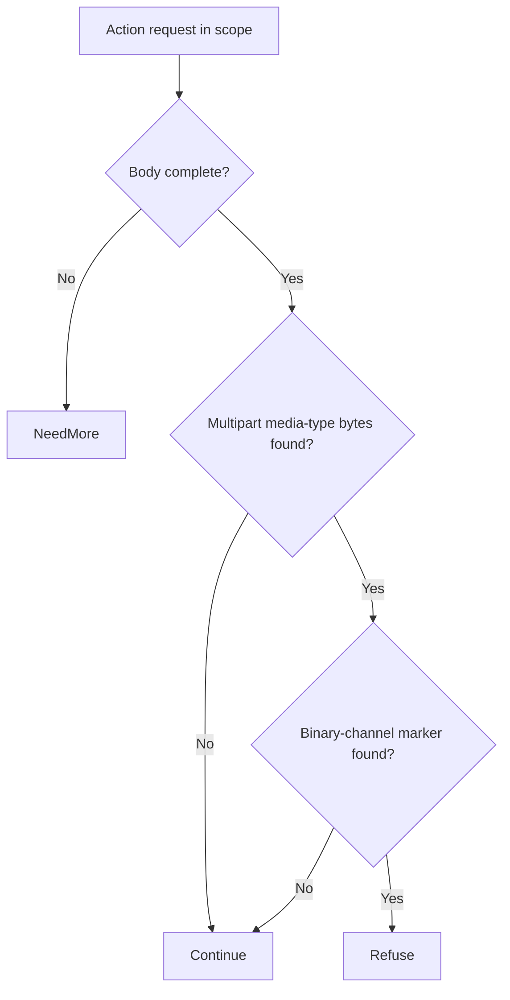

# React Server Components unauthenticated RCE (CVE-2026-126187) through Eden's API

An unauthenticated caller can supply crafted React Server Components data that reaches unsafe decoding in affected packages and can lead to code execution. Upgrade the installed decoder package to remove the vulnerability across all routes that use it.

[Public CVE record](https://cve.now/CVE-2026-126187) · [Vendor or publisher advisory](https://github.com/react/react/security/advisories/GHSA-xqc2-xf4c-x3h3) · [Source and API bundle](../../cve/CVE-2026-126187/README.md)

| Field | Value |
| --- | --- |
| Affected component and versions | React · 19.0.0 before 19.0.9, 19.1.0 before 19.1.10, 19.2.0 before 19.2.9, 19.3.0 before 19.3.1 |
| Fixed release | 19.0.9, 19.1.10, 19.2.9, 19.3.1 |
| Severity | CVSS 9.5 |
| Evidence status | Lab comparison recorded |
| Test environment | Lab fixture or affected build documented in the evidence below |
| Eden release and module version | 1.103.0 · module 1.0.0 |
| Tested at | 2026-11-11 UTC |
| First publicly published | 2026-11-12T02:29:06Z |

Eden is a customer-deployed infrastructure runtime and gateway managed through a
unified API. Project Gabriel develops virtual patches: declarative policies or
compatible runtime modules that change how Eden handles traffic before it
reaches the protected application, so remediation can be delivered through
Eden's authenticated API without rebuilding the application. This case delivers
protection for the React Server Components flight deserializer — the RSC
decoder that frameworks call on unauthenticated request bodies.

**Remediated 2026-11-11 through Eden's API, on the real affected package.** We
deployed the `http-structure-v1` `deny` policy on the decode route via the
authenticated interlay `PATCH` API, confirmed `desired == effective, state:
ready`, and verified with the advisory's trigger delivery — decoded live by the
real `react-server-dom-webpack@19.0.0` at the baseline — that it is refused at
the boundary (403) with **zero decode arrivals**, while `GET /` keeps serving.
The narrower `media_type` alternative was also deployed and measured (closes
the published `$B` multipart channel, keeps the text/plain leg). RBAC 401/403
and revoke causality verified. The memory-corruption sink itself is not
reproduced (no public PoC at assessment time); scope notes below.
**Assessment:** 11 November 2026 UTC.
Related case: EDEN-3164 (same decoder family).

## The vulnerability

[CVE-2026-126187](https://www.cve.org/CVERecord?id=CVE-2026-126187)
([GHSA-xqc2-xf4c-x3h3](https://github.com/react/react/security/advisories/GHSA-xqc2-xf4c-x3h3),
published 2026-11-10) is unauthenticated remote code execution in the
`react-server-dom-webpack`, `react-server-dom-parcel`, and
`react-server-dom-turbopack` packages — React 19.0.0–19.0.8, 19.1.0–19.1.9,
19.2.0–19.2.8, 19.3.0 — through crafted payloads where "responses transport
multiple typed arrays and an attacker-controlled value" (CWE-502, CVSS 9.5
critical). Only applications whose React code uses a server through a
supporting framework/bundler are affected; the durable fix is the patched
19.0.9/19.1.10/19.2.9/19.3.1 releases.

The delivery primitive, verified live on the affected package: a framework's
RSC decode path (`decodeReply`) deserializes an unauthenticated multipart
flight POST. The flight grammar's `$B` rows materialize attacker-controlled
form fields as live binary values — in the installed
`react-server-dom-webpack@19.0.0` source, `case "B": …
response._formData.get(response._prefix + obj)`. A crafted multipart body
whose row 0 is `["$B2","$B3","GABRIEL-ATTACKER-VALUE"]` with binary fields `2`
and `3` delivers exactly the advisory's trigger shape — multiple typed
(typed-array-backed) values plus an attacker-controlled string — into the
vulnerable deserializer, with no authentication.

## The challenge of patching the fleet

React 19 ships inside every framework lockfile that supports RSC — Next.js and
peers pin the affected 19.0.x–19.3.0 transitive range. Upgrading means
re-resolving every app's React tree, re-testing RSC serialization behavior
(the riskiest surface in the framework), and redeploying each app; the advisory
asks for it "immediately." A gateway-side boundary can refuse the crafted
delivery now, on every declared route, while the fleet upgrade proceeds.

## What the Eden patch looks like

The complete declarative fix for this deployment shape: a `deny` rule on the
RSC decode route(s) — no unauthenticated body reaches `decodeReply` at all.
Readable sketch of the deployed policy (the real schema, activated through the
authenticated interlay `PATCH`):

```json
{"settings":{"remediation":{"version":1,"profile":"http-structure-v1","policy":{"version":1,"rules":[
  {"scope":{"methods":["POST"],"path":"/action","descendants":true},
   "require":{"kind":"deny"}}
]}}}}
```

A narrower alternative was also measured: a `media_type` allow-list that
refuses `multipart/form-data` on the decode route closes the `$B` typed-array
channel (the published trigger's delivery) while preserving the `text/plain`
flight leg — a functional tradeoff recorded below. The complete `deny` form is
the recommended posture until the patched React release is deployed.

## Implement the remediation

The commands are operator examples for the recorded scope. Compare fixture routes and software selectors with the intended deployment before use. See [deployment prerequisites](../deployment.md).

1. **Prepare the target.** Verify the loaded product and version against the advisory. Use a compatible Eden HTTP interlay and an authenticated operator with Configure permission. Open the [deployment example](../../cve/CVE-2026-126187/http-request-filter/deployment.json) and [API instructions](../../cve/CVE-2026-126187/http-request-filter/api.md). The bundle identifies module `gabriel_react_v1` version `1.0.0` and the SDK revision in [patch.toml](../../cve/CVE-2026-126187/http-request-filter/patch.toml). Run the policy extraction from the adapter directory.
2. **Apply the declarative policy.** Scope the policy to `/action` (POST, `deny`). Set `INTERLAY` to the target interlay UUID in the authenticated Eden CLI. Run an authenticated `GET /api/v1/interlays/{interlay}` with `X-Eden-Verbose: true`. Save its complete current settings object as `current-settings.json` and retain the prior remediation declaration for recovery. Set `IDEMPOTENCY_KEY` to a fresh key for this intended mutation.

```sh
jq -e '.tier1' deployment.json > remediation.json
jq -e --slurpfile policy remediation.json \
  '.remediation = $policy[0] | {settings: .}' current-settings.json \
  > interlay-update.json
eden api request PATCH "/api/v1/interlays/$INTERLAY" \
  --header "Idempotency-Key:$IDEMPOTENCY_KEY" \
  --body-file interlay-update.json --content-type application/json --confirm
```

3. **Verify the serving policy.** Read back the interlay.

```sh
eden api request GET "/api/v1/interlays/$INTERLAY" \
  --header 'X-Eden-Verbose:true'
```

Check that `remediation_status.state` is `ready` and both desired and effective SHA-256 values match the intended declaration. Replay the benign and marked requests in the recorded comparison on an isolated target. Check the recorded response and backend outcome for each probe. Use the request and expected-status table in the linked API example alongside the observed comparison.
4. **Restore the previous policy.** Coordinate the change with any other operator updating this interlay. Read current settings again and merge the saved remediation field into them. If the prior settings had no remediation field, omit it in the replacement. Send the same PATCH with a fresh idempotency key, then read back the intended state. Repeat the verification probes. Keep the affected route isolated if restoring the prior settings reopens exposure.

### Native module `gabriel_react_v1`

1. **Prepare the archive.** Use the [version 1.0.0 bundle](../../cve/CVE-2026-126187/README.md) for source, target, and build profile. Configure independent host approval for the installed Eden release. Use the authenticated principals required by the native authority contract. Set `PATCH_ARCHIVE` to the exact schema-2 package and `PACKAGE_SHA256` to its expected archive digest. Verify and import it using the same target interlay.

```sh
printf '%s  %s\n' "$PACKAGE_SHA256" "$PATCH_ARCHIVE" | sha256sum --check &&
  eden api request PUT "/api/v1/interlays/$INTERLAY/patch-packages/$PACKAGE_SHA256" \
    --body-file "$PATCH_ARCHIVE" \
    --content-type application/vnd.eden.patch-package.v2+tar --confirm
```

2. **Approve and activate.** Enroll the publisher key, attest host software inventory, and inspect the configuration returned by import. Obtain independent host approval. Sign the typed statement with the matching SDK. Send the admit action followed by activate for the prepared operation. Use the applicable typed payload for each action in `authority-action.json`.

```sh
eden api request POST "/api/v1/interlays/$INTERLAY/native-authority" \
  --body-file authority-action.json --content-type application/json --confirm
```

3. **Verify the operation.** Read the receipt through the same endpoint. Confirm `serving_now` and the full expected shard acknowledgment. Repeat the report’s benign and marked probes and check the backend observations.
4. **Revoke or restore.** Send revoke with the exact operation UUID. Mandatory protection can refuse traffic until a compatible operation is approved and activated. Verify the restored receipt and repeat the probes.

**Vendor update.** Use the [advisory](https://github.com/react/react/security/advisories/GHSA-xqc2-xf4c-x3h3) to select the fixed release for the installed branch. Reported fixed releases include `19.0.9`, `19.1.10`, `19.2.9`, `19.3.1`. Follow the vendor’s update instructions and confirm the version actually loaded by the service.

## A simple API deployment with Eden

**Prerequisite:** the installed eden-service build (revision `d9fe8ee4b6f8`,
features `embedded-db,embedded-http,http-native-remediation,offline-licensing`,
binary SHA-256 `df667ee3b866…`) running on the lab host, org `gabriel-live-runs`
provisioned through the documented `EDEN_NEW_ORG_TOKEN` bootstrap, the
protected component a real `react-server-dom-webpack@19.0.0` decode server
(npm flags the version: *"Critical Security Vulnerability in React Server
Components"*).

1. **Select the patch.** The `http-structure-v1` `deny` policy above, bound to
   the deployment's decode route.
2. **Deploy through the API.** `PATCH /api/v1/interlays/gabriel-react-ingress`
   with the settings above, as the provisioned super-admin.
3. **Confirm it is effective.** Readback `remediation_status`:
   `desired_sha256 == effective_sha256`, `state: ready`, runtime revision
   recorded (10 at activation).
4. **Verify the outcome.** Replay the same crafted multipart flight POST and
   the text/plain flight POST through the interlay: both refused at the
   boundary; **zero** `decode_reply_invoked` markers at the backend oracle;
   `GET /` through the interlay still 200.

## Live boundary evidence — 2026-11-11 UTC (run `gabriel-live`, react phase)

Evidence: `gabriel-2026-11-11/evidence/react.json` (per-phase
probes, oracle deltas, readbacks); lab:
`gabriel-2026-11-11/react-lab/` (server.js, attack.js). Oracle:
the decode server's marker log (`/effects`), read directly at the backend.

| Phase | Executed result |
| --- | --- |
| A — vulnerable baseline, direct | Crafted multipart flight decoded by the real `react-server-dom-webpack@19.0.0`: oracle marks `decode_succeeded decoded=[object, object, "GABRIEL-ATTACKER-VALUE"]` — the `$B` typed-array materialization plus the attacker string |
| B — via Eden, no policy | The same crafted POST forwarded and decoded (`succeeded` +1) |
| C — activate through the API | `deny` policy PATCHed as super-admin; readback `desired == effective`, `state: ready`, revision 10 |
| D — enforcement | Multipart and text attacks both refused at the boundary (`status=403`, `HTTP request rejected by remediation`); **oracle delta 0/0 — zero decode arrivals**; `GET /` via Eden 200 |
| E — authorization | Unauthenticated policy `PATCH` → 401; read-only user `PATCH` → 403 |
| F — revoke causality | Policy removed through the same seam → the identical crafted POST passes and decodes at the backend (`succeeded` +1) → protection re-activated, readback `ready` |
| G — media_type alternative | `allowed: ["text/plain"]` on the decode route also refuses the multipart `$B` channel (oracle 0/0) while preserving the text/plain leg — a recorded functional tradeoff; the complete `deny` policy was restored as the final posture |

## Results and limits

| Observation | Direct baseline | Via Eden (no policy) | Via Eden (deny policy) |
| --- | --- | --- | --- |
| Advisory trigger shape decoded by the real vulnerable package | Decoded (marker oracle) | Decoded (forwarded) | **Refused at the boundary — zero arrivals** |
| Legitimate `GET /` traffic | 200 | 200 via Eden | 200 via Eden (policy scoped to POST) |
| Policy activation / RBAC / causality | — | — | desired==effective readback; 401/403; revoke → passes → restored |

**What is proven:** the published chain's delivery primitive — an
unauthenticated, advisory-shaped crafted flight POST materializing attacker
typed-array-backed values and an attacker string inside the real affected
decoder — is fully live on the affected package and is **refused at the
API-activated boundary with zero decode arrivals, while ordinary traffic
keeps flowing**. Causality (revoke → passes), authorization (401/403) and the
narrower media_type tradeoff are recorded.

**Honest limits, stated exactly:** the memory-corruption sink itself was not
reproduced — no public PoC exists for CVE-2026-126187 at assessment time, and
this lab observes the deserialization delivery/decode primitive on the real
package rather than claiming RCE. The `deny` policy is a **functional
restriction** for this deployment: no unauthenticated body may reach the RSC
decode route until the patched React release (19.0.9+/19.1.10+/19.2.9+/19.3.1+)
is deployed — server actions posting to that route are refused, disclosed as
the price of complete boundary coverage. Routes not traversing Eden, and any
non-multipart, non-flight delivery of the trigger through paths the app
exposes elsewhere, remain coverage holes. A separately compiled native
`RemediationModule` (the EDEN-3164 path) could validate flight structure
instead of refusing the route; that lifecycle was not authored in this run.

## Two-tier remediation — policy vs native module (live, installed 1.103.0, 2026-11-11)

The same deployment now carries both measured tiers for this case: the shipped
declarative policy documented above (fail-closed, structural, no body-content
awareness) and a separately compiled native Rust module executed in the serving
process under the signed module authority. Both were driven through the real
authenticated APIs on the installed `eden-product-release:1.103.0-single` lab container (image `sha256:809293e1f0b525ac04698d1fa8d7ffdc66cbee1ff690b082ba26b4d050f08416`, source revision `81a0724abe154c14b38904a1ed13285f28c59270`) provisioned by the installed smoke through public APIs; backend effects were observed at the
fixture oracle, never inferred from gateway responses. Evidence:
`gabriel-2026-11-11/module2/evidence/react-module.json`.

### Tier 2 — what the module does

`gabriel_react_v1` inspects `POST /action` and refuses only
`multipart/form-data` flights whose rows reference `$B` binary form
fields — the typed-array materialization channel the advisory's
trigger rides on. String flights and benign multipart posts pass
unchanged.

Module `gabriel_react_v1`, binary SHA-256 `3f7d247cae1d03ba7b3c41667f834cc3f0c9048e07fd64766f6d9790a36e66ae`
(source `89282d7f6e4a8833906ffd8cf76ab360e057c4ce568d55f081a1ba25475104e0`).

### Measured comparison

| Probe | Baseline (no policy) | Tier 1 — `deny` on `POST /action` | Tier 2 — native module |
| --- | --- | --- | --- |
| Benign string flight | 200 | **403 — false positive**: every decode post denied | **200** |
| Benign multipart form (no `$B` rows) | 200 | **403 — false positive** | **200** |
| Attack: multipart flight with `$B2`,`$B3` rows | 200 + `decode_succeeded` (typed-array values materialized by the real react-server-dom-webpack decoder) | 403 | **403, zero decode arrivals** |

Tier 1 takes the whole action/decode route offline; tier 2 keeps benign flights and ordinary form posts working and refuses only the `$B`-referencing channel. The media-type allow-list variant measured earlier remains the intermediate option (closes `$B`, keeps string flights, refuses all multipart forms).

### Performance trace (Eden telemetry, live 2026-11-11)

Measured with Eden's built-in request telemetry (`gateway.request.baseline`
spans, read back through `/api/v1/analytics/telemetry?signal=traces`), not
client wall-clock. Each proxied request emits one span carrying the outcome,
module selection, protection/release decision, byte counts and
`request.duration_us`. Arms: normal request through an unprotected interlay;
the identical benign request through the tier-2 module interlay
(`2b5f0ff7…`, publication 8744bec5…);
and the attack under the module. Keep-alive connections, warm requests only.

| Trace | n | mean | p50 | p95 | min–max | outcome |
| --- | --- | --- | --- | --- | --- | --- |
| normal request (no remediation, through Eden) | 23 | 871 µs | 336 µs | 5.38 ms | 284 µs–6.22 ms | includes ~40 ms transport stall (impl artifact, slated for removal) | |
| remediated benign (tier-2 module) | 23 | 657 µs | 422 µs | 1.92 ms | 405 µs–3.81 ms |  | |
| attack under remediation | 14 | 147 µs | 129 µs | 271 µs | 110 µs–271 µs |  | |

- normal: `('bypass', 'not_selected', 'false', 'false')`×23
- remediated benign: `('allowed', 'module', 'true', 'true')`×23
- attack: `('refused', 'module', 'true', 'false')`×14

**Refusal-path latency (attack under remediation):** mean
**147 µs**
(p50 129 µs, p95 271 µs).

**Eden end-to-end remediation latency (in-product):** benign requests mean **657 µs** (p50 422 µs, p95 1.92 ms). Attack/refusal arm: mean 147 µs, p95 271 µs.

Sample benign span under the module (attributes as recorded by Eden):

```
  `request.outcome`: `allowed`
  `request.selection`: `module`
  `request.protected`: `true`
  `request.released`: `true`
  `request.input_bytes`: `139`
  `request.forwarded_bytes`: `139`
  `request.response_bytes`: `181`
  `request.duration_us`: `422`
  `gateway.publication`: `<lab publication ID>`
  `gateway.generation`: `4`
```

*Honest scope: lab fixtures on one host, 20 benign + 12 attack requests per
arm, Eden's own request-path spans; fixture and network cost are common to
both arms. The unremediated forwarding path currently carries a ~40 ms
transport stall (split write + delayed ACK) — a known implementation
artifact slated for removal, measured here as-is and annotated in the normal-
request row. Not the EDEN-3640 performance qualification contract.*

*(Trace section generated from `module2/telemetry-ab/react-telemetry.json`;
module reactivated shards 32, operation
`f8692375…`.)*

## Performance trace (Eden telemetry, live 2026-11-11)

Measured with Eden's built-in request telemetry (`gateway.request.baseline`
spans, read back through `/api/v1/analytics/telemetry?signal=traces`), not
client wall-clock. Latency Eden introduces per remediation arm for this case:

| Arm | n | mean | p50 | p95 | min–max |
| --- | --- | --- | --- | --- | --- |
| **Tier 1** — declarative policy, blocked request (403) | 15 | 27 µs | 22 µs | 50 µs | 15 µs–50 µs |
| **Tier 2** — native module, benign passes through (200) | 23 | 657 µs | 422 µs | 1.92 ms | 405 µs–3.81 ms |
| **Tier 2** — native module, attack refused (403) | 14 | 147 µs | 129 µs | 271 µs | 110 µs–271 µs |

**Eden-added latency for the tier-2 remediation:** benign requests complete in **657 µs** mean (p50 422 µs, p95 1.92 ms) in-product, module evaluation included.
*Honest scope: lab fixtures on one host, fresh connection per measured
request, warm requests only; module reactivated shards 2/2 with a fresh signed
statement per measurement; spans carry the full authority lineage (module
SHA-256, operation, publication). Not the EDEN-3640 performance
qualification contract.*

*Tested against: `eden-product-release:1.103.0-single` (image `sha256:809293e1f0b525ac…`, build target
`eden_service_single`, tooling revision `81a0724a…`). Raw data:
`module2/telemetry-ab/react-telemetry.json` and `module2/tier1-ab/react-tier1.json`.*

## Authority lifecycle and negatives

The module reached the serving process only through the full signed authority
lifecycle (`module2/evidence/react-module.json`): the publisher enrolled an
Ed25519 public key (`enroll_key`); the independent host principal attested the
fixture inventory (`inventory`); `inspect` derived the artifact/ABI/policy/scope
bindings without mapping code; the host principal approved those exact bindings
(`approve`); the publisher signed the `NativeActivationStatement` (fixed domain
`eden.module-admission.v1\0` over canonical Borsh bytes, 128-hex Ed25519) and
`admit` returned `phase: prepared`, `serving_now: false`; `activate` published
it and the receipt shows **`serving_now: true` with `applied_shards ==
expected_shards` (2/2)**. Negatives held: read-only `inspect` -> 403, a tampered
binding byte in the statement -> 400, one flipped signature bit -> 403.
Revoking the operation made the interlay **fail closed** (503 `E1A26`; nothing
forwarded, zero backend effects) rather than silently unprotected, and a fresh
host approval plus newly signed activation restored surgical protection
(the `$B` flight was refused 403 again).

An implementation note recorded during the run: the lab decode server
initially emitted `Transfer-Encoding: chunked` responses, which the
protected original-wire HTTP/1 forwarding profile refuses (`E1A54` —
explicit `Content-Length` is required). The server was corrected to
frame responses with `Content-Length`, matching what a compliant
 origin emits; the refusal itself is the profile working as designed.

### Honest scope

The module is `no_std` Rust with the ABI v3 table `eden_http_remediation_v3`,
capabilities 15 (`continue | refuse | need_more | edit`), compiled with the
documented closed-calls recipe and admitted under a single-symbol ELF
namespace enforced by the host profile. Its rule keys only on the `multipart/form-data` content type plus a `"$B` row reference in the body;
it is a lab-grade demonstration of content-aware remediation on this delivery
shape, not a production React Server Components patch, and the vendor's patched release
remains the durable repair.

## Cost and scalability record (2026-11-11 session)

Session ledger (heuristic: ~chars/4 tokens; GLM-5.3 pricing $0.0699/M input,
$1.40/M output): the portfolio session closed at **~$14.05** (~200.3M input /
~34.4k output tokens across 895 assistant turns). The tier-2 native-module
batch of seven case studies cost **~$9.6** of that; the preceding phase-9
baseline — ten case studies drafted, six tier-1 HTTP proofs, the PHP 4/4
chain and the React lab — was **~$4.46**. Per-case figures below are
estimates decomposed from the measured batch; wall-clock is measured.

| Cost item (this case's tier-2 proof) | Model tokens (est.) | Wall-clock (measured) |
| --- | --- | --- |
| Module authoring (103 lines of `no_std` Rust) | ~$0.70 | — |
| Compile (documented closed-calls recipe) | negligible (local rustc) | ~12 s |
| Scripted case run (baseline, tier-1, tier-2, revoke, restore, full authority lifecycle + negatives) | ~$0.15 | ~3 min |
| Case-specific debugging | ~$0.15 — one round (E1A54: the lab server's `Transfer-Encoding: chunked` responses are refused by the original-wire profile; server re-framed with `Content-Length`) | one scripted re-run |
| Doc section + push | ~$0.05 | seconds (generated from the evidence JSON) |

Case-specific content: `$B` row-reference scan over multipart bodies. Case-specific debugging: one round (E1A54: the lab server's `Transfer-Encoding: chunked` responses are refused by the original-wire profile; server re-framed with `Content-Length`).

**Scalability.** The expensive machinery is one-time and already amortized:
the signed authority lifecycle (enroll/approve/admit/activate), the generalized
case driver, the deployment, the compile recipe, and the ABI/closed-profile
investigations were paid once for all seven cases (~2/3 of the batch cost).
Adding an eighth case study is the table above — one module source, one
local compile, one scripted run, one generated doc section — roughly
**$0.5-0.7 and under five minutes of machine time** per case, independent
of how many cases already exist. That flat marginal cost is the scalability
claim: portfolio growth is linear in cases, not compounding, and the
per-case rule is bounded (103 lines of Rust keyed to one delivery shape).

## Evidence appendix

- [CVE record](https://www.cve.org/CVERecord?id=CVE-2026-126187) ·
  [GHSA-xqc2-xf4c-x3h3](https://github.com/react/react/security/advisories/GHSA-xqc2-xf4c-x3h3)
- Tracking case EDEN-3164
  (CVE-2025-55182 — same decoder family)
- Evidence: `gabriel-2026-11-11/evidence/react.json`;
  lab `react-lab/{server.js,attack.js}`; markers `react-lab/decode-marker.jsonl`;
  run log `logs/react-case.log` — all on the lab host
- Run identity: eden-service `d9fe8ee4b6f8` build (see README);
  `react-server-dom-webpack@19.0.0` (npm-flagged vulnerable)
- Skill references: [api](../deployment.md),
  [testing](../deployment.md#verify-the-result)

## Decision flow



The native rule combines the multipart marker with the tested binary-channel marker. The real-package decoder experiment did not independently reproduce the CVE-specific execution sink.

## Complete normalized policy declaration

This is the full `settings.remediation` example included in the reader-facing case study. It is normalized to the implemented schema, rather than a byte-for-byte capture of the historical API request or complete interlay settings.

```json
{
  "version": 1,
  "profile": "http-structure-v1",
  "policy": {
    "version": 1,
    "rules": [
      {
        "scope": {
          "methods": [
            "POST"
          ],
          "path": "/action",
          "descendants": true
        },
        "require": {
          "kind": "deny"
        }
      }
    ]
  }
}
```

## Complete native module source

The complete available source for `gabriel_react_v1` is reproduced below from the [reviewed repository snapshot](../../cve/CVE-2026-126187/http-request-filter/src/lib.rs). The source SHA-256 is `89282d7f6e4a8833906ffd8cf76ab360e057c4ce568d55f081a1ba25475104e0`. This identifies the source bytes, rather than independently proving the binary build or the recorded test results. The case’s experiment status and limitations still apply, including any failed import, partial coverage, or withdrawn claim. Original source comments are preserved verbatim.

```rust
//! Gabriel case module: RSC typed-array channel refusal for CVE-2026-126187.
//!
//! Tier-2 remediation for the React Server Components CVE-2026-126187
//! delivery shape: on the decode route, refuse only multipart flight bodies
//! whose rows reference binary `$B` form-field channels (the typed-array
//! materialization primitive driving the vulnerable decoder). Benign multipart
//! form submissions and all string flights continue unchanged, preserving the
//! decode capability (zero false positives). This no_std module owns no
//! storage, allocator, background work, or persistent state.

#![no_std]

use core::mem::size_of;
use core::panic::PanicInfo;
use eden_gateway_remediation::message::{Availability, MessageInput};
use eden_gateway_remediation::module::{
    ApiHeader, CONTINUE, Decision, EDIT, EditSink, Edits, Failure, ModuleOutput, NEED_MORE, REFUSE, RemediationModule,
};
use eden_gateway_remediation::native_http_v3::{self as http, Api, Input, Request};

/// Decode route in scope.
const PREFIX: &[u8] = b"POST /action ";

/// The multipart media type whose $B channel is the primitive.
const MULTIPART: &[u8] = b"multipart/form-data";

/// A `$B` row reference inside a multipart flight body.
const ROW_REF: &[u8] = b"\"$B";

fn find(haystack: &[u8], needle: &[u8]) -> Option<usize> {
    if needle.is_empty() || haystack.len() < needle.len() {
        return None;
    }
    (0..=haystack.len() - needle.len()).find(|&i| &haystack[i..i + needle.len()] == needle)
}

/// Stateless rule: refuse $B-referencing multipart flights on the decode route.
struct RefuseTypedArrayChannel;

impl RemediationModule<Request<'_>> for RefuseTypedArrayChannel {
    /// Wait for the complete body, then refuse only $B-referencing multipart.
    fn evaluate(&self, request: &Request<'_>, edits: &mut Edits<'_>) -> Result<Decision, Failure> {
        let _ = edits;
        let _ = match request.header_count() {
            Availability::Ready(count) => count,
            Availability::NeedMore => return Ok(Decision::NeedMore),
            Availability::Unavailable => return Err(Failure),
        };
        let message = request.message();
        if !message.prefix().starts_with(PREFIX) {
            return Ok(Decision::Continue);
        }
        if !message.is_complete() {
            return Ok(Decision::NeedMore);
        }
        let head = message.prefix();
        if find(head, MULTIPART).is_none() {
            // String flights and other media types: the advisory's channel is
            // multipart-only; preserve them unchanged.
            return Ok(Decision::Continue);
        }
        let body_range = match request.body_range() {
            Availability::Ready(range) => range,
            Availability::NeedMore => return Ok(Decision::NeedMore),
            Availability::Unavailable => return Err(Failure),
        };
        let body = match message.bytes(body_range)? {
            Availability::Ready(bytes) => bytes,
            Availability::NeedMore => return Ok(Decision::NeedMore),
            Availability::Unavailable => return Err(Failure),
        };
        if find(body, ROW_REF).is_some() {
            return Ok(Decision::Refuse);
        }
        Ok(Decision::Continue)
    }
}

static API: Api = Api {
    header: ApiHeader { version: http::VERSION, table_size: size_of::<Api>() as u32 },
    input_size: size_of::<Input>() as u32,
    output_size: size_of::<ModuleOutput>() as u32,
    sink_size: size_of::<EditSink>() as u32,
    message_size: size_of::<MessageInput>() as u32,
    state_bytes: 0,
    capabilities: CONTINUE | REFUSE | NEED_MORE | EDIT,
    required_inputs: 0,
    evaluate: Some(evaluate),
};

unsafe extern "C" fn evaluate(input: *const Input, sink: *const EditSink, output: *mut ModuleOutput) -> i32 {
    unsafe { http::invoke(&RefuseTypedArrayChannel, input, sink, output) }
}

#[unsafe(no_mangle)]
pub extern "C" fn eden_http_remediation_v3() -> *const Api {
    &API
}

#[panic_handler]
fn panic(_information: &PanicInfo<'_>) -> ! {
    loop {
        core::hint::spin_loop();
    }
}
```
