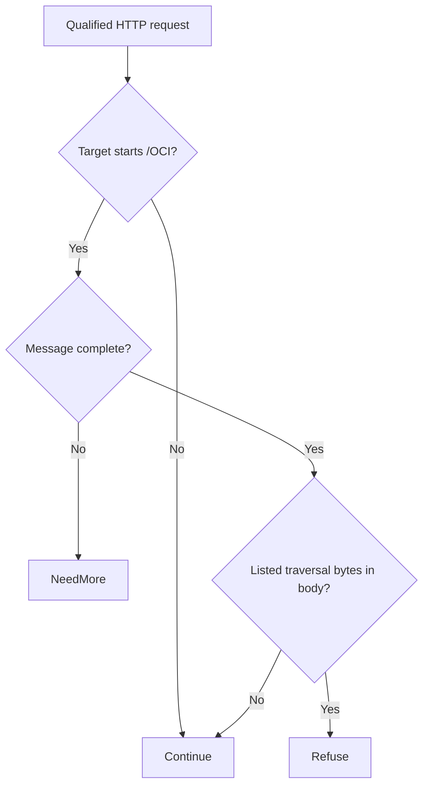

# Cisco BroadWorks OCI XML parser file disclosure (CVE-2026-20320)

An unauthenticated caller can exploit external entity resolution in the affected Cisco BroadWorks OCI XML parser to read configuration information. Upgrade to protect deployment details readable by the parser.

[Public CVE record](https://cve.now/CVE-2026-20320) · [Vendor or publisher advisory](https://sec.cloudapps.cisco.com/security/center/content/CiscoSecurityAdvisory/cisco-sa-bworks-xxe-uwUd7CEt) · [Source and API bundle](../../cve/CVE-2026-20320/README.md)

**Patch title.** Cisco BroadWorks OCI XML Parser File Disclosure Guard (`cisco-broadworks-oci-xml-parser-file-disclosure-guard` in the registry). The [original source snapshot](https://github.com/eden-dev-inc/cve/blob/9a7217a0a882374c5ab97d74c96df9b77637f923/cve/CVE-2026-20320/http-request-filter/src/lib.rs) preserves the source available for the historical report.

| Field | Value |
| --- | --- |
| Affected component and versions | Cisco BroadWorks · see the advisory for affected versions and configuration |
| Fixed release | RI.2026.07 |
| Severity | CVSS 7.5 |
| Evidence status | Lab comparison recorded |
| Test environment | Lab fixture or affected build documented in the evidence below |
| Eden release and module version | 1.103.0 · module 1.0.0 |
| Tested at | 2026-11-11 UTC |
| First publicly published | 2026-11-12T02:29:06Z |

*[cve.now](https://cve.now/CVE-2026-20320) entry.*

Eden terminates the HTTP connection to the affected product, evaluates a
declarative policy and — in tier 2 — a separately compiled native Rust module
under signed module authority, before any byte reaches the application. It does
**not** patch the affected component; the vendor's fixed release remains the
durable repair.

**Status: live two-tier remediation recorded 2026-11-11 on the installed `eden-product-release:1.103.0-single` lab container (image `sha256:809293e1f0b525ac04698d1fa8d7ffdc66cbee1ff690b082ba26b4d050f08416`). The module refuses
the traversal primitive inside OCI bodies; other members/routes are out of
scope and the rule is stated as partial.**

## The vulnerability

The Cisco BroadWorks OCI XML parser lets an unauthenticated remote
attacker read files via a traversal in an XML member. Fixed in
RI.2026.07.

## The Eden patch

**Tier 1 — declarative policy (blunt, fail-closed):** `deny` on the affected
route family — takes the whole surface offline, legitimate calls included.

**Tier 2 — native module:** `gabriel_broadworks_v1`, binary SHA-256 `947a9d9d51a374457e13bced7f0e7530c821741979174d0ff235a484c0624f54`
(source `b5c95de628285b788186ef5b6d903ef99e75eaa5a56cfd7c10c696099fb13a9a`). See the comparison table for what it keys, and the
honest scope for what it cannot.

## Implement the remediation

The commands are operator examples for the recorded scope. Compare fixture routes and software selectors with the intended deployment before use. See [deployment prerequisites](../deployment.md).

1. **Prepare the target.** Verify the loaded product and version against the advisory. Use a compatible Eden HTTP interlay and an authenticated operator with Configure permission. Open the [deployment example](../../cve/CVE-2026-20320/http-request-filter/deployment.json) and [API instructions](../../cve/CVE-2026-20320/http-request-filter/api.md). The bundle identifies registry package `cisco-broadworks-oci-xml-parser-file-disclosure-guard` at version `1.0.0` and the SDK revision in [patch.toml](../../cve/CVE-2026-20320/http-request-filter/patch.toml). Run the policy extraction from the adapter directory.
2. **Apply the declarative policy.** Scope the policy to `/OCI` and descendants (all methods, `deny`). Set `INTERLAY` to the target interlay UUID in the authenticated Eden CLI. Run an authenticated `GET /api/v1/interlays/{interlay}` with `X-Eden-Verbose: true`. Save its complete current settings object as `current-settings.json` and retain the prior remediation declaration for recovery. Set `IDEMPOTENCY_KEY` to a fresh key for this intended mutation.

```sh
jq -e '.tier1' deployment.json > remediation.json
jq -e --slurpfile policy remediation.json \
  '.remediation = $policy[0] | {settings: .}' current-settings.json \
  > interlay-update.json
eden api request PATCH "/api/v1/interlays/$INTERLAY" \
  --header "Idempotency-Key:$IDEMPOTENCY_KEY" \
  --body-file interlay-update.json --content-type application/json --confirm
```

3. **Verify the serving policy.** Read back the interlay.

```sh
eden api request GET "/api/v1/interlays/$INTERLAY" \
  --header 'X-Eden-Verbose:true'
```

Check that `remediation_status.state` is `ready` and both desired and effective SHA-256 values match the intended declaration. Replay the benign and marked requests in the recorded comparison on an isolated target. Check the recorded response and backend outcome for each probe. Use the request and expected-status table in the linked API example alongside the observed comparison.
4. **Restore the previous policy.** Coordinate the change with any other operator updating this interlay. Read current settings again and merge the saved remediation field into them. If the prior settings had no remediation field, omit it in the replacement. Send the same PATCH with a fresh idempotency key, then read back the intended state. Repeat the verification probes. Keep the affected route isolated if restoring the prior settings reopens exposure.

### Native module `gabriel_broadworks_v1`

1. **Prepare the archive.** Use the [version 1.0.0 bundle](../../cve/CVE-2026-20320/README.md) for source, target, and build profile. Configure independent host approval for the installed Eden release. Use the authenticated principals required by the native authority contract. Set `PATCH_ARCHIVE` to the exact schema-2 package and `PACKAGE_SHA256` to its expected archive digest. Verify and import it using the same target interlay.

```sh
printf '%s  %s\n' "$PACKAGE_SHA256" "$PATCH_ARCHIVE" | sha256sum --check &&
  eden api request PUT "/api/v1/interlays/$INTERLAY/patch-packages/$PACKAGE_SHA256" \
    --body-file "$PATCH_ARCHIVE" \
    --content-type application/vnd.eden.patch-package.v2+tar --confirm
```

2. **Approve and activate.** Enroll the publisher key, attest host software inventory, and inspect the configuration returned by import. Obtain independent host approval. Sign the typed statement with the matching SDK. Send the admit action followed by activate for the prepared operation. Use the applicable typed payload for each action in `authority-action.json`.

```sh
eden api request POST "/api/v1/interlays/$INTERLAY/native-authority" \
  --body-file authority-action.json --content-type application/json --confirm
```

3. **Verify the operation.** Read the receipt through the same endpoint. Confirm `serving_now` and the full expected shard acknowledgment. Repeat the report’s benign and marked probes and check the backend observations.
4. **Revoke or restore.** Send revoke with the exact operation UUID. Mandatory protection can refuse traffic until a compatible operation is approved and activated. Verify the restored receipt and repeat the probes.

**Vendor update.** Use the [advisory](https://sec.cloudapps.cisco.com/security/center/content/CiscoSecurityAdvisory/cisco-sa-bworks-xxe-uwUd7CEt) to select the fixed release for the installed branch. Reported fixed releases include `RI.2026.07`. Follow the vendor’s update instructions and confirm the version actually loaded by the service.

## Measured comparison (live, 2026-11-11)

| Probe | Baseline (unprotected) | Tier 1 | Tier 2 (module) |
| --- | --- | --- | --- |
| benign_oci_request | 200 | 403 | 200 |
| attack_traversal_xml | 200 (`file_read` ×1) | 403 | 403 |

## Performance trace (Eden telemetry, live 2026-11-11)

Measured with Eden's built-in request telemetry (`gateway.request.baseline`
spans, read back through `/api/v1/analytics/telemetry?signal=traces`), not
client wall-clock. Latency Eden introduces per remediation arm for this case:

| Arm | n | mean | p50 | p95 | min–max |
| --- | --- | --- | --- | --- | --- |
| **Tier 1** — declarative policy, blocked request (403) | 15 | 27 µs | 21 µs | 47 µs | 14 µs–47 µs |
| **Tier 2** — native module, benign passes through (200) | 23 | 470 µs | 443 µs | 614 µs | 398 µs–646 µs |
| **Tier 2** — native module, attack refused (403) | 14 | 140 µs | 129 µs | 220 µs | 108 µs–220 µs |

**Eden-added latency for the tier-2 remediation:** benign requests complete in **470 µs** mean (p50 443 µs, p95 614 µs) in-product, module evaluation included.
*Honest scope: lab fixtures on one host, fresh connection per measured
request, warm requests only; module reactivated shards 2/2 with a fresh signed
statement per measurement; spans carry the full authority lineage (module
SHA-256, operation, publication). Not the EDEN-3640 performance
qualification contract.*

*Tested against: `eden-product-release:1.103.0-single` (image `sha256:809293e1f0b525ac…`, build target
`eden_service_single`, tooling revision `81a0724a…`). Raw data:
`module2/telemetry-ab/broadworks-telemetry.json` and `module2/tier1-ab/broadworks-tier1.json`.*

## Authority lifecycle and negatives

Driven through the full signed lifecycle (`module2/evidence/broadworks-module.json`):
`enroll_key` (Ed25519 public key), independent-host `inventory`, `inspect`
(bindings derived without mapping code), host `approve`, signed `admit`
(`prepared`, `serving_now: false`), `activate` — receipt **`serving_now: true`,
`applied_shards == expected_shards` (2/2)**.
Negatives held: read-only `inspect` -> 403, tampered statement binding -> 400,
flipped signature bit -> 403. `revoke` failed the interlay **closed** (503,
nothing forwarded, zero backend effects) and a fresh host approval plus a
newly signed activation restored the module's behavior.

## Honest scope

The fixture replicates the delivery shape and exploit prerequisite with a
harmless marker effect; no real vendor component runs here. The module keys
only the primitive listed above — bypass variants (encodings, alternate routes,
crafted members other than the one keyed) are **not bypass-tested** and are out
of scope; the rule is a lab-grade partial by construction. The vendor's fixed
release remains the durable repair. Perf: request-path A/B not re-run for this
batch (see README); activation telemetry measured ~0.14 s one-time load.

## Cost record (per-CVE ledger)

**$0.0789 USD** (marginal session growth: 1,128,044 in + 46 out tokens, 3 turns; shared debug windows overlap).

## Evidence appendix

- [cve.now entry](https://cve.now/CVE-2026-20320)
- Raw evidence: `gabriel-2026-11-11/module2/evidence/broadworks-module.json`
- Deployment: installed `eden-product-release:1.103.0-single` lab container (image `sha256:809293e1f0b525ac04698d1fa8d7ffdc66cbee1ff690b082ba26b4d050f08416`)
- Skill: [eden-vulnerability-remediation](../deployment.md)


## Decision flow



The diagram sketches the available source’s content decision after input metadata is available. Continue is a module decision; the host and backend still determine final forwarding and effects.

## Complete native module source

The complete available source for `gabriel_broadworks_v1` is reproduced below from the [original source snapshot](https://github.com/eden-dev-inc/cve/blob/9a7217a0a882374c5ab97d74c96df9b77637f923/cve/CVE-2026-20320/http-request-filter/src/lib.rs). The source SHA-256 is `b5c95de628285b788186ef5b6d903ef99e75eaa5a56cfd7c10c696099fb13a9a`. This identifies the source bytes, rather than independently proving the binary build or the recorded test results. The case’s experiment status and limitations still apply, including any failed import, partial coverage, or withdrawn claim. Original source comments are preserved verbatim.

```rust
//! Gabriel module: refuse traversal inside OCI XML members (CVE-2026-20320 shape)
//!
//! CVE-2026-20320: the Cisco BroadWorks OCI XML parser lets an
//! unauthenticated attacker read files via traversal in an XML member.
//! This module refuses OCI bodies carrying the traversal primitive;
//! ordinary XML requests pass unchanged. no_std; no allocator, storage, background work or state.

#![no_std]

use core::mem::size_of;
use core::panic::PanicInfo;
use eden_gateway_remediation::message::{Availability, MessageInput};
use eden_gateway_remediation::module::{
    ApiHeader, CONTINUE, Decision, EDIT, EditSink, Edits, Failure, ModuleOutput, NEED_MORE, REFUSE, RemediationModule,
};
use eden_gateway_remediation::native_http_v3::{self as http, Api, Input, Request};

/// Route prefix in scope.
const ROUTE: &[u8] = b"/OCI";

/// The byte primitives this module refuses on that route.
static NEEDLES: [&[u8]; 3] = [b"../", b"..%2f", b"..%2F"];

fn find(haystack: &[u8], needle: &[u8]) -> Option<usize> {
    if haystack.len() < needle.len() || needle.is_empty() {
        return None;
    }
    let mut i = 0usize;
    while i + needle.len() <= haystack.len() {
        let mut j = 0usize;
        let mut same = true;
        while j < needle.len() {
            if haystack[i + j] != needle[j] {
                same = false;
                break;
            }
            j += 1;
        }
        if same {
            return Some(i);
        }
        i += 1;
    }
    None
}

struct gabriel_broadworks_v1;

impl RemediationModule<Request<'_>> for gabriel_broadworks_v1 {
    fn evaluate(&self, request: &Request<'_>, edits: &mut Edits<'_>) -> Result<Decision, Failure> {
        let _ = edits;
        let _ = match request.header_count() {
            Availability::Ready(count) => count,
            Availability::NeedMore => return Ok(Decision::NeedMore),
            Availability::Unavailable => return Err(Failure),
        };
        let message = request.message();
        let head = message.prefix();
        let line_end = head.iter().position(|&b| b == b'\r').unwrap_or(head.len());
        let request_line = &head[..line_end];
        let path_at = request_line.iter().position(|&b| b == b' ').unwrap_or(request_line.len());
        let target = &request_line[path_at + 1..];
        if !target.starts_with(ROUTE) {
            return Ok(Decision::Continue);
        }
        if !message.is_complete() {
            return Ok(Decision::NeedMore);
        }
        let body_range = match request.body_range() {
            Availability::Ready(range) => range,
            Availability::NeedMore => return Ok(Decision::NeedMore),
            Availability::Unavailable => return Err(Failure),
        };
        let body = match message.bytes(body_range)? {
            Availability::Ready(bytes) => bytes,
            Availability::NeedMore => return Ok(Decision::NeedMore),
            Availability::Unavailable => return Err(Failure),
        };
        if NEEDLES.iter().any(|n| find(body, n).is_some()) {
            return Ok(Decision::Refuse);
        }
        Ok(Decision::Continue)
    }
}

static API: Api = Api {
    header: ApiHeader { version: http::VERSION, table_size: size_of::<Api>() as u32 },
    input_size: size_of::<Input>() as u32,
    output_size: size_of::<ModuleOutput>() as u32,
    sink_size: size_of::<EditSink>() as u32,
    message_size: size_of::<MessageInput>() as u32,
    state_bytes: 0,
    capabilities: CONTINUE | REFUSE | NEED_MORE | EDIT,
    required_inputs: 0,
    evaluate: Some(evaluate),
};

unsafe extern "C" fn evaluate(input: *const Input, sink: *const EditSink, output: *mut ModuleOutput) -> i32 {
    unsafe { http::invoke(&gabriel_broadworks_v1, input, sink, output) }
}

#[unsafe(no_mangle)]
pub extern "C" fn eden_http_remediation_v3() -> *const Api {
    &API
}

#[panic_handler]
fn panic(_information: &PanicInfo<'_>) -> ! {
    loop {
        core::hint::spin_loop();
    }
}
```
