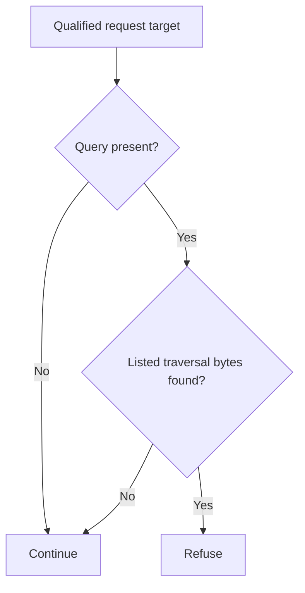

# Atlassian Data Center unauthenticated root-directory file access (CVE-2026-21589)

An unauthenticated caller can read certain server files on affected Atlassian Data Center and Server products. Apply the appropriate product update to protect local files exposed through the application.

**Patch title.** Atlassian Data Center Root-directory File Access Guard (`atlassian-data-center-root-directory-file-access-guard` in the registry). The [original source snapshot](https://github.com/eden-dev-inc/cve/blob/9a7217a0a882374c5ab97d74c96df9b77637f923/cve/CVE-2026-21589/http-request-filter/src/lib.rs) preserves the source available for the historical report.

[Public CVE record](https://cve.now/CVE-2026-21589) · [Source and API bundle](../../cve/CVE-2026-21589/README.md)

| Field | Value |
| --- | --- |
| Affected component and versions | See the advisory for the affected versions of each product or package: Bamboo Data Center, Bitbucket Data Center, Confluence Data Center, Crowd Data Center, Crucible Data Center, Fisheye Data Center, Jira Service Management Data Center, Jira Software Data Center |
| Fixed release | See the advisory for product-specific fixes |
| Severity | CVSS 9.3 |
| Evidence status | Lab comparison recorded |
| Test environment | Lab fixture or affected build documented in the evidence below |
| Eden release and module version | 1.103.0 · module 1.0.0 |
| Tested at | 2026-11-11 UTC |
| First publicly published | 2026-11-12T02:29:06Z |

*Atlassian Bamboo, Bitbucket, Confluence, Crowd, Crucible, Fisheye, Jira (fixed releases per advisory) — [cve.now](https://cve.now/CVE-2026-21589) month ranking entry.*

Eden terminates the HTTP connection to the affected product, evaluates a
declarative policy and — in tier 2 — a separately compiled native Rust module
under signed module authority, before any byte reaches the application. This
removes the delivery primitive from the network path. It does **not** patch
the affected Atlassian instance; the vendor's fixed release remains the
durable repair.

**Status: live two-tier remediation recorded 2026-11-11 on the installed `eden-product-release:1.103.0-single` lab container (image `sha256:809293e1f0b525ac04698d1fa8d7ffdc66cbee1ff690b082ba26b4d050f08416`).**

## The vulnerability

An unauthenticated remote attacker accesses specific files within the web
application root directory, exposing sensitive information in some
configurations. KEV-listed, public exploit tooling.

The fleet challenge for this class is unchanged from the portfolio: the
durable fix is the vendor's patched release, but fleets contain appliances
and long-lived deployments that cannot upgrade inside an exploitation window
(KEV-listed, public tooling). Eden's boundary removes the delivery primitive
from the network path immediately, at a separately compiled enforcement point,
without touching the application host.

## The Eden patch

**Tier 1 — declarative policy (blunt, fail-closed):** `deny` on `/plugins` GET
descendants — takes the whole plugin surface offline, including ordinary
plugin routes. Fail-closed with no content awareness.

**Tier 2 — native module (surgical):** `gabriel_attraversal_v1` refuses
requests whose *query string* carries the parent-directory byte sequence
`../` or its percent-encoded form — the traversal primitive as delivered
through the file parameter of a plugin route; ordinary query strings pass
unchanged.

Module `gabriel_attraversal_v1`, binary SHA-256 `40f734441b396733d1917ce5cd4bc3e4e78a295766951c2d84f1c38a6f464a1d`
(source `64c298cfc92e80fbca23e696d9b2b180c2045da6a8d99f0013c9be4a7a09d11c`),
keys `../` sequences inside the request query string.

## Implement the remediation

The commands are operator examples for the recorded scope. Compare fixture routes and software selectors with the intended deployment before use. See [deployment prerequisites](../deployment.md).

1. **Prepare the target.** Verify the loaded product and version against the advisory. Use a compatible Eden HTTP interlay and an authenticated operator with Configure permission. Open the [deployment example](../../cve/CVE-2026-21589/http-request-filter/deployment.json) and [API instructions](../../cve/CVE-2026-21589/http-request-filter/api.md). The bundle identifies registry package `atlassian-data-center-root-directory-file-access-guard` at version `1.0.0` and the SDK revision in [patch.toml](../../cve/CVE-2026-21589/http-request-filter/patch.toml). Run the policy extraction from the adapter directory.
2. **Apply the declarative policy.** Scope the policy to `/plugins` and descendants (GET, `deny`). Set `INTERLAY` to the target interlay UUID in the authenticated Eden CLI. Run an authenticated `GET /api/v1/interlays/{interlay}` with `X-Eden-Verbose: true`. Save its complete current settings object as `current-settings.json` and retain the prior remediation declaration for recovery. Set `IDEMPOTENCY_KEY` to a fresh key for this intended mutation.

```sh
jq -e '.tier1' deployment.json > remediation.json
jq -e --slurpfile policy remediation.json \
  '.remediation = $policy[0] | {settings: .}' current-settings.json \
  > interlay-update.json
eden api request PATCH "/api/v1/interlays/$INTERLAY" \
  --header "Idempotency-Key:$IDEMPOTENCY_KEY" \
  --body-file interlay-update.json --content-type application/json --confirm
```

3. **Verify the serving policy.** Read back the interlay.

```sh
eden api request GET "/api/v1/interlays/$INTERLAY" \
  --header 'X-Eden-Verbose:true'
```

Check that `remediation_status.state` is `ready` and both desired and effective SHA-256 values match the intended declaration. Replay the benign and marked requests in the recorded comparison on an isolated target. Check the recorded response and backend outcome for each probe. Use the request and expected-status table in the linked API example alongside the observed comparison.
4. **Restore the previous policy.** Coordinate the change with any other operator updating this interlay. Read current settings again and merge the saved remediation field into them. If the prior settings had no remediation field, omit it in the replacement. Send the same PATCH with a fresh idempotency key, then read back the intended state. Repeat the verification probes. Keep the affected route isolated if restoring the prior settings reopens exposure.

### Native module `gabriel_attraversal_v1`

1. **Prepare the archive.** Use the [version 1.0.0 bundle](../../cve/CVE-2026-21589/README.md) for source, target, and build profile. Configure independent host approval for the installed Eden release. Use the authenticated principals required by the native authority contract. Set `PATCH_ARCHIVE` to the exact schema-2 package and `PACKAGE_SHA256` to its expected archive digest. Verify and import it using the same target interlay.

```sh
printf '%s  %s\n' "$PACKAGE_SHA256" "$PATCH_ARCHIVE" | sha256sum --check &&
  eden api request PUT "/api/v1/interlays/$INTERLAY/patch-packages/$PACKAGE_SHA256" \
    --body-file "$PATCH_ARCHIVE" \
    --content-type application/vnd.eden.patch-package.v2+tar --confirm
```

2. **Approve and activate.** Enroll the publisher key, attest host software inventory, and inspect the configuration returned by import. Obtain independent host approval. Sign the typed statement with the matching SDK. Send the admit action followed by activate for the prepared operation. Use the applicable typed payload for each action in `authority-action.json`.

```sh
eden api request POST "/api/v1/interlays/$INTERLAY/native-authority" \
  --body-file authority-action.json --content-type application/json --confirm
```

3. **Verify the operation.** Read the receipt through the same endpoint. Confirm `serving_now` and the full expected shard acknowledgment. Repeat the report’s benign and marked probes and check the backend observations.
4. **Revoke or restore.** Send revoke with the exact operation UUID. Mandatory protection can refuse traffic until a compatible operation is approved and activated. Verify the restored receipt and repeat the probes.

**Vendor update.** Use the [advisory](https://cve.now/CVE-2026-21589) and its product-specific vendor references to select the fixed release for the exact installed product or package and release line. Follow its update instructions and confirm the version actually loaded by the service.

## Measured comparison (live, 2026-11-11)

| Probe | Baseline (unprotected) | Tier 1 | Tier 2 (module) |
| --- | --- | --- | --- |
| benign_dashboard | 200 | 200 | 200 |
| benign_file_read (`?file=conf/app.txt`) | 200 | 403 | 200 |
| attack_query_traversal (`?file=../../webapp/secret.properties`) | 200 (`file_read` ×1) | 403 | **403 (`file_read` ×0)** |
| native_path_traversal_refused (`/../..` in raw path) | 400 | 400 | 501 |

**Recorded product strengths (measured, not module claims):** raw `../`
inside the request *path* is refused natively by Eden's ingress with 400
`HTTP method or request target is unsupported` — the raw path form never
reaches the backend even unprotected, so the module-provable delivery shape
is the query/parameter form. With a native module active, the protected
forwarding profile additionally refuses the malformed path with 501
(E1A54-class) — stricter than the baseline 400. Both are preserved in the
table as honest observations.

## Performance trace (Eden telemetry, live 2026-11-11)

Measured with Eden's built-in request telemetry (`gateway.request.baseline`
spans, read back through `/api/v1/analytics/telemetry?signal=traces`), not
client wall-clock. Latency Eden introduces per remediation arm for this case:

| Arm | n | mean | p50 | p95 | min–max |
| --- | --- | --- | --- | --- | --- |
| **Tier 1** — declarative policy, blocked request (403) | 15 | 27 µs | 22 µs | 44 µs | 17 µs–44 µs |
| **Tier 2** — native module, benign passes through (200) | 21 | 372 µs | 352 µs | 505 µs | 313 µs–552 µs |
| **Tier 2** — native module, attack refused (403) | 14 | 142 µs | 129 µs | 233 µs | 117 µs–233 µs |

**Eden-added latency for the tier-2 remediation:** benign requests complete in **372 µs** mean (p50 352 µs, p95 505 µs) in-product, module evaluation included.
*Honest scope: lab fixtures on one host, fresh connection per measured
request, warm requests only; module reactivated shards 2/2 with a fresh signed
statement per measurement; spans carry the full authority lineage (module
SHA-256, operation, publication). Not the EDEN-3640 performance
qualification contract.*

*Tested against: `eden-product-release:1.103.0-single` (image `sha256:809293e1f0b525ac…`, build target
`eden_service_single`, tooling revision `81a0724a…`). Raw data:
`module2/telemetry-ab/attraversal-telemetry.json` and `module2/tier1-ab/attraversal-tier1.json`.*

## Authority lifecycle and negatives

Reached the serving process only through the full signed lifecycle
(`module2/evidence/attraversal-module.json`): `enroll_key` (Ed25519 public
key), independent-host `inventory`, `inspect` (bindings derived without
mapping code), host `approve`, signed `admit` (`prepared`, `serving_now:
false`), `activate` — receipt **`serving_now: true`,
`applied_shards == expected_shards` (2/2)**. Negatives held: read-only
`inspect` -> 403, tampered statement binding -> 400, flipped signature bit
-> 403. `revoke` made the interlay **fail closed** (503, nothing forwarded,
zero backend effects) and a fresh host approval plus a newly signed activation
restored surgical protection (the traversal probe was refused 403 again).

## Honest scope

The fixture replicates the delivery shape and exploit prerequisite with
harmless marker effects; no real Atlassian Data Center product runs here.
Traversal delivered in bodies or non-query parameters of other routes, and
traffic off this boundary, are out of scope. Modules are lab-grade rules
for the fixture delivery shapes, not production patches. Perf: the
request-path A/B was not re-run for this batch (see README); activation
telemetry measured ~0.14 s one-time load.

## Cost record (per-CVE ledger)

**$0.0768 USD** nominal (marginal session growth over this case's window:
1,098,339 input + 54 output tokens across 3 assistant turns; the window
included the delivery-shape investigation that found the native path refusal).

## Evidence appendix

- [cve.now entry](https://cve.now/CVE-2026-21589)
- Raw evidence: `gabriel-2026-11-11/module2/evidence/attraversal-module.json`
- Deployment: installed `eden-product-release:1.103.0-single` lab container (image `sha256:809293e1f0b525ac04698d1fa8d7ffdc66cbee1ff690b082ba26b4d050f08416`)
- Skill: [eden-vulnerability-remediation](../deployment.md)

## Decision flow



The available module scans the query without a route-specific prefix gate. It covers the listed byte patterns, not every separator or encoding covered by the vendor mitigation.

## Complete native module source

The complete available source for `gabriel_attraversal_v1` is reproduced below from the [original source snapshot](https://github.com/eden-dev-inc/cve/blob/9a7217a0a882374c5ab97d74c96df9b77637f923/cve/CVE-2026-21589/http-request-filter/src/lib.rs). The source SHA-256 is `64c298cfc92e80fbca23e696d9b2b180c2045da6a8d99f0013c9be4a7a09d11c`. This identifies the source bytes, rather than independently proving the binary build or the recorded test results. The case’s experiment status and limitations still apply, including any failed import, partial coverage, or withdrawn claim. Original source comments are preserved verbatim.

```rust
//! Gabriel module: refuse path-traversal byte sequences on any route
//! (CVE-2026-21589 shape).
//!
//! CVE-2026-21589: unauthenticated attackers read files inside the web
//! application root of Atlassian Data Center products. The traversal is
//! delivered through a file parameter on plugin routes (raw `../` inside the
//! request *path* is natively refused by Eden's ingress request-target
//! validation, so the delivery shape that reaches this boundary carries the
//! primitive in the query string). This module refuses any request whose
//! query string contains the parent-directory byte sequence `../` or its
//! percent-encoded form; ordinary query strings and paths pass unchanged.
//! no_std.

#![no_std]

use core::mem::size_of;
use core::panic::PanicInfo;
use eden_gateway_remediation::message::{Availability, MessageInput};
use eden_gateway_remediation::module::{
    ApiHeader, CONTINUE, Decision, EDIT, EditSink, Edits, Failure, ModuleOutput, NEED_MORE, REFUSE, RemediationModule,
};
use eden_gateway_remediation::native_http_v3::{self as http, Api, Input, Request};

/// The traversal primitive, plain and percent-encoded (case-insensitive).
const TRAVERSAL: &[u8] = b"../";
const TRAVERSAL_ENC: &[u8] = b"..%2f";
const TRAVERSAL_ENC_UPPER: &[u8] = b"..%2F";

fn find(haystack: &[u8], needle: &[u8]) -> Option<usize> {
    if haystack.len() < needle.len() || needle.is_empty() {
        return None;
    }
    let mut i = 0usize;
    while i + needle.len() <= haystack.len() {
        let mut j = 0usize;
        let mut same = true;
        while j < needle.len() {
            if haystack[i + j] != needle[j] {
                same = false;
                break;
            }
            j += 1;
        }
        if same {
            return Some(i);
        }
        i += 1;
    }
    None
}

fn find_ignore_case(haystack: &[u8], needle: &[u8]) -> Option<usize> {
    if haystack.len() < needle.len() || needle.is_empty() {
        return None;
    }
    let mut i = 0usize;
    while i + needle.len() <= haystack.len() {
        let mut j = 0usize;
        let mut same = true;
        while j < needle.len() {
            if haystack[i + j].to_ascii_lowercase() != needle[j].to_ascii_lowercase() {
                same = false;
                break;
            }
            j += 1;
        }
        if same {
            return Some(i);
        }
        i += 1;
    }
    None
}

struct RefuseTraversal;

impl RemediationModule<Request<'_>> for RefuseTraversal {
    fn evaluate(&self, request: &Request<'_>, edits: &mut Edits<'_>) -> Result<Decision, Failure> {
        let _ = edits;
        let _ = match request.header_count() {
            Availability::Ready(count) => count,
            Availability::NeedMore => return Ok(Decision::NeedMore),
            Availability::Unavailable => return Err(Failure),
        };
        let message = request.message();
        let head = message.prefix();
        let line_end = head.iter().position(|&b| b == b'\r').unwrap_or(head.len());
        let request_line = &head[..line_end];
        let path_at = request_line.iter().position(|&b| b == b' ').unwrap_or(request_line.len());
        let target = &request_line[path_at + 1..];
        let q_at = target.iter().position(|&b| b == b'?');
        let query = match q_at {
            Some(at) => &target[at + 1..],
            None => return Ok(Decision::Continue),
        };
        if find(query, TRAVERSAL).is_some()
            || find_ignore_case(query, TRAVERSAL_ENC).is_some()
            || find_ignore_case(query, TRAVERSAL_ENC_UPPER).is_some()
        {
            return Ok(Decision::Refuse);
        }
        Ok(Decision::Continue)
    }
}

static API: Api = Api {
    header: ApiHeader { version: http::VERSION, table_size: size_of::<Api>() as u32 },
    input_size: size_of::<Input>() as u32,
    output_size: size_of::<ModuleOutput>() as u32,
    sink_size: size_of::<EditSink>() as u32,
    message_size: size_of::<MessageInput>() as u32,
    state_bytes: 0,
    capabilities: CONTINUE | REFUSE | NEED_MORE | EDIT,
    required_inputs: 0,
    evaluate: Some(evaluate),
};

unsafe extern "C" fn evaluate(input: *const Input, sink: *const EditSink, output: *mut ModuleOutput) -> i32 {
    unsafe { http::invoke(&RefuseTraversal, input, sink, output) }
}

#[unsafe(no_mangle)]
pub extern "C" fn eden_http_remediation_v3() -> *const Api {
    &API
}

#[panic_handler]
fn panic(_information: &PanicInfo<'_>) -> ! {
    loop {
        core::hint::spin_loop();
    }
}
```
