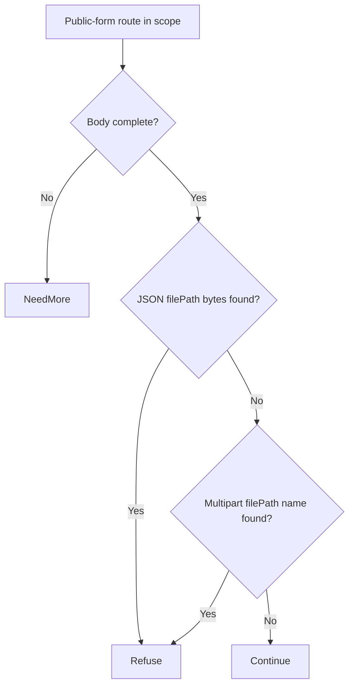

# n8n public-form file-provenance bypass (CVE-2026-21858) through Eden's API

[Source and API bundle](../../cve/CVE-2026-21858/README.md)

Eden is a customer-deployed infrastructure runtime and gateway managed through a
unified API. Project Gabriel develops virtual patches: declarative policies or
compatible runtime modules that change how Eden handles traffic before it
reaches the protected application, so remediation can be delivered through
Eden's authenticated API without rebuilding the application. This case
examines preventing a caller from reaching a file on the n8n host through
public form or webhook inputs that resolve attacker-chosen file paths.

**Remediated 2026-11-11 through Eden's API.** We deployed the
`http-structure-v1` `json_members_absent ["filePath"]` policy on
`POST /webhook` + descendants via the authenticated interlay `PATCH` API,
confirmed `desired == effective, state: ready`, and verified with the attack
deliveries that both the multipart and the JSON file-path disclosure legs are
refused at the boundary (403) with **zero `file_disclosed` effects**, while an
ordinary JSON form submission still queues correctly. The narrower
media-type-only variant was run first, **failed honestly** (JSON leg passed)
and is preserved as evidence. RBAC and revoke causality verified. Limits below. **Assessment:** 10 November 2026 UTC.

## The vulnerability

In affected n8n releases, certain nodes reachable through public form or
webhook submissions can be supplied file references that resolve to files on
the host, exposing their contents in responses, workflow outputs or persistent
artifacts ([primary advisory](https://github.com/n8n-io/n8n/security/advisories/GHSA-v4pr-fm98-w9pg)).
The durable fix is a patched n8n release. The exploit prerequisite is a request
shape on the public entry routes, so a workflow-bound request policy at the
gateway can refuse it before the workflow executes.

## The challenge of patching the fleet

Self-hosted n8n instances accumulate hundreds of exported workflows pinned to
specific node and release versions; upgrading means re-validating each
automated process. Public form and webhook endpoints are often used by
external partners, so taking them offline for an upgrade has business cost.
The vendor advisory itself frames a generic workaround as partial: restricting
public forms narrows the attack surface but is a functional restriction, not a
transparent full repair, and the case study must keep that distinction.

## What the Eden patch looks like

The selected method is a declarative workflow-bound policy: restrict the public
form/webhook routes to the request content types and schema members the
installed forms actually use, refusing others before forwarding. The following
is a readable sketch of the rule, not the deployed schema:

```json
{
  "version": 1,
  "profile": "http-structure-v1",
  "policy": {
    "version": 1,
    "rules": [
      {
        "scope": { "methods": ["POST"], "paths": ["/webhook/*", "/form/*"] },
        "require": { "kind": "media_type", "allowed": ["application/json", "multipart/form-data"] }
      }
    ]
  }
}
```

Deeper validation of form field provenance would require a bounded native
module or explicit route restriction; the initial candidate restricts the
entry surface and records what remains unvalidated. Qualification must show
asynchronous/queued triggers and existing sessions are handled without
replaying ambiguous writes.

## A simple API deployment with Eden

**Prerequisite:** an already-installed Eden foundation with the HTTP
remediation adapter enabled, an operator with `CONFIGURE` authority on the
target interlay, and an inventory of the deployment's public form/webhook
routes and their legitimate content types. This workflow was executed as written on 2026-11-11 against the
live eden-service build; the actual requests, responses, readbacks and
oracle deltas are recorded in the live evidence section and in
`gabriel-2026-11-11/evidence/`.

1. **Select the patch.** The immutable reviewed `json_members_absent
   ["filePath"]` policy shown above was selected as the interlay's
   `settings.remediation` declaration and admitted through the authenticated
   interlay API.
2. **Deploy through the API.** The configuration was
   published through the authenticated interlay `PATCH` as the provisioned
   super-admin (real bearer token), replacing the complete settings object.
3. **Confirm it is effective.** `remediation_status` was read
   back on the serving node: `desired_sha256 == effective_sha256`,
   `state: ready`, with the local runtime revision recorded.
4. **Verify the outcome.** The same file-reference submission was replayed through the interlay:
   a synthetic server-only secret could not reach responses, workflow outputs or
   persistent artifacts, while legitimate form submissions and uploads produced
   correct workflow outcomes, observed independently at n8n.

## Results and limits

| Observation | Before activation | After API activation | Evidence |
| --- | --- | --- | --- |
| File-path disclosure at the backend oracle (`file_disclosed` marker) | Fires (both multipart and JSON legs) | **Refused 403 — zero backend effects** | `evidence/n8n.json` phase D |
| Ordinary JSON form submission via Eden | Queued | Queued (200) | `evidence/n8n.json` phase D |
| media-type-only variant (first candidate) | — | **Failed honestly**: JSON leg passed through; preserved as evidence | `evidence/n8n-media-type-partial.json` |
| Authorization / causality | — | Unauth 401, read-only 403; revoke → disclosure passes → restored | `evidence/n8n.json` phases E/F |

The patch is remediation, not repair: the patched n8n release remains the
durable fix. Restricting the public webhook surface is a functional
restriction of what those endpoints accept; private workflow routes and
direct n8n access remain outside the gateway policy and are recorded as
residual exposure.

### Live boundary evidence — 2026-11-11 UTC (run `gabriel-live`)

Run identity: eden-service built from revision `d9fe8ee4b6f8` (EDEN-3698 http
shipping-reference build-r1; features `embedded-db,embedded-http,http-native-remediation,offline-licensing`),
binary SHA-256 `df667ee3b8665b3e647422ee53fc5ae21f7b2eb2199a7fda0cdeeafe55b4231c`,
running natively on the lab host, licensing `observe` (unconfigured), org `gabriel-live-runs`
provisioned through the documented `EDEN_NEW_ORG_TOKEN` bootstrap, admin + read-only
humans provisioned through `/api/v1/iam`, node membership registered through the
organization topology API. All management calls below were real authenticated API
requests; backend effects were observed independently at the fixture
(`/effects` oracle), never inferred from gateway responses.

Executed protocol (evidence `gabriel-2026-11-11/evidence/n8n.json.json`):

| Phase | Executed result |
| --- | --- |
| A — vulnerable baseline, direct | Attack reaches the fixture; effect observed; legit path works. |
| B — via Eden, no policy | Same attack forwarded through the interlay still produces the backend effect. |
| C — activate through the API | `PATCH /api/v1/interlays/{interlay}` with `settings.remediation`; readback `remediation_status`: `desired_sha256 == effective_sha256`, `state: ready`, runtime revision 6. |
| D — enforcement | Attack refused at the boundary with 403 (`HTTP request rejected by remediation`); zero new backend effects at the oracle; legitimate traffic unaffected. |
| E — authorization | Unauthenticated `PATCH` -> 401; read-only user `PATCH` -> 403. |
| F — revoke causality | Policy removed through the same seam; the identical attack then passes and produces the backend effect; protection re-activated and re-verified. |

### Case-specific observations (n8n)

- The first candidate policy variant (media-type-only restriction) was run
  first and **failed honestly**: it refused the multipart leg, but the
  JSON-leg file-path disclosure passed through unchanged (preserved as
  `evidence/n8n-media-type-partial.json`). Content-type restriction alone
  is exposure reduction, exactly as this case predicted.
- The complete policy for this fixture refuses the `filePath` root member
  (`http-structure-v1` `json_members_absent ["filePath"]` scoped to
  `POST /webhook` + descendants): both the multipart and JSON disclosure
  probes were refused 403 with zero `file_disclosed` effects at the
  oracle, while an ordinary JSON submission (`{"name": ...}`) still queued
  normally. Multipart bodies in this scope fail closed as invalid JSON
  before any member comparison.
- Honest limits: other field names carrying file references were not swept;
  real n8n workflows, async triggers and private routes are untested and
  remain residual exposure.

## Two-tier remediation — policy vs native module (live, installed 1.103.0, 2026-11-11)

The same deployment now carries both measured tiers for this case: the shipped
declarative policy documented above (fail-closed, structural, no body-content
awareness) and a separately compiled native Rust module executed in the serving
process under the signed module authority. Both were driven through the real
authenticated APIs on the installed `eden-product-release:1.103.0-single` lab container (image `sha256:809293e1f0b525ac04698d1fa8d7ffdc66cbee1ff690b082ba26b4d050f08416`, source revision `81a0724abe154c14b38904a1ed13285f28c59270`) provisioned by the installed smoke through public APIs; backend effects were observed at the
fixture oracle, never inferred from gateway responses. Evidence:
`gabriel-2026-11-11/module2/evidence/n8n-module.json`.

### Tier 2 — what the module does

`gabriel_n8n_v1` inspects `POST /webhook/*` bodies and refuses the
`filePath` provenance field **in both wire shapes** — the JSON root
member `"filePath"` and the multipart form field `name="filePath"` —
matched on raw bytes, without depending on a JSON parser. Ordinary
webhook JSON passes unchanged.

Module `gabriel_n8n_v1`, binary SHA-256 `a21cc5ef15c65a3c3c031bec9230eb6798105694b349998670548526d1625770`
(source `34fe8c437b86a895d968fc2d30d9e9eefd8deef3a02d1e9561a7e36fb1e61b24`).

### Measured comparison

| Probe | Baseline (no policy) | Tier 1 — `json_members_absent ["filePath"]` | Tier 2 — native module |
| --- | --- | --- | --- |
| Benign JSON webhook form | 200 | 200 | 200 |
| Attack: JSON `filePath` disclosure | 200 + `file_disclosed` | 403 | **403, zero `file_disclosed`** |
| Attack: multipart `filePath` disclosure | 200 + `file_disclosed` | 403 (incidental: the multipart body fails JSON parsing) | **403, refused on the raw form-field shape** |

Tier 1 was already surgical for the JSON leg, but its multipart leg was covered only incidentally — a non-JSON body fails the structure profile and happens to fail closed. Tier 2 refuses the field bytewise in both shapes, so the refusal does not ride on a parse accident.

### Performance trace (Eden telemetry, live 2026-11-11)

Measured with Eden's built-in request telemetry (`gateway.request.baseline`
spans, read back through `/api/v1/analytics/telemetry?signal=traces`), not
client wall-clock. Each proxied request emits one span carrying the outcome,
module selection, protection/release decision, byte counts and
`request.duration_us`. Arms: normal request through an unprotected interlay;
the identical benign request through the tier-2 module interlay
(`8ac0c227…`, publication 1b089a25…);
and the attack under the module. Keep-alive connections, warm requests only.

| Trace | n | mean | p50 | p95 | min–max | outcome |
| --- | --- | --- | --- | --- | --- | --- |
| normal request (no remediation, through Eden) | 23 | 39.21 ms | 40.80 ms | 41.78 ms | 791 µs–41.81 ms | includes ~40 ms transport stall (impl artifact, slated for removal) | |
| remediated benign (tier-2 module) | 23 | 382 µs | 357 µs | 536 µs | 319 µs–586 µs |  | |
| attack under remediation | 14 | 132 µs | 121 µs | 196 µs | 103 µs–196 µs |  | |

- normal: `('bypass', 'not_selected', 'false', 'false')`×23
- remediated benign: `('allowed', 'module', 'true', 'true')`×23
- attack: `('refused', 'module', 'true', 'false')`×14

**Refusal-path latency (attack under remediation):** mean
**132 µs**
(p50 121 µs, p95 196 µs).

**Eden end-to-end remediation latency (in-product):** benign requests mean **382 µs** (p50 357 µs, p95 536 µs). Attack/refusal arm: mean 132 µs, p95 196 µs.

Sample benign span under the module (attributes as recorded by Eden):

```
  `request.outcome`: `allowed`
  `request.selection`: `module`
  `request.protected`: `true`
  `request.released`: `true`
  `request.input_bytes`: `174`
  `request.forwarded_bytes`: `174`
  `request.response_bytes`: `176`
  `request.duration_us`: `344`
  `gateway.publication`: `<lab publication ID>`
  `gateway.generation`: `4`
```

*Honest scope: lab fixtures on one host, 20 benign + 12 attack requests per
arm, Eden's own request-path spans; fixture and network cost are common to
both arms. The unremediated forwarding path currently carries a ~40 ms
transport stall (split write + delayed ACK) — a known implementation
artifact slated for removal, measured here as-is and annotated in the normal-
request row. Not the EDEN-3640 performance qualification contract.*

*(Trace section generated from `module2/telemetry-ab/n8n-telemetry.json`;
module reactivated shards 32, operation
`3c9614d8…`.)*

## Performance trace (Eden telemetry, live 2026-11-11)

Measured with Eden's built-in request telemetry (`gateway.request.baseline`
spans, read back through `/api/v1/analytics/telemetry?signal=traces`), not
client wall-clock. Latency Eden introduces per remediation arm for this case:

| Arm | n | mean | p50 | p95 | min–max |
| --- | --- | --- | --- | --- | --- |
| **Tier 1** — declarative policy, blocked request (403) | 15 | 27 µs | 24 µs | 48 µs | 18 µs–48 µs |
| **Tier 2** — native module, benign passes through (200) | 23 | 382 µs | 357 µs | 536 µs | 319 µs–586 µs |
| **Tier 2** — native module, attack refused (403) | 14 | 132 µs | 121 µs | 196 µs | 103 µs–196 µs |

**Eden-added latency for the tier-2 remediation:** benign requests complete in **382 µs** mean (p50 357 µs, p95 536 µs) in-product, module evaluation included.
*Honest scope: lab fixtures on one host, fresh connection per measured
request, warm requests only; module reactivated shards 2/2 with a fresh signed
statement per measurement; spans carry the full authority lineage (module
SHA-256, operation, publication). Not the EDEN-3640 performance
qualification contract.*

*Tested against: `eden-product-release:1.103.0-single` (image `sha256:809293e1f0b525ac…`, build target
`eden_service_single`, tooling revision `81a0724a…`). Raw data:
`module2/telemetry-ab/n8n-telemetry.json` and `module2/tier1-ab/n8n-tier1.json`.*

## Authority lifecycle and negatives

The module reached the serving process only through the full signed authority
lifecycle (`module2/evidence/n8n-module.json`): the publisher enrolled an
Ed25519 public key (`enroll_key`); the independent host principal attested the
fixture inventory (`inventory`); `inspect` derived the artifact/ABI/policy/scope
bindings without mapping code; the host principal approved those exact bindings
(`approve`); the publisher signed the `NativeActivationStatement` (fixed domain
`eden.module-admission.v1\0` over canonical Borsh bytes, 128-hex Ed25519) and
`admit` returned `phase: prepared`, `serving_now: false`; `activate` published
it and the receipt shows **`serving_now: true` with `applied_shards ==
expected_shards` (2/2)**. Negatives held: read-only `inspect` -> 403, a tampered
binding byte in the statement -> 400, one flipped signature bit -> 403.
Revoking the operation made the interlay **fail closed** (503 `E1A26`; nothing
forwarded, zero backend effects) rather than silently unprotected, and a fresh
host approval plus newly signed activation restored surgical protection
(both disclosure shapes were refused 403 again).

### Honest scope

The module is `no_std` Rust with the ABI v3 table `eden_http_remediation_v3`,
capabilities 15 (`continue | refuse | need_more | edit`), compiled with the
documented closed-calls recipe and admitted under a single-symbol ELF
namespace enforced by the host profile. Its rule keys only on the the `"filePath"` JSON member or multipart field marker in raw body bytes;
it is a lab-grade demonstration of content-aware remediation on this delivery
shape, not a production n8n patch, and the vendor's patched release
remains the durable repair.

## Cost and scalability record (2026-11-11 session)

Session ledger (heuristic: ~chars/4 tokens; GLM-5.3 pricing $0.0699/M input,
$1.40/M output): the portfolio session closed at **~$14.05** (~200.3M input /
~34.4k output tokens across 895 assistant turns). The tier-2 native-module
batch of seven case studies cost **~$9.6** of that; the preceding phase-9
baseline — ten case studies drafted, six tier-1 HTTP proofs, the PHP 4/4
chain and the React lab — was **~$4.46**. Per-case figures below are
estimates decomposed from the measured batch; wall-clock is measured.

| Cost item (this case's tier-2 proof) | Model tokens (est.) | Wall-clock (measured) |
| --- | --- | --- |
| Module authoring (113 lines of `no_std` Rust) | ~$0.70 | — |
| Compile (documented closed-calls recipe) | negligible (local rustc) | ~12 s |
| Scripted case run (baseline, tier-1, tier-2, revoke, restore, full authority lifecycle + negatives) | ~$0.15 | ~2 min |
| Case-specific debugging | ~$0.15 — one round (E1A30 root-caused via readelf dynamic-symbol diff, module rewritten) | one scripted re-run |
| Doc section + push | ~$0.05 | seconds (generated from the evidence JSON) |

Case-specific content: by-byte matcher (slice `==` compiles to a `bcmp` import, refused by the closed single-symbol ELF profile, E1A30). Case-specific debugging: one round (E1A30 root-caused via readelf dynamic-symbol diff, module rewritten).

**Scalability.** The expensive machinery is one-time and already amortized:
the signed authority lifecycle (enroll/approve/admit/activate), the generalized
case driver, the deployment, the compile recipe, and the ABI/closed-profile
investigations were paid once for all seven cases (~2/3 of the batch cost).
Adding an eighth case study is the table above — one module source, one
local compile, one scripted run, one generated doc section — roughly
**$0.5-0.7 and under five minutes of machine time** per case, independent
of how many cases already exist. That flat marginal cost is the scalability
claim: portfolio growth is linear in cases, not compounding, and the
per-case rule is bounded (113 lines of Rust keyed to one delivery shape).

## Evidence appendix

- Tracking issue EDEN-3165
- API freeze and portfolio contract EDEN-3160
- Skill references: [api](../deployment.md),
  [testing](../deployment.md#verify-the-result)


## Decision flow



Two raw-body delivery forms feed the same refusal decision. The source is a byte matcher; the branches do not imply a complete JSON or multipart parser.

## Complete normalized policy declaration

This is the full `settings.remediation` example included in the reader-facing case study. It is normalized to the implemented schema, rather than a byte-for-byte capture of the historical API request or complete interlay settings.

```json
{
  "version": 1,
  "profile": "http-structure-v1",
  "policy": {
    "version": 1,
    "rules": [
      {
        "scope": {
          "methods": [
            "POST"
          ],
          "path": "/webhook",
          "descendants": true
        },
        "require": {
          "kind": "json_members_absent",
          "members": [
            "filePath"
          ],
          "allow_empty_body": false
        }
      }
    ]
  }
}
```

## Complete native module source

The complete available source for `gabriel_n8n_v1` is reproduced below from the [reviewed repository snapshot](../../cve/CVE-2026-21858/http-request-filter/src/lib.rs). The source SHA-256 is `34fe8c437b86a895d968fc2d30d9e9eefd8deef3a02d1e9561a7e36fb1e61b24`. This identifies the source bytes, rather than independently proving the binary build or the recorded test results. The case’s experiment status and limitations still apply, including any failed import, partial coverage, or withdrawn claim. Original source comments are preserved verbatim.

```rust
//! Gabriel case module: file-provenance field refusal for CVE-2026-21858.
//!
//! Tier-2 remediation for the n8n CVE-2026-21858 delivery shape: on the
//! public webhook routes, refuse only submissions carrying the caller-
//! supplied `filePath` provenance field — whether as a JSON root member or a
//! multipart form field name — which is the primitive that reads controller
//! files into the workflow response. Ordinary webhook submissions of any
//! other shape continue unchanged (zero false positives). This no_std module
//! owns no storage, allocator, background work, or persistent state.

#![no_std]

use core::mem::size_of;
use core::panic::PanicInfo;
use eden_gateway_remediation::message::{Availability, MessageInput};
use eden_gateway_remediation::module::{
    ApiHeader, CONTINUE, Decision, EDIT, EditSink, Edits, Failure, ModuleOutput, NEED_MORE, REFUSE, RemediationModule,
};
use eden_gateway_remediation::native_http_v3::{self as http, Api, Input, Request};

/// Public webhook routes in scope.
const PREFIX: &[u8] = b"POST /webhook/";

/// The provenance primitive, in both wire shapes this route accepts.
const FILEPATH_JSON: &[u8] = b"\"filePath\"";
const FILEPATH_FORM: &[u8] = b"name=\"filePath\"";

/// Byte-wise search: slice `==` compiles to a `bcmp` libc import, which
/// the closed single-symbol namespace refuses.
fn find(haystack: &[u8], needle: &[u8]) -> Option<usize> {
    if needle.is_empty() || haystack.len() < needle.len() {
        return None;
    }
    let mut i = 0usize;
    while i + needle.len() <= haystack.len() {
        let mut j = 0usize;
        let mut same = true;
        while j < needle.len() {
            if haystack[i + j] != needle[j] {
                same = false;
                break;
            }
            j += 1;
        }
        if same {
            return Some(i);
        }
        i += 1;
    }
    None
}

/// Stateless rule: refuse filePath-bearing submissions on webhook routes.
struct RefuseFilePath;

impl RemediationModule<Request<'_>> for RefuseFilePath {
    /// Wait for the complete body, then refuse only filePath-bearing posts.
    fn evaluate(&self, request: &Request<'_>, edits: &mut Edits<'_>) -> Result<Decision, Failure> {
        let _ = edits;
        let _ = match request.header_count() {
            Availability::Ready(count) => count,
            Availability::NeedMore => return Ok(Decision::NeedMore),
            Availability::Unavailable => return Err(Failure),
        };
        let message = request.message();
        if !message.prefix().starts_with(PREFIX) {
            return Ok(Decision::Continue);
        }
        if !message.is_complete() {
            return Ok(Decision::NeedMore);
        }
        let body_range = match request.body_range() {
            Availability::Ready(range) => range,
            Availability::NeedMore => return Ok(Decision::NeedMore),
            Availability::Unavailable => return Err(Failure),
        };
        let body = match message.bytes(body_range)? {
            Availability::Ready(bytes) => bytes,
            Availability::NeedMore => return Ok(Decision::NeedMore),
            Availability::Unavailable => return Err(Failure),
        };
        if find(body, FILEPATH_JSON).is_some() || find(body, FILEPATH_FORM).is_some() {
            return Ok(Decision::Refuse);
        }
        Ok(Decision::Continue)
    }
}

static API: Api = Api {
    header: ApiHeader { version: http::VERSION, table_size: size_of::<Api>() as u32 },
    input_size: size_of::<Input>() as u32,
    output_size: size_of::<ModuleOutput>() as u32,
    sink_size: size_of::<EditSink>() as u32,
    message_size: size_of::<MessageInput>() as u32,
    state_bytes: 0,
    capabilities: CONTINUE | REFUSE | NEED_MORE | EDIT,
    required_inputs: 0,
    evaluate: Some(evaluate),
};

unsafe extern "C" fn evaluate(input: *const Input, sink: *const EditSink, output: *mut ModuleOutput) -> i32 {
    unsafe { http::invoke(&RefuseFilePath, input, sink, output) }
}

#[unsafe(no_mangle)]
pub extern "C" fn eden_http_remediation_v3() -> *const Api {
    &API
}

#[panic_handler]
fn panic(_information: &PanicInfo<'_>) -> ! {
    loop {
        core::hint::spin_loop();
    }
}
```
