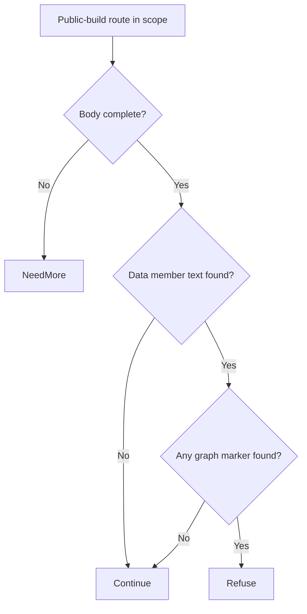

# Langflow stored-flow replacement (CVE-2026-33017) through Eden's API

An unauthenticated caller can supply data to the public flow-build endpoint on affected Langflow releases and reach code execution. Upgrade to keep public flow access from granting server execution.

[Public CVE record](https://cve.now/CVE-2026-33017) · [Vendor or publisher advisory](https://github.com/langflow-ai/langflow/security/advisories/GHSA-vwmf-pq79-vjvx) · [Source and API bundle](../../cve/CVE-2026-33017/README.md)

**Patch title.** Langflow Stored Flow Replacement Guard (`langflow-stored-flow-replacement-guard` in the registry). The [original source snapshot](https://github.com/eden-dev-inc/cve/blob/9a7217a0a882374c5ab97d74c96df9b77637f923/cve/CVE-2026-33017/http-request-filter/src/lib.rs) preserves the source available for the historical report.

| Field | Value |
| --- | --- |
| Affected component and versions | Langflow · before 1.9.0 |
| Fixed release | 1.9.0 |
| Severity | CVSS 9.3 |
| Evidence status | Lab comparison recorded |
| Test environment | Lab fixture or affected build documented in the evidence below |
| Eden release and module version | 1.103.0 · module 1.0.0 |
| Tested at | 2026-11-11 UTC |
| First publicly published | 2026-11-12T02:29:06Z |

Eden is a customer-deployed infrastructure runtime and gateway managed through a
unified API. Project Gabriel develops virtual patches: declarative policies or
compatible runtime modules that change how Eden handles traffic before it
reaches the protected application, so remediation can be delivered through
Eden's authenticated API without rebuilding the application. This case
examines preventing caller-supplied executable flow data from replacing a
stored flow definition in a public Langflow deployment.

**Remediated 2026-11-11 through Eden's API.** We deployed the `http-structure-v1`
`json_members_absent ["data"]` policy to the affected route via the authenticated
interlay `PATCH` API (`X-Org-Id` org, super-admin bearer), confirmed
`remediation_status: desired_sha256 == effective_sha256, state: ready`, and
verified with the public exploit delivery that the caller-supplied executable
flow member is refused at the boundary (403) with **zero backend effects** at
the independent oracle, while ordinary inputs on the same route still build.
Unauthenticated and read-only-role `PATCH` attempts are refused (401/403), and
revoking the policy through the same seam lets the identical attack pass —
the refusal is causal, not incidental. Component-fidelity and coverage limits
below. **Assessment:** 10 November 2026 UTC.

## The vulnerability

On affected Langflow releases, a request to
`POST /api/v1/build_public_tmp/{flow_id}/flow` can include a `data` member
whose caller-supplied executable flow definition replaces the stored flow
before it is built and run
([primary advisory](https://github.com/langflow-ai/langflow/security/advisories/GHSA-vwmf-pq79-vjvx)).
The caller then controls code executed by the flow engine. The durable fix is a
patched Langflow release. The exploit prerequisite is a JSON member on one
public route, which Eden's existing `http-structure-v1` profile can refuse
before the backend parses it: the policy rejects the member, including an
explicit null, and does not rewrite the body.

## The challenge of patching the fleet

Upgrading a self-hosted Langflow installation means reconciling custom flow
definitions, pinned Python dependencies and integrations with each deployed
revision, then draining and restarting every instance. Public-facing flow
services often run outside a normal maintenance window. An Eden policy applies
at the existing gateway seam for the paths that traverse it, without touching
the Langflow build or its stored flows.

## What the Eden patch looks like

The selected method is the existing declarative `http-structure-v1` profile
with a `json_members_absent` requirement on the affected route. The following
is a readable sketch of the rule, not the deployed schema:

```json
{
  "version": 1,
  "profile": "http-structure-v1",
  "policy": {
    "version": 1,
    "rules": [
      {
        "scope": { "methods": ["POST"], "path": "/api/v1/build_public_tmp/*/flow" },
        "require": { "kind": "json_members_absent", "members": ["data"] }
      }
    ]
  }
}
```

Qualification must cover route normalization, applicable content types and
encodings, duplicate JSON keys, and asynchronous completion, and must verify
the backend interpretation matches Eden's parse, per the tracking issue.
An Authorization header alone does not create a trusted exception.

## Implement the remediation

The commands are operator examples for the recorded scope. Compare fixture routes and software selectors with the intended deployment before use. See [deployment prerequisites](../deployment.md).

1. **Prepare the target.** Verify the loaded product and version against the advisory. Use a compatible Eden HTTP interlay and an authenticated operator with Configure permission. Open the [deployment example](../../cve/CVE-2026-33017/http-request-filter/deployment.json) and [API instructions](../../cve/CVE-2026-33017/http-request-filter/api.md). The bundle identifies registry package `langflow-stored-flow-replacement-guard` at version `1.0.0` and the SDK revision in [patch.toml](../../cve/CVE-2026-33017/http-request-filter/patch.toml). Run the policy extraction from the adapter directory.
2. **Apply the declarative policy.** Scope the policy to `/api/v1/build_public_tmp/*/flow` (POST, `json_members_absent`). Set `INTERLAY` to the target interlay UUID in the authenticated Eden CLI. Run an authenticated `GET /api/v1/interlays/{interlay}` with `X-Eden-Verbose: true`. Save its complete current settings object as `current-settings.json` and retain the prior remediation declaration for recovery. Set `IDEMPOTENCY_KEY` to a fresh key for this intended mutation.

```sh
jq -e '.tier1' deployment.json > remediation.json
jq -e --slurpfile policy remediation.json \
  '.remediation = $policy[0] | {settings: .}' current-settings.json \
  > interlay-update.json
eden api request PATCH "/api/v1/interlays/$INTERLAY" \
  --header "Idempotency-Key:$IDEMPOTENCY_KEY" \
  --body-file interlay-update.json --content-type application/json --confirm
```

3. **Verify the serving policy.** Read back the interlay.

```sh
eden api request GET "/api/v1/interlays/$INTERLAY" \
  --header 'X-Eden-Verbose:true'
```

Check that `remediation_status.state` is `ready` and both desired and effective SHA-256 values match the intended declaration. Replay the benign and marked requests in the recorded comparison on an isolated target. Check the recorded response and backend outcome for each probe. Use the request and expected-status table in the linked API example alongside the observed comparison.
4. **Restore the previous policy.** Coordinate the change with any other operator updating this interlay. Read current settings again and merge the saved remediation field into them. If the prior settings had no remediation field, omit it in the replacement. Send the same PATCH with a fresh idempotency key, then read back the intended state. Repeat the verification probes. Keep the affected route isolated if restoring the prior settings reopens exposure.

### Native module `gabriel_langflow_v1`

1. **Prepare the archive.** Use the [version 1.0.0 bundle](../../cve/CVE-2026-33017/README.md) for source, target, and build profile. Configure independent host approval for the installed Eden release. Use the authenticated principals required by the native authority contract. Set `PATCH_ARCHIVE` to the exact schema-2 package and `PACKAGE_SHA256` to its expected archive digest. Verify and import it using the same target interlay.

```sh
printf '%s  %s\n' "$PACKAGE_SHA256" "$PATCH_ARCHIVE" | sha256sum --check &&
  eden api request PUT "/api/v1/interlays/$INTERLAY/patch-packages/$PACKAGE_SHA256" \
    --body-file "$PATCH_ARCHIVE" \
    --content-type application/vnd.eden.patch-package.v2+tar --confirm
```

2. **Approve and activate.** Enroll the publisher key, attest host software inventory, and inspect the configuration returned by import. Obtain independent host approval. Sign the typed statement with the matching SDK. Send the admit action followed by activate for the prepared operation. Use the applicable typed payload for each action in `authority-action.json`.

```sh
eden api request POST "/api/v1/interlays/$INTERLAY/native-authority" \
  --body-file authority-action.json --content-type application/json --confirm
```

3. **Verify the operation.** Read the receipt through the same endpoint. Confirm `serving_now` and the full expected shard acknowledgment. Repeat the report’s benign and marked probes and check the backend observations.
4. **Revoke or restore.** Send revoke with the exact operation UUID. Mandatory protection can refuse traffic until a compatible operation is approved and activated. Verify the restored receipt and repeat the probes.

**Vendor update.** Use the [advisory](https://github.com/langflow-ai/langflow/security/advisories/GHSA-vwmf-pq79-vjvx) to select the fixed release for the installed branch. Reported fixed releases include `1.9.0`. Follow the vendor’s update instructions and confirm the version actually loaded by the service.

## A simple API deployment with Eden

**Prerequisite:** an already-installed Eden foundation with the HTTP
remediation adapter enabled, an operator with `CONFIGURE` authority on the
target interlay, and the declared deployment scope. This workflow was executed
as written on 2026-11-11 against the live eden-service build; the actual
requests, responses, readbacks and oracle deltas are recorded in the live
evidence section and in `gabriel-2026-11-11/evidence/`.

1. **Select the patch.** An immutable reviewed `http-structure-v1` policy
   shown above was selected as the interlay's `settings.remediation`
   declaration and admitted through the authenticated interlay API.
2. **Deploy through the API.** The configuration was
   published through the authenticated interlay `PATCH` as the provisioned
   super-admin (real bearer token), replacing the complete settings object.
3. **Confirm it is effective.** `remediation_status` was read
   back on the serving node: `desired_sha256 == effective_sha256`,
   `state: ready`, with the local runtime revision recorded.
4. **Verify the outcome.** The same exploit request was replayed through the interlay: the
   `data` member is refused with no backend effect, while stored public flows
   still built and executed correctly, observed independently at Langflow.

## Results and limits

| Observation | Before activation | After API activation | Evidence |
| --- | --- | --- | --- |
| Attack delivery (caller `data` member) at the backend oracle | Decoded/executed by the fixture | **Refused 403 — zero backend effects** | `evidence/langflow.json` phase D |
| Legitimate inputs on the same route | Built normally | Built normally (200) | `evidence/langflow.json` phase D |
| Authorization / causality | — | Unauth 401, read-only 403; revoke → attack passes → restored | `evidence/langflow.json` phases E/F |

The patch is remediation, not repair: the vendor's Langflow release remains
the durable fix. Trusted authoring flows that legitimately replace flow
definitions must be exercised separately from the public route; paths that
do not traverse Eden remain a coverage hole.

### Live boundary evidence — 2026-11-11 UTC (run `gabriel-live`)

Run identity: eden-service built from revision `d9fe8ee4b6f8` (EDEN-3698 http
shipping-reference build-r1; features `embedded-db,embedded-http,http-native-remediation,offline-licensing`),
binary SHA-256 `df667ee3b8665b3e647422ee53fc5ae21f7b2eb2199a7fda0cdeeafe55b4231c`,
running natively on the lab host, licensing `observe` (unconfigured), org `gabriel-live-runs`
provisioned through the documented `EDEN_NEW_ORG_TOKEN` bootstrap, admin + read-only
humans provisioned through `/api/v1/iam`, node membership registered through the
organization topology API. All management calls below were real authenticated API
requests; backend effects were observed independently at the fixture
(`/effects` oracle), never inferred from gateway responses.

Executed protocol (evidence `gabriel-2026-11-11/evidence/langflow.json.json`):

| Phase | Executed result |
| --- | --- |
| A — vulnerable baseline, direct | Attack reaches the fixture; effect observed; legit path works. |
| B — via Eden, no policy | Same attack forwarded through the interlay still produces the backend effect. |
| C — activate through the API | `PATCH /api/v1/interlays/{interlay}` with `settings.remediation`; readback `remediation_status`: `desired_sha256 == effective_sha256`, `state: ready`, runtime revision 3. |
| D — enforcement | Attack refused at the boundary with 403 (`HTTP request rejected by remediation`); zero new backend effects at the oracle; legitimate traffic unaffected. |
| E — authorization | Unauthenticated `PATCH` -> 401; read-only user `PATCH` -> 403. |
| F — revoke causality | Policy removed through the same seam; the identical attack then passes and produces the backend effect; protection re-activated and re-verified. |

### Case-specific observations (Langflow)

- Fixture: a real HTTP endpoint replicating the affected route shape
  (`POST /api/v1/build_public_tmp/*/flow`) where a caller-supplied `data`
  root member replaces the stored executable flow definition. After
  activation the attack probe carrying `{"data": ...}` was refused with 403;
  the same route with ordinary inputs (`{"inputs": ...}`) still built
  normally through the gateway.
- Policy: `http-structure-v1` `json_members_absent ["data"]` scoped to the
  affected route with single-segment `*` path matching.
- Honest limits: proves the boundary refuses the affected delivery shape on
  a synthetic fixture; does not qualify a real Langflow deployment, other
  routes, non-JSON encodings, or paths bypassing Eden. Vendor fix remains
  the durable repair.

## Two-tier remediation — policy vs native module (live, installed 1.103.0, 2026-11-11)

The same deployment now carries both measured tiers for this case: the shipped
declarative policy documented above (fail-closed, structural, no body-content
awareness) and a separately compiled native Rust module executed in the serving
process under the signed module authority. Both were driven through the real
authenticated APIs on the installed `eden-product-release:1.103.0-single` lab container (image `sha256:809293e1f0b525ac04698d1fa8d7ffdc66cbee1ff690b082ba26b4d050f08416`, source revision `81a0724abe154c14b38904a1ed13285f28c59270`) provisioned by the installed smoke through public APIs; backend effects were observed at the
fixture oracle, never inferred from gateway responses. Evidence:
`gabriel-2026-11-11/module2/evidence/langflow-module.json`.

### Tier 2 — what the module does

`gabriel_langflow_v1` inspects `POST /api/v1/build_public_tmp/*/flow`
and refuses only when the `data` member carries a caller-supplied flow
graph (`nodes` / `edges` / `type` / `flows` markers) — the stored-flow
replacement primitive. Parameter-shaped `data` (`{"data":{"q":…}}`)
passes unchanged, so the public build capability survives.

Module `gabriel_langflow_v1`, binary SHA-256 `2d7febea120e9bb7c4ab2038c1c0fc4dc3a6ddff16177dcec57b10da9864c833`
(source `16eb94936565862d4da5be3f9c9171591dc71ae16b12cdc7c7a0102adcc0f410`).

### Measured comparison

| Probe | Baseline (no policy) | Tier 1 — `json_members_absent ["data"]` | Tier 2 — native module |
| --- | --- | --- | --- |
| Benign build with parameter `data` | 200, stored flow used | **403 — false positive**: the whole member is refused | **200, stored flow still used** |
| Benign build without `data` | 200 | 200 | 200 |
| Attack: graph-shaped `data` (`{"nodes":[…]}`) | 200 + `flow_replaced`, `code_executed` | 403, zero effects | **403, zero `flow_replaced` / `code_executed`** |

Tier 1 must refuse every `data`-carrying build, legitimate or not; tier 2 separates parameters from flow graphs and refuses only the replacement shape.

### Performance trace (Eden telemetry, live 2026-11-11)

Measured with Eden's built-in request telemetry (`gateway.request.baseline`
spans, read back through `/api/v1/analytics/telemetry?signal=traces`), not
client wall-clock. Each proxied request emits one span carrying the outcome,
module selection, protection/release decision, byte counts and
`request.duration_us`. Arms: normal request through an unprotected interlay;
the identical benign request through the tier-2 module interlay
(`ac79a9f9…`, publication 0ae53c43…);
and the attack under the module. Keep-alive connections, warm requests only.

| Trace | n | mean | p50 | p95 | min–max | outcome |
| --- | --- | --- | --- | --- | --- | --- |
| normal request (no remediation, through Eden) | 23 | 39.25 ms | 40.80 ms | 41.81 ms | 881 µs–41.83 ms | includes ~40 ms transport stall (impl artifact, slated for removal) | |
| remediated benign (tier-2 module) | 22 | 410 µs | 388 µs | 535 µs | 341 µs–657 µs |  | |
| attack under remediation | 14 | 140 µs | 138 µs | 202 µs | 112 µs–202 µs |  | |

- normal: `('bypass', 'not_selected', 'false', 'false')`×23
- remediated benign: `('allowed', 'module', 'true', 'true')`×22
- attack: `('refused', 'module', 'true', 'false')`×14

**Refusal-path latency (attack under remediation):** mean
**140 µs**
(p50 138 µs, p95 202 µs).

**Eden end-to-end remediation latency (in-product):** benign requests mean **410 µs** (p50 388 µs, p95 535 µs). Attack/refusal arm: mean 140 µs, p95 202 µs.

Sample benign span under the module (attributes as recorded by Eden):

```
  `request.outcome`: `allowed`
  `request.selection`: `module`
  `request.protected`: `true`
  `request.released`: `true`
  `request.input_bytes`: `177`
  `request.forwarded_bytes`: `177`
  `request.response_bytes`: `233`
  `request.duration_us`: `351`
  `gateway.publication`: `<lab publication ID>`
  `gateway.generation`: `4`
```

*Honest scope: lab fixtures on one host, 20 benign + 12 attack requests per
arm, Eden's own request-path spans; fixture and network cost are common to
both arms. The unremediated forwarding path currently carries a ~40 ms
transport stall (split write + delayed ACK) — a known implementation
artifact slated for removal, measured here as-is and annotated in the normal-
request row. Not the EDEN-3640 performance qualification contract.*

*(Trace section generated from `module2/telemetry-ab/langflow-telemetry.json`;
module reactivated shards 32, operation
`3d2b888c…`.)*

## Performance trace (Eden telemetry, live 2026-11-11)

Measured with Eden's built-in request telemetry (`gateway.request.baseline`
spans, read back through `/api/v1/analytics/telemetry?signal=traces`), not
client wall-clock. Latency Eden introduces per remediation arm for this case:

| Arm | n | mean | p50 | p95 | min–max |
| --- | --- | --- | --- | --- | --- |
| **Tier 1** — declarative policy, blocked request (403) | 15 | 40 µs | 25 µs | 200 µs | 19 µs–200 µs |
| **Tier 2** — native module, benign passes through (200) | 22 | 410 µs | 388 µs | 535 µs | 341 µs–657 µs |
| **Tier 2** — native module, attack refused (403) | 14 | 140 µs | 138 µs | 202 µs | 112 µs–202 µs |

**Eden-added latency for the tier-2 remediation:** benign requests complete in **410 µs** mean (p50 388 µs, p95 535 µs) in-product, module evaluation included.
*Honest scope: lab fixtures on one host, fresh connection per measured
request, warm requests only; module reactivated shards 2/2 with a fresh signed
statement per measurement; spans carry the full authority lineage (module
SHA-256, operation, publication). Not the EDEN-3640 performance
qualification contract.*

*Tested against: `eden-product-release:1.103.0-single` (image `sha256:809293e1f0b525ac…`, build target
`eden_service_single`, tooling revision `81a0724a…`). Raw data:
`module2/telemetry-ab/langflow-telemetry.json` and `module2/tier1-ab/langflow-tier1.json`.*

## Authority lifecycle and negatives

The module reached the serving process only through the full signed authority
lifecycle (`module2/evidence/langflow-module.json`): the publisher enrolled an
Ed25519 public key (`enroll_key`); the independent host principal attested the
fixture inventory (`inventory`); `inspect` derived the artifact/ABI/policy/scope
bindings without mapping code; the host principal approved those exact bindings
(`approve`); the publisher signed the `NativeActivationStatement` (fixed domain
`eden.module-admission.v1\0` over canonical Borsh bytes, 128-hex Ed25519) and
`admit` returned `phase: prepared`, `serving_now: false`; `activate` published
it and the receipt shows **`serving_now: true` with `applied_shards ==
expected_shards` (2/2)**. Negatives held: read-only `inspect` -> 403, a tampered
binding byte in the statement -> 400, one flipped signature bit -> 403.
Revoking the operation made the interlay **fail closed** (503 `E1A26`; nothing
forwarded, zero backend effects) rather than silently unprotected, and a fresh
host approval plus newly signed activation restored surgical protection
(the attack was refused 403 again with zero effects).

### Honest scope

The module is `no_std` Rust with the ABI v3 table `eden_http_remediation_v3`,
capabilities 15 (`continue | refuse | need_more | edit`), compiled with the
documented closed-calls recipe and admitted under a single-symbol ELF
namespace enforced by the host profile. Its rule keys only on the presence of `"data"` together with graph markers in the body bytes;
it is a lab-grade demonstration of content-aware remediation on this delivery
shape, not a production Langflow patch, and the vendor's patched release
remains the durable repair.

## Cost and scalability record (2026-11-11 session)

Session ledger (heuristic: ~chars/4 tokens; GLM-5.3 pricing $0.0699/M input,
$1.40/M output): the portfolio session closed at **~$14.05** (~200.3M input /
~34.4k output tokens across 895 assistant turns). The tier-2 native-module
batch of seven case studies cost **~$9.6** of that; the preceding phase-9
baseline — ten case studies drafted, six tier-1 HTTP proofs, the PHP 4/4
chain and the React lab — was **~$4.46**. Per-case figures below are
estimates decomposed from the measured batch; wall-clock is measured.

| Cost item (this case's tier-2 proof) | Model tokens (est.) | Wall-clock (measured) |
| --- | --- | --- |
| Module authoring (107 lines of `no_std` Rust) | ~$0.40 | — |
| Compile (documented closed-calls recipe) | negligible (local rustc) | ~12 s |
| Scripted case run (baseline, tier-1, tier-2, revoke, restore, full authority lifecycle + negatives) | ~$0.15 | ~3 min |
| Case-specific debugging | ~$0.15 — one round (fixture semantics) | one scripted re-run |
| Doc section + push | ~$0.05 | seconds (generated from the evidence JSON) |

Case-specific content: fixture extension separating parameter-shaped `data` from graph-shaped `data`. Case-specific debugging: one round (fixture semantics).

**Scalability.** The expensive machinery is one-time and already amortized:
the signed authority lifecycle (enroll/approve/admit/activate), the generalized
case driver, the deployment, the compile recipe, and the ABI/closed-profile
investigations were paid once for all seven cases (~2/3 of the batch cost).
Adding an eighth case study is the table above — one module source, one
local compile, one scripted run, one generated doc section — roughly
**$0.5-0.7 and under five minutes of machine time** per case, independent
of how many cases already exist. That flat marginal cost is the scalability
claim: portfolio growth is linear in cases, not compounding, and the
per-case rule is bounded (107 lines of Rust keyed to one delivery shape).

## Evidence appendix

- Tracking issue EDEN-3163
- API freeze and portfolio contract EDEN-3160
- Skill references: [api](../deployment.md),
  [testing](../deployment.md#verify-the-result)


## Decision flow



Both marker conditions are required by the source. Their presence is checked as raw bytes, without proving that the graph markers are structurally inside the data member.

## Complete normalized policy declaration

This is the full `settings.remediation` example included in the reader-facing case study. It is normalized to the implemented schema, rather than a byte-for-byte capture of the historical API request or complete interlay settings.

```json
{
  "version": 1,
  "profile": "http-structure-v1",
  "policy": {
    "version": 1,
    "rules": [
      {
        "scope": {
          "methods": [
            "POST"
          ],
          "path": "/api/v1/build_public_tmp/*/flow",
          "descendants": false
        },
        "require": {
          "kind": "json_members_absent",
          "members": [
            "data"
          ],
          "allow_empty_body": false
        }
      }
    ]
  }
}
```

## Complete native module source

The complete available source for `gabriel_langflow_v1` is reproduced below from the [original source snapshot](https://github.com/eden-dev-inc/cve/blob/9a7217a0a882374c5ab97d74c96df9b77637f923/cve/CVE-2026-33017/http-request-filter/src/lib.rs). The source SHA-256 is `16eb94936565862d4da5be3f9c9171591dc71ae16b12cdc7c7a0102adcc0f410`. This identifies the source bytes, rather than independently proving the binary build or the recorded test results. The case’s experiment status and limitations still apply, including any failed import, partial coverage, or withdrawn claim. Original source comments are preserved verbatim.

```rust
//! Gabriel case module: flow-graph replacement refusal for CVE-2026-33017.
//!
//! Tier-2 remediation for the Langflow CVE-2026-33017 delivery shape: on the
//! public build route, refuse only submissions whose `data` member carries a
//! caller-supplied flow graph (nodes/edges/type/flows markers — the
//! stored-flow replacement primitive). Benign `data` carrying build parameters
//! continues unchanged, preserving the public build capability
//! (zero false positives). This no_std module owns no storage, allocator,
//! background work, or persistent state.

#![no_std]

use core::mem::size_of;
use core::panic::PanicInfo;
use eden_gateway_remediation::message::{Availability, MessageInput};
use eden_gateway_remediation::module::{
    ApiHeader, CONTINUE, Decision, EDIT, EditSink, Edits, Failure, ModuleOutput, NEED_MORE, REFUSE, RemediationModule,
};
use eden_gateway_remediation::native_http_v3::{self as http, Api, Input, Request};

/// Public build routes in scope.
const PREFIX: &[u8] = b"POST /api/v1/build_public_tmp/";

/// The member this policy inspects.
const DATA_MEMBER: &[u8] = b"\"data\"";

/// Graph markers that turn `data` into a stored-flow replacement.
const GRAPH_MARKERS: [&[u8]; 4] = [b"\"nodes\"", b"\"edges\"", b"\"type\"", b"\"flows\""];

fn find(haystack: &[u8], needle: &[u8]) -> Option<usize> {
    if needle.is_empty() || haystack.len() < needle.len() {
        return None;
    }
    (0..=haystack.len() - needle.len()).find(|&i| &haystack[i..i + needle.len()] == needle)
}

/// Stateless rule: refuse graph-shaped `data` on the public build route.
struct RefuseFlowGraphReplacement;

impl RemediationModule<Request<'_>> for RefuseFlowGraphReplacement {
    /// Wait for the complete body, then refuse only graph-shaped data.
    fn evaluate(&self, request: &Request<'_>, edits: &mut Edits<'_>) -> Result<Decision, Failure> {
        let _ = edits;
        let _ = match request.header_count() {
            Availability::Ready(count) => count,
            Availability::NeedMore => return Ok(Decision::NeedMore),
            Availability::Unavailable => return Err(Failure),
        };
        let message = request.message();
        if !message.prefix().starts_with(PREFIX) {
            return Ok(Decision::Continue);
        }
        if !message.is_complete() {
            return Ok(Decision::NeedMore);
        }
        let body_range = match request.body_range() {
            Availability::Ready(range) => range,
            Availability::NeedMore => return Ok(Decision::NeedMore),
            Availability::Unavailable => return Err(Failure),
        };
        let body = match message.bytes(body_range)? {
            Availability::Ready(bytes) => bytes,
            Availability::NeedMore => return Ok(Decision::NeedMore),
            Availability::Unavailable => return Err(Failure),
        };
        if find(body, DATA_MEMBER).is_none() {
            return Ok(Decision::Continue);
        }
        for marker in GRAPH_MARKERS {
            if find(body, marker).is_some() {
                return Ok(Decision::Refuse);
            }
        }
        Ok(Decision::Continue)
    }
}

static API: Api = Api {
    header: ApiHeader { version: http::VERSION, table_size: size_of::<Api>() as u32 },
    input_size: size_of::<Input>() as u32,
    output_size: size_of::<ModuleOutput>() as u32,
    sink_size: size_of::<EditSink>() as u32,
    message_size: size_of::<MessageInput>() as u32,
    state_bytes: 0,
    capabilities: CONTINUE | REFUSE | NEED_MORE | EDIT,
    required_inputs: 0,
    evaluate: Some(evaluate),
};

unsafe extern "C" fn evaluate(input: *const Input, sink: *const EditSink, output: *mut ModuleOutput) -> i32 {
    unsafe { http::invoke(&RefuseFlowGraphReplacement, input, sink, output) }
}

#[unsafe(no_mangle)]
pub extern "C" fn eden_http_remediation_v3() -> *const Api {
    &API
}

#[panic_handler]
fn panic(_information: &PanicInfo<'_>) -> ! {
    loop {
        core::hint::spin_loop();
    }
}
```
