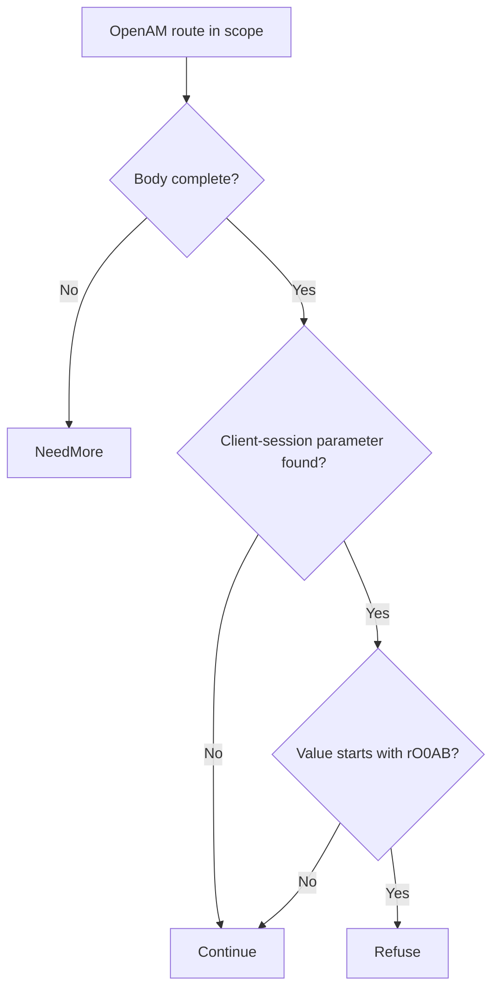

# OpenAM jato.clientSession pre-auth deserialization RCE (CVE-2026-33439)

An unauthenticated caller can bypass the affected OpenAM Java deserialization restrictions and execute code on the identity server. Upgrade OpenAM to protect the server and the identity workflows it controls.

**Patch title.** OpenAM jato.clientSession Deserialization RCE Guard (`openam-jato-clientsession-deserialization-rce-guard` in the registry). The [original source snapshot](https://github.com/eden-dev-inc/cve/blob/9a7217a0a882374c5ab97d74c96df9b77637f923/cve/CVE-2026-33439/http-request-filter/src/lib.rs) preserves the source available for the historical report.

[Public CVE record](https://cve.now/CVE-2026-33439) · [Source and API bundle](../../cve/CVE-2026-33439/README.md)

| Field | Value |
| --- | --- |
| Affected component and versions | See the advisory for the affected versions of each product or package: OpenAM, org.openidentityplatform.openam:openam |
| Fixed release | See the advisory for product-specific fixes |
| Severity | CVSS 9.3 |
| Evidence status | Lab comparison recorded |
| Test environment | Lab fixture or affected build documented in the evidence below |
| Eden release and module version | 1.103.0 · module 1.0.0 |
| Tested at | 2026-11-11 UTC |
| First publicly published | 2026-11-12T02:29:06Z |

*OpenIdentityPlatform OpenAM <= 16.0.5 (fixed 16.0.6) — [cve.now](https://cve.now/CVE-2026-33439) month ranking entry.*

Eden terminates the HTTP connection to the affected product, evaluates a
declarative policy and — in tier 2 — a separately compiled native Rust module
under signed module authority, before any byte reaches the application. This
removes the delivery primitive from the network path. It does **not** patch
the affected OpenAM instance; the vendor's fixed release remains the
durable repair.

**Status: live two-tier remediation recorded 2026-11-11 on the installed `eden-product-release:1.103.0-single` lab container (image `sha256:809293e1f0b525ac04698d1fa8d7ffdc66cbee1ff690b082ba26b4d050f08416`).**

## The vulnerability

OpenAM's JATO ViewBean endpoints deserialize the `jato.clientSession`
HTTP parameter without the whitelist applied to `jato.pageSession` after
CVE-2021-35464, giving unauthenticated remote code execution on reachable
pages (e.g. Password Reset). Exploit public, Nuclei template available.

The fleet challenge for this class is unchanged from the portfolio: the durable
fix is the vendor's patched release, but fleets contain appliances and
long-lived deployments that cannot upgrade inside an exploitation window
(KEV-listed, public tooling). Eden's boundary removes the delivery primitive
from the network path immediately, at a separately compiled enforcement point,
without touching the application host.

## The Eden patch

**Tier 1 — declarative policy (blunt, fail-closed):** `deny` on `/openam/UI` POST descendants — takes every JATO form offline, including ordinary logins.

**Tier 2 — native module (surgical):** `gabriel_openamdeser_v1` refuses requests whose `jato.clientSession=`
parameter carries the serialized-Java magic marker (`rO0AB`, base64 of
0xACED0005); ordinary form posts — including ordinary clientSession
values — pass unchanged.

Module `gabriel_openamdeser_v1`, binary SHA-256 `89021ccf7b18d6a589836ede179fe1ac58941b0eec288152790ef855cba46588` (source `f4d07b08f41dcf52806fcc70b15d2a27bc4d6dcfec82b81241e77b9ff86c3d6a`),
keys the serialized-Java marker in jato.clientSession values.

## Implement the remediation

The commands are operator examples for the recorded scope. Compare fixture routes and software selectors with the intended deployment before use. See [deployment prerequisites](../deployment.md).

1. **Prepare the target.** Verify the loaded product and version against the advisory. Use a compatible Eden HTTP interlay and an authenticated operator with Configure permission. Open the [deployment example](../../cve/CVE-2026-33439/http-request-filter/deployment.json) and [API instructions](../../cve/CVE-2026-33439/http-request-filter/api.md). The bundle identifies registry package `openam-jato-clientsession-deserialization-rce-guard` at version `1.0.0` and the SDK revision in [patch.toml](../../cve/CVE-2026-33439/http-request-filter/patch.toml). Run the policy extraction from the adapter directory.
2. **Apply the declarative policy.** Scope the policy to `/openam/UI` and descendants (POST, `deny`). Set `INTERLAY` to the target interlay UUID in the authenticated Eden CLI. Run an authenticated `GET /api/v1/interlays/{interlay}` with `X-Eden-Verbose: true`. Save its complete current settings object as `current-settings.json` and retain the prior remediation declaration for recovery. Set `IDEMPOTENCY_KEY` to a fresh key for this intended mutation.

```sh
jq -e '.tier1' deployment.json > remediation.json
jq -e --slurpfile policy remediation.json \
  '.remediation = $policy[0] | {settings: .}' current-settings.json \
  > interlay-update.json
eden api request PATCH "/api/v1/interlays/$INTERLAY" \
  --header "Idempotency-Key:$IDEMPOTENCY_KEY" \
  --body-file interlay-update.json --content-type application/json --confirm
```

3. **Verify the serving policy.** Read back the interlay.

```sh
eden api request GET "/api/v1/interlays/$INTERLAY" \
  --header 'X-Eden-Verbose:true'
```

Check that `remediation_status.state` is `ready` and both desired and effective SHA-256 values match the intended declaration. Replay the benign and marked requests in the recorded comparison on an isolated target. Check the recorded response and backend outcome for each probe. Use the request and expected-status table in the linked API example alongside the observed comparison.
4. **Restore the previous policy.** Coordinate the change with any other operator updating this interlay. Read current settings again and merge the saved remediation field into them. If the prior settings had no remediation field, omit it in the replacement. Send the same PATCH with a fresh idempotency key, then read back the intended state. Repeat the verification probes. Keep the affected route isolated if restoring the prior settings reopens exposure.

### Native module `gabriel_openamdeser_v1`

1. **Prepare the archive.** Use the [version 1.0.0 bundle](../../cve/CVE-2026-33439/README.md) for source, target, and build profile. Configure independent host approval for the installed Eden release. Use the authenticated principals required by the native authority contract. Set `PATCH_ARCHIVE` to the exact schema-2 package and `PACKAGE_SHA256` to its expected archive digest. Verify and import it using the same target interlay.

```sh
printf '%s  %s\n' "$PACKAGE_SHA256" "$PATCH_ARCHIVE" | sha256sum --check &&
  eden api request PUT "/api/v1/interlays/$INTERLAY/patch-packages/$PACKAGE_SHA256" \
    --body-file "$PATCH_ARCHIVE" \
    --content-type application/vnd.eden.patch-package.v2+tar --confirm
```

2. **Approve and activate.** Enroll the publisher key, attest host software inventory, and inspect the configuration returned by import. Obtain independent host approval. Sign the typed statement with the matching SDK. Send the admit action followed by activate for the prepared operation. Use the applicable typed payload for each action in `authority-action.json`.

```sh
eden api request POST "/api/v1/interlays/$INTERLAY/native-authority" \
  --body-file authority-action.json --content-type application/json --confirm
```

3. **Verify the operation.** Read the receipt through the same endpoint. Confirm `serving_now` and the full expected shard acknowledgment. Repeat the report’s benign and marked probes and check the backend observations.
4. **Revoke or restore.** Send revoke with the exact operation UUID. Mandatory protection can refuse traffic until a compatible operation is approved and activated. Verify the restored receipt and repeat the probes.

**Vendor update.** Use the [advisory](https://cve.now/CVE-2026-33439) and its product-specific vendor references to select the fixed release for the exact installed product or package and release line. Follow its update instructions and confirm the version actually loaded by the service.

## Measured comparison (live, 2026-11-11)

| Probe | Baseline (unprotected) | Tier 1 | Tier 2 (module) |
| --- | --- | --- | --- |
| benign_form_post | 200 | 403 | 200 (`class_loaded` ×0, `rce_marker` ×0) |
| benign_session_param | 200 | 403 | 200 (`class_loaded` ×0, `rce_marker` ×0) |
| attack_java_gadget | 200 | 403 | 403 (`class_loaded` ×0, `rce_marker` ×0) |

Every tier-2 refusal was measured against the same probe's live unprotected
baseline; benign rows document tier-1's false positives and tier-2's zero.


## Performance trace (Eden telemetry, live 2026-11-11)

Measured with Eden's built-in request telemetry (`gateway.request.baseline`
spans, read back through `/api/v1/analytics/telemetry?signal=traces`), not
client wall-clock. Latency Eden introduces per remediation arm for this case:

| Arm | n | mean | p50 | p95 | min–max |
| --- | --- | --- | --- | --- | --- |
| **Tier 1** — declarative policy, blocked request (403) | 15 | 26 µs | 22 µs | 53 µs | 16 µs–53 µs |
| **Tier 2** — native module, benign passes through (200) | 23 | 457 µs | 428 µs | 609 µs | 358 µs–744 µs |
| **Tier 2** — native module, attack refused (403) | 14 | 136 µs | 133 µs | 219 µs | 105 µs–219 µs |

**Eden-added latency for the tier-2 remediation:** benign requests complete in **457 µs** mean (p50 428 µs, p95 609 µs) in-product, module evaluation included.
*Honest scope: lab fixtures on one host, fresh connection per measured
request, warm requests only; module reactivated shards 2/2 with a fresh signed
statement per measurement; spans carry the full authority lineage (module
SHA-256, operation, publication). Not the EDEN-3640 performance
qualification contract.*

*Tested against: `eden-product-release:1.103.0-single` (image `sha256:809293e1f0b525ac…`, build target
`eden_service_single`, tooling revision `81a0724a…`). Raw data:
`module2/telemetry-ab/openamdeser-telemetry.json` and `module2/tier1-ab/openamdeser-tier1.json`.*

## Authority lifecycle and negatives

Reached the serving process only through the full signed lifecycle
(`module2/evidence/openamdeser-module.json`): `enroll_key` (Ed25519 public key),
independent-host `inventory`, `inspect` (bindings derived without mapping
code), host `approve`, signed `admit` (`prepared`, `serving_now: false`),
`activate` — receipt **`serving_now: true`, `applied_shards == expected_shards`
(2/2)**. Negatives held:
read-only `inspect` -> 403, tampered statement binding -> 400, flipped
signature bit -> 403. `revoke` made the interlay **fail closed** (503,
nothing forwarded, zero backend effects) and a fresh host approval plus a
newly signed activation restored surgical protection.

## Honest scope

The fixture replicates the delivery shape and exploit prerequisite with
harmless marker effects; no real OpenAM runs here. Other deserialization sinks (jato.pageSession is whitelisted upstream),
non-JATO routes and off-boundary traffic are out of scope; gadget-class
diversity inside the marker is not classified — the marker itself is the
delivery primitive and is refused.
Modules are lab-grade rules for the fixture delivery shapes, not production
OpenAM patches. Perf: the request-path A/B was not re-run for this
batch (see README); activation telemetry measured ~0.14 s one-time load.

## Cost record (per-CVE ledger)

**0.0256 USD** (marginal session growth over this case's window: 366,308 input + 20 output tokens across 1 assistant turns; windows can overlap where debugging was shared).

## Evidence appendix

- [cve.now entry](https://cve.now/CVE-2026-33439)
- Raw evidence: `gabriel-2026-11-11/module2/evidence/openamdeser-module.json`
- Deployment: installed `eden-product-release:1.103.0-single` lab container (image `sha256:809293e1f0b525ac04698d1fa8d7ffdc66cbee1ff690b082ba26b4d050f08416`)
- Skill: [eden-vulnerability-remediation](../deployment.md)


## Decision flow



The source checks a particular serialized-Java marker after the selected parameter. The diagram does not represent a general deserialization validator.

## Complete native module source

The complete available source for `gabriel_openamdeser_v1` is reproduced below from the [original source snapshot](https://github.com/eden-dev-inc/cve/blob/9a7217a0a882374c5ab97d74c96df9b77637f923/cve/CVE-2026-33439/http-request-filter/src/lib.rs). The source SHA-256 is `f4d07b08f41dcf52806fcc70b15d2a27bc4d6dcfec82b81241e77b9ff86c3d6a`. This identifies the source bytes, rather than independently proving the binary build or the recorded test results. The case’s experiment status and limitations still apply, including any failed import, partial coverage, or withdrawn claim. Original source comments are preserved verbatim.

```rust
//! Gabriel module: refuse serialized-Java gadget payloads in the OpenAM
//! jato.clientSession parameter (CVE-2026-33439 shape).
//!
//! CVE-2026-33439: OpenAM's JATO ViewBean endpoints deserialize the
//! jato.clientSession HTTP parameter without the whitelist applied to
//! jato.pageSession, giving pre-authentication RCE. This module refuses
//! requests on the JATO surface whose jato.clientSession parameter carries
//! the serialized-Java marker (base64 of the 0xACED0005 magic, `rO0AB`);
//! ordinary form posts — including ordinary jato.clientSession values — pass
//! unchanged. no_std.

#![no_std]

use core::mem::size_of;
use core::panic::PanicInfo;
use eden_gateway_remediation::message::{Availability, MessageInput};
use eden_gateway_remediation::module::{
    ApiHeader, CONTINUE, Decision, EDIT, EditSink, Edits, Failure, ModuleOutput, NEED_MORE, REFUSE, RemediationModule,
};
use eden_gateway_remediation::native_http_v3::{self as http, Api, Input, Request};

/// The JATO surface in scope.
const ROUTE: &[u8] = b"/openam/UI/";

/// The parameter this module inspects.
const PARAM: &[u8] = b"jato.clientSession=";

/// The serialized-Java magic marker refused in its value.
const SER_MARKER: &[u8] = b"rO0AB";

fn find(haystack: &[u8], needle: &[u8]) -> Option<usize> {
    if haystack.len() < needle.len() || needle.is_empty() {
        return None;
    }
    let mut i = 0usize;
    while i + needle.len() <= haystack.len() {
        let mut j = 0usize;
        let mut same = true;
        while j < needle.len() {
            if haystack[i + j] != needle[j] {
                same = false;
                break;
            }
            j += 1;
        }
        if same {
            return Some(i);
        }
        i += 1;
    }
    None
}

struct RefuseJavaGadget;

impl RemediationModule<Request<'_>> for RefuseJavaGadget {
    fn evaluate(&self, request: &Request<'_>, edits: &mut Edits<'_>) -> Result<Decision, Failure> {
        let _ = edits;
        let _ = match request.header_count() {
            Availability::Ready(count) => count,
            Availability::NeedMore => return Ok(Decision::NeedMore),
            Availability::Unavailable => return Err(Failure),
        };
        let message = request.message();
        let head = message.prefix();
        let line_end = head.iter().position(|&b| b == b'\r').unwrap_or(head.len());
        let request_line = &head[..line_end];
        let path_at = request_line.iter().position(|&b| b == b' ').unwrap_or(request_line.len());
        let path = &request_line[path_at + 1..];
        if !path.starts_with(ROUTE) {
            return Ok(Decision::Continue);
        }
        if !message.is_complete() {
            return Ok(Decision::NeedMore);
        }
        let body_range = match request.body_range() {
            Availability::Ready(range) => range,
            Availability::NeedMore => return Ok(Decision::NeedMore),
            Availability::Unavailable => return Err(Failure),
        };
        let body = match message.bytes(body_range)? {
            Availability::Ready(bytes) => bytes,
            Availability::NeedMore => return Ok(Decision::NeedMore),
            Availability::Unavailable => return Err(Failure),
        };
        let Some(at) = find(body, PARAM) else {
            return Ok(Decision::Continue);
        };
        let value = &body[at + PARAM.len()..];
        if value.starts_with(SER_MARKER) {
            return Ok(Decision::Refuse);
        }
        Ok(Decision::Continue)
    }
}

static API: Api = Api {
    header: ApiHeader { version: http::VERSION, table_size: size_of::<Api>() as u32 },
    input_size: size_of::<Input>() as u32,
    output_size: size_of::<ModuleOutput>() as u32,
    sink_size: size_of::<EditSink>() as u32,
    message_size: size_of::<MessageInput>() as u32,
    state_bytes: 0,
    capabilities: CONTINUE | REFUSE | NEED_MORE | EDIT,
    required_inputs: 0,
    evaluate: Some(evaluate),
};

unsafe extern "C" fn evaluate(input: *const Input, sink: *const EditSink, output: *mut ModuleOutput) -> i32 {
    unsafe { http::invoke(&RefuseJavaGadget, input, sink, output) }
}

#[unsafe(no_mangle)]
pub extern "C" fn eden_http_remediation_v3() -> *const Api {
    &API
}

#[panic_handler]
fn panic(_information: &PanicInfo<'_>) -> ! {
    loop {
        core::hint::spin_loop();
    }
}
```
