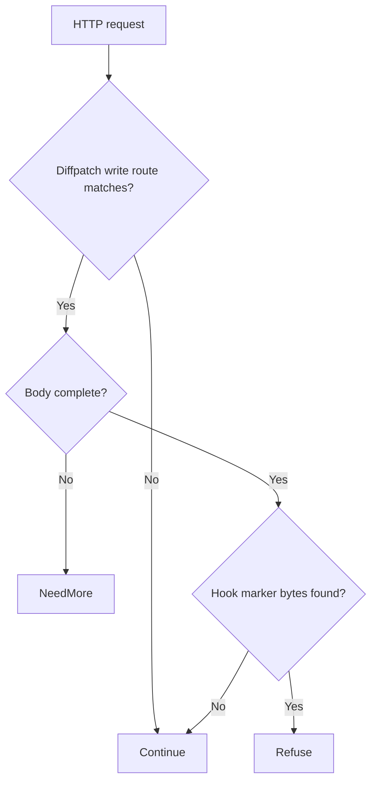

# Gitea diffpatch API git-hook execution (CVE-2026-60004)

[Source and API bundle](../../cve/CVE-2026-60004/README.md)

*Gitea 1.17 up to before 1.27.1 (fixed 1.27.1) — [cve.now](https://cve.now/CVE-2026-60004) month ranking entry.*

Eden terminates the HTTP connection to the affected product, evaluates a
declarative policy and — in tier 2 — a separately compiled native Rust module
under signed module authority, before any byte reaches the application. This
removes the delivery primitive from the network path. It does **not** patch
the affected Gitea instance; the vendor's fixed release remains the
durable repair.

**Status: live two-tier remediation recorded 2026-11-11 on the installed `eden-product-release:1.103.0-single` lab container (image `sha256:809293e1f0b525ac04698d1fa8d7ffdc66cbee1ff690b082ba26b4d050f08416`).**

## The vulnerability

A user with repository write access can run shell commands on the
server through the diffpatch API's git-hook handling. KEV-listed,
exploit public.

The fleet challenge for this class is unchanged from the portfolio: the durable
fix is the vendor's patched release, but fleets contain appliances and
long-lived deployments that cannot upgrade inside an exploitation window
(KEV-listed, public tooling). Eden's boundary removes the delivery primitive
from the network path immediately, at a separately compiled enforcement point,
without touching the application host.

## The Eden patch

**Tier 1 — declarative policy (blunt, fail-closed):** `deny` on `/api/v1/repos` POST descendants — blocks every repository API write.

**Tier 2 — native module (surgical):** `gabriel_giteadiff_v1` refuses diffpatch bodies carrying a `"hook"`
or `"hooks"` member — the command-execution surface — while ordinary
diff/patch payloads pass unchanged, preserving repository writes.

Module `gabriel_giteadiff_v1`, binary SHA-256 `df9e6229a18f3d76f08e9e0ecb880cadd93b58855cb0cc39b69441f4f5a33b5d` (source `c05a55a575f3c47e4661d8e4193478626e180326cbed4d21d486a8be4f0b8398`),
keys hook members on the diffpatch route.

## Measured comparison (live, 2026-11-11)

| Probe | Baseline (unprotected) | Tier 1 | Tier 2 (module) |
| --- | --- | --- | --- |
| benign_diff | 200 | 403 | 200 (`hook_executed` ×0) |
| attack_hook | 200 | 403 | 403 (`hook_executed` ×0) |

Every tier-2 refusal was measured against the same probe's live unprotected
baseline; benign rows document tier-1's false positives and tier-2's zero.


## Performance trace (Eden telemetry, live 2026-11-11)

Measured with Eden's built-in request telemetry (`gateway.request.baseline`
spans, read back through `/api/v1/analytics/telemetry?signal=traces`), not
client wall-clock. Latency Eden introduces per remediation arm for this case:

| Arm | n | mean | p50 | p95 | min–max |
| --- | --- | --- | --- | --- | --- |
| **Tier 1** — declarative policy, blocked request (403) | 15 | 29 µs | 22 µs | 72 µs | 14 µs–72 µs |
| **Tier 2** — native module, benign passes through (200) | 22 | 361 µs | 347 µs | 521 µs | 282 µs–629 µs |
| **Tier 2** — native module, attack refused (403) | 14 | 138 µs | 123 µs | 208 µs | 109 µs–208 µs |

**Eden-added latency for the tier-2 remediation:** benign requests complete in **361 µs** mean (p50 347 µs, p95 521 µs) in-product, module evaluation included.
*Honest scope: lab fixtures on one host, fresh connection per measured
request, warm requests only; module reactivated shards 2/2 with a fresh signed
statement per measurement; spans carry the full authority lineage (module
SHA-256, operation, publication). Not the EDEN-3640 performance
qualification contract.*

*Tested against: `eden-product-release:1.103.0-single` (image `sha256:809293e1f0b525ac…`, build target
`eden_service_single`, tooling revision `81a0724a…`). Raw data:
`module2/telemetry-ab/giteadiff-telemetry.json` and `module2/tier1-ab/giteadiff-tier1.json`.*

## Authority lifecycle and negatives

Reached the serving process only through the full signed lifecycle
(`module2/evidence/giteadiff-module.json`): `enroll_key` (Ed25519 public key),
independent-host `inventory`, `inspect` (bindings derived without mapping
code), host `approve`, signed `admit` (`prepared`, `serving_now: false`),
`activate` — receipt **`serving_now: true`, `applied_shards == expected_shards`
(2/2)**. Negatives held:
read-only `inspect` -> 403, tampered statement binding -> 400, flipped
signature bit -> 403. `revoke` made the interlay **fail closed** (503,
nothing forwarded, zero backend effects) and a fresh host approval plus a
newly signed activation restored surgical protection.

## Honest scope

The fixture replicates the delivery shape and exploit prerequisite with
harmless marker effects; no real Gitea runs here. Other server-side execution surfaces in the repository API remain; the
module keys the hook primitive only.
Modules are lab-grade rules for the fixture delivery shapes, not production
Gitea patches. Perf: the request-path A/B was not re-run for this
batch (see README); activation telemetry measured ~0.14 s one-time load.

## Cost record (per-CVE ledger)

**0.0255 USD** (marginal session growth over this case's window: 364,240 input + 1 output tokens across 1 assistant turns; windows can overlap where debugging was shared).

## Evidence appendix

- [cve.now entry](https://cve.now/CVE-2026-60004)
- Raw evidence: `gabriel-2026-11-11/module2/evidence/giteadiff-module.json`
- Deployment: installed `eden-product-release:1.103.0-single` lab container (image `sha256:809293e1f0b525ac04698d1fa8d7ffdc66cbee1ff690b082ba26b4d050f08416`)
- Skill: [eden-vulnerability-remediation](../deployment.md)


## Decision flow



This shows the fixture-oriented hook marker rule. Repository-controlled patch contents and actual hook installation are not semantically validated by this scan.

## Complete native module source

The complete available source for `gabriel_giteadiff_v1` is reproduced below from the [reviewed repository snapshot](../../cve/CVE-2026-60004/http-request-filter/src/lib.rs). The source SHA-256 is `c05a55a575f3c47e4661d8e4193478626e180326cbed4d21d486a8be4f0b8398`. This identifies the source bytes, rather than independently proving the binary build or the recorded test results. The case’s experiment status and limitations still apply, including any failed import, partial coverage, or withdrawn claim. Original source comments are preserved verbatim.

```rust
//! Gabriel module: refuse git-hook execution via the Gitea diffpatch API
//! (CVE-2026-60004 shape).
//!
//! CVE-2026-60004: a user with repository write access can run shell
//! commands on the server through the diffpatch API's git-hook handling.
//! This module refuses diffpatch bodies carrying a hook/hooks member — the
//! command-execution surface — while ordinary diff/patch payloads pass
//! unchanged, preserving the repository write capability. no_std.

#![no_std]

use core::mem::size_of;
use core::panic::PanicInfo;
use eden_gateway_remediation::message::{Availability, MessageInput};
use eden_gateway_remediation::module::{
    ApiHeader, CONTINUE, Decision, EDIT, EditSink, Edits, Failure, ModuleOutput, NEED_MORE, REFUSE, RemediationModule,
};
use eden_gateway_remediation::native_http_v3::{self as http, Api, Input, Request};

/// The API route in scope.
const ROUTE: &[u8] = b"POST /api/v1/repos/";

/// The route suffix this policy keys on.
const SUFFIX: &[u8] = b"/diffpatch";

/// The command-execution member refused on that route.
const HOOK_A: &[u8] = b"\"hook\"";
const HOOK_B: &[u8] = b"\"hooks\"";

fn find(haystack: &[u8], needle: &[u8]) -> Option<usize> {
    if haystack.len() < needle.len() || needle.is_empty() {
        return None;
    }
    let mut i = 0usize;
    while i + needle.len() <= haystack.len() {
        let mut j = 0usize;
        let mut same = true;
        while j < needle.len() {
            if haystack[i + j] != needle[j] {
                same = false;
                break;
            }
            j += 1;
        }
        if same {
            return Some(i);
        }
        i += 1;
    }
    None
}

struct RefuseHookExecution;

impl RemediationModule<Request<'_>> for RefuseHookExecution {
    fn evaluate(&self, request: &Request<'_>, edits: &mut Edits<'_>) -> Result<Decision, Failure> {
        let _ = edits;
        let _ = match request.header_count() {
            Availability::Ready(count) => count,
            Availability::NeedMore => return Ok(Decision::NeedMore),
            Availability::Unavailable => return Err(Failure),
        };
        let message = request.message();
        let head = message.prefix();
        let line_end = head.iter().position(|&b| b == b'\r').unwrap_or(head.len());
        let request_line = &head[..line_end];
        if !request_line.starts_with(ROUTE) || find(request_line, SUFFIX).is_none() {
            return Ok(Decision::Continue);
        }
        if !message.is_complete() {
            return Ok(Decision::NeedMore);
        }
        let body_range = match request.body_range() {
            Availability::Ready(range) => range,
            Availability::NeedMore => return Ok(Decision::NeedMore),
            Availability::Unavailable => return Err(Failure),
        };
        let body = match message.bytes(body_range)? {
            Availability::Ready(bytes) => bytes,
            Availability::NeedMore => return Ok(Decision::NeedMore),
            Availability::Unavailable => return Err(Failure),
        };
        if find(body, HOOK_A).is_some() || find(body, HOOK_B).is_some() {
            return Ok(Decision::Refuse);
        }
        Ok(Decision::Continue)
    }
}

static API: Api = Api {
    header: ApiHeader { version: http::VERSION, table_size: size_of::<Api>() as u32 },
    input_size: size_of::<Input>() as u32,
    output_size: size_of::<ModuleOutput>() as u32,
    sink_size: size_of::<EditSink>() as u32,
    message_size: size_of::<MessageInput>() as u32,
    state_bytes: 0,
    capabilities: CONTINUE | REFUSE | NEED_MORE | EDIT,
    required_inputs: 0,
    evaluate: Some(evaluate),
};

unsafe extern "C" fn evaluate(input: *const Input, sink: *const EditSink, output: *mut ModuleOutput) -> i32 {
    unsafe { http::invoke(&RefuseHookExecution, input, sink, output) }
}

#[unsafe(no_mangle)]
pub extern "C" fn eden_http_remediation_v3() -> *const Api {
    &API
}

#[panic_handler]
fn panic(_information: &PanicInfo<'_>) -> ! {
    loop {
        core::hint::spin_loop();
    }
}
```
