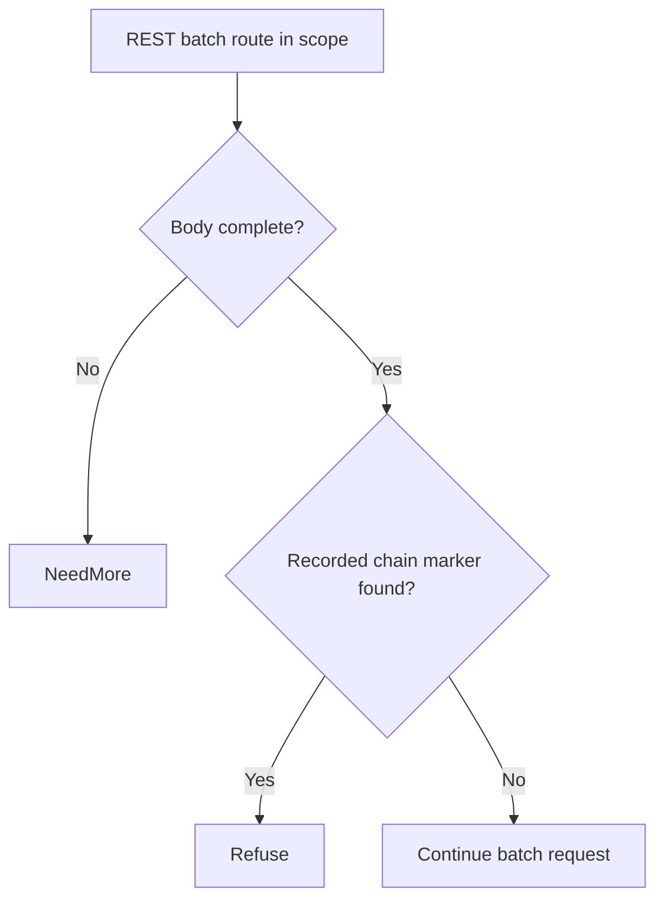

# WordPress REST batch route confusion chained to SQL injection (CVE-2026-63030)

[Source and API bundle](../../cve/CVE-2026-63030/README.md)

*WordPress 6.9.0-6.9.4, 7.0.0-7.0.1 (fixed 6.9.5, 7.0.2) — [cve.now](https://cve.now/CVE-2026-63030) month ranking entry.*

Eden terminates the HTTP connection to the affected product, evaluates a
declarative policy and — in tier 2 — a separately compiled native Rust module
under signed module authority, before any byte reaches the application. This
removes the delivery primitive from the network path. It does **not** patch
the affected WordPress instance; the vendor's fixed release remains the
durable repair.

**Status: live two-tier remediation recorded 2026-11-11 on the installed `eden-product-release:1.103.0-single` lab container (image `sha256:809293e1f0b525ac04698d1fa8d7ffdc66cbee1ff690b082ba26b4d050f08416`).**

## The vulnerability

The REST API batch endpoint (`POST /wp-json/batch/v1`) suffers a route
confusion issue which, chained with the `author__not_in` WP_Query SQL
injection (CVE-2026-60137), lets an unauthenticated attacker run SQL
queries and reach remote code execution. KEV-listed, exploit public.

The fleet challenge for this class is unchanged from the portfolio: the durable
fix is the vendor's patched release, but fleets contain appliances and
long-lived deployments that cannot upgrade inside an exploitation window
(KEV-listed, public tooling). Eden's boundary removes the delivery primitive
from the network path immediately, at a separately compiled enforcement point,
without touching the application host.

## The Eden patch

**Tier 1 — declarative policy (blunt, fail-closed):** `deny` on `/wp-json/batch` descendants — takes the whole batch API offline (every legitimate batch call refused).

**Tier 2 — native module (surgical):** `gabriel_wpbatch_v1` inspects batch envelope bodies and refuses only
envelopes whose subrequests carry the `author__not_in` query primitive —
the SQLi chain element. Ordinary batch requests pass unchanged.

Module `gabriel_wpbatch_v1`, binary SHA-256 `09d2a2a64ae0a8580e512564ab720e7d5b6eec46dbbc5ed6f40eed4c3a348d67` (source `885f9f0dd41faeaabb7f3365f8d3bd129fe9c59d029cda732faa7114c1250243`),
keys the `author__not_in` byte sequence inside batch envelope bodies.

## Measured comparison (live, 2026-11-11)

| Probe | Baseline (unprotected) | Tier 1 | Tier 2 (module) |
| --- | --- | --- | --- |
| benign_batch | 200 | 403 | 200 (`rce_marker` ×0, `sql_executed` ×0) |
| benign_batch_two | 200 | 403 | 200 (`rce_marker` ×0, `sql_executed` ×0) |
| attack_author_not_in | 200 | 403 | 403 (`rce_marker` ×0, `sql_executed` ×0) |

Every tier-2 refusal was measured against the same probe's live unprotected
baseline; benign rows document tier-1's false positives and tier-2's zero.


## Performance trace (Eden telemetry, live 2026-11-11)

Measured with Eden's built-in request telemetry (`gateway.request.baseline`
spans, read back through `/api/v1/analytics/telemetry?signal=traces`), not
client wall-clock. Latency Eden introduces per remediation arm for this case:

| Arm | n | mean | p50 | p95 | min–max |
| --- | --- | --- | --- | --- | --- |
| **Tier 1** — declarative policy, blocked request (403) | 15 | 30 µs | 23 µs | 56 µs | 19 µs–56 µs |
| **Tier 2** — native module, benign passes through (200) | 21 | 374 µs | 370 µs | 514 µs | 312 µs–622 µs |
| **Tier 2** — native module, attack refused (403) | 14 | 130 µs | 120 µs | 177 µs | 111 µs–177 µs |

**Eden-added latency for the tier-2 remediation:** benign requests complete in **374 µs** mean (p50 370 µs, p95 514 µs) in-product, module evaluation included.
*Honest scope: lab fixtures on one host, fresh connection per measured
request, warm requests only; module reactivated shards 2/2 with a fresh signed
statement per measurement; spans carry the full authority lineage (module
SHA-256, operation, publication). Not the EDEN-3640 performance
qualification contract.*

*Tested against: `eden-product-release:1.103.0-single` (image `sha256:809293e1f0b525ac…`, build target
`eden_service_single`, tooling revision `81a0724a…`). Raw data:
`module2/telemetry-ab/wpbatch-telemetry.json` and `module2/tier1-ab/wpbatch-tier1.json`.*

## Authority lifecycle and negatives

Reached the serving process only through the full signed lifecycle
(`module2/evidence/wpbatch-module.json`): `enroll_key` (Ed25519 public key),
independent-host `inventory`, `inspect` (bindings derived without mapping
code), host `approve`, signed `admit` (`prepared`, `serving_now: false`),
`activate` — receipt **`serving_now: true`, `applied_shards == expected_shards`
(2/2)**. Negatives held:
read-only `inspect` -> 403, tampered statement binding -> 400, flipped
signature bit -> 403. `revoke` made the interlay **fail closed** (503,
nothing forwarded, zero backend effects) and a fresh host approval plus a
newly signed activation restored surgical protection.

## Honest scope

The fixture replicates the delivery shape and exploit prerequisite with
harmless marker effects; no real WordPress runs here. Other SQLi vectors into WP_Query, non-batch routes, and traffic that
never traverses this boundary are out of scope; the module keys only the
chained primitive observed in the advisory.
Modules are lab-grade rules for the fixture delivery shapes, not production
WordPress patches. Perf: the request-path A/B was not re-run for this
batch (see README); activation telemetry measured ~0.14 s one-time load.

## Cost record (per-CVE ledger)

**0.6898 USD** (marginal session growth over this case's window: 9,854,688 input + 718 output tokens across 27 assistant turns; windows can overlap where debugging was shared).

## Evidence appendix

- [cve.now entry](https://cve.now/CVE-2026-63030)
- Raw evidence: `gabriel-2026-11-11/module2/evidence/wpbatch-module.json`
- Deployment: installed `eden-product-release:1.103.0-single` lab container (image `sha256:809293e1f0b525ac04698d1fa8d7ffdc66cbee1ff690b082ba26b4d050f08416`)
- Skill: [eden-vulnerability-remediation](../deployment.md)


## Decision flow



The diagram shows the native rule’s byte-level branch, not a full WordPress batch router or SQL parser.

## Complete native module source

The complete available source for `gabriel_wpbatch_v1` is reproduced below from the [reviewed repository snapshot](../../cve/CVE-2026-63030/http-request-filter/src/lib.rs). The source SHA-256 is `885f9f0dd41faeaabb7f3365f8d3bd129fe9c59d029cda732faa7114c1250243`. This identifies the source bytes, rather than independently proving the binary build or the recorded test results. The case’s experiment status and limitations still apply, including any failed import, partial coverage, or withdrawn claim. Original source comments are preserved verbatim.

```rust
//! Gabriel module: refuse the author__not_in SQLi chain primitive in
//! WordPress REST batch envelopes (CVE-2026-63030 shape).
//!
//! CVE-2026-63030: the REST API batch endpoint's route confusion, chained
//! with the author__not_in WP_Query SQL injection (CVE-2026-60137), lets an
//! unauthenticated attacker run SQL and reach RCE. This module refuses only
//! batch envelopes whose subrequests carry the author__not_in query primitive;
//! every other batch request (normal subrequests, path/body variations)
//! passes unchanged. no_std; no allocator, storage, background work or state.

#![no_std]

use core::mem::size_of;
use core::panic::PanicInfo;
use eden_gateway_remediation::message::{Availability, MessageInput};
use eden_gateway_remediation::module::{
    ApiHeader, CONTINUE, Decision, EDIT, EditSink, Edits, Failure, ModuleOutput, NEED_MORE, REFUSE, RemediationModule,
};
use eden_gateway_remediation::native_http_v3::{self as http, Api, Input, Request};

/// The batch route in scope.
const ROUTE: &[u8] = b"POST /wp-json/batch/v1";

/// The SQLi chain primitive refused inside batch envelopes.
const CHAIN: &[u8] = b"author__not_in";

fn find(haystack: &[u8], needle: &[u8]) -> Option<usize> {
    if needle.is_empty() || haystack.len() < needle.len() {
        return None;
    }
    let mut i = 0usize;
    while i + needle.len() <= haystack.len() {
        let mut j = 0usize;
        let mut same = true;
        while j < needle.len() {
            if haystack[i + j] != needle[j] {
                same = false;
                break;
            }
            j += 1;
        }
        if same {
            return Some(i);
        }
        i += 1;
    }
    None
}

struct RefuseSqliChain;

impl RemediationModule<Request<'_>> for RefuseSqliChain {
    fn evaluate(&self, request: &Request<'_>, edits: &mut Edits<'_>) -> Result<Decision, Failure> {
        let _ = edits;
        let _ = match request.header_count() {
            Availability::Ready(count) => count,
            Availability::NeedMore => return Ok(Decision::NeedMore),
            Availability::Unavailable => return Err(Failure),
        };
        let message = request.message();
        if !message.prefix().starts_with(ROUTE) {
            return Ok(Decision::Continue);
        }
        if !message.is_complete() {
            return Ok(Decision::NeedMore);
        }
        let body_range = match request.body_range() {
            Availability::Ready(range) => range,
            Availability::NeedMore => return Ok(Decision::NeedMore),
            Availability::Unavailable => return Err(Failure),
        };
        let body = match message.bytes(body_range)? {
            Availability::Ready(bytes) => bytes,
            Availability::NeedMore => return Ok(Decision::NeedMore),
            Availability::Unavailable => return Err(Failure),
        };
        if find(body, CHAIN).is_some() {
            return Ok(Decision::Refuse);
        }
        Ok(Decision::Continue)
    }
}

static API: Api = Api {
    header: ApiHeader { version: http::VERSION, table_size: size_of::<Api>() as u32 },
    input_size: size_of::<Input>() as u32,
    output_size: size_of::<ModuleOutput>() as u32,
    sink_size: size_of::<EditSink>() as u32,
    message_size: size_of::<MessageInput>() as u32,
    state_bytes: 0,
    capabilities: CONTINUE | REFUSE | NEED_MORE | EDIT,
    required_inputs: 0,
    evaluate: Some(evaluate),
};

unsafe extern "C" fn evaluate(input: *const Input, sink: *const EditSink, output: *mut ModuleOutput) -> i32 {
    unsafe { http::invoke(&RefuseSqliChain, input, sink, output) }
}

#[unsafe(no_mangle)]
pub extern "C" fn eden_http_remediation_v3() -> *const Api {
    &API
}

#[panic_handler]
fn panic(_information: &PanicInfo<'_>) -> ! {
    loop {
        core::hint::spin_loop();
    }
}
```
