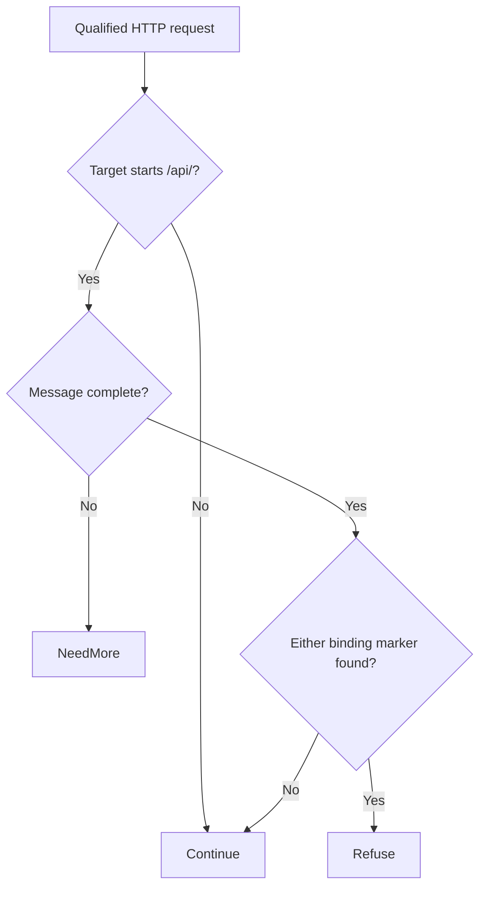

# Vaultwarden cross-org group binding (CVE-2026-95814)

A revoked or unconfirmed member can retain access to organization vault items on affected Vaultwarden instances. Upgrade Vaultwarden so membership status is enforced for secret reads, changes, and attachments.

[Public CVE record](https://cve.now/CVE-2026-95814) · [Vendor or publisher advisory](https://www.vulncheck.com/advisories/vaultwarden-through-1.37.3-authorization-bypass-via-missing-status-check) · [Source and API bundle](../../cve/CVE-2026-95814/README.md)

**Patch title.** Vaultwarden Cross-org Group Binding Guard (`vaultwarden-cross-org-group-binding-guard` in the registry). The [original source snapshot](https://github.com/eden-dev-inc/cve/blob/9a7217a0a882374c5ab97d74c96df9b77637f923/cve/CVE-2026-95814/http-request-filter/src/lib.rs) preserves the source available for the historical report.

| Field | Value |
| --- | --- |
| Affected component and versions | vaultwarden · through 1.37.3 |
| Fixed release | See the advisory |
| Severity | CVSS 8.6 |
| Evidence status | Lab comparison recorded. CVE attribution unverified |
| Test environment | Lab fixture or affected build documented in the evidence below |
| Eden release and module version | 1.103.0 · module 1.0.0 |
| Tested at | 2026-11-11 UTC |
| First publicly published | 2026-11-12T02:29:06Z |

*[cve.now](https://cve.now/CVE-2026-95814) entry.*

Eden terminates the HTTP connection to the affected product, evaluates a
declarative policy and — in tier 2 — a separately compiled native Rust module
under signed module authority, before any byte reaches the application. It does
**not** patch the affected component; the vendor's fixed release remains the
durable repair.

**Status: two-tier fixture comparison recorded. CVE coverage unverified.**

## Fixture and advisory scope

The fixture models cross-organization group binding. The [Vaultwarden advisory for that mechanism](https://github.com/dani-garcia/vaultwarden/security/advisories/GHSA-569v-845w-g82p) identifies CVE-2026-43912. The experiment does not establish a result for CVE-2026-95814.

## The Eden patch

**Tier 1 — declarative policy (blunt, fail-closed):** `deny` on the affected
route family — takes the whole surface offline, legitimate calls included.

**Tier 2 — native module:** `gabriel_vaultwarden_v1`, binary SHA-256 `f864dee4ee28c40e116b067c214e0826360b8d13fcdf0a64eaba66952ae6c643`
(source `257d7763b279d72cf9ea682978431b8aae0cd8be11b46e4bc7fb5ce7249d564d`) — refuse cross-org group binding members.

## Implement the remediation

Use this procedure in an isolated fixture to reproduce the scoped restriction. Follow the vendor update for the underlying exposure. See [deployment prerequisites](../deployment.md).

1. **Prepare the target.** Verify the loaded product and version against the advisory. Use a compatible Eden HTTP interlay and an authenticated operator with Configure permission. Open the [deployment example](../../cve/CVE-2026-95814/http-request-filter/deployment.json) and [API instructions](../../cve/CVE-2026-95814/http-request-filter/api.md). The bundle identifies registry package `vaultwarden-cross-org-group-binding-guard` at version `1.0.0` and the SDK revision in [patch.toml](../../cve/CVE-2026-95814/http-request-filter/patch.toml). Run the policy extraction from the adapter directory.
2. **Apply the declarative policy.** Scope the policy to `/api` and descendants (all methods, `deny`). Set `INTERLAY` to the target interlay UUID in the authenticated Eden CLI. Run an authenticated `GET /api/v1/interlays/{interlay}` with `X-Eden-Verbose: true`. Save its complete current settings object as `current-settings.json` and retain the prior remediation declaration for recovery. Set `IDEMPOTENCY_KEY` to a fresh key for this intended mutation.

```sh
jq -e '.tier1' deployment.json > remediation.json
jq -e --slurpfile policy remediation.json \
  '.remediation = $policy[0] | {settings: .}' current-settings.json \
  > interlay-update.json
eden api request PATCH "/api/v1/interlays/$INTERLAY" \
  --header "Idempotency-Key:$IDEMPOTENCY_KEY" \
  --body-file interlay-update.json --content-type application/json --confirm
```

3. **Verify the serving policy.** Read back the interlay.

```sh
eden api request GET "/api/v1/interlays/$INTERLAY" \
  --header 'X-Eden-Verbose:true'
```

Check that `remediation_status.state` is `ready` and both desired and effective SHA-256 values match the intended declaration. Replay the benign and marked requests in the recorded comparison on an isolated target. Check the recorded response and backend outcome for each probe. Use the request and expected-status table in the linked API example alongside the observed comparison.
4. **Restore the previous policy.** Coordinate the change with any other operator updating this interlay. Read current settings again and merge the saved remediation field into them. If the prior settings had no remediation field, omit it in the replacement. Send the same PATCH with a fresh idempotency key, then read back the intended state. Repeat the verification probes. Keep the affected route isolated if restoring the prior settings reopens exposure.

**Vendor update.** Use the [advisory](https://www.vulncheck.com/advisories/vaultwarden-through-1.37.3-authorization-bypass-via-missing-status-check) to identify the supported update or workaround for the installed release. The advisory data used here supplies no fixed version. Confirm the running version and verify the affected feature after the change.

## Measured comparison (live, 2026-11-11)

| Probe | Baseline (unprotected) | Tier 1 | Tier 2 (module) |
| --- | --- | --- | --- |
| benign_org_call | 200 | 403 | 200 |
| attack_cross_org | 200 (`cross_org_write` ×1) | 403 | 403 |

## Performance trace (Eden telemetry, live 2026-11-11)

Measured with Eden's built-in request telemetry (`gateway.request.baseline`
spans, read back through `/api/v1/analytics/telemetry?signal=traces`), not
client wall-clock. Latency Eden introduces per remediation arm for this case:

| Arm | n | mean | p50 | p95 | min–max |
| --- | --- | --- | --- | --- | --- |
| **Tier 1** — declarative policy, blocked request (403) | 15 | 29 µs | 24 µs | 53 µs | 19 µs–53 µs |
| **Tier 2** — native module, benign passes through (200) | 23 | 358 µs | 345 µs | 463 µs | 297 µs–612 µs |
| **Tier 2** — native module, attack refused (403) | 14 | 161 µs | 153 µs | 260 µs | 123 µs–260 µs |

**Eden-added latency for the tier-2 remediation:** benign requests complete in **358 µs** mean (p50 345 µs, p95 463 µs) in-product, module evaluation included.
*Honest scope: lab fixtures on one host, fresh connection per measured
request, warm requests only; module reactivated shards 2/2 with a fresh signed
statement per measurement; spans carry the full authority lineage (module
SHA-256, operation, publication). Not the EDEN-3640 performance
qualification contract.*

*Tested against: `eden-product-release:1.103.0-single` (image `sha256:809293e1f0b525ac…`, build target
`eden_service_single`, tooling revision `81a0724a…`). Raw data:
`module2/telemetry-ab/vaultwarden-telemetry.json` and `module2/tier1-ab/vaultwarden-tier1.json`.*

## Authority lifecycle and negatives

Driven through the full signed lifecycle (`module2/evidence/vaultwarden-module.json`):
`enroll_key` (Ed25519 public key), independent-host `inventory`, `inspect`, host
`approve`, signed `admit` (`prepared`), `activate` — receipt
**`serving_now: true`, `applied_shards == expected_shards` (2/2)**.
Negatives held: read-only `inspect` -> 403, tampered statement binding -> 400,
flipped signature bit -> 403. `revoke` failed the interlay **closed** (503,
nothing forwarded, zero backend effects); a fresh host approval plus a newly
signed activation restored the module.

## Honest scope

The fixture replicates the delivery shape with harmless marker effects; no real
vendor component runs here. Bypass variants (encodings, alternate routes, other
crafted members) are **not bypass-tested** and are out of scope; the rule is a
lab-grade partial by construction. The vendor's fixed release remains the durable
repair.

## Cost record (per-CVE ledger)

ledger window shared.

## Evidence appendix

- [cve.now entry](https://cve.now/CVE-2026-95814)
- Raw evidence: `gabriel-2026-11-11/module2/evidence/vaultwarden-module.json`
- Deployment: installed `eden-product-release:1.103.0-single` lab container (image `sha256:809293e1f0b525ac04698d1fa8d7ffdc66cbee1ff690b082ba26b4d050f08416`)
- Skill: [eden-vulnerability-remediation](../deployment.md)


## Decision flow



The diagram sketches the available source’s content decision after input metadata is available. Continue is a module decision; the host and backend still determine final forwarding and effects. The conflicting CVE attribution remains unresolved.

## Complete native module source

The complete available source for `gabriel_vaultwarden_v1` is reproduced below from the [original source snapshot](https://github.com/eden-dev-inc/cve/blob/9a7217a0a882374c5ab97d74c96df9b77637f923/cve/CVE-2026-95814/http-request-filter/src/lib.rs). The source SHA-256 is `257d7763b279d72cf9ea682978431b8aae0cd8be11b46e4bc7fb5ce7249d564d`. This identifies the source bytes, rather than independently proving the binary build or the recorded test results. The case’s experiment status and limitations still apply, including any failed import, partial coverage, or withdrawn claim. Original source comments are preserved verbatim.

```rust
//! Gabriel module: refuse cross-org group binding members (CVE-2026-95814 shape)
//!
//! CVE-2026-43912: Vaultwarden's cross-org group binding enables
//! unauthorized read and write access into another organization.
//! This module refuses org-API bodies carrying cross-org binding
//! members (marker class; partiality stated). no_std; no allocator, storage, background work or state.

#![no_std]

use core::mem::size_of;
use core::panic::PanicInfo;
use eden_gateway_remediation::message::{Availability, MessageInput};
use eden_gateway_remediation::module::{
    ApiHeader, CONTINUE, Decision, EDIT, EditSink, Edits, Failure, ModuleOutput, NEED_MORE, REFUSE, RemediationModule,
};
use eden_gateway_remediation::native_http_v3::{self as http, Api, Input, Request};

/// Route prefix in scope.
const ROUTE: &[u8] = b"/api/";

/// The byte primitives this module refuses on that route.
static NEEDLES: [&[u8]; 2] = [b"\"externalId\"", b"\"collections\""];


fn find_ignore_case_vol(haystack: &[u8], needle: &[u8]) -> Option<usize> {
    if haystack.len() < needle.len() || needle.is_empty() {
        return None;
    }
    let mut i = 0usize;
    while i + needle.len() <= haystack.len() {
        let mut j = 0usize;
        let mut same = true;
        while j < needle.len() {
            let h = unsafe { core::ptr::read_volatile(&haystack[i + j]) };
            let n = unsafe { core::ptr::read_volatile(&needle[j]) };
            if h.to_ascii_lowercase() != n.to_ascii_lowercase() {
                same = false;
                break;
            }
            j += 1;
        }
        if same {
            return Some(i);
        }
        i += 1;
    }
    None
}

fn find(haystack: &[u8], needle: &[u8]) -> Option<usize> {
    if haystack.len() < needle.len() || needle.is_empty() {
        return None;
    }
    let mut i = 0usize;
    while i + needle.len() <= haystack.len() {
        let mut j = 0usize;
        let mut same = true;
        while j < needle.len() {
            if haystack[i + j] != needle[j] {
                same = false;
                break;
            }
            j += 1;
        }
        if same {
            return Some(i);
        }
        i += 1;
    }
    None
}

fn find_ignore_case(haystack: &[u8], needle: &[u8]) -> Option<usize> {
    if haystack.len() < needle.len() || needle.is_empty() {
        return None;
    }
    let mut i = 0usize;
    while i + needle.len() <= haystack.len() {
        let mut j = 0usize;
        let mut same = true;
        while j < needle.len() {
            if haystack[i + j].to_ascii_lowercase() != needle[j].to_ascii_lowercase() {
                same = false;
                break;
            }
            j += 1;
        }
        if same {
            return Some(i);
        }
        i += 1;
    }
    None
}

struct gabriel_vaultwarden_v1;

impl RemediationModule<Request<'_>> for gabriel_vaultwarden_v1 {
    fn evaluate(&self, request: &Request<'_>, edits: &mut Edits<'_>) -> Result<Decision, Failure> {
        let _ = edits;
        let _ = match request.header_count() {
            Availability::Ready(count) => count,
            Availability::NeedMore => return Ok(Decision::NeedMore),
            Availability::Unavailable => return Err(Failure),
        };
        let message = request.message();
        let head = message.prefix();
        let line_end = head.iter().position(|&b| b == b'\r').unwrap_or(head.len());
        let request_line = &head[..line_end];
        let path_at = request_line.iter().position(|&b| b == b' ').unwrap_or(request_line.len());
        let target = &request_line[path_at + 1..];
        if !target.starts_with(ROUTE) {
            return Ok(Decision::Continue);
        }
        if !message.is_complete() {
            return Ok(Decision::NeedMore);
        }
        let body_range = match request.body_range() {
            Availability::Ready(range) => range,
            Availability::NeedMore => return Ok(Decision::NeedMore),
            Availability::Unavailable => return Err(Failure),
        };
        let body = match message.bytes(body_range)? {
            Availability::Ready(bytes) => bytes,
            Availability::NeedMore => return Ok(Decision::NeedMore),
            Availability::Unavailable => return Err(Failure),
        };
        if NEEDLES.iter().any(|n| find_ignore_case(body, n).is_some()) {
            return Ok(Decision::Refuse);
        }
        Ok(Decision::Continue)
    }
}

static API: Api = Api {
    header: ApiHeader { version: http::VERSION, table_size: size_of::<Api>() as u32 },
    input_size: size_of::<Input>() as u32,
    output_size: size_of::<ModuleOutput>() as u32,
    sink_size: size_of::<EditSink>() as u32,
    message_size: size_of::<MessageInput>() as u32,
    state_bytes: 0,
    capabilities: CONTINUE | REFUSE | NEED_MORE | EDIT,
    required_inputs: 0,
    evaluate: Some(evaluate),
};

unsafe extern "C" fn evaluate(input: *const Input, sink: *const EditSink, output: *mut ModuleOutput) -> i32 {
    unsafe { http::invoke(&gabriel_vaultwarden_v1, input, sink, output) }
}

#[unsafe(no_mangle)]
pub extern "C" fn eden_http_remediation_v3() -> *const Api {
    &API
}

#[panic_handler]
fn panic(_information: &PanicInfo<'_>) -> ! {
    loop {
        core::hint::spin_loop();
    }
}
```
