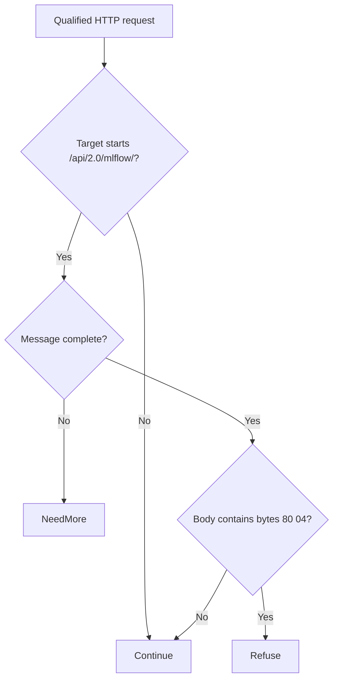

# MLflow dspy pickle deserialization bypass (CVE-2026-96775)

[Source and API bundle](../../cve/CVE-2026-96775/README.md)

*[cve.now](https://cve.now/CVE-2026-96775) entry.*

Eden terminates the HTTP connection to the affected product, evaluates a
declarative policy and — in tier 2 — a separately compiled native Rust module
under signed module authority, before any byte reaches the application. It does
**not** patch the affected component; the vendor's fixed release remains the
durable repair.

**Status: live two-tier remediation recorded 2026-11-11 on the installed `eden-product-release:1.103.0-single` lab container (image `sha256:809293e1f0b525ac04698d1fa8d7ffdc66cbee1ff690b082ba26b4d050f08416`).**

## The vulnerability

MLflow's dspy flavor (>=2.0) applies the allow-pickle control only when
the model_path ends in .pkl, allowing remote code execution via non-.pkl
paths carrying pickled payloads.

## The Eden patch

**Tier 1 — declarative policy (blunt, fail-closed):** `deny` on the affected
route family — takes the whole surface offline, legitimate calls included.

**Tier 2 — native module:** `gabriel_mlflowpickle_v1`, binary SHA-256 `e895ce5051b7ab003514c3342a1a80a63d0c407336bb6093a8a89a41634cbc48`
(source `7bbdadc6a4f87543ec800272e0db75b5573e5008188f0af43cf6e4109ac85fa3`) — refuse pickle magic in non-.pkl model payloads.

## Measured comparison (live, 2026-11-11)

| Probe | Baseline (unprotected) | Tier 1 | Tier 2 (module) |
| --- | --- | --- | --- |
| benign_model_load | 200 | 403 | 200 |
| attack_pickle_bypass | 200 (`pickle_deserialized` ×1, `rce_marker` ×1) | 403 | 403 |

## Performance trace (Eden telemetry, live 2026-11-11)

Measured with Eden's built-in request telemetry (`gateway.request.baseline`
spans, read back through `/api/v1/analytics/telemetry?signal=traces`), not
client wall-clock. Latency Eden introduces per remediation arm for this case:

| Arm | n | mean | p50 | p95 | min–max |
| --- | --- | --- | --- | --- | --- |
| **Tier 1** — declarative policy, blocked request (403) | 15 | 28 µs | 24 µs | 54 µs | 18 µs–54 µs |
| **Tier 2** — native module, benign passes through (200) | 23 | 378 µs | 348 µs | 521 µs | 310 µs–737 µs |
| **Tier 2** — native module, attack refused (403) | 14 | 144 µs | 132 µs | 217 µs | 118 µs–217 µs |

**Eden-added latency for the tier-2 remediation:** benign requests complete in **378 µs** mean (p50 348 µs, p95 521 µs) in-product, module evaluation included.
*Honest scope: lab fixtures on one host, fresh connection per measured
request, warm requests only; module reactivated shards 2/2 with a fresh signed
statement per measurement; spans carry the full authority lineage (module
SHA-256, operation, publication). Not the EDEN-3640 performance
qualification contract.*

*Tested against: `eden-product-release:1.103.0-single` (image `sha256:809293e1f0b525ac…`, build target
`eden_service_single`, tooling revision `81a0724a…`). Raw data:
`module2/telemetry-ab/mlflowpickle-telemetry.json` and `module2/tier1-ab/mlflowpickle-tier1.json`.*

## Authority lifecycle and negatives

Driven through the full signed lifecycle (`module2/evidence/mlflowpickle-module.json`):
`enroll_key` (Ed25519 public key), independent-host `inventory`, `inspect`, host
`approve`, signed `admit` (`prepared`), `activate` — receipt
**`serving_now: true`, `applied_shards == expected_shards` (2/2)**.
Negatives held: read-only `inspect` -> 403, tampered statement binding -> 400,
flipped signature bit -> 403. `revoke` failed the interlay **closed** (503,
nothing forwarded, zero backend effects); a fresh host approval plus a newly
signed activation restored the module.

## Honest scope

The fixture replicates the delivery shape with harmless marker effects; no real
vendor component runs here. Bypass variants (encodings, alternate routes, other
crafted members) are **not bypass-tested** and are out of scope; the rule is a
lab-grade partial by construction. The vendor's fixed release remains the durable
repair.

## Cost record (per-CVE ledger)

ledger window shared.

## Evidence appendix

- [cve.now entry](https://cve.now/CVE-2026-96775)
- Raw evidence: `gabriel-2026-11-11/module2/evidence/mlflowpickle-module.json`
- Deployment: installed `eden-product-release:1.103.0-single` lab container (image `sha256:809293e1f0b525ac04698d1fa8d7ffdc66cbee1ff690b082ba26b4d050f08416`)
- Skill: [eden-vulnerability-remediation](../deployment.md)


## Decision flow



The diagram sketches the available source’s content decision after input metadata is available. Continue is a module decision; the host and backend still determine final forwarding and effects.

## Complete native module source

The complete available source for `gabriel_mlflowpickle_v1` is reproduced below from the [reviewed repository snapshot](../../cve/CVE-2026-96775/http-request-filter/src/lib.rs). The source SHA-256 is `7bbdadc6a4f87543ec800272e0db75b5573e5008188f0af43cf6e4109ac85fa3`. This identifies the source bytes, rather than independently proving the binary build or the recorded test results. The case’s experiment status and limitations still apply, including any failed import, partial coverage, or withdrawn claim. Original source comments are preserved verbatim.

```rust
//! Gabriel module: refuse pickle magic in non-.pkl model payloads (CVE-2026-96775 shape)
//!
//! CVE-2026-96775: MLflow's dspy flavor applies the
//! MLFLOW_ALLOW_PICKLE_DESERIALIZATION control only to .pkl paths,
//! allowing arbitrary code execution via non-.pkl pickle payloads.
//! This module refuses mlflow bodies carrying the Python pickle magic
//! header regardless of the model path suffix. no_std; no allocator, storage, background work or state.

#![no_std]

use core::mem::size_of;
use core::panic::PanicInfo;
use eden_gateway_remediation::message::{Availability, MessageInput};
use eden_gateway_remediation::module::{
    ApiHeader, CONTINUE, Decision, EDIT, EditSink, Edits, Failure, ModuleOutput, NEED_MORE, REFUSE, RemediationModule,
};
use eden_gateway_remediation::native_http_v3::{self as http, Api, Input, Request};

/// Route prefix in scope.
const ROUTE: &[u8] = b"/api/2.0/mlflow/";

/// The byte primitives this module refuses on that route.
static NEEDLES: [&[u8]; 1] = [b"\x80\x04"];


fn find_ignore_case_vol(haystack: &[u8], needle: &[u8]) -> Option<usize> {
    if haystack.len() < needle.len() || needle.is_empty() {
        return None;
    }
    let mut i = 0usize;
    while i + needle.len() <= haystack.len() {
        let mut j = 0usize;
        let mut same = true;
        while j < needle.len() {
            let h = unsafe { core::ptr::read_volatile(&haystack[i + j]) };
            let n = unsafe { core::ptr::read_volatile(&needle[j]) };
            if h.to_ascii_lowercase() != n.to_ascii_lowercase() {
                same = false;
                break;
            }
            j += 1;
        }
        if same {
            return Some(i);
        }
        i += 1;
    }
    None
}

fn find(haystack: &[u8], needle: &[u8]) -> Option<usize> {
    if haystack.len() < needle.len() || needle.is_empty() {
        return None;
    }
    let mut i = 0usize;
    while i + needle.len() <= haystack.len() {
        let mut j = 0usize;
        let mut same = true;
        while j < needle.len() {
            if haystack[i + j] != needle[j] {
                same = false;
                break;
            }
            j += 1;
        }
        if same {
            return Some(i);
        }
        i += 1;
    }
    None
}

fn find_ignore_case(haystack: &[u8], needle: &[u8]) -> Option<usize> {
    if haystack.len() < needle.len() || needle.is_empty() {
        return None;
    }
    let mut i = 0usize;
    while i + needle.len() <= haystack.len() {
        let mut j = 0usize;
        let mut same = true;
        while j < needle.len() {
            if haystack[i + j].to_ascii_lowercase() != needle[j].to_ascii_lowercase() {
                same = false;
                break;
            }
            j += 1;
        }
        if same {
            return Some(i);
        }
        i += 1;
    }
    None
}

struct gabriel_mlflowpickle_v1;

impl RemediationModule<Request<'_>> for gabriel_mlflowpickle_v1 {
    fn evaluate(&self, request: &Request<'_>, edits: &mut Edits<'_>) -> Result<Decision, Failure> {
        let _ = edits;
        let _ = match request.header_count() {
            Availability::Ready(count) => count,
            Availability::NeedMore => return Ok(Decision::NeedMore),
            Availability::Unavailable => return Err(Failure),
        };
        let message = request.message();
        let head = message.prefix();
        let line_end = head.iter().position(|&b| b == b'\r').unwrap_or(head.len());
        let request_line = &head[..line_end];
        let path_at = request_line.iter().position(|&b| b == b' ').unwrap_or(request_line.len());
        let target = &request_line[path_at + 1..];
        if !target.starts_with(ROUTE) {
            return Ok(Decision::Continue);
        }
        if !message.is_complete() {
            return Ok(Decision::NeedMore);
        }
        let body_range = match request.body_range() {
            Availability::Ready(range) => range,
            Availability::NeedMore => return Ok(Decision::NeedMore),
            Availability::Unavailable => return Err(Failure),
        };
        let body = match message.bytes(body_range)? {
            Availability::Ready(bytes) => bytes,
            Availability::NeedMore => return Ok(Decision::NeedMore),
            Availability::Unavailable => return Err(Failure),
        };
        if NEEDLES.iter().any(|n| find_ignore_case(body, n).is_some()) {
            return Ok(Decision::Refuse);
        }
        Ok(Decision::Continue)
    }
}

static API: Api = Api {
    header: ApiHeader { version: http::VERSION, table_size: size_of::<Api>() as u32 },
    input_size: size_of::<Input>() as u32,
    output_size: size_of::<ModuleOutput>() as u32,
    sink_size: size_of::<EditSink>() as u32,
    message_size: size_of::<MessageInput>() as u32,
    state_bytes: 0,
    capabilities: CONTINUE | REFUSE | NEED_MORE | EDIT,
    required_inputs: 0,
    evaluate: Some(evaluate),
};

unsafe extern "C" fn evaluate(input: *const Input, sink: *const EditSink, output: *mut ModuleOutput) -> i32 {
    unsafe { http::invoke(&gabriel_mlflowpickle_v1, input, sink, output) }
}

#[unsafe(no_mangle)]
pub extern "C" fn eden_http_remediation_v3() -> *const Api {
    &API
}

#[panic_handler]
fn panic(_information: &PanicInfo<'_>) -> ! {
    loop {
        core::hint::spin_loop();
    }
}
```
