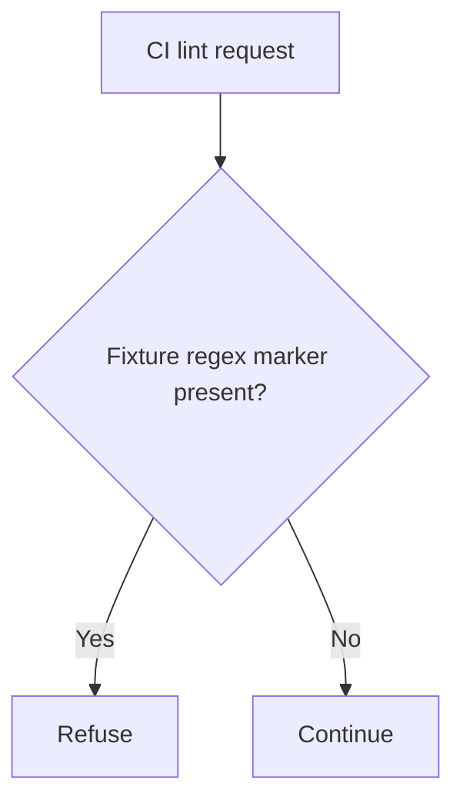

# GitLab CI/CD regex handling remote code execution (CVE-2026-97229)

Under the advisory's conditions, an unauthenticated remote caller can run arbitrary code on a GitLab server through crafted regular expressions in CI/CD configuration validation. Public exploit code — including a Metasploit module — exists and the flaw is on CISA's exploited catalog.

[Public CVE record](https://cve.now/CVE-2026-97229) · [Advisory reference](https://docs.gitlab.com/releases/patches/patch-release-gitlab-19-4-2-released/) · [Module source](modules/CVE-2026-97229.rs) · [Source and API bundle](../../cve/CVE-2026-97229/README.md)

| Field | Value |
| --- | --- |
| Affected component and versions | GitLab CE and EE 19.2 before 19.2.8, 19.3 before 19.3.5, and 19.4 before 19.4.2 |
| Fixed release | 19.2.8 or 19.3.5 or 19.4.2 |
| Severity | Critical (CVSS 10, CNA, CISA KEV) |
| Evidence status | Recorded fixture comparison |
| Test environment | Synthetic HTTP fixture behind a single-node Eden 1.103.0 interlay |
| Eden release and module version | 1.103.0 · gabriel_gitlabregex_v1 1.0.0 |
| Tested at | 2026-11-13 UTC |
| First publicly published | 2026-11-12T02:29:06Z |

**Result.** The marked fixture request raised the backend counter in the baseline (200, +1). The declarative tier refused it (403, counter unchanged; benign false positive recorded where the tier-1 deny covers the benign route). The native module refused the advisory-shaped request (403, counter unchanged) while the benign probe stayed HTTP 200, verified against an independent backend counter through Eden 1.103.0.

## The vulnerability

GitLab identifies insufficient validation in the CI/CD regular expression compiler. Under the advisory's conditions a crafted regular expression can cause code execution. The Eden fixture exercised selected regex markers on a synthetic lint route.

## The Eden patch

**Tier 1 — declarative policy.** The recorded policy denies every method on the recorded fixture route and its descendants. This is a coarse rule: it also blocked the benign probe on the same route, which is the recorded false positive.

```json
{
  "version": 1,
  "profile": "http-structure-v1",
  "policy": {
    "version": 1,
    "rules": [
      {
        "scope": {
          "methods": [],
          "path": "/api/v4/ci/lint",
          "descendants": true
        },
        "require": {
          "kind": "deny"
        }
      }
    ]
  }
}
```

**Tier 2 — native Rust module.** gabriel_gitlabregex_v1 waits for a complete request, matches the CI lint route, and refuses bodies carrying crafted regex constructs — the injection markers recorded from the exploit family.

```rust
const ROUTE: &[u8] = b"/api/v4/ci/lint";
static MARKS: [&[u8]; 3] = [b"(?{", b"(?<", b"(*posix"];
```

## Implement the remediation

The commands are operator examples for the recorded scope. Compare fixture routes and software selectors with the intended deployment before use. See [deployment prerequisites](../deployment.md) and the [API example](../../cve/CVE-2026-97229/http-request-filter/api.md).

1. **Prepare the target.** Verify the loaded GitLab CE/EE version against the advisory. Use a compatible Eden HTTP interlay and an authenticated operator with Configure permission. Use the recorded declaration and the linked source.
2. **Apply the declaratory policy.** Set `INTERLAY` to the target interlay UUID in the authenticated Eden CLI. Save the interlay's complete current settings, place the policy from this report in `settings.remediation`, and PATCH the full settings object with a fresh `Idempotency-Key`. Read the interlay back and confirm `remediation_status.state` is `ready`.
3. **Import and activate the native module.** Build the schema-2 archive from the linked source with the compatible SDK, verify its digest, and PUT it to the interlay's patch-packages endpoint. Import requires explicit activation: enroll the publisher key, attest the host inventory, inspect the returned configuration, obtain independent host approval, sign the typed statement, admit, and activate. Read the receipt until `serving_now` is true and the expected shards are acknowledged. Full command sequences are in the [API example](../../cve/CVE-2026-97229/http-request-filter/api.md).
4. **Verify, revoke, and restore.** Replay the benign and advisory-shaped probes and compare the backend counter. Revoke the operation and confirm the advisory-shaped request no longer succeeds (fail-closed 503); re-approve, re-admit, and reactivate a replacement operation to restore protection.

**Vendor update.** Apply the vendor update for the installed release or model. [Advisory reference](https://docs.gitlab.com/releases/patches/patch-release-gitlab-19-4-2-released/)

## Fixture and probes

The benign probe linted an ordinary CI script. The marked fixture probe linted content embedding the crafted regex constructs. The fixture incremented its marker when a crafted regex reached its validator.

## Measured comparison (2026-11-13 UTC)

The values after each status are the observed increases in the fixture's effect counter.

| Probe | Baseline | Declarative policy | Native module |
| --- | --- | --- | --- |
| Benign CI lint | 200, 0 | 403, 0 | 200, 0 |
| Advisory-shaped crafted regex | 200, 1 | 403, 0 | 403, 0 |

The marker set covers the recorded injection constructs on the lint route; alternate regex escapes or other CI-import surfaces were not exercised.

## Authority lifecycle and signed module checks

Import returned HTTP 201 with explicit activation required and signature verification deferred. Read-only inspection was refused (403) for the reader principal, admission of a tampered statement was rejected (400), and admission of an invalid signature was refused (403). The activation receipt reported the module serving on all 32 expected shards. After revocation the advisory-shaped probe received HTTP 503 (fail-closed); re-approval and reactivation restored the refusal (403, counter unchanged).

- Source SHA-256 `2082f1e7c95633caa49fa43389df01fd9f4a2440f1ddd24dd98b33ae62d92b6d`
- Tested binary SHA-256 `612dbe79d15e637c53395078c5400e624cd3bc23f773ee5cf9c7bc9a098b74b1`
- Activation operation `636451ee-1a31-4900-ada9-bee52a4ce18e`

## Performance trace (November 13 fixture)

Instrument: client wall-clock through the interlay (includes the network hop), warmup discarded, mean/p50/p95 in milliseconds.

| Arm | n | mean | p50 | p95 |
| --- | --- | --- | --- | --- |
| Tier 1 — declarative policy, blocked | 15 | 0.4 ms | 0.4 ms | 0.6 ms |
| Tier 2 — module, benign passes (200) | 20 | 0.7 ms | 0.7 ms | 1.0 ms |
| Tier 2 — module, attack refused | 15 | 0.4 ms | 0.4 ms | 0.6 ms |

## Test scope

The fixture recorded refusal of selected regex markers on its lint route. The GitLab regular-expression compiler, its integer overflow, and OS command execution remain unverified.

## Evidence and artifacts

- [Public CVE record](https://cve.now/CVE-2026-97229)
- [Published module source](modules/CVE-2026-97229.rs)

## Cost record

The November 11 run includes a separate cost ledger and Eden telemetry. [November 11 report](https://github.com/eden-dev-inc/cve/blob/66c637aa5b4fe80a9e9b29023b751a8ce713eaab/docs/case-studies/CVE_2026_97229.md#cost-record-per-cve-ledger)

## Evidence appendix

The current module source and earlier evidence are linked above. The flow below depicts the November 13 fixture rule.



[Current Rust source](../../cve/CVE-2026-97229/http-request-filter/src/lib.rs)
