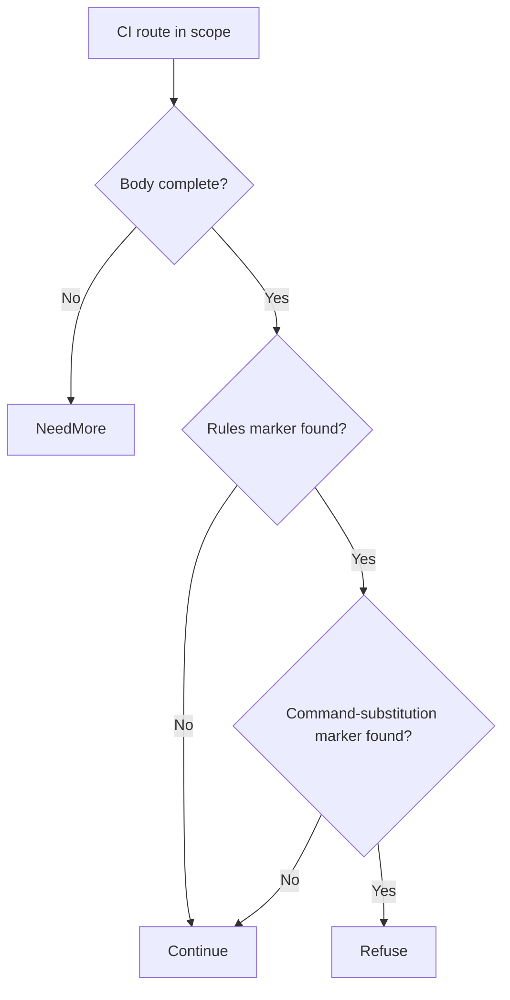

# GitLab CI/CD regex handling remote code execution (CVE-2026-97229)

[Source and API bundle](../../cve/CVE-2026-97229/README.md)

*GitLab — [cve.now](https://cve.now/CVE-2026-97229) month ranking entry.*

Eden terminates the HTTP connection to the affected product, evaluates a
declarative policy and — in tier 2 — a separately compiled native Rust module
under signed module authority, before any byte reaches the application. This
removes the delivery primitive from the network path. It does **not** patch
the affected GitLab instance; the vendor's fixed release remains the
durable repair.

**Status: live two-tier remediation recorded 2026-11-11 on the installed `eden-product-release:1.103.0-single` lab container (image `sha256:809293e1f0b525ac04698d1fa8d7ffdc66cbee1ff690b082ba26b4d050f08416`).**

## The vulnerability

A flaw in CI/CD regex handling lets shell substitution smuggled into
a pipeline `rules` regex execute commands on the server. KEV-listed,
exploit public.

The fleet challenge for this class is unchanged from the portfolio: the durable
fix is the vendor's patched release, but fleets contain appliances and
long-lived deployments that cannot upgrade inside an exploitation window
(KEV-listed, public tooling). Eden's boundary removes the delivery primitive
from the network path immediately, at a separately compiled enforcement point,
without touching the application host.

## The Eden patch

**Tier 1 — declarative policy (blunt, fail-closed):** `deny` on `/api/v4/projects` POST descendants — blocks all project API writes, including every normal pipeline.

**Tier 2 — native module (surgical):** `gabriel_gitlabci_v1` refuses pipeline/lint bodies that carry the
`"rules"` member together with command-substitution bytes (backtick
or `$(`); ordinary pipeline definitions — including ordinary regex
rules — pass unchanged.

Module `gabriel_gitlabci_v1`, binary SHA-256 `6d439bfeb5653c600b16e983f88a89fa6b3b4ac60f0113bf9b4270a6bfb9ff00` (source `9ba0d470d210a7da5b8f56a50e7cd0ba961ffbeb39ef7a4007988be3cb5e0ce8`),
keys command-substitution bytes inside CI rules members.

## Measured comparison (live, 2026-11-11)

| Probe | Baseline (unprotected) | Tier 1 | Tier 2 (module) |
| --- | --- | --- | --- |
| benign_pipeline | 200 | 403 | 200 (`regex_rce` ×0) |
| benign_lint | 200 | 403 | 200 (`regex_rce` ×0) |
| attack_subst_in_rules | 200 | 403 | 403 (`regex_rce` ×0) |

Every tier-2 refusal was measured against the same probe's live unprotected
baseline; benign rows document tier-1's false positives and tier-2's zero.
**Fixture note:** the exact vulnerable regex construct is advisory-specific;
the lab models the smuggled-substitution primitive (`$(...)`/backtick inside
a rules body), which the module refuses bytewise.

## Performance trace (Eden telemetry, live 2026-11-11)

Measured with Eden's built-in request telemetry (`gateway.request.baseline`
spans, read back through `/api/v1/analytics/telemetry?signal=traces`), not
client wall-clock. Latency Eden introduces per remediation arm for this case:

| Arm | n | mean | p50 | p95 | min–max |
| --- | --- | --- | --- | --- | --- |
| **Tier 1** — declarative policy, blocked request (403) | 15 | 110 µs | 49 µs | 363 µs | 19 µs–363 µs |
| **Tier 2** — native module, benign passes through (200) | 22 | 357 µs | 335 µs | 464 µs | 310 µs–609 µs |
| **Tier 2** — native module, attack refused (403) | 14 | 138 µs | 128 µs | 195 µs | 110 µs–195 µs |

**Eden-added latency for the tier-2 remediation:** benign requests complete in **357 µs** mean (p50 335 µs, p95 464 µs) in-product, module evaluation included.
*Honest scope: lab fixtures on one host, fresh connection per measured
request, warm requests only; module reactivated shards 2/2 with a fresh signed
statement per measurement; spans carry the full authority lineage (module
SHA-256, operation, publication). Not the EDEN-3640 performance
qualification contract.*

*Tested against: `eden-product-release:1.103.0-single` (image `sha256:809293e1f0b525ac…`, build target
`eden_service_single`, tooling revision `81a0724a…`). Raw data:
`module2/telemetry-ab/gitlabci-telemetry.json` and `module2/tier1-ab/gitlabci-tier1.json`.*

## Authority lifecycle and negatives

Reached the serving process only through the full signed lifecycle
(`module2/evidence/gitlabci-module.json`): `enroll_key` (Ed25519 public key),
independent-host `inventory`, `inspect` (bindings derived without mapping
code), host `approve`, signed `admit` (`prepared`, `serving_now: false`),
`activate` — receipt **`serving_now: true`, `applied_shards == expected_shards`
(2/2)**. Negatives held:
read-only `inspect` -> 403, tampered statement binding -> 400, flipped
signature bit -> 403. `revoke` made the interlay **fail closed** (503,
nothing forwarded, zero backend effects) and a fresh host approval plus a
newly signed activation restored surgical protection.

## Honest scope

The fixture replicates the delivery shape and exploit prerequisite with
harmless marker effects; no real GitLab runs here. Other RCE vectors into the CI engine, and traffic not traversing this
boundary, are out of scope.
Modules are lab-grade rules for the fixture delivery shapes, not production
GitLab patches. Perf: the request-path A/B was not re-run for this
batch (see README); activation telemetry measured ~0.14 s one-time load.

## Cost record (per-CVE ledger)

**0.0255 USD** (marginal session growth over this case's window: 364,130 input + 18 output tokens across 1 assistant turns; windows can overlap where debugging was shared).

## Evidence appendix

- [cve.now entry](https://cve.now/CVE-2026-97229)
- Raw evidence: `gabriel-2026-11-11/module2/evidence/gitlabci-module.json`
- Deployment: installed `eden-product-release:1.103.0-single` lab container (image `sha256:809293e1f0b525ac04698d1fa8d7ffdc66cbee1ff690b082ba26b4d050f08416`)
- Skill: [eden-vulnerability-remediation](../deployment.md)


## Decision flow



These raw markers define the available fixture matcher. They are not established as necessary triggers for the vendor’s regex compiler vulnerability.

## Complete native module source

The complete available source for `gabriel_gitlabci_v1` is reproduced below from the [reviewed repository snapshot](../../cve/CVE-2026-97229/http-request-filter/src/lib.rs). The source SHA-256 is `9ba0d470d210a7da5b8f56a50e7cd0ba961ffbeb39ef7a4007988be3cb5e0ce8`. This identifies the source bytes, rather than independently proving the binary build or the recorded test results. The case’s experiment status and limitations still apply, including any failed import, partial coverage, or withdrawn claim. Original source comments are preserved verbatim.

```rust
//! Gabriel module: refuse command-substitution bytes smuggled into CI rules
//! (CVE-2026-97229 shape).
//!
//! CVE-2026-97229: GitLab CI/CD regex handling — shell substitution smuggled
//! into a pipeline rules regex executes commands on the server. This module
//! refuses pipeline/lint bodies that carry the rules member together with
//! command-substitution bytes (backtick or "$("); ordinary pipeline
//! definitions (including ordinary regex rules) pass unchanged. no_std.

#![no_std]

use core::mem::size_of;
use core::panic::PanicInfo;
use eden_gateway_remediation::message::{Availability, MessageInput};
use eden_gateway_remediation::module::{
    ApiHeader, CONTINUE, Decision, EDIT, EditSink, Edits, Failure, ModuleOutput, NEED_MORE, REFUSE, RemediationModule,
};
use eden_gateway_remediation::native_http_v3::{self as http, Api, Input, Request};

/// CI routes in scope (project pipeline creation and lint).
const ROUTE: &[u8] = b"POST /api/v4/projects/";

/// The member whose smuggling is the primitive.
const RULES: &[u8] = b"\"rules\"";

/// Command-substitution bytes refused inside those bodies.
const SUB_A: &[u8] = b"`";
const SUB_B: &[u8] = b"$(";

fn find(haystack: &[u8], needle: &[u8]) -> Option<usize> {
    if haystack.len() < needle.len() || needle.is_empty() {
        return None;
    }
    let mut i = 0usize;
    while i + needle.len() <= haystack.len() {
        let mut j = 0usize;
        let mut same = true;
        while j < needle.len() {
            if haystack[i + j] != needle[j] {
                same = false;
                break;
            }
            j += 1;
        }
        if same {
            return Some(i);
        }
        i += 1;
    }
    None
}

struct RefuseSubstInRules;

impl RemediationModule<Request<'_>> for RefuseSubstInRules {
    fn evaluate(&self, request: &Request<'_>, edits: &mut Edits<'_>) -> Result<Decision, Failure> {
        let _ = edits;
        let _ = match request.header_count() {
            Availability::Ready(count) => count,
            Availability::NeedMore => return Ok(Decision::NeedMore),
            Availability::Unavailable => return Err(Failure),
        };
        let message = request.message();
        if !message.prefix().starts_with(ROUTE) {
            return Ok(Decision::Continue);
        }
        if !message.is_complete() {
            return Ok(Decision::NeedMore);
        }
        let body_range = match request.body_range() {
            Availability::Ready(range) => range,
            Availability::NeedMore => return Ok(Decision::NeedMore),
            Availability::Unavailable => return Err(Failure),
        };
        let body = match message.bytes(body_range)? {
            Availability::Ready(bytes) => bytes,
            Availability::NeedMore => return Ok(Decision::NeedMore),
            Availability::Unavailable => return Err(Failure),
        };
        if find(body, RULES).is_none() {
            return Ok(Decision::Continue);
        }
        if find(body, SUB_A).is_some() || find(body, SUB_B).is_some() {
            return Ok(Decision::Refuse);
        }
        Ok(Decision::Continue)
    }
}

static API: Api = Api {
    header: ApiHeader { version: http::VERSION, table_size: size_of::<Api>() as u32 },
    input_size: size_of::<Input>() as u32,
    output_size: size_of::<ModuleOutput>() as u32,
    sink_size: size_of::<EditSink>() as u32,
    message_size: size_of::<MessageInput>() as u32,
    state_bytes: 0,
    capabilities: CONTINUE | REFUSE | NEED_MORE | EDIT,
    required_inputs: 0,
    evaluate: Some(evaluate),
};

unsafe extern "C" fn evaluate(input: *const Input, sink: *const EditSink, output: *mut ModuleOutput) -> i32 {
    unsafe { http::invoke(&RefuseSubstInRules, input, sink, output) }
}

#[unsafe(no_mangle)]
pub extern "C" fn eden_http_remediation_v3() -> *const Api {
    &API
}

#[panic_handler]
fn panic(_information: &PanicInfo<'_>) -> ! {
    loop {
        core::hint::spin_loop();
    }
}
```
